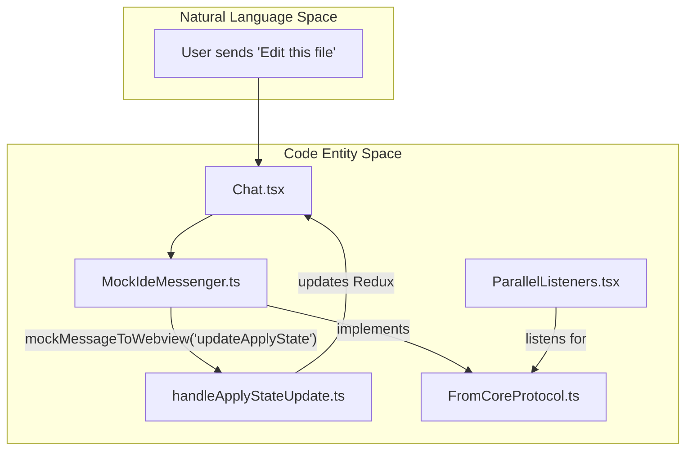
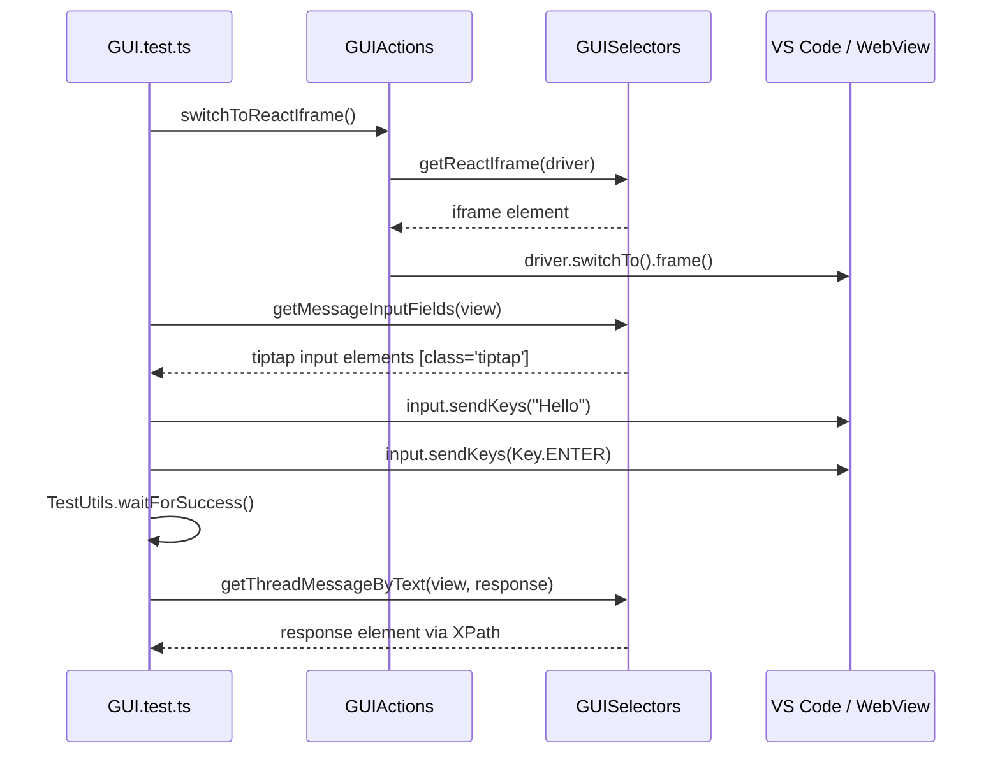

# Testing Strategy

Relevant source files

The following files were used as context for generating this wiki page:

- [.continue/prompts/update-llm-info.prompt](.continue/prompts/update-llm-info.prompt)
- [core/config/yaml/LocalPlatformClient.vitest.ts](core/config/yaml/LocalPlatformClient.vitest.ts)
- [core/jest.config.js](core/jest.config.js)
- [core/llm/utils/extractContentFromCodeBlocks.test.ts](core/llm/utils/extractContentFromCodeBlocks.test.ts)
- [core/llm/utils/extractContentFromCodeBlocks.ts](core/llm/utils/extractContentFromCodeBlocks.ts)
- [core/test/jest.global-setup.ts](core/test/jest.global-setup.ts)
- [core/test/vitest.global-setup.ts](core/test/vitest.global-setup.ts)
- [core/test/vitest.setup.ts](core/test/vitest.setup.ts)
- [core/vitest.config.ts](core/vitest.config.ts)
- [extensions/cli/src/e2e/resume-flag.test.ts](extensions/cli/src/e2e/resume-flag.test.ts)
- [extensions/vscode/e2e/README.md](extensions/vscode/e2e/README.md)
- [extensions/vscode/e2e/TestUtils.ts](extensions/vscode/e2e/TestUtils.ts)
- [extensions/vscode/e2e/actions/Autocomplete.actions.ts](extensions/vscode/e2e/actions/Autocomplete.actions.ts)
- [extensions/vscode/e2e/actions/GUI.actions.ts](extensions/vscode/e2e/actions/GUI.actions.ts)
- [extensions/vscode/e2e/actions/Global.actions.ts](extensions/vscode/e2e/actions/Global.actions.ts)
- [extensions/vscode/e2e/actions/KeyboardShortcuts.actions.ts](extensions/vscode/e2e/actions/KeyboardShortcuts.actions.ts)
- [extensions/vscode/e2e/selectors/GUI.selectors.ts](extensions/vscode/e2e/selectors/GUI.selectors.ts)
- [extensions/vscode/e2e/tests/Autocomplete.test.ts](extensions/vscode/e2e/tests/Autocomplete.test.ts)
- [extensions/vscode/e2e/tests/Edit.test.ts](extensions/vscode/e2e/tests/Edit.test.ts)
- [extensions/vscode/e2e/tests/GUI.test.ts](extensions/vscode/e2e/tests/GUI.test.ts)
- [extensions/vscode/e2e/tests/KeyboardShortcuts.test.ts](extensions/vscode/e2e/tests/KeyboardShortcuts.test.ts)
- [extensions/vscode/e2e/tests/PromptFile.test.ts](extensions/vscode/e2e/tests/PromptFile.test.ts)
- [extensions/vscode/src/util/addCode.ts](extensions/vscode/src/util/addCode.ts)
- [gui/src/components/StyledMarkdownPreview/utils/remarkTables.tsx](gui/src/components/StyledMarkdownPreview/utils/remarkTables.tsx)
- [gui/src/components/dialogs/ConfirmationDialog.test.tsx](gui/src/components/dialogs/ConfirmationDialog.test.tsx)
- [gui/src/context/MockIdeMessenger.ts](gui/src/context/MockIdeMessenger.ts)
- [gui/src/hooks/ParallelListeners.tsx](gui/src/hooks/ParallelListeners.tsx)
- [gui/src/pages/gui/chat-tests/EditToolScenarios.test.tsx](gui/src/pages/gui/chat-tests/EditToolScenarios.test.tsx)
- [gui/src/pages/gui/chat-tests/ParallelToolCallsActions.test.tsx](gui/src/pages/gui/chat-tests/ParallelToolCallsActions.test.tsx)
- [gui/src/pages/gui/chat-tests/ParallelToolCallsBasic.test.tsx](gui/src/pages/gui/chat-tests/ParallelToolCallsBasic.test.tsx)
- [gui/src/pages/gui/chat-tests/ParallelToolCallsStreaming.test.tsx](gui/src/pages/gui/chat-tests/ParallelToolCallsStreaming.test.tsx)
- [gui/src/pages/history/history.test.tsx](gui/src/pages/history/history.test.tsx)
- [gui/src/util/test/render.tsx](gui/src/util/test/render.tsx)

## Purpose and Scope

This document describes the testing strategy for the Continue codebase, including unit tests, integration tests, end-to-end (E2E) tests, and smoke tests. It covers the test matrix across platforms, test execution in CI/CD pipelines, and the implementation of specific test suites for the Core, GUI, and IDE extensions.

---

## Test Categories

The codebase employs multiple testing levels organized by component:

### Unit and Integration Tests

| Component | Test Command | Framework | Location |
|-----------|-------------|-----------|----------|
| **core** | `npm test` / `npm run vitest` | Jest / Vitest | [core/]() |
| **gui** | `npm test` | Vitest | [gui/]() |
| **extensions/vscode** | `npm run vitest` | Vitest | [extensions/vscode/]() |
| **extensions/cli** | `npm test` | Vitest | [extensions/cli/]() |
| **extensions/intellij** | `./gradlew check` | JUnit | [extensions/intellij/]() |

The `core` module uses a dual-test runner approach during its migration to Vitest. Legacy tests run with Jest [core/jest.config.js:4-43](), while newer tests use Vitest [core/vitest.config.ts:3-14](). Unit tests in the `core` package often target utility functions like code block extraction [core/llm/utils/extractContentFromCodeBlocks.test.ts]().

Sources: [core/jest.config.js:42-43](), [core/vitest.config.ts:11-13]()

### End-to-End (E2E) Tests

E2E tests validate complete workflows by driving a real VS Code instance using `vscode-extension-tester`.

- **Location**: [extensions/vscode/e2e/tests/]()
- **Infrastructure**: Tests utilize `WebDriver` and `WebView` to interact with the sidebar and editor [extensions/vscode/e2e/tests/GUI.test.ts:20-21]().
- **Selectors**: Encapsulated in `GUISelectors` using XPath, class names, and data-testids [extensions/vscode/e2e/selectors/GUI.selectors.ts:5-178]().
- **Actions**: High-level interactions like `sendMessage` or `switchToReactIframe` are defined in `GUIActions` [extensions/vscode/e2e/actions/GUI.actions.ts:14-204]().

Sources: [extensions/vscode/e2e/tests/GUI.test.ts:1-11](), [extensions/vscode/e2e/selectors/GUI.selectors.ts:5-178]()

---

## GUI and Webview Testing

GUI tests often require mocking the communication between the React webview and the IDE/Core. This is achieved via the `MockIdeMessenger`.

**GUI Message Flow and Mocking**

The `MockIdeMessenger` implements `IIdeMessenger` [gui/src/context/MockIdeMessenger.ts:131]() and provides default responses for common IDE operations like `getWorkspaceDirs`, `config/getSerializedProfileInfo`, and `llm/compileChat` [gui/src/context/MockIdeMessenger.ts:28-114](). It simulates streaming responses via `llmStreamChat` [gui/src/context/MockIdeMessenger.ts:190-211]().

Sources: [gui/src/context/MockIdeMessenger.ts:131-211](), [gui/src/pages/gui/chat-tests/EditToolScenarios.test.tsx:61-80](), [gui/src/hooks/ParallelListeners.tsx:144-153]()

---

## VS Code E2E Testing Strategy

E2E tests use a "Page Object" pattern split into Selectors and Actions to maintain stability.

### Key Test Entities

| Entity | Role | Code Pointer |
|--------|------|--------------|
| `GUIActions` | High-level GUI workflows (toggle GUI, select models) | [extensions/vscode/e2e/actions/GUI.actions.ts:14-204]() |
| `GUISelectors` | DOM element locators (input fields, buttons) | [extensions/vscode/e2e/selectors/GUI.selectors.ts:5-178]() |
| `TestUtils` | Timing, OS-specific keys, and message generation | [extensions/vscode/e2e/TestUtils.ts:8-117]() |
| `GlobalActions` | Workspace management and extension-wide settings | [extensions/vscode/e2e/actions/Global.actions.ts]() |

### Workflow: Chat Interaction Test

**Chat Workflow E2E Test Execution**

Sources: [extensions/vscode/e2e/tests/GUI.test.ts:106-114](), [extensions/vscode/e2e/actions/GUI.actions.ts:36-72](), [extensions/vscode/e2e/selectors/GUI.selectors.ts:10-12](), [extensions/vscode/e2e/selectors/GUI.selectors.ts:144-148]()

---

## Test Implementation Details

### Mocking LLM Responses
For testing without real API costs, the system uses mock models. In E2E tests, the configuration points to a "TEST LLM" [extensions/vscode/e2e/tests/GUI.test.ts:38](). In GUI unit tests, `MockIdeMessenger` provides `setChatResponseText` to simulate LLM outputs [gui/src/context/MockIdeMessenger.ts:181-188]().

### Configuration Variants
Tests are executed against multiple configuration formats as defined in `test-continue/config.json` and `test-continue/config.yaml` [extensions/vscode/e2e/README.md:37-38]().

### Platform Specifics
- **Control Key**: The `TestUtils.osControlKey` dynamically switches between `Key.CONTROL` and `Key.META` based on the platform (`darwin` vs others) [extensions/vscode/e2e/TestUtils.ts:110-116]().
- **Keyboard Shortcuts**: Tests specifically verify that `Cmd/Ctrl+L` correctly focuses the input and manages the sidebar state [extensions/vscode/e2e/tests/KeyboardShortcuts.test.ts:141-157]().

### Edit and Tool Call Testing
The system tests complex tool-calling scenarios, such as the `EditExistingFile` tool [gui/src/pages/gui/chat-tests/EditToolScenarios.test.tsx:34]().
1. **Trigger**: Send input that results in a tool call [gui/src/pages/gui/chat-tests/EditToolScenarios.test.tsx:113-117]().
2. **Execution**: Verify `applyToFile` is called with the correct `streamId` and changes [gui/src/pages/gui/chat-tests/EditToolScenarios.test.tsx:132-138]().
3. **Validation**: Use `mockMessageToWebview` with `updateApplyState` to send updates and verify UI transitions, such as showing the `edit-accept-button` [gui/src/pages/gui/chat-tests/EditToolScenarios.test.tsx:146-168]().

Sources: [extensions/vscode/e2e/tests/Edit.test.ts:16-54](), [gui/src/pages/gui/chat-tests/EditToolScenarios.test.tsx:17-43](), [extensions/vscode/e2e/selectors/GUI.selectors.ts:103-105]()

---

## CI/CD Matrix and Execution

Tests are distributed across the CI pipeline to ensure platform compatibility:

- **Setup**: `npm run e2e:all` performs the full setup including extension compilation [extensions/vscode/e2e/README.md:5-9]().
- **Fast Iteration**: 
    - `npm run e2e:quick` for test code changes [extensions/vscode/e2e/README.md:15]().
    - `npm run e2e:rebuild-gui` for GUI changes [extensions/vscode/e2e/README.md:17]().
- **Failure Analysis**: `TestUtils.waitForSuccess` and `TestUtils.expectNoElement` are used to handle async race conditions in the UI [extensions/vscode/e2e/TestUtils.ts:36-94]().

Sources: [extensions/vscode/e2e/README.md:1-42](), [extensions/vscode/e2e/TestUtils.ts:8-117]()