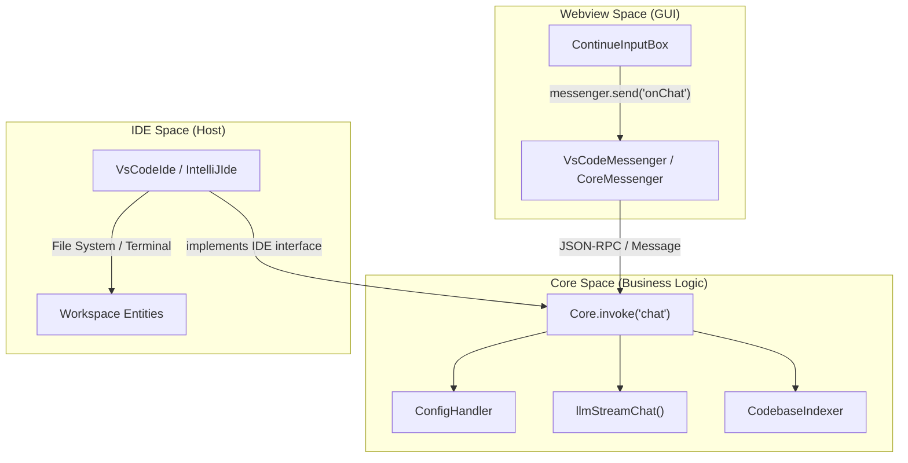
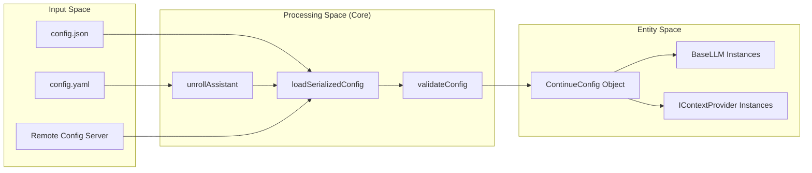

# Glossary

Relevant source files

The following files were used as context for generating this wiki page:

- [binary/package-lock.json](binary/package-lock.json)
- [core/config/ConfigHandler.ts](core/config/ConfigHandler.ts)
- [core/config/ProfileLifecycleManager.ts](core/config/ProfileLifecycleManager.ts)
- [core/config/load.ts](core/config/load.ts)
- [core/config/profile/LocalProfileLoader.ts](core/config/profile/LocalProfileLoader.ts)
- [core/config/profile/LocalProfileLoader.vitest.ts](core/config/profile/LocalProfileLoader.vitest.ts)
- [core/config/profile/doLoadConfig.ts](core/config/profile/doLoadConfig.ts)
- [core/config/profile/doLoadConfig.vitest.ts](core/config/profile/doLoadConfig.vitest.ts)
- [core/config/types.ts](core/config/types.ts)
- [core/config/yaml/loadLocalYamlBlocks.ts](core/config/yaml/loadLocalYamlBlocks.ts)
- [core/config/yaml/loadYaml.ts](core/config/yaml/loadYaml.ts)
- [core/core.ts](core/core.ts)
- [core/index.d.ts](core/index.d.ts)
- [core/llm/autodetect.ts](core/llm/autodetect.ts)
- [core/llm/index.ts](core/llm/index.ts)
- [core/llm/llms/Anthropic.ts](core/llm/llms/Anthropic.ts)
- [core/llm/llms/ClawRouter.ts](core/llm/llms/ClawRouter.ts)
- [core/llm/llms/ClawRouter.vitest.ts](core/llm/llms/ClawRouter.vitest.ts)
- [core/llm/llms/Cohere.ts](core/llm/llms/Cohere.ts)
- [core/llm/llms/Gemini.ts](core/llm/llms/Gemini.ts)
- [core/llm/llms/Ollama.ts](core/llm/llms/Ollama.ts)
- [core/llm/llms/OpenAI.ts](core/llm/llms/OpenAI.ts)
- [core/llm/llms/SambaNova.ts](core/llm/llms/SambaNova.ts)
- [core/llm/llms/VertexAI.ts](core/llm/llms/VertexAI.ts)
- [core/llm/llms/WatsonX.ts](core/llm/llms/WatsonX.ts)
- [core/llm/llms/gemini-types.ts](core/llm/llms/gemini-types.ts)
- [core/llm/llms/index.ts](core/llm/llms/index.ts)
- [core/llm/toolSupport.test.ts](core/llm/toolSupport.test.ts)
- [core/llm/toolSupport.ts](core/llm/toolSupport.ts)
- [core/package-lock.json](core/package-lock.json)
- [core/package.json](core/package.json)
- [core/protocol/core.ts](core/protocol/core.ts)
- [core/protocol/ide.ts](core/protocol/ide.ts)
- [core/protocol/messenger/messageIde.ts](core/protocol/messenger/messageIde.ts)
- [core/protocol/messenger/reverseMessageIde.ts](core/protocol/messenger/reverseMessageIde.ts)
- [core/protocol/passThrough.ts](core/protocol/passThrough.ts)
- [core/protocol/webview.ts](core/protocol/webview.ts)
- [core/util/filesystem.ts](core/util/filesystem.ts)
- [core/util/paths.ts](core/util/paths.ts)
- [docs/customize/model-providers/more/SambaNova.mdx](docs/customize/model-providers/more/SambaNova.mdx)
- [docs/customize/model-providers/more/cerebras.mdx](docs/customize/model-providers/more/cerebras.mdx)
- [docs/customize/model-providers/more/clawrouter.mdx](docs/customize/model-providers/more/clawrouter.mdx)
- [docs/customize/model-providers/more/cloudflare.mdx](docs/customize/model-providers/more/cloudflare.mdx)
- [docs/customize/model-providers/more/flowise.mdx](docs/customize/model-providers/more/flowise.mdx)
- [docs/customize/model-providers/overview.mdx](docs/customize/model-providers/overview.mdx)
- [docs/customize/model-providers/top-level/azure.mdx](docs/customize/model-providers/top-level/azure.mdx)
- [docs/customize/model-providers/top-level/ollama.mdx](docs/customize/model-providers/top-level/ollama.mdx)
- [docs/guides/ollama-guide.mdx](docs/guides/ollama-guide.mdx)
- [extensions/cli/src/commands/checks.ts](extensions/cli/src/commands/checks.ts)
- [extensions/cli/src/index.ts](extensions/cli/src/index.ts)
- [extensions/cli/src/ui/AppRoot.tsx](extensions/cli/src/ui/AppRoot.tsx)
- [extensions/cli/src/ui/index.ts](extensions/cli/src/ui/index.ts)
- [extensions/cli/src/util/errorState.ts](extensions/cli/src/util/errorState.ts)
- [extensions/cli/src/util/exit.ts](extensions/cli/src/util/exit.ts)
- [extensions/cli/src/util/metadata.test.ts](extensions/cli/src/util/metadata.test.ts)
- [extensions/cli/src/util/metadata.ts](extensions/cli/src/util/metadata.ts)
- [extensions/intellij/src/main/kotlin/com/github/continuedev/continueintellijextension/constants/MessageTypes.kt](extensions/intellij/src/main/kotlin/com/github/continuedev/continueintellijextension/constants/MessageTypes.kt)
- [extensions/vscode/config_schema.json](extensions/vscode/config_schema.json)
- [extensions/vscode/package-lock.json](extensions/vscode/package-lock.json)
- [extensions/vscode/package.json](extensions/vscode/package.json)
- [extensions/vscode/src/VsCodeIde.ts](extensions/vscode/src/VsCodeIde.ts)
- [extensions/vscode/src/extension/VsCodeExtension.ts](extensions/vscode/src/extension/VsCodeExtension.ts)
- [extensions/vscode/src/util/ideUtils.ts](extensions/vscode/src/util/ideUtils.ts)
- [gui/package-lock.json](gui/package-lock.json)
- [gui/package.json](gui/package.json)
- [gui/public/logos/clawrouter.png](gui/public/logos/clawrouter.png)
- [gui/src/pages/AddNewModel/configs/models.ts](gui/src/pages/AddNewModel/configs/models.ts)
- [gui/src/pages/AddNewModel/configs/providers.ts](gui/src/pages/AddNewModel/configs/providers.ts)
- [packages/config-yaml/package-lock.json](packages/config-yaml/package-lock.json)
- [packages/config-yaml/package.json](packages/config-yaml/package.json)
- [packages/config-yaml/src/__tests__/index.test.ts](packages/config-yaml/src/__tests__/index.test.ts)
- [packages/config-yaml/src/converter.ts](packages/config-yaml/src/converter.ts)
- [packages/config-yaml/src/index.ts](packages/config-yaml/src/index.ts)
- [packages/config-yaml/src/load/merge.ts](packages/config-yaml/src/load/merge.ts)
- [packages/config-yaml/src/load/unroll.ts](packages/config-yaml/src/load/unroll.ts)
- [packages/config-yaml/src/schemas/index.ts](packages/config-yaml/src/schemas/index.ts)
- [packages/config-yaml/src/validation.ts](packages/config-yaml/src/validation.ts)
- [packages/llm-info/src/providers/inception.ts](packages/llm-info/src/providers/inception.ts)
- [packages/openai-adapters/src/apis/Bedrock.ts](packages/openai-adapters/src/apis/Bedrock.ts)
- [packages/openai-adapters/src/apis/Gemini.test.ts](packages/openai-adapters/src/apis/Gemini.test.ts)
- [packages/openai-adapters/src/apis/Gemini.ts](packages/openai-adapters/src/apis/Gemini.ts)
- [packages/openai-adapters/src/index.ts](packages/openai-adapters/src/index.ts)
- [packages/openai-adapters/src/types.ts](packages/openai-adapters/src/types.ts)
- [packages/openai-adapters/src/util/gemini-types.ts](packages/openai-adapters/src/util/gemini-types.ts)

This glossary defines technical terms, architectural concepts, and domain-specific jargon used throughout the Continue codebase. It serves as a reference for onboarding engineers to navigate the relationship between abstract system concepts and their concrete implementations.

## Core Architectural Terms

### Core
The central business logic engine of Continue. It is designed to be IDE-agnostic and runs as a separate process (or background thread) to handle LLM interactions, indexing, and configuration management.
*   **Implementation**: `class Core` in [core/core.ts:89-131]().
*   **Initialization**: Managed by the `VsCodeExtension` in VS Code [extensions/vscode/package.json:58]() or the `ContinuePluginService` in IntelliJ.
*   **Key Services**: Holds instances of `ConfigHandler`, `CodebaseIndexer`, `CompletionProvider`, and `NextEditProvider` [core/core.ts:90-93]().

### Messenger
The communication abstraction used to pass messages between the three main layers: IDE, Core, and Webview (GUI). It implements a request-response pattern and event broadcasting.
*   **Interface**: `IMessenger` in [core/core.ts:84]().
*   **Protocol Definitions**:
    *   `ToCoreProtocol`: Messages sent to the Core [core/core.ts:82]().
    *   `FromCoreProtocol`: Messages sent from the Core [core/core.ts:82]().
    *   `ToWebviewProtocol`: Messages sent to the React GUI (defined in `core/protocol/webview.ts`).

### IDE Abstraction
An interface that allows the Core to perform editor-specific actions (reading files, showing diffs, getting terminal contents) without knowing which IDE is being used.
*   **Interface**: `IDE` in [core/index.d.ts:47]().
*   **Implementations**: `VsCodeIde` in the VS Code extension [extensions/vscode/src/VsCodeIde.ts]() and `IntellijIde` in the IntelliJ plugin.

### Communication Data Flow
The following diagram illustrates how the `Messenger` bridges the "Natural Language Space" (User Input) to the "Code Entity Space" (Core Logic).

**System Communication Overview**

**Sources**: [core/core.ts:111-131](), [core/index.d.ts:47](), [core/llm/streamChat.ts](), [extensions/vscode/src/VsCodeIde.ts]()

---

## LLM & Context Terms

### ILLM
The primary abstraction for Large Language Models. Every provider (OpenAI, Anthropic, Ollama, etc.) must implement this interface to provide chat, completion, and embedding capabilities.
*   **Interface**: `ILLM` in [core/index.d.ts:98-169]().
*   **Base Class**: `BaseLLM` provides common logic and autodetect capabilities [core/llm/index.ts:90]().
*   **Capabilities**: Includes `streamChat`, `complete`, `embed`, and `countTokens` [core/index.d.ts:108-150]().

### Context Provider
A module that retrieves external information (files, terminal output, GitHub issues) to be injected into the LLM prompt.
*   **Interface**: `IContextProvider` in [core/index.d.ts:261-272]().
*   **Registry**: Managed via `ConfigHandler` during the config loading pipeline [core/config/load.ts:65]().

### Chunk
A fragment of a document (usually code) used for indexing and retrieval. Chunks include metadata like line numbers and file paths.
*   **Definition**: `interface Chunk` in [core/index.d.ts:45-49]().

---

## Configuration System Terms

### ConfigHandler
The service responsible for loading, validating, and watching for changes in the user's configuration files (`config.json` or `config.yaml`).
*   **Class**: `ConfigHandler` in [core/core.ts:90]().
*   **Loading Logic**: Orchestrates the transformation from raw files to the `ContinueConfig` object [core/config/load.ts:112-167]().

### Assistant / Profile
A specific configuration "block" that defines a set of models, context providers, and rules. Users can switch between different profiles.
*   **Types**: Defined in `@continuedev/config-yaml` [packages/config-yaml/package.json]().
*   **YAML Blocks**: Support for assistants, prompts, and tools [core/config/yaml/loadYaml.ts:57-61]().

### YAML Unrolling
The process of resolving references and inheritance in `config.yaml` files to produce a flat, executable configuration.
*   **Function**: `unrollAssistant` in [core/config/yaml/loadYaml.ts:105]().

**Configuration Loading Pipeline**

**Sources**: [core/config/load.ts:112-167](), [core/config/yaml/loadYaml.ts:105-123](), [core/llm/index.ts:90]()

---

## Feature-Specific Jargon

### FIM (Fill-In-the-Middle)
A technique used for tab autocomplete where the LLM is provided with a "prefix" (code before the cursor) and a "suffix" (code after the cursor) to predict the missing code.
*   **Function**: `streamFim` in [core/index.d.ts:120-125]().

### MCP (Model Context Protocol)
An open protocol that allows Continue to connect to external "Context Servers" which provide tools and resources.
*   **Manager**: `MCPManagerSingleton` in [core/core.ts:69]().
*   **Integration**: Integrated into the config via `loadJsonMcpConfigs` [core/config/load.ts:60]().

### Next Edit
A feature that predicts the user's next likely edit location and prepares context or suggestions in advance.
*   **Provider**: `NextEditProvider` in [core/core.ts:93]().
*   **Queueing**: Uses `PrefetchQueue` to manage pending predictions [core/core.ts:80]().

### Vertical Diff
A UI pattern in VS Code where changes are rendered inline using decorations rather than a standard side-by-side diff view.
*   **Commands**: `continue.acceptVerticalDiffBlock` and `continue.rejectVerticalDiffBlock` [extensions/vscode/package.json:174-184]().

---

## Abbreviations Table

| Abbreviation | Full Name | Description | Code Pointer |
| :--- | :--- | :--- | :--- |
| **LSP** | Language Server Protocol | Used to get definitions/symbols from the IDE. | [extensions/vscode/package-lock.json:56]() |
| **PII** | Personally Identifiable Information | Data stripped before telemetry collection. | [extensions/vscode/package.json:92]() |
| **FTS** | Full Text Search | Search capability often paired with embeddings. | [core/index.d.ts:185]() |
| **URI** | Uniform Resource Identifier | Used for cross-platform file and resource identification. | [core/core.ts:2]() |
| **JCEF** | Java Chromium Embedded Framework | Browser engine used for the IntelliJ plugin GUI. | [extensions/vscode/package-lock.json:34]() (Logic mirrored in IntelliJ) |

**Sources**: [extensions/vscode/package.json](), [core/index.d.ts](), [core/core.ts](), [core/config/load.ts](), [extensions/vscode/package-lock.json]()