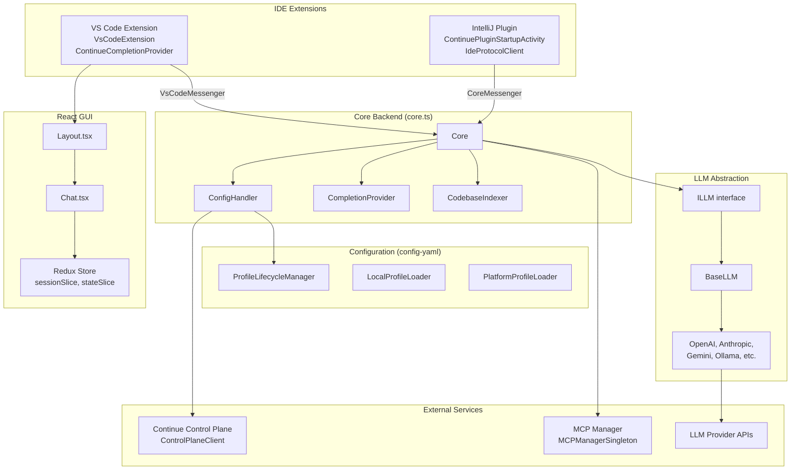
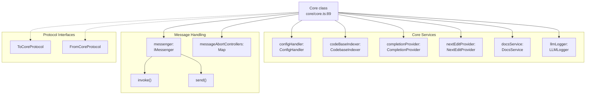
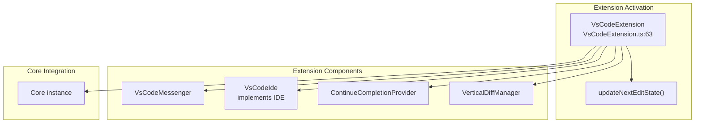
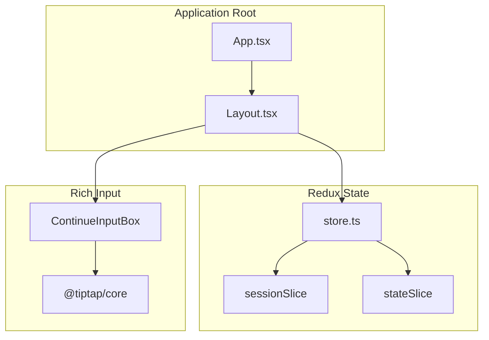
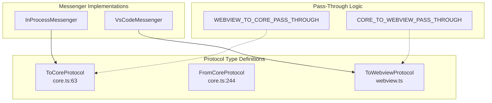
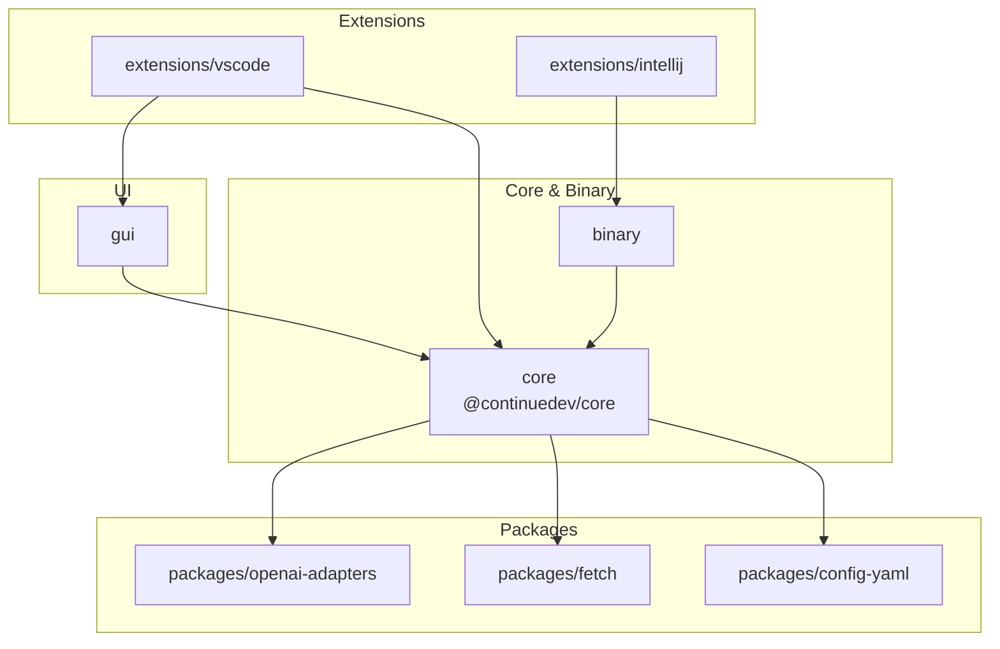
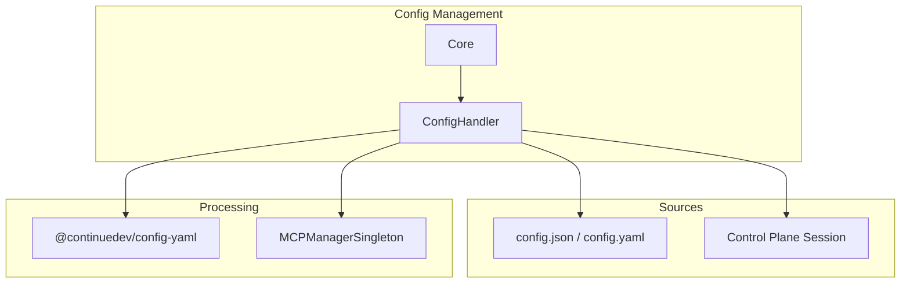

# Architecture

Relevant source files

The following files were used as context for generating this wiki page:

- [binary/package-lock.json](binary/package-lock.json)
- [core/core.ts](core/core.ts)
- [core/package-lock.json](core/package-lock.json)
- [core/package.json](core/package.json)
- [core/protocol/core.ts](core/protocol/core.ts)
- [core/protocol/ide.ts](core/protocol/ide.ts)
- [core/protocol/messenger/messageIde.ts](core/protocol/messenger/messageIde.ts)
- [core/protocol/messenger/reverseMessageIde.ts](core/protocol/messenger/reverseMessageIde.ts)
- [core/protocol/passThrough.ts](core/protocol/passThrough.ts)
- [core/protocol/webview.ts](core/protocol/webview.ts)
- [core/util/filesystem.ts](core/util/filesystem.ts)
- [extensions/intellij/src/main/kotlin/com/github/continuedev/continueintellijextension/constants/MessageTypes.kt](extensions/intellij/src/main/kotlin/com/github/continuedev/continueintellijextension/constants/MessageTypes.kt)
- [extensions/vscode/package-lock.json](extensions/vscode/package-lock.json)
- [extensions/vscode/package.json](extensions/vscode/package.json)
- [extensions/vscode/src/VsCodeIde.ts](extensions/vscode/src/VsCodeIde.ts)
- [extensions/vscode/src/extension/VsCodeExtension.ts](extensions/vscode/src/extension/VsCodeExtension.ts)
- [extensions/vscode/src/util/ideUtils.ts](extensions/vscode/src/util/ideUtils.ts)
- [gui/package-lock.json](gui/package-lock.json)
- [gui/package.json](gui/package.json)
- [packages/config-yaml/package.json](packages/config-yaml/package.json)

Continue is an open-source AI code assistant with a multi-tier architecture consisting of IDE extensions (VS Code, IntelliJ), a core backend service, a React-based GUI, and an LLM abstraction layer supporting 40+ AI providers. The system uses message-passing protocols for communication between isolated processes, enabling clean separation of concerns and cross-platform IDE support.

This page provides a high-level architectural overview. For detailed information, see:
- [System Architecture](#2.1) - Complete system interactions and component relationships
- [Package Structure](#2.2) - Monorepo organization and dependencies  
- [Communication Protocols](#2.3) - Message passing and protocol definitions
- [IDE Integration Patterns](#2.4) - Cross-platform IDE abstraction patterns

## System Overview

Continue's architecture consists of four main layers that communicate through typed protocols:

**High-Level System Architecture**

**Sources:** [core/core.ts:89-131](), [core/core.ts:138-167](), [extensions/vscode/src/extension/VsCodeExtension.ts:63-80](), [core/context/mcp/MCPManagerSingleton.ts]()

The architecture maintains strict separation:
- **IDE Layer**: Platform-specific integration (e.g., `VsCodeExtension` [extensions/vscode/src/extension/VsCodeExtension.ts:63-172]())
- **Core Layer**: Business logic in `Core` class [core/core.ts:89-124]()
- **Configuration Layer**: Multi-source config via `ConfigHandler` [core/core.ts:138-144]() and profile management.
- **LLM Layer**: Provider abstraction through `ILLM` interface and `BaseLLM`.
- **GUI Layer**: React application with Redux state management [gui/package.json:25-74]().

## Core Backend

The `Core` class [core/core.ts:89-124]() orchestrates all backend functionality:

**Core Class Structure**

**Sources:** [core/core.ts:89-124](), [core/protocol/core.ts:63-242]()

`Core` responsibilities:
- **Message Routing**: `invoke()` and `send()` methods for request/response and fire-and-forget patterns [core/core.ts:111-124]().
- **Service Management**: Initializes and coordinates `ConfigHandler`, `CodebaseIndexer`, `DocsService`, and `NextEditProvider` [core/core.ts:138-167]().
- **Abort Control**: Manages `AbortController` instances for cancellable operations via `messageAbortControllers` [core/core.ts:98-109]().
- **Protocol Handlers**: Implements the handlers for the extensive `ToCoreProtocol` [core/protocol/core.ts:63-242]().

## IDE Extensions

Continue supports multiple IDEs through platform-specific extensions sharing a common `IDE` interface [core/core.ts:130]().

**VS Code Extension Architecture**

**Sources:** [extensions/vscode/src/extension/VsCodeExtension.ts:63-80](), [extensions/vscode/package.json:153-205]()

VS Code extension components:
- `VsCodeExtension`: Main extension class managing lifecycle and service instantiation [extensions/vscode/src/extension/VsCodeExtension.ts:63]().
- `ContinueCompletionProvider`: Implements tab-autocomplete logic [extensions/vscode/src/extension/VsCodeExtension.ts:80]().
- `VsCodeMessenger`: Routes messages between the webview and the core [extensions/vscode/src/extension/VsCodeExtension.ts:40]().
- Extensive commands registered in `package.json` [extensions/vscode/package.json:153-205]().

## React GUI

The GUI is a React application shared across IDEs via webview integration [gui/package.json:54-60]().

**GUI Component Hierarchy**

**Sources:** [gui/package.json:18-40](), [gui/package.json:60-69]().

Key components:
- `Layout`: Root component managing routing and global UI state.
- `ContinueInputBox`: TipTap-based editor for rich chat input [gui/package.json:26-38]().
- `Redux Store`: Centralized state for chat sessions, configuration, and indexing status [gui/package.json:25]().

## Communication Protocols

Continue uses typed protocol definitions for all inter-process communication:

**Protocol Definitions and Message Flow**

**Sources:** [core/protocol/core.ts:63-242](), [core/protocol/core.ts:244-307](), [core/protocol/passThrough.ts:9-109]().

Protocol structure:
- `ToCoreProtocol`: Message types for Core operations (history, config, context, indexing) [core/protocol/core.ts:63-242]().
- `FromCoreProtocol`: Messages sent from the Core to the IDE/Webview (notifications, status updates) [core/protocol/core.ts:244-307]().
- `Pass-Through`: Pre-defined lists of message types that are automatically routed between components [core/protocol/passThrough.ts:9-109]().

## Monorepo Structure

Continue is organized as a monorepo with several interconnected packages:

**Package Dependencies**

**Sources:** [extensions/vscode/package-lock.json:12-18](), [core/package.json:61-66](), [gui/package.json:43](), [binary/package-lock.json:15]().

| Package | Purpose | Key Dependencies |
|---------|---------|-----------------|
| `core` [core/package.json]() | Central business logic, LLM providers, indexing. | `@continuedev/config-yaml`, `openai`, `ollama` |
| `gui` [gui/package.json]() | React-based user interface. | `react`, `@reduxjs/toolkit`, `core` |
| `extensions/vscode` [extensions/vscode/package.json]() | VS Code specific integration. | `core`, `vscode-languageclient` |
| `binary` [binary/package-lock.json]() | Standalone binary wrapper for the core (used by IntelliJ). | `core` |
| `packages/config-yaml` [packages/config-yaml/package.json]() | YAML configuration parsing and validation. | `yaml`, `zod` |

## Configuration System

The configuration system is centered around `ConfigHandler`, which manages the loading and refreshing of configuration from various sources.

**Configuration Loading Pipeline**

**Sources:** [core/core.ts:138-144](), [core/core.ts:146-160](), [core/package.json:61-62]().

`ConfigHandler` architecture:
- **Initialization**: Created within `Core` and linked to the IDE and session info [core/core.ts:138]().
- **MCP Integration**: Refreshed when Model Context Protocol (MCP) connections change [core/core.ts:146-160]().
- **Validation**: Uses `@continuedev/config-yaml` for parsing and `zod` for runtime validation [core/package.json:126]().