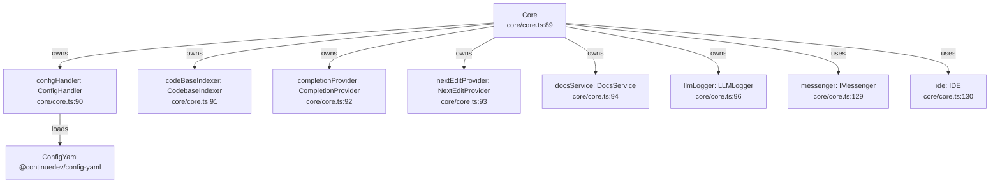
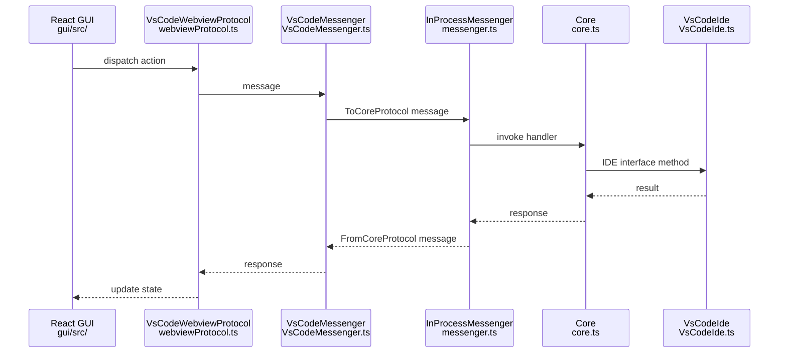
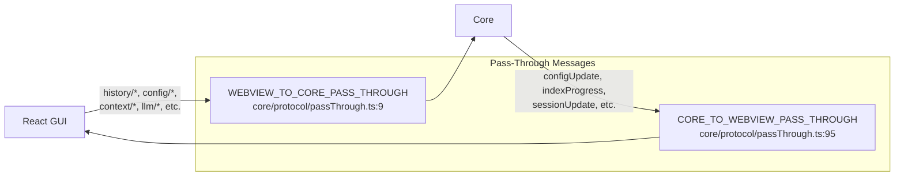

# System Architecture

<details>
<summary>Relevant source files</summary>

The following files were used as context for generating this wiki page:

- [binary/package-lock.json](binary/package-lock.json)
- [core/core.ts](core/core.ts)
- [core/package-lock.json](core/package-lock.json)
- [core/package.json](core/package.json)
- [core/protocol/core.ts](core/protocol/core.ts)
- [core/protocol/ide.ts](core/protocol/ide.ts)
- [core/protocol/messenger/messageIde.ts](core/protocol/messenger/messageIde.ts)
- [core/protocol/messenger/reverseMessageIde.ts](core/protocol/messenger/reverseMessageIde.ts)
- [core/protocol/passThrough.ts](core/protocol/passThrough.ts)
- [core/protocol/webview.ts](core/protocol/webview.ts)
- [core/util/filesystem.ts](core/util/filesystem.ts)
- [extensions/intellij/src/main/kotlin/com/github/continuedev/continueintellijextension/constants/MessageTypes.kt](extensions/intellij/src/main/kotlin/com/github/continuedev/continueintellijextension/constants/MessageTypes.kt)
- [extensions/vscode/package-lock.json](extensions/vscode/package-lock.json)
- [extensions/vscode/package.json](extensions/vscode/package.json)
- [extensions/vscode/src/VsCodeIde.ts](extensions/vscode/src/VsCodeIde.ts)
- [extensions/vscode/src/extension/VsCodeExtension.ts](extensions/vscode/src/extension/VsCodeExtension.ts)
- [extensions/vscode/src/util/ideUtils.ts](extensions/vscode/src/util/ideUtils.ts)
- [gui/package-lock.json](gui/package-lock.json)
- [gui/package.json](gui/package.json)
- [packages/config-yaml/package.json](packages/config-yaml/package.json)

</details>


## Purpose and Scope

This document describes Continue's layered system architecture, explaining how the IDE extensions, Core orchestrator, GUI, and external services interact through message-passing protocols. It covers the separation of concerns between platform-specific code and shared business logic, the configuration system, and the communication patterns that enable cross-platform functionality.

For details on specific communication protocols, see [Communication Protocols](#2.3). For IDE-specific integration patterns, see [IDE Integration Patterns](#2.4). For the package organization, see [Package Structure](#2.2).

## High-Level Architecture

Continue uses a layered architecture with strict separation between IDE-specific code, shared business logic, and the user interface. This design enables a single codebase to support multiple IDEs (VS Code, IntelliJ) and a CLI while maintaining consistent functionality.

### Core Component Relationships

```mermaid
graph TB
    subgraph IDE["IDE Layer"]
        VSCodeExt["VsCodeExtension<br/>extensions/vscode/src/extension/VsCodeExtension.ts"]
        IntelliJPlugin["ContinuePluginService<br/>Kotlin plugin service"]
        CLITool["CLI Application<br/>binary/"]
    end
    
    subgraph Messenger["Message Router Layer"]
        VSCodeMsngr["VsCodeMessenger<br/>extensions/vscode/src/extension/VsCodeMessenger.ts"]
        IntelliJMsngr["IdeProtocolClient<br/>Kotlin message handler"]
        InProcessMsngr["InProcessMessenger<br/>core/protocol/messenger.ts"]
    end
    
    subgraph CoreLayer["Core Layer"]
        CoreClass["Core<br/>core/core.ts"]
        ConfigHandlerClass["ConfigHandler<br/>core/config/ConfigHandler.ts"]
        CodeBaseIndexer["CodebaseIndexer<br/>core/indexing/CodebaseIndexer.ts"]
        CompletionProvider["CompletionProvider<br/>core/autocomplete/CompletionProvider.ts"]
    end
    
    subgraph GUI["GUI Layer"]
        ReactApp["React Application<br/>gui/src/"]
        ReduxStore["Redux Store<br/>sessionSlice, stateSlice"]
        WebviewProtocol["VsCodeWebviewProtocol<br/>extensions/vscode/src/webviewProtocol.ts"]
    end
    
    subgraph External["External Services"]
        ControlPlane["ControlPlaneClient<br/>core/control-plane/client.ts"]
        LLMProviders["LLM Providers<br/>core/llm/llms/"]
        MCPManager["MCPManagerSingleton<br/>core/context/mcp/MCPManagerSingleton.ts"]
    end
    
    VSCodeExt -->|creates| InProcessMsngr [extensions/vscode/src/extension/VsCodeExtension.ts:181-190]()
    VSCodeExt -->|creates| VSCodeMsngr [extensions/vscode/src/extension/VsCodeExtension.ts:181-190]()
    
    VSCodeMsngr -->|handles| InProcessMsngr [extensions/vscode/src/extension/VsCodeMessenger.ts:45-66]()
    
    InProcessMsngr -->|instantiates| CoreClass [extensions/vscode/src/extension/VsCodeExtension.ts:200-210]()
    CoreClass -->|owns| ConfigHandlerClass [core/core.ts:138]()
    CoreClass -->|owns| CodeBaseIndexer [core/core.ts:162-167]()
    CoreClass -->|owns| CompletionProvider [core/core.ts:92]()
    
    VSCodeExt -->|embeds| ReactApp [extensions/vscode/package.json:56]()
    ReactApp -->|manages| ReduxStore [gui/package.json:25]()
    ReactApp -->|communicates via| WebviewProtocol [extensions/vscode/src/extension/VsCodeExtension.ts:175-180]()
    
    ConfigHandlerClass -->|uses| ControlPlane [core/core.ts:138]()
    CoreClass -->|calls| LLMProviders [core/core.ts:17-20]()
    CoreClass -->|integrates| MCPManager [core/core.ts:146-160]()
```

**Sources:** [core/core.ts:92-182](), [extensions/vscode/src/extension/VsCodeExtension.ts:63-210](), [core/protocol/messenger.ts:1-20]()

## Core Orchestrator

The `Core` class serves as the central orchestrator, managing all business logic and coordinating between subsystems. It is instantiated by IDE extensions and communicates through message protocols.



The `Core` constructor initializes all subsystems and registers message handlers for different message types, handling everything from history management to autocomplete to indexing operations. It listens for configuration updates via `configHandler.onConfigUpdate` to broadcast changes to the messenger.

**Sources:** [core/core.ts:89-106](), [core/core.ts:128-205](), [core/core.ts:169-185]()

## Message-Passing Architecture

Continue uses a strict message-passing architecture with typed protocols to maintain separation between layers. Messages flow through well-defined channels with no direct function calls across layer boundaries.

### Message Protocol Types

| Protocol Type | Source | Target | Purpose |
|--------------|--------|--------|---------|
| `ToCoreProtocol` | IDE or Webview | Core | Requests to Core business logic [core/protocol/core.ts:63]() |
| `FromCoreProtocol` | Core | IDE or Webview | Responses and notifications from Core [core/core.ts:118]() |
| `ToWebviewProtocol` | IDE or Core | Webview | Requests to update the GUI state [extensions/vscode/src/extension/VsCodeMessenger.ts:45]() |

**Sources:** [core/protocol/core.ts:63-243](), [core/core.ts:118-125](), [core/protocol/passThrough.ts:95-109]()

### Message Flow Diagram



**Sources:** [extensions/vscode/src/extension/VsCodeMessenger.ts:45-66](), [core/protocol/messenger.ts:1-20](), [core/core.ts:128-132]()

### Pass-Through Messages

The architecture includes pass-through message lists that allow direct communication between the Webview and Core, bypassing the IDE layer for efficiency. These are defined in `WEBVIEW_TO_CORE_PASS_THROUGH` and `CORE_TO_WEBVIEW_PASS_THROUGH`.



Examples of pass-through messages include `"history/list"`, `"config/addModel"`, `"llm/streamChat"`, `"indexProgress"`, and `"configUpdate"`.

**Sources:** [core/protocol/passThrough.ts:9-110](), [core/protocol/core.ts:63-243]()

## Configuration System Architecture

The configuration system supports multiple sources (local YAML/JSON, remote profiles) and manages profile lifecycle across different scopes.

```mermaid
graph TB
    subgraph Sources["Configuration Sources"]
        ConfigYaml["config.yaml<br/>~/.continue/config.yaml"]
        ConfigJson["config.json<br/>~/.continue/config.json"]
        LocalBlocks[".continue/ blocks<br/>Workspace YAML files"]
    end
    
    subgraph Loading["Configuration Loading"]
        ConfigHandler["ConfigHandler<br/>core/config/ConfigHandler.ts"]
        ConfigYamlPkg["ConfigYaml<br/>@continuedev/config-yaml"]
    end
    
    subgraph Processing["Processing Pipeline"]
        DoLoadConfig["doLoadConfig<br/>core/config/profile/doLoadConfig.ts"]
    end
    
    subgraph Result["Result"]
        ContinueConfig["ContinueConfig<br/>Final configuration object"]
    end
    
    ConfigYaml --> ConfigYamlPkg [packages/config-yaml/package.json:2-17]()
    ConfigJson --> ConfigHandler [core/core.ts:138]()
    LocalBlocks --> ConfigYamlPkg [core/core.ts:50]()
    
    ConfigHandler --> DoLoadConfig
    ConfigYamlPkg --> DoLoadConfig
    
    DoLoadConfig --> ContinueConfig
```

**Sources:** [core/core.ts:138-144](), [packages/config-yaml/package.json:1-30](), [core/protocol/core.ts:1-7]()

## GUI State Management

The React GUI uses Redux for state management with clear separation between session state, configuration state, and UI state.

```mermaid
graph TB
    subgraph Store["Redux Store"]
        SessionSlice["sessionSlice<br/>Current chat session state"]
        StateSlice["stateSlice<br/>Global state"]
    end
    
    subgraph Components["React Components"]
        Chat["Chat<br/>gui/src/pages/gui/Chat.tsx"]
        ContinueInputBox["ContinueInputBox<br/>gui/src/components/mainInput/ContinueInputBox.tsx"]
    end
    
    Components -->|dispatch| Store [gui/package.json:25]()
    Components -->|selector| Store [gui/package.json:60]()
```

**Sources:** [gui/package.json:25](), [gui/package.json:60-69](), [gui/package.json:18-83]()

## VS Code Extension Architecture

The VS Code extension follows a specific initialization pattern that creates the Core, manages the webview, and coordinates between all subsystems.

```mermaid
graph TB
    VsCodeExtension["VsCodeExtension<br/>extensions/vscode/src/extension/VsCodeExtension.ts:63"]
    
    subgraph Creation["Component Creation"]
        Sidebar["ContinueGUIWebviewViewProvider<br/>extensions/vscode/src/ContinueGUIWebviewViewProvider.ts"]
        InProcessMessenger["InProcessMessenger<br/>core/protocol/messenger.ts"]
        VsCodeMessenger["VsCodeMessenger<br/>extensions/vscode/src/extension/VsCodeMessenger.ts:40"]
        Core["Core<br/>core/core.ts"]
    end
    
    subgraph Managers["Manager Setup"]
        VerticalDiffManager["VerticalDiffManager<br/>extensions/vscode/src/diff/vertical/manager.ts"]
        EditDecorationManager["EditDecorationManager<br/>extensions/vscode/src/quickEdit/EditDecorationManager.ts"]
        CompletionProvider["ContinueCompletionProvider<br/>extensions/vscode/src/autocomplete/completionProvider.ts"]
    end
    
    VsCodeExtension --> Sidebar [extensions/vscode/src/extension/VsCodeExtension.ts:71]()
    VsCodeExtension --> InProcessMessenger [extensions/vscode/src/extension/VsCodeExtension.ts:9]()
    VsCodeExtension --> VsCodeMessenger [extensions/vscode/src/extension/VsCodeExtension.ts:40]()
    VsCodeExtension --> Core [extensions/vscode/src/extension/VsCodeExtension.ts:76]()
    VsCodeExtension --> VerticalDiffManager [extensions/vscode/src/extension/VsCodeExtension.ts:74]()
    VsCodeExtension --> EditDecorationManager [extensions/vscode/src/extension/VsCodeExtension.ts:73]()
    VsCodeExtension --> CompletionProvider [extensions/vscode/src/extension/VsCodeExtension.ts:80]()
```

**Sources:** [extensions/vscode/src/extension/VsCodeExtension.ts:63-86](), [extensions/vscode/src/extension/VsCodeExtension.ts:172-210]()

## LLM Integration Layer

The Core integrates with LLM providers through an abstraction layer that provides a unified interface.

```mermaid
graph TB
    subgraph Providers["Provider Implementations"]
        Ollama["Ollama<br/>core/llm/llms/Ollama.ts"]
        Lemonade["Lemonade<br/>core/llm/llms/Lemonade.ts"]
    end
    
    subgraph Usage["Core Usage"]
        llmStreamChat["llmStreamChat()<br/>core/llm/streamChat.ts"]
        CompletionProvider["CompletionProvider<br/>core/autocomplete/CompletionProvider.ts"]
    end
    
    llmStreamChat -->|calls| Ollama [core/core.ts:77]()
    CompletionProvider -->|calls| Lemonade [core/core.ts:92]()
```

**Sources:** [core/core.ts:17-19](), [core/core.ts:77](), [core/core.ts:92](), [core/package.json:57-127]()

## Indexing and Context

Continue maintains multiple types of indexes for providing context to LLMs:

```mermaid
graph TB
    subgraph Indexing["Indexing Systems"]
        CodeBaseIndexer["CodebaseIndexer<br/>core/indexing/CodebaseIndexer.ts"]
        DocsService["DocsService<br/>core/indexing/docs/DocsService.ts"]
        MCPManager["MCPManagerSingleton<br/>core/context/mcp/MCPManagerSingleton.ts"]
    end
    
    subgraph Databases["Storage"]
        Vectordb["Vectordb<br/>LanceDB/Vector embeddings"]
        DevDataSqliteDb["DevDataSqliteDb<br/>SQLite metadata"]
    end
    
    CodeBaseIndexer -->|uses| Vectordb [core/package.json:119]()
    CodeBaseIndexer -->|uses| DevDataSqliteDb [core/core.ts:12]()
    DocsService -->|managed by| Core [core/core.ts:140-144]()
    MCPManager -->|refreshes| ConfigHandler [core/core.ts:146-160]()
```

**Sources:** [core/core.ts:12-15](), [core/core.ts:162-168](), [core/core.ts:146-160](), [core/package.json:112-119]()

## Build and Distribution

Continue uses a monorepo structure with separate build processes for each component.

```mermaid
graph TB
    subgraph Source["Source Packages"]
        CoreSrc["core/<br/>TypeScript"]
        GUISrc["gui/<br/>React + TypeScript"]
        VSCodeSrc["extensions/vscode/<br/>TypeScript"]
        BinarySrc["binary/<br/>TypeScript"]
    end
    
    subgraph Build["Build Tools"]
        TSC["tsc<br/>TypeScript compiler"]
        Vite["Vite<br/>GUI bundler"]
        ESBuild["esbuild<br/>Extension bundler"]
    end
    
    CoreSrc --> TSC [core/package.json:10]()
    GUISrc --> Vite [gui/package.json:10]()
    VSCodeSrc --> ESBuild [extensions/vscode/package-lock.json:80]()
```

**Sources:** [core/package.json:5-10](), [gui/package.json:7-10](), [extensions/vscode/package-lock.json:80-87]()