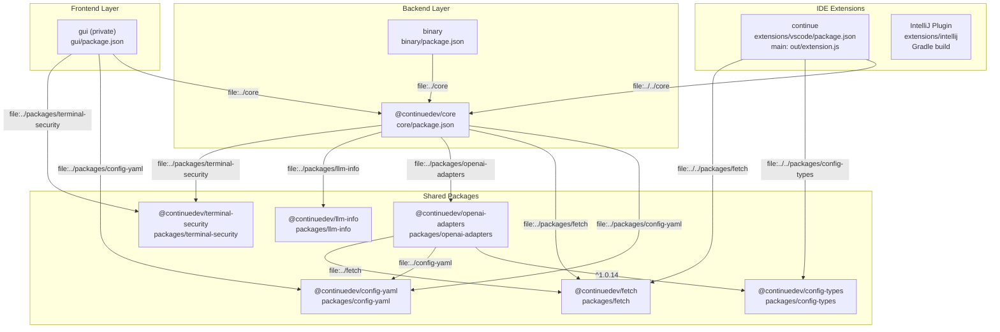

# Package Structure

<details>
<summary>Relevant source files</summary>

The following files were used as context for generating this wiki page:

- [.continue/environment.json](.continue/environment.json)
- [.github/CODEOWNERS](.github/CODEOWNERS)
- [.gitignore](.gitignore)
- [.husky/pre-commit](.husky/pre-commit)
- [.prettierignore](.prettierignore)
- [.prettierrc](.prettierrc)
- [binary/package-lock.json](binary/package-lock.json)
- [core/package-lock.json](core/package-lock.json)
- [core/package.json](core/package.json)
- [core/protocol/coreWebview.ts](core/protocol/coreWebview.ts)
- [extensions/vscode/package-lock.json](extensions/vscode/package-lock.json)
- [extensions/vscode/package.json](extensions/vscode/package.json)
- [gui/package-lock.json](gui/package-lock.json)
- [gui/package.json](gui/package.json)
- [package-lock.json](package-lock.json)
- [package.json](package.json)
- [packages/config-yaml/package.json](packages/config-yaml/package.json)
- [packages/continue-sdk/package-lock.json](packages/continue-sdk/package-lock.json)
- [packages/continue-sdk/package.json](packages/continue-sdk/package.json)
- [packages/continue-sdk/tsconfig.json](packages/continue-sdk/tsconfig.json)
- [packages/openai-adapters/package-lock.json](packages/openai-adapters/package-lock.json)
- [packages/openai-adapters/package.json](packages/openai-adapters/package.json)
- [packages/openai-adapters/src/apis/WatsonX.ts](packages/openai-adapters/src/apis/WatsonX.ts)

</details>


This document describes the monorepo structure of the Continue codebase, detailing the purpose and dependencies of each major package. Continue is organized as a multi-package repository with several top-level directories containing distinct modules that work together to provide AI coding assistance across multiple IDEs.

For information about the high-level system architecture and how these packages interact at runtime, see [System Architecture](#2.1). For details on message passing between packages, see [Communication Protocols](#2.3).

## Monorepo Organization

Continue uses a monorepo structure with the following top-level organization:

| Directory | Purpose | Language | Package Name | Main Entry |
|-----------|---------|----------|--------------|------------|
| `core/` | Backend orchestration, LLM integration, context providers | TypeScript | `@continuedev/core` | [core/package.json:15]() (Module) |
| `gui/` | React-based user interface shared by all IDE extensions | TypeScript/React | `gui` (private) | [gui/package.json:4]() (Module) |
| `extensions/vscode/` | VS Code extension implementation | TypeScript | `continue` | [extensions/vscode/package.json:58]() |
| `extensions/intellij/` | IntelliJ plugin implementation | Kotlin/Java | N/A | Gradle build |
| `packages/config-yaml/` | YAML configuration parser and block resolver | TypeScript | `@continuedev/config-yaml` | [packages/config-yaml/package.json:5]() |
| `packages/openai-adapters/` | OpenAI-compatible LLM adapters | TypeScript | `@continuedev/openai-adapters` | [packages/openai-adapters/package.json:5]() |
| `packages/config-types/` | TypeScript type definitions for config | TypeScript | `@continuedev/config-types` | [extensions/vscode/package-lock.json:12]() |
| `packages/fetch/` | HTTP client with proxy support | TypeScript | `@continuedev/fetch` | [core/package-lock.json:18]() |
| `packages/llm-info/` | Model metadata and capabilities | TypeScript | `@continuedev/llm-info` | [core/package-lock.json:19]() |
| `packages/terminal-security/` | Terminal command validation | TypeScript | `@continuedev/terminal-security` | [core/package-lock.json:21]() |
| `binary/` | Standalone CLI tool / Core binary | TypeScript | `binary` | [binary/package-lock.json:28]() |

**Sources:** [extensions/vscode/package.json:1-58](), [core/package.json:1-4](), [gui/package.json:1-6](), [packages/openai-adapters/package.json:1-7](), [binary/package-lock.json:1-29]()

## Package Dependency Graph

This diagram shows npm package dependencies using actual package names from `package.json` and `package-lock.json` files:



**Note:** Dependencies prefixed with `file:` indicate monorepo workspace links, while version strings (e.g., `^1.0.14`) indicate published npm packages.

**Sources:** [extensions/vscode/package-lock.json:11-18](), [core/package.json:61-67](), [gui/package.json:19-20,43](), [packages/openai-adapters/package.json:23-25](), [binary/package-lock.json:11-15]()

## Core Package (`@continuedev/core`)

The `core` package contains all backend business logic and is the heart of the Continue system. It is published as `@continuedev/core` (version 1.1.0) and consumed by IDE extensions.

### Package Configuration

```json
{
  "name": "@continuedev/core",
  "version": "1.1.0",
  "description": "The Continue Core contains functionality that can be shared across web, VS Code, or Node.js",
  "type": "module",
  "engines": { "node": ">=20.20.1" }
}
```

**Sources:** [core/package.json:1-4,129-131]()

### External Dependencies by Category

The core package dependencies from [core/package.json:57-127]():

**LLM Provider SDKs:**
- `@anthropic-ai/sdk@^0.62.0` [core/package.json:57]()
- `openai@^5.13.1` [core/package.json:101]()
- `@aws-sdk/client-bedrock-runtime@^3.931.0` [core/package.json:58]()
- `google-auth-library@^10.4.1` [core/package.json:83]()
- `ollama@^0.4.6` [core/package.json:99]()

**Continue Internal Packages:**
- `@continuedev/config-yaml@file:../packages/config-yaml` [core/package.json:62]()
- `@continuedev/openai-adapters@file:../packages/openai-adapters` [core/package.json:65]()
- `@continuedev/fetch@file:../packages/fetch` [core/package.json:63]()
- `@continuedev/llm-info@file:../packages/llm-info` [core/package.json:64]()

**Embeddings & Vector DB:**
- `@xenova/transformers@2.14.0` [core/package.json:70]()
- `onnxruntime-node@1.14.0` [core/package.json:100]()
- `vectordb@0.4.20` [core/package.json:119]()

**Protocol Integration:**
- `@modelcontextprotocol/sdk@^1.25.2` [core/package.json:67]()
- `socket.io-client@^4.7.3` [core/package.json:111]()

**Sources:** [core/package.json:57-127]()

## GUI Package

The `gui` package is a React application providing the chat interface. It is shared across VS Code and IntelliJ via webview embedding.

### Key Dependencies

- **React**: `react@^18.2.0`, `react-dom@^18.2.0` [gui/package.json:54-55]()
- **State Management**: `@reduxjs/toolkit@^2.11.2`, `react-redux@^8.0.5` [gui/package.json:25,60]()
- **Editor**: `@tiptap/core`, `@tiptap/react` [gui/package.json:26,36]()
- **Markdown**: `react-markdown@^9.0.1` [gui/package.json:59]()
- **Diagrams**: `mermaid@^11.10.0` [gui/package.json:51]()

**Sources:** [gui/package.json:18-83]()

## VS Code Extension Package (`continue`)

The VS Code extension (`extensions/vscode`) implements the IDE-specific integration.

### Package Configuration

```json
{
  "name": "continue",
  "version": "1.3.40",
  "publisher": "Continue",
  "main": "./out/extension.js",
  "engines": { 
    "vscode": "^1.70.0",
    "node": ">=20.20.1" 
  },
  "activationEvents": [
    "onUri",
    "onStartupFinished",
    "onView:continueGUIView"
  ]
}
```

**Sources:** [extensions/vscode/package.json:1-58]()

### Key Dependencies

From [extensions/vscode/package-lock.json:11-59]():

- `core@file:../../core` [extensions/vscode/package-lock.json:18]()
- `@continuedev/config-types@file:../../packages/config-types` [extensions/vscode/package-lock.json:12]()
- `@continuedev/fetch@file:../../packages/fetch` [extensions/vscode/package-lock.json:13]()
- `@vscode/ripgrep@^1.15.9` [extensions/vscode/package-lock.json:16]()
- `vectordb@0.4.20` [extensions/vscode/package-lock.json:54]()
- `vscode-languageclient@^8.0.2` [extensions/vscode/package-lock.json:56]()

**Sources:** [extensions/vscode/package-lock.json:11-59]()

## Shared Packages (`packages/`)

### config-yaml Package (`@continuedev/config-yaml`)

Implements the YAML configuration system used for profile management and block resolution.

**Package Configuration:**
```json
{
  "name": "@continuedev/config-yaml",
  "version": "1.23.0",
  "main": "dist/index.js",
  "bin": {
    "config-yaml": "./dist/cli.js"
  }
}
```

**Sources:** [packages/config-yaml/package.json:1-17]()

### openai-adapters Package (`@continuedev/openai-adapters`)

Provides OpenAI-compatible adapters for diverse LLM providers using the Vercel AI SDK and native SDKs.

**Architecture and Dependencies:**
- `ai@^6.0.86`: Core Vercel AI SDK [packages/openai-adapters/package.json:27]()
- `@ai-sdk/anthropic`, `@ai-sdk/google`, `@ai-sdk/openai`, `@ai-sdk/deepseek`: Provider-specific adapters [packages/openai-adapters/package.json:15-18]()

**Sources:** [packages/openai-adapters/package.json:1-35]()

## Build and Dependency Management

### Workspace Configuration

The monorepo uses file-based package references (`file:../path`) for local development:

**From core/package.json:**
```json
{
  "dependencies": {
    "@continuedev/config-yaml": "file:../packages/config-yaml",
    "@continuedev/fetch": "file:../packages/fetch",
    "@continuedev/llm-info": "file:../packages/llm-info",
    "@continuedev/openai-adapters": "file:../packages/openai-adapters",
    "@continuedev/terminal-security": "file:../packages/terminal-security"
  }
}
```

**Sources:** [core/package.json:62-66]()

### TypeScript Compilation

Each package has its own TypeScript configuration and build scripts:

- **Core**: `npm run build` executes `tsc -p ./tsconfig.npm.json` [core/package.json:10]().
- **GUI**: `npm run build` executes `tsc && vite build` [gui/package.json:10]().
- **VS Code**: Uses `esbuild` for bundling and `tsc` for type checking [extensions/vscode/package-lock.json:80,86]().
- **Binary**: Uses `esbuild` and `@vercel/ncc` for packaging [binary/package-lock.json:35,37]().

**Sources:** [core/package.json:10](), [gui/package.json:10](), [extensions/vscode/package-lock.json:80-86](), [binary/package-lock.json:35-37]()