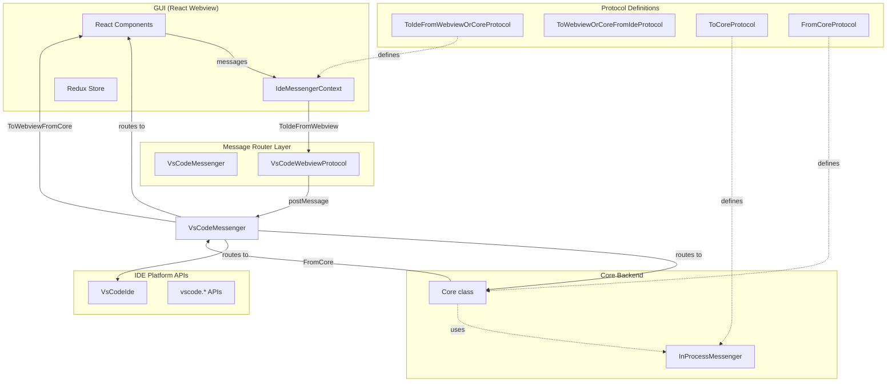
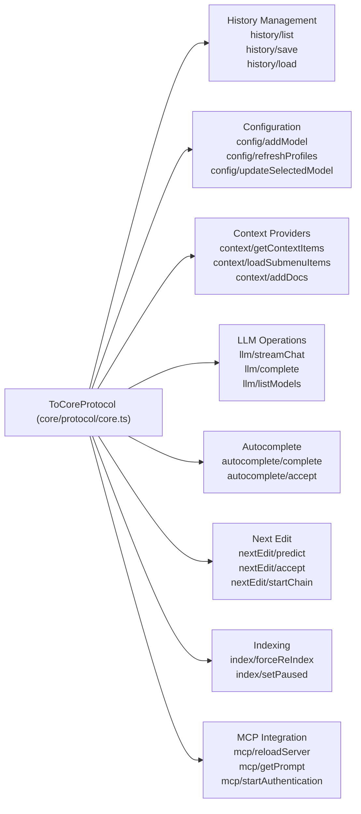
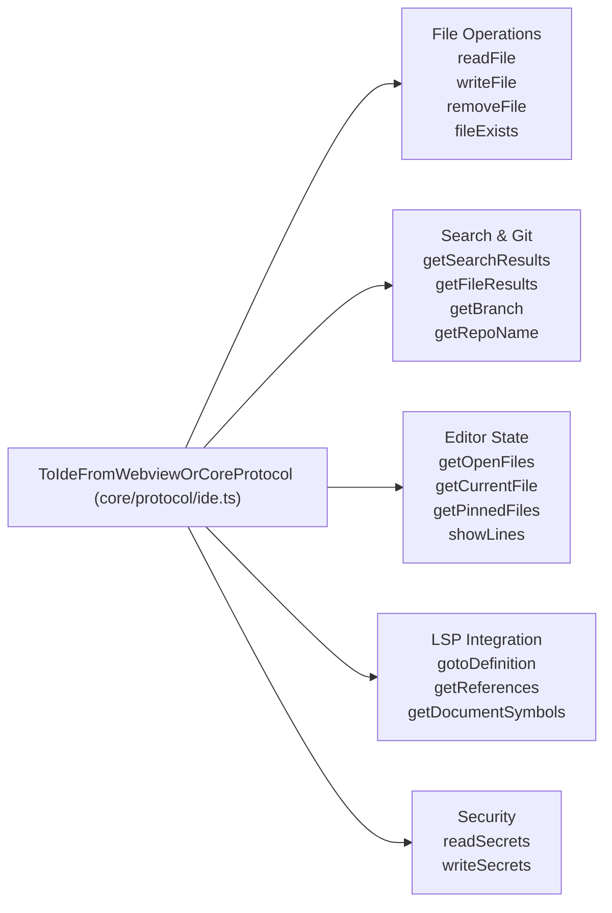
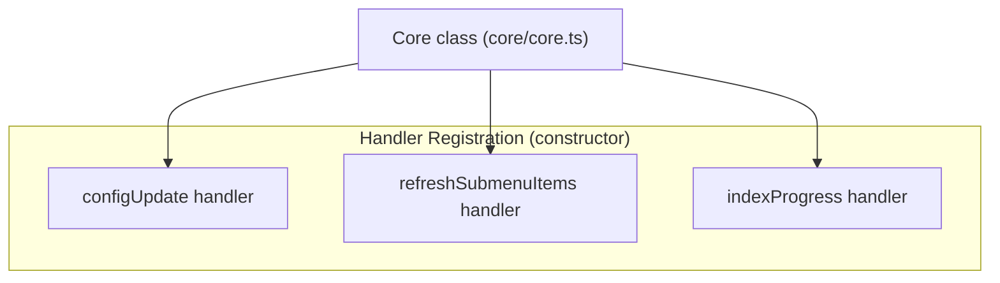
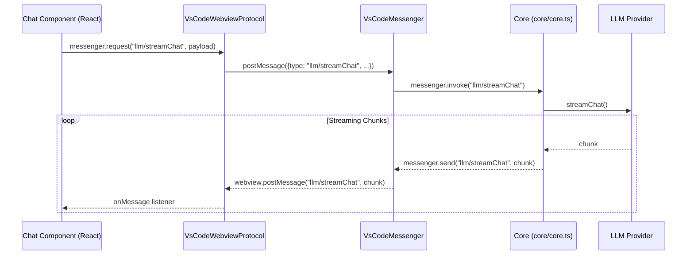

# Communication Protocols

Relevant source files

The following files were used as context for generating this wiki page:

- [.continue/environment.json](.continue/environment.json)
- [.github/CODEOWNERS](.github/CODEOWNERS)
- [.gitignore](.gitignore)
- [.husky/pre-commit](.husky/pre-commit)
- [.prettierignore](.prettierignore)
- [.prettierrc](.prettierrc)
- [core/core.ts](core/core.ts)
- [core/protocol/core.ts](core/protocol/core.ts)
- [core/protocol/coreWebview.ts](core/protocol/coreWebview.ts)
- [core/protocol/ide.ts](core/protocol/ide.ts)
- [core/protocol/messenger/messageIde.ts](core/protocol/messenger/messageIde.ts)
- [core/protocol/messenger/reverseMessageIde.ts](core/protocol/messenger/reverseMessageIde.ts)
- [core/protocol/passThrough.ts](core/protocol/passThrough.ts)
- [core/protocol/webview.ts](core/protocol/webview.ts)
- [core/util/filesystem.ts](core/util/filesystem.ts)
- [extensions/intellij/src/main/kotlin/com/github/continuedev/continueintellijextension/constants/MessageTypes.kt](extensions/intellij/src/main/kotlin/com/github/continuedev/continueintellijextension/constants/MessageTypes.kt)
- [extensions/vscode/src/VsCodeIde.ts](extensions/vscode/src/VsCodeIde.ts)
- [extensions/vscode/src/extension/VsCodeExtension.ts](extensions/vscode/src/extension/VsCodeExtension.ts)
- [extensions/vscode/src/util/ideUtils.ts](extensions/vscode/src/util/ideUtils.ts)
- [package-lock.json](package-lock.json)
- [package.json](package.json)

## Purpose and Scope

This document describes the message-passing protocols used in Continue's architecture to enable communication between the IDE extensions, Core backend, and GUI webview. It covers the protocol type definitions, message routing implementations, and the request/response patterns that enable bidirectional real-time communication across these components.

For information about how the Core orchestrator processes messages, see [Core Orchestrator](3.1). For details on state management in the GUI, see [State Management](8.3).

---

## Protocol Architecture Overview

Continue implements a strongly-typed message passing system with three primary communication channels. The architecture relies on an `IMessenger` interface to abstract the underlying transport (IPC, Webview postMessage, or TCP).

### Component Communication Flow

**Sources:** [core/core.ts:128-131](), [extensions/vscode/src/extension/VsCodeMessenger.ts:40-40](), [extensions/vscode/src/extension/VsCodeExtension.ts:75-76]()

---

## Protocol Type Definitions

### Core Protocol Interfaces

The protocol system defines primary TypeScript interfaces that establish message contracts:

| Protocol Interface | Direction | Purpose | Location |
|-------------------|-----------|---------|----------|
| `ToCoreProtocol` | → Core | Requests that Core can handle | [core/protocol/core.ts:63-255]() |
| `FromCoreProtocol` | Core → | Notifications Core can send | [core/protocol/coreWebview.ts]() |
| `ToIdeFromWebviewOrCoreProtocol` | Webview/Core → IDE | Requests sent to IDE implementation | [core/protocol/ide.ts:21-91]() |

Each protocol is defined as a TypeScript mapped type where each key is a message type string and the value is a tuple of `[PayloadType, ReturnType]`.

**Sources:** [core/protocol/core.ts:63-255](), [core/protocol/ide.ts:21-91]()

### ToCoreProtocol Message Categories

The `ToCoreProtocol` handles the bulk of business logic requests including history, configuration, context, and LLM interactions.

**Sources:** [core/protocol/core.ts:69-255]()

### ToIdeFromWebviewOrCoreProtocol Message Types

These messages allow the React-based GUI or the Core orchestrator to trigger native IDE actions defined in the `IDE` interface.

**Sources:** [core/protocol/ide.ts:21-91]()

---

## Message Routing Architecture

### VsCodeMessenger Routing

The `VsCodeMessenger` class in the VS Code extension implements the bridge between the Webview and the Core. It uses specialized registration methods to handle different message sources:

1.  **`onWebview`**: Listens for messages originating from the React GUI.
2.  **`onCore`**: Listens for messages originating from the Core backend.
3.  **`onWebviewOrCore`**: Listens for messages that can originate from either, typically IDE-level requests like file system access or settings.

**Routing Destinations:**
*   **Direct Handling**: Actions like `showFile` or `reloadWindow` are handled directly by calling VS Code APIs.
*   **Pass-Through**: Messages destined for Core are forwarded via the `IMessenger` implementation using the `WEBVIEW_TO_CORE_PASS_THROUGH` list [core/protocol/passThrough.ts:9-90]().

**Sources:** [extensions/vscode/src/extension/VsCodeMessenger.ts:40-40](), [core/protocol/passThrough.ts:9-90]()

---

## Pass-Through Message System

To minimize boilerplate, Continue uses lists of message types that are automatically forwarded between components.

### WEBVIEW_TO_CORE_PASS_THROUGH

This list contains messages that the IDE extension should forward from the GUI to the Core backend.

| Category | Message Types |
| :--- | :--- |
| **History** | `history/list`, `history/save`, `history/load`, `history/clear` |
| **Config** | `config/addModel`, `config/refreshProfiles`, `config/updateSelectedModel` |
| **Context** | `context/getContextItems`, `context/addDocs`, `context/indexDocs` |
| **LLM** | `llm/streamChat`, `llm/complete`, `llm/listModels` |
| **Next Edit** | `nextEdit/predict`, `nextEdit/accept`, `nextEdit/reject` |
| **MCP** | `mcp/reloadServer`, `mcp/getPrompt`, `mcp/startAuthentication` |

**Sources:** [core/protocol/passThrough.ts:9-90]()

### CORE_TO_WEBVIEW_PASS_THROUGH

This list contains notifications from Core that are forwarded to the GUI, such as configuration updates or indexing progress.

*   `configUpdate`: Triggered when the configuration is reloaded [core/protocol/passThrough.ts:97]().
*   `indexProgress`: Updates on codebase indexing status [core/protocol/passThrough.ts:98]().
*   `refreshSubmenuItems`: Updates for @mention dropdowns (e.g., for MCP) [core/protocol/passThrough.ts:101]().
*   `sessionUpdate`: Updates for the current chat session [core/protocol/passThrough.ts:106]().

**Sources:** [core/protocol/passThrough.ts:95-109]()

---

## Core Message Handler Registration

The `Core` class serves as the central hub, registering handlers for `ToCoreProtocol` messages during its initialization.

**Example: Abort Logic**
The `Core` class manages `AbortController` instances to allow cancellation of long-running requests by message ID [core/core.ts:98-106](). The `abortById` function triggers the signal for a specific message [core/core.ts:107-109]().

**Sources:** [core/core.ts:98-109](), [core/core.ts:169-178]()

---

## Message Lifecycle Example: Chat Stream

The following diagram illustrates how a chat request traverses the communication layers from the GUI to the Core.

**Sources:** [core/core.ts:111-124](), [extensions/vscode/src/extension/VsCodeMessenger.ts:40-40](), [core/protocol/passThrough.ts:59-59]()

---

## Error Handling in Protocols

The protocol system includes centralized error propagation:

*   **IDE Toasts**: Errors encountered in Core or the Extension can be sent to the GUI or shown as native notifications using `ide.showToast` [extensions/vscode/src/VsCodeIde.ts:148-165]().
*   **Abort Logic**: The `Core` class tracks active message IDs and provides an `abort` mechanism to cancel long-running operations like LLM streams [core/core.ts:98-109]().
*   **IntelliJ Specifics**: The IntelliJ implementation maintains its own list of pass-through message types to ensure consistency with the TypeScript core [extensions/intellij/src/main/kotlin/com/github/continuedev/continueintellijextension/constants/MessageTypes.kt:55-158]().

**Sources:** [extensions/vscode/src/VsCodeIde.ts:148-165](), [core/core.ts:98-109](), [extensions/intellij/src/main/kotlin/com/github/continuedev/continueintellijextension/constants/MessageTypes.kt:55-158]()

---

## Summary of Key Classes and Files

| Entity | Role | File |
| :--- | :--- | :--- |
| `IMessenger` | Interface for bidirectional message passing | [core/protocol/messenger.ts]() |
| `VsCodeMessenger` | Central router for VS Code extension | [extensions/vscode/src/extension/VsCodeMessenger.ts]() |
| `Core` | Central logic handler for Core protocol | [core/core.ts]() |
| `ToCoreProtocol` | Type definitions for Core requests | [core/protocol/core.ts]() |
| `WEBVIEW_TO_CORE_PASS_THROUGH` | List of automatically forwarded messages | [core/protocol/passThrough.ts]() |
| `VsCodeIde` | Implementation of IDE interface for VS Code | [extensions/vscode/src/VsCodeIde.ts]() |

**Sources:** [core/core.ts:89-96](), [extensions/vscode/src/VsCodeIde.ts:38-48](), [core/protocol/passThrough.ts:9-90]()