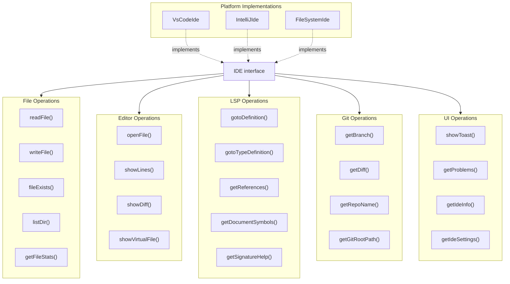
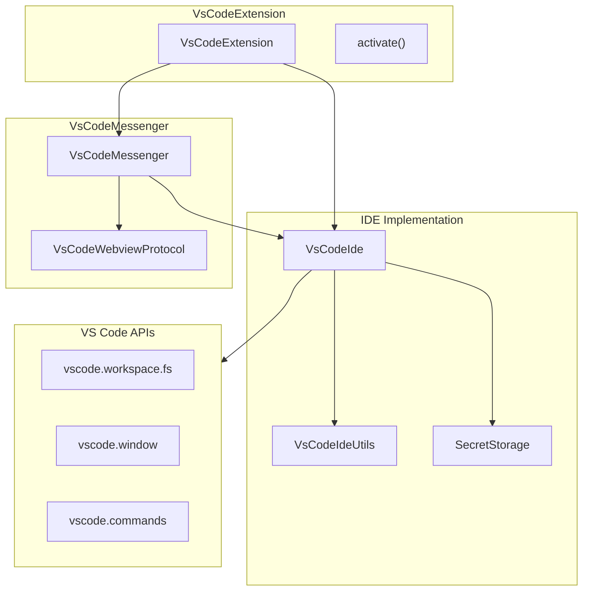
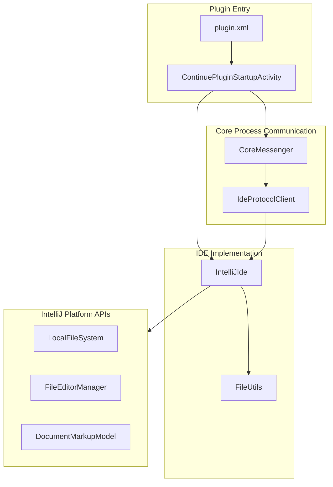
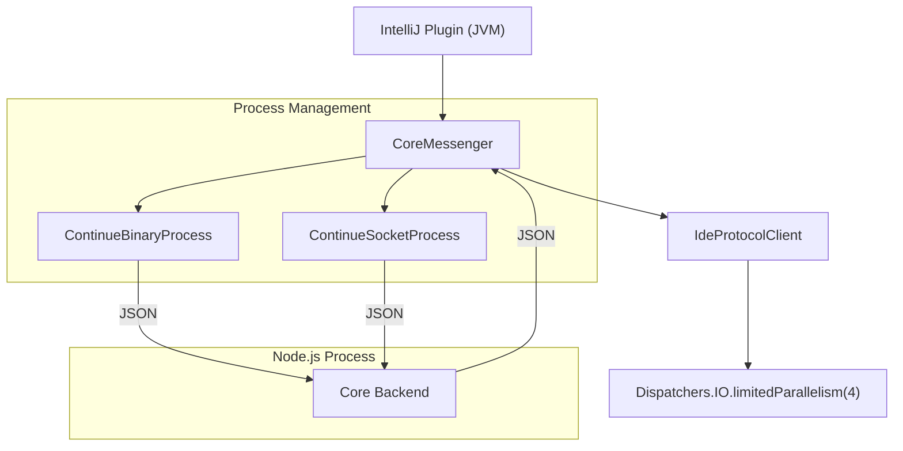

# IDE Integration Patterns

<details>
<summary>Relevant source files</summary>

The following files were used as context for generating this wiki page:

- [core/core.ts](core/core.ts)
- [core/protocol/core.ts](core/protocol/core.ts)
- [core/protocol/ide.ts](core/protocol/ide.ts)
- [core/protocol/ideWebview.ts](core/protocol/ideWebview.ts)
- [core/protocol/messenger/messageIde.ts](core/protocol/messenger/messageIde.ts)
- [core/protocol/messenger/reverseMessageIde.ts](core/protocol/messenger/reverseMessageIde.ts)
- [core/protocol/passThrough.ts](core/protocol/passThrough.ts)
- [core/protocol/webview.ts](core/protocol/webview.ts)
- [core/util/filesystem.ts](core/util/filesystem.ts)
- [extensions/intellij/src/main/kotlin/com/github/continuedev/continueintellijextension/constants/MessageTypes.kt](extensions/intellij/src/main/kotlin/com/github/continuedev/continueintellijextension/constants/MessageTypes.kt)
- [extensions/vscode/src/VsCodeIde.ts](extensions/vscode/src/VsCodeIde.ts)
- [extensions/vscode/src/commands.ts](extensions/vscode/src/commands.ts)
- [extensions/vscode/src/extension/VsCodeExtension.ts](extensions/vscode/src/extension/VsCodeExtension.ts)
- [extensions/vscode/src/extension/VsCodeMessenger.ts](extensions/vscode/src/extension/VsCodeMessenger.ts)
- [extensions/vscode/src/util/ideUtils.ts](extensions/vscode/src/util/ideUtils.ts)
- [gui/src/components/Layout.tsx](gui/src/components/Layout.tsx)
- [gui/src/components/mainInput/ContinueInputBox.tsx](gui/src/components/mainInput/ContinueInputBox.tsx)
- [gui/src/components/mainInput/InputToolbar.tsx](gui/src/components/mainInput/InputToolbar.tsx)
- [gui/src/components/modelSelection/ModelSelect.tsx](gui/src/components/modelSelection/ModelSelect.tsx)
- [gui/src/pages/gui/Chat.tsx](gui/src/pages/gui/Chat.tsx)

</details>


Continue supports multiple IDEs (VS Code, IntelliJ, CLI) through a unified `IDE` interface abstraction. Platform-specific implementations (`VsCodeIde`, `IntelliJIde`) translate IDE-native APIs to this common interface, allowing the core backend to remain platform-agnostic.

For overall system architecture, see [System Architecture](#2.1). For message protocols, see [Communication Protocols](#2.3).

---

## The IDE Interface Abstraction

The `IDE` interface defines methods across file operations, editor manipulation, Git integration, LSP queries, and UI interactions. This interface is the primary contract that the `Core` class uses to interact with the host environment [core/core.ts:130-130]().

**IDE Interface Method Categories**



Sources: [core/index.d.ts:47-47](), [extensions/vscode/src/VsCodeIde.ts:38-38](), [extensions/intellij/src/main/kotlin/com/github/continuedev/continueintellijextension/continue/IntelliJIde.kt:43-47]()

---

## VS Code Implementation Architecture

`VsCodeIde` implements the `IDE` interface using native VS Code APIs. The extension runs the core backend in-process within the Node.js runtime.

**VS Code Extension Component Structure**



Sources: [extensions/vscode/src/extension/VsCodeExtension.ts:63-80](), [extensions/vscode/src/VsCodeIde.ts:38-48](), [extensions/vscode/src/extension/VsCodeMessenger.ts:39-84]()

### VsCodeIde Method Implementations

| Method Category | Implementation Pattern | VS Code API / Code Entity |
|----------------|----------------------|-------------|
| File Operations | `vscode.workspace.fs` via `VsCodeIdeUtils` | `this.ideUtils.stat()` [extensions/vscode/src/VsCodeIde.ts:75-75]() |
| Editor Operations | `vscode.window` + utility functions | `openEditorAndRevealRange()` [extensions/vscode/src/VsCodeIde.ts:19-19]() |
| LSP Queries | `vscode.commands.executeCommand()` | `executeGotoProvider()` [extensions/vscode/src/VsCodeIde.ts:86-86]() |
| Git Operations | Git extension `Repository` API | `this.getRepo(dir)` [extensions/vscode/src/VsCodeIde.ts:168-168]() |
| Secrets | `SecretStorage` wrapper | `this.secretStorage.get(key)` [extensions/vscode/src/VsCodeIde.ts:51-51]() |
| UI Notifications | `vscode.window` notification methods | `showErrorMessage()` [extensions/vscode/src/VsCodeIde.ts:155-155]() |

Sources: [extensions/vscode/src/VsCodeIde.ts:73-83](), [extensions/vscode/src/VsCodeIde.ts:85-127](), [extensions/vscode/src/VsCodeIde.ts:148-165](), [extensions/vscode/src/VsCodeIde.ts:167-183]()

---

## IntelliJ Implementation Architecture

`IntelliJIde` implements the `IDE` interface using IntelliJ Platform APIs. Unlike VS Code, the core backend runs as a separate Node.js process communicating via JSON over stdin/stdout or TCP.

**IntelliJ Plugin Component Structure**



Sources: [extensions/intellij/src/main/resources/META-INF/plugin.xml:17-54](), [extensions/intellij/src/main/kotlin/com/github/continuedev/continueintellijextension/continue/IntelliJIde.kt:43-47](), [extensions/intellij/src/main/kotlin/com/github/continuedev/continueintellijextension/continue/CoreMessenger.kt:17-43]()

### IntelliJ Core Process Architecture

IntelliJ runs the core backend as a separate Node.js process to isolate it from the JVM. Communication is via JSON over stdin/stdout or TCP.

**Core Process Communication Flow**



The `IdeProtocolClient` uses `Dispatchers.IO.limitedParallelism(4)` to prevent UI freezing when handling concurrent IDE operations.

Sources: [extensions/intellij/src/main/kotlin/com/github/continuedev/continueintellijextension/continue/IdeProtocolClient.kt:34-53](), [extensions/intellij/src/main/kotlin/com/github/continuedev/continueintellijextension/continue/CoreMessenger.kt:36-43]()

---

## File System Operations

Both implementations provide file system operations but handle URI schemes and security ignores differently.

### VS Code File System Handling

VS Code natively supports multiple URI schemes through its file system provider API. The `VsCodeIde.fileExists()` method handles unsupported schemes gracefully using `VsCodeIdeUtils`.

```typescript
async fileExists(uri: string): Promise<boolean> {
  try {
    const stat = await this.ideUtils.stat(vscode.Uri.parse(uri));
    return stat !== null;
  } catch (error) {
    if (error instanceof vscode.FileSystemError) {
      return false;
    }
    throw error;
  }
}
```

Sources: [extensions/vscode/src/VsCodeIde.ts:73-83]()

### IntelliJ File System Handling

IntelliJ uses `VirtualFileManager` and `LocalFileSystem` for file operations. The implementation includes extensive security-focused ignore patterns (`DEFAULT_SECURITY_IGNORE_FILETYPES`) to prevent sensitive files like `.env` or SSH keys from being processed.

Sources: [extensions/intellij/src/main/kotlin/com/github/continuedev/continueintellijextension/continue/IntelliJIde.kt:50-111]()

---

## LSP Integration

Both implementations provide access to Language Server Protocol features, but through different mechanisms.

### VS Code LSP Integration

VS Code directly exposes LSP providers through `vscode.commands.executeCommand()`.

```typescript
async gotoDefinition(location: Location): Promise<RangeInFile[]> {
  const result = await executeGotoProvider({
    uri: vscode.Uri.parse(location.filepath),
    line: location.position.line,
    character: location.position.character,
    name: "vscode.executeDefinitionProvider",
  });
  return result;
}
```

Sources: [extensions/vscode/src/VsCodeIde.ts:85-94](), [extensions/vscode/src/VsCodeIde.ts:118-127]()

### IntelliJ LSP Integration

IntelliJ's implementation of LSP methods currently returns empty results or null as it primarily relies on its internal indexing and PSI for these features, which are not yet fully mapped to the `IDE` interface.

Sources: [extensions/intellij/src/main/kotlin/com/github/continuedev/continueintellijextension/continue/IntelliJIde.kt:120-121]()

---

## Platform Detection and Adaptation

Implementations provide `IdeInfo` to enable platform-specific behavior adaptation.

### IdeInfo Structure

**VsCodeIde.getIdeInfo()**:
```typescript
getIdeInfo(): Promise<IdeInfo> {
  return Promise.resolve({
    ideType: "vscode",
    name: vscode.env.appName,
    version: vscode.version,
    remoteName: vscode.env.remoteName || "local",
    extensionVersion: getExtensionVersion(),
    isPrerelease: isExtensionPrerelease(),
  });
}
```

Sources: [extensions/vscode/src/VsCodeIde.ts:201-210]()

**IntelliJIde.getIdeInfo()**:
```kotlin
override suspend fun getIdeInfo(): IdeInfo {
    val applicationInfo = ApplicationInfo.getInstance()
    val ideName: String = applicationInfo.fullApplicationName
    val ideVersion = applicationInfo.fullVersion
    // ... remote detection ...
    val plugin = PluginManagerCore.getPlugin(PluginId.getId(pluginId))
    val extensionVersion = plugin?.version ?: "Unknown"

    return IdeInfo(
        ideType = "jetbrains",
        name = ideName,
        version = ideVersion,
        remoteName = remoteName,
        extensionVersion = extensionVersion,
        isPrerelease = false
    )
}
```

Sources: [extensions/intellij/src/main/kotlin/com/github/continuedev/continueintellijextension/continue/IntelliJIde.kt:138-162]()