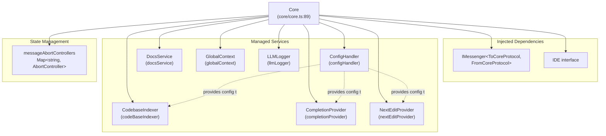
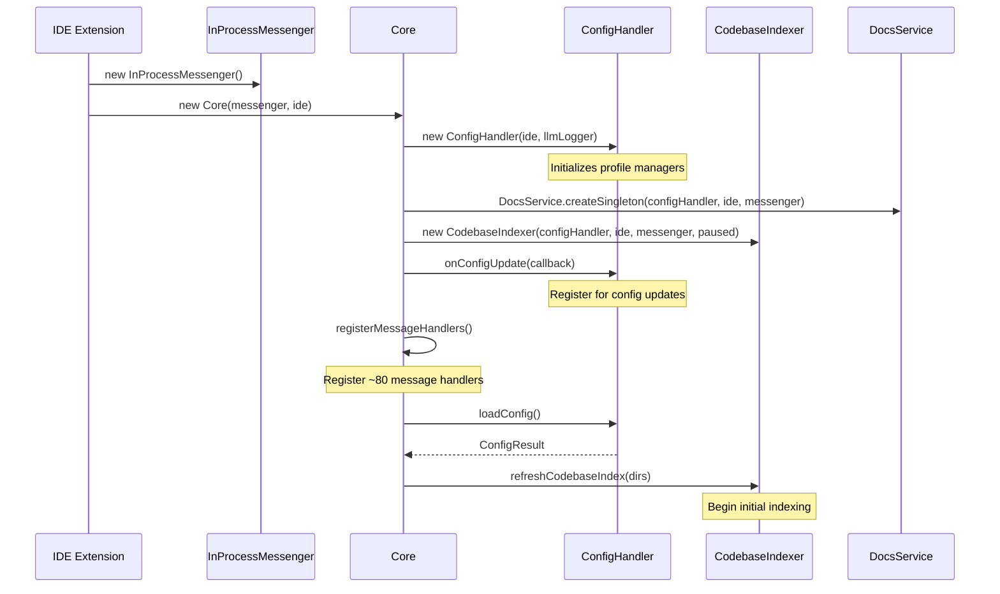
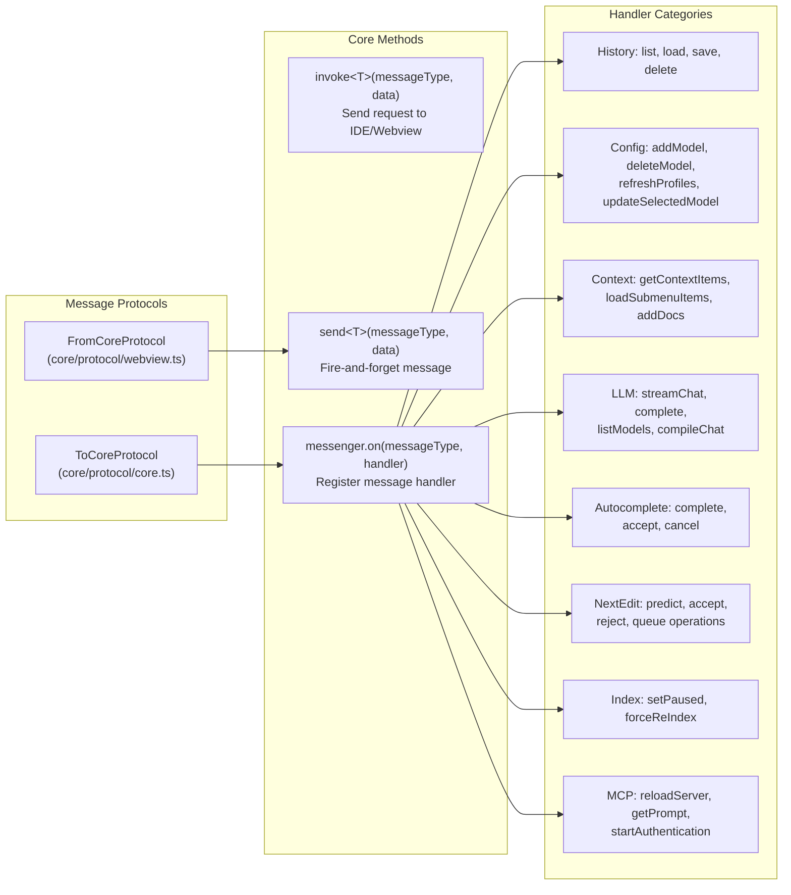
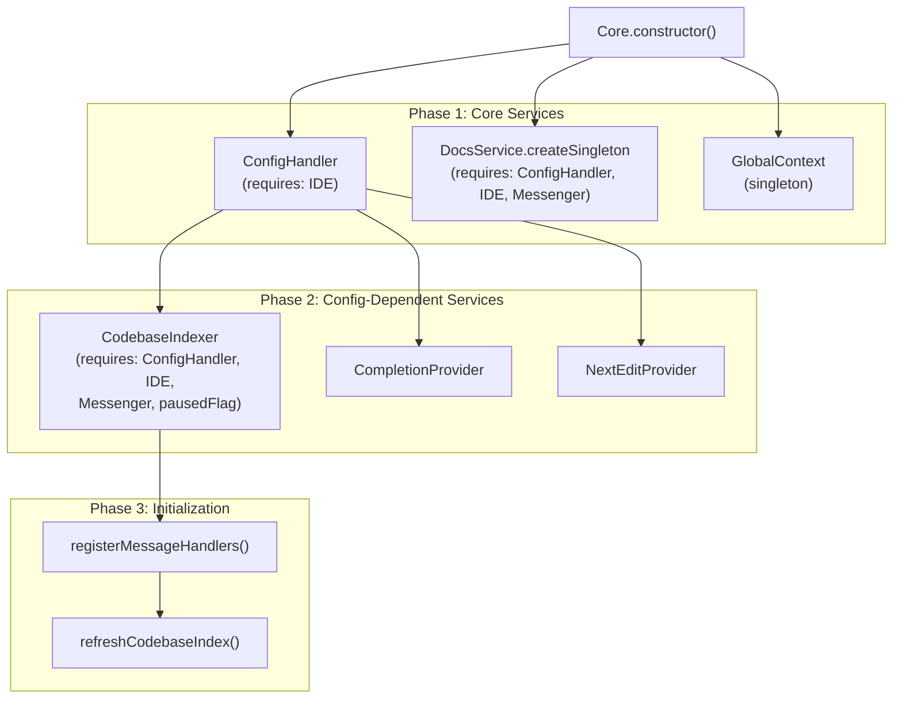

# Core System

Relevant source files

The following files were used as context for generating this wiki page:

- [core/core.ts](core/core.ts)
- [core/protocol/core.ts](core/protocol/core.ts)
- [core/protocol/ide.ts](core/protocol/ide.ts)
- [core/protocol/messenger/messageIde.ts](core/protocol/messenger/messageIde.ts)
- [core/protocol/messenger/reverseMessageIde.ts](core/protocol/messenger/reverseMessageIde.ts)
- [core/protocol/passThrough.ts](core/protocol/passThrough.ts)
- [core/protocol/webview.ts](core/protocol/webview.ts)
- [core/util/filesystem.ts](core/util/filesystem.ts)
- [extensions/intellij/src/main/kotlin/com/github/continuedev/continueintellijextension/constants/MessageTypes.kt](extensions/intellij/src/main/kotlin/com/github/continuedev/continueintellijextension/constants/MessageTypes.kt)
- [extensions/vscode/src/VsCodeIde.ts](extensions/vscode/src/VsCodeIde.ts)
- [extensions/vscode/src/extension/VsCodeExtension.ts](extensions/vscode/src/extension/VsCodeExtension.ts)
- [extensions/vscode/src/util/ideUtils.ts](extensions/vscode/src/util/ideUtils.ts)

The Core System is the central orchestration layer of Continue, responsible for business logic, service coordination, and message routing between the IDE, GUI, and external services. It acts as the single source of truth for configuration, manages stateful services like codebase indexing and autocomplete, and provides a unified message-based API for all client interactions.

For information about the GUI state management and user interface, see [User Interface](#8). For details on IDE-specific integrations, see [VS Code Extension](#6) and [IntelliJ Plugin](#7). For communication protocols, see [Communication Protocols](#2.3).

## Core Class Architecture

The `Core` class serves as the central hub that instantiates and coordinates all major services. It is initialized with an `IMessenger` and an `IDE` instance, then creates and manages the lifecycle of configuration, indexing, autocomplete, and other services.

**Core Class Structure**

Sources: [core/core.ts:89-106]()

The `Core` constructor performs several critical initialization steps:

1. **Configuration Management**: Creates a `ConfigHandler` to manage configuration loading and updates [core/core.ts:138]().
2. **Service Initialization**: Instantiates `DocsService` [core/core.ts:140](), `CodebaseIndexer` [core/core.ts:162](), and `NextEditProvider`.
3. **MCP Integration**: Sets up MCP connection refresh callbacks to trigger config reloads and UI updates [core/core.ts:146-160]().
4. **Message Handler Registration**: Registers all protocol handlers via `this.registerMessageHandlers()` [core/core.ts:281]().
5. **Indexing Setup**: Schedules initial codebase indexing based on workspace directories [core/core.ts:285-287]().

**Service Initialization Flow**

Sources: [core/core.ts:128-287](), [extensions/vscode/src/extension/VsCodeExtension.ts:181-200]()

## Message Routing Architecture

The Core system uses a message-passing architecture defined by the `ToCoreProtocol` and `FromCoreProtocol` type dictionaries. All interactions with the Core are asynchronous message-based calls, enabling IDE-agnostic operation.

**Message Protocol Structure**

Sources: [core/protocol/core.ts:63-354](), [core/core.ts:111-124]()

### Message Handler Registration

The `registerMessageHandlers()` method in Core binds all message types to their handler functions. This happens during Core construction and establishes the complete API surface.

**Abort Management**
The Core manages request cancellation using `messageAbortControllers`. Long-running requests like LLM streaming [core/core.ts:618]() or indexing [core/core.ts:851]() can be cancelled via the `abort` message [core/core.ts:313]().

Sources: [core/core.ts:98-109](), [core/core.ts:290-1186]()

### Pass-Through Messages

Many messages pass directly between the Webview and Core without IDE intervention. These are defined in pass-through lists to optimize routing across different IDE implementations.

| Pass-Through Direction | Source | Key Messages |
|------------------------|--------|--------------|
| `WEBVIEW_TO_CORE` | [core/protocol/passThrough.ts:9]() | `history/list`, `llm/streamChat`, `config/refreshProfiles`, `autocomplete/complete` |
| `CORE_TO_WEBVIEW` | [core/protocol/passThrough.ts:95]() | `configUpdate`, `indexProgress`, `refreshSubmenuItems`, `sessionUpdate` |

Sources: [core/protocol/passThrough.ts:1-110](), [extensions/intellij/src/main/kotlin/com/github/continuedev/continueintellijextension/constants/MessageTypes.kt:55-158]()

## Configuration Management

The configuration system is managed by the `ConfigHandler`. It orchestrates the loading of `config.yaml` or `config.json` files and handles profile management.

For details, see [Configuration Architecture](#5.1).

### Configuration Loading Pipeline

The `doLoadConfig()` function performs the multi-stage configuration loading process:

1. **Format Selection**: Prefers YAML over JSON if available.
2. **MCP Integration**: Connects to Model Context Protocol servers.
3. **Context Providers**: Initializes built-in and custom context providers.
4. **Model Rectification**: Applies saved model selections from `GlobalContext`.

Sources: [core/core.ts:138-144](), [core/core.ts:169-185]()

## Service Coordination

The Core class coordinates several stateful services that operate independently but share configuration and state.

### Primary Services

- **Core Orchestrator**: The central hub for all business logic. For details, see [Core Orchestrator](#3.1).
- **Message Routing**: Manages communication between components. For details, see [Message Routing](#3.2).
- **Context Providers**: Supplies context (files, docs, terminal) to LLMs. For details, see [Context Providers](#3.3).
- **Codebase Indexing**: Manages semantic search indexing using LanceDB. For details, see [Codebase Indexing](#3.4).
- **MCP Integration**: Connects to Model Context Protocol servers. For details, see [MCP Integration](#3.5).

### Service Lifecycle and Dependencies

Sources: [core/core.ts:128-287]()

## IDE Abstraction

The Core interacts with the IDE through the `IDE` interface. This allows the same business logic to run in VS Code, IntelliJ, or a CLI environment.

- **VS Code Implementation**: `VsCodeIde` [extensions/vscode/src/VsCodeIde.ts:38]().
- **File System Implementation**: `FileSystemIde` [core/util/filesystem.ts:22]().
- **Message-based Implementation**: `MessageIde` [core/protocol/messenger/messageIde.ts:21](), used when the Core runs in a separate process.

Sources: [core/index.d.ts:47](), [core/protocol/ide.ts:21-91]()