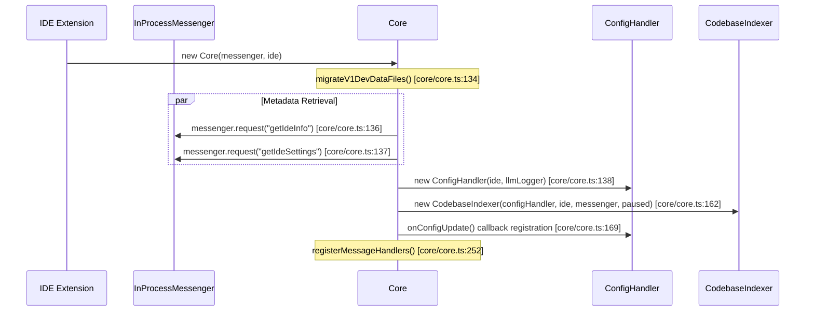

# Core Orchestrator

<details>
<summary>Relevant source files</summary>

The following files were used as context for generating this wiki page:

- [.continue/prompts/core-unit-test.prompt](.continue/prompts/core-unit-test.prompt)
- [core/context/retrieval/util.ts](core/context/retrieval/util.ts)
- [core/core.ts](core/core.ts)
- [core/edit/lazy/findInAst.test.ts](core/edit/lazy/findInAst.test.ts)
- [core/indexing/chunk/basic.test.ts](core/indexing/chunk/basic.test.ts)
- [core/indexing/docs/DocsService.skip.ts](core/indexing/docs/DocsService.skip.ts)
- [core/protocol/core.ts](core/protocol/core.ts)
- [core/protocol/ide.ts](core/protocol/ide.ts)
- [core/protocol/messenger/messageIde.ts](core/protocol/messenger/messageIde.ts)
- [core/protocol/messenger/reverseMessageIde.ts](core/protocol/messenger/reverseMessageIde.ts)
- [core/protocol/passThrough.ts](core/protocol/passThrough.ts)
- [core/protocol/webview.ts](core/protocol/webview.ts)
- [core/test/fixtures.ts](core/test/fixtures.ts)
- [core/util/chatDescriber.test.ts](core/util/chatDescriber.test.ts)
- [core/util/chatDescriber.ts](core/util/chatDescriber.ts)
- [core/util/extractMinimalStackTraceInfo.test.ts](core/util/extractMinimalStackTraceInfo.test.ts)
- [core/util/extractMinimalStackTraceInfo.ts](core/util/extractMinimalStackTraceInfo.ts)
- [core/util/fetchFavicon.test.ts](core/util/fetchFavicon.test.ts)
- [core/util/filesystem.ts](core/util/filesystem.ts)
- [core/util/index.test.ts](core/util/index.test.ts)
- [core/util/index.ts](core/util/index.ts)
- [core/util/messageContent.test.ts](core/util/messageContent.test.ts)
- [core/util/tts.ts](core/util/tts.ts)
- [core/util/withExponentialBackoff.test.ts](core/util/withExponentialBackoff.test.ts)
- [extensions/cli/src/util/exponentialBackoff.ts](extensions/cli/src/util/exponentialBackoff.ts)
- [extensions/cli/src/util/withExponentialBackoff.test.ts](extensions/cli/src/util/withExponentialBackoff.test.ts)
- [extensions/intellij/src/main/kotlin/com/github/continuedev/continueintellijextension/constants/MessageTypes.kt](extensions/intellij/src/main/kotlin/com/github/continuedev/continueintellijextension/constants/MessageTypes.kt)
- [extensions/vscode/src/VsCodeIde.ts](extensions/vscode/src/VsCodeIde.ts)
- [extensions/vscode/src/extension/VsCodeExtension.ts](extensions/vscode/src/extension/VsCodeExtension.ts)
- [extensions/vscode/src/util/ideUtils.ts](extensions/vscode/src/util/ideUtils.ts)

</details>


The Core Orchestrator is the central coordination hub of the Continue system, implemented by the `Core` class. It instantiates and manages all major business logic services (configuration, indexing, autocomplete, LLM interaction), registers message handlers for protocol operations, and serves as the bridge between IDE extensions, the GUI, and the underlying AI capabilities.

For information about the message routing protocols that Core uses to communicate, see [Communication Protocols](2.3). For details on individual services managed by Core, see [Configuration System](5), [Codebase Indexing](3.4), and [Autocomplete System](6.4).

## Purpose and Responsibilities

The `Core` class serves as the orchestrator with these key responsibilities:

- **Service Lifecycle Management**: Instantiates and owns `ConfigHandler`, `CodebaseIndexer`, `CompletionProvider`, `NextEditProvider`, and `DocsService` [core/core.ts:90-94]().
- **Message Protocol Coordination**: Registers handlers for all `ToCoreProtocol` message types and routes them to appropriate services [core/core.ts:290-1117]().
- **Configuration Propagation**: Listens to config updates via `onConfigUpdate` and notifies dependent services or the GUI [core/core.ts:169-210]().
- **Abort Signal Management**: Maintains `messageAbortControllers` for cancellable operations like LLM streaming [core/core.ts:98-106]().

Sources: [core/core.ts:89-109](), [core/core.ts:290-1117]()

## System Architecture

The following diagram bridges the "Natural Language Space" of system concepts to the "Code Entity Space" by mapping orchestrator components to their implementation classes.

**Core Component Mapping**
```mermaid
graph TB
    subgraph "IDE Layer [Code Entity Space]"
        VsCodeIde["VsCodeIde (IDE Implementation)"]
        IntelliJIde["IntelliJIde (IDE Implementation)"]
    end
    
    subgraph "Communication [Code Entity Space]"
        IMessenger["IMessenger Interface"]
        ToCoreProtocol["ToCoreProtocol (Message Schema)"]
    end
    
    subgraph "Core Orchestrator [Code Entity Space]"
        Core["class Core"]
        AbortMap["messageAbortControllers: Map"]
    end
    
    subgraph "Managed Services [Code Entity Space]"
        ConfigHandler["ConfigHandler"]
        CodebaseIndexer["CodebaseIndexer"]
        CompletionProvider["CompletionProvider"]
        NextEditProvider["NextEditProvider"]
        DocsService["DocsService"]
    end
    
    VsCodeIde --- IMessenger
    IntelliJIde --- IMessenger
    IMessenger -->|routes to| Core [core/core.ts:129]()
    
    Core -->|instantiates| ConfigHandler [core/core.ts:138]()
    Core -->|instantiates| CodebaseIndexer [core/core.ts:162]()
    Core -->|instantiates| CompletionProvider [core/core.ts:220]()
    Core -->|instantiates| NextEditProvider [core/core.ts:237]()
    Core -->|instantiates| DocsService [core/core.ts:140]()
    
    Core -->|manages| AbortMap [core/core.ts:98]()
```

Sources: [core/core.ts:89-106](), [core/core.ts:128-182](), [core/protocol/ide.ts:21-91]()

## Core Initialization Sequence

The `Core` constructor performs a carefully orchestrated initialization sequence to set up the environment before processing messages.

**Initialization Data Flow**


Key initialization steps:

1.  **Directory Migration**: Calls `migrateV1DevDataFiles()` to ensure the `.continue` directory structure and data are up to date [core/core.ts:134]().
2.  **Async Metadata**: Requests `getIdeInfo` and `getIdeSettings` from the IDE via the messenger [core/core.ts:136-137]().
3.  **Service Instantiation**:
    *   `ConfigHandler` is initialized first to handle settings and LLM configuration [core/core.ts:138]().
    *   `DocsService` is created as a singleton to manage documentation indexing [core/core.ts:140]().
    *   `CodebaseIndexer` is initialized with the current indexing pause state from `GlobalContext` [core/core.ts:162-167]().
4.  **MCP Synchronization**: Configures `MCPManagerSingleton` to trigger a config reload whenever Model Context Protocol connections are refreshed [core/core.ts:146-160]().
5.  **Config Update Subscriptions**: Registers a listener that pushes `configUpdate` messages to the webview and triggers codebase re-indexing if new indexes were added [core/core.ts:169-210]().

Sources: [core/core.ts:128-210]()

## Service Management

### Owned Services and Their Roles

| Service | Property Name | Purpose | Key Dependencies |
| :--- | :--- | :--- | :--- |
| `ConfigHandler` | `configHandler` | Loads and manages configuration, handles profiles and MCP server integration | `IDE`, `LLMLogger` [core/core.ts:90, 138]() |
| `CodebaseIndexer` | `codeBaseIndexer` | Manages the lifecycle of codebase embeddings and vector database synchronization | `ConfigHandler`, `IDE`, `IMessenger` [core/core.ts:91, 162]() |
| `CompletionProvider` | `completionProvider` | Orchestrates tab-autocomplete logic and model interaction | `ConfigHandler`, `IDE`, `IMessenger` [core/core.ts:92, 220]() |
| `NextEditProvider` | `nextEditProvider` | Predicts the next logical edit location based on recent changes | `ConfigHandler`, `IDE` [core/core.ts:93, 237]() |
| `DocsService` | `docsService` (private) | Handles crawling and indexing of external documentation sites | `ConfigHandler`, `IDE`, `IMessenger` [core/core.ts:94, 140]() |

Sources: [core/core.ts:90-94](), [core/core.ts:138-248]()

### Service Coordination via Config Updates

The Core coordinates service updates through the `ConfigHandler.onConfigUpdate` callback. When configuration changes (e.g., a user edits `config.json` or switches profiles), Core ensures all subsystems are notified [core/core.ts:169]().

1.  **Webview Notification**: Core serializes the new config and sends it to the webview via the `configUpdate` message [core/core.ts:173]().
2.  **Indexing Refresh**: If the configuration update added new indexes, Core triggers `codeBaseIndexer.refreshCodebaseIndex()` [core/core.ts:180-184]().
3.  **Submenu Refresh**: MCP providers and other context providers are refreshed in the UI via `refreshSubmenuItems` [core/core.ts:156, 191]().

Sources: [core/core.ts:169-210]()

## Message Protocol Implementation

### Message Handler Registration

The `registerMessageHandlers` method (called during initialization) sets up the routing logic for all incoming requests from the IDE or Webview [core/core.ts:252]().

Handler categories:

*   **History**: Handlers for `history/list`, `history/load`, and `history/save` manage session persistence [core/protocol/core.ts:70-73]().
*   **LLM Interaction**: `llm/streamChat` routes chat requests through `llmStreamChat` [core/core.ts:618](), while `llm/complete` handles non-streaming completions [core/core.ts:599]().
*   **Context**: `context/getContextItems` coordinates context providers to gather information for prompts [core/core.ts:717]().
*   **Indexing**: `index/forceReIndex` and `index/setPaused` control the `CodebaseIndexer` [core/core.ts:1017, 1030]().

Sources: [core/core.ts:290-1117](), [core/protocol/core.ts:63-242]()

### Abort Controller Management

Core maintains a `Map<string, AbortController>` to support cancellation of long-running LLM requests [core/core.ts:98]().

1.  **Creation**: When a streaming request starts (e.g., `llm/streamChat`), Core calls `addMessageAbortController(id)` [core/core.ts:99]().
2.  **Association**: The resulting `AbortSignal` is passed to the LLM provider or indexing service [core/core.ts:625]().
3.  **Cancellation**: If the user clicks "Stop" in the GUI, an `abort` message is sent to Core, which calls `abortById(messageId)` to trigger the signal [core/core.ts:107, 314]().

Sources: [core/core.ts:98-109](), [core/core.ts:314](), [core/core.ts:618-628]()

## Helper Methods and Utilities

### Protocol Wrappers

Core provides high-level wrappers around the `IMessenger` to simplify communication with other components:

*   **`invoke`**: Used to send a request to the IDE and await a typed response [core/core.ts:111-116]().
*   **`send`**: Used to fire-and-forget messages to the Webview or IDE [core/core.ts:118-124]().

Sources: [core/core.ts:111-124]()

### IDE Abstraction Integration

Core interacts with the IDE through the `IDE` interface, which is implemented differently for VS Code and IntelliJ. This allows the Core logic to remain platform-agnostic while performing file operations, running terminal commands, or accessing LSP features.

| Feature | Implementation Method | Protocol Mapping |
| :--- | :--- | :--- |
| File Read | `ide.readFile(path)` | `readFile` [core/protocol/ide.ts:36]() |
| LSP Symbols | `ide.getDocumentSymbols(uri)` | `getDocumentSymbols` [core/protocol/ide.ts:87]() |
| Terminal | `ide.runCommand(cmd)` | `runCommand` [core/protocol/ide.ts:30]() |

Sources: [core/core.ts:130](), [core/protocol/ide.ts:21-91](), [extensions/vscode/src/VsCodeIde.ts:38]()