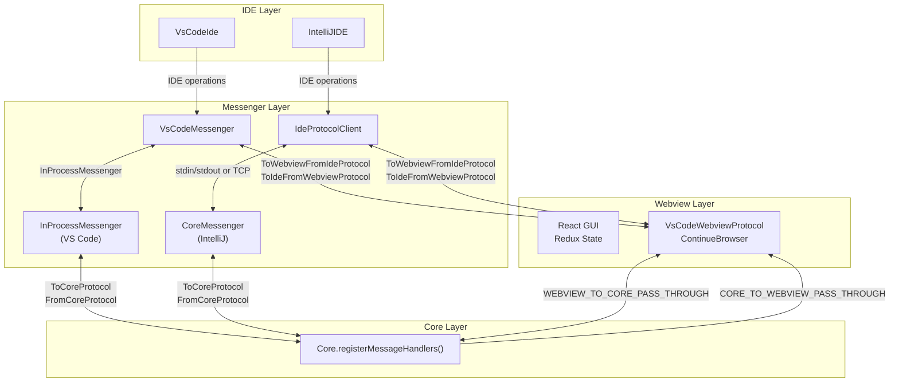
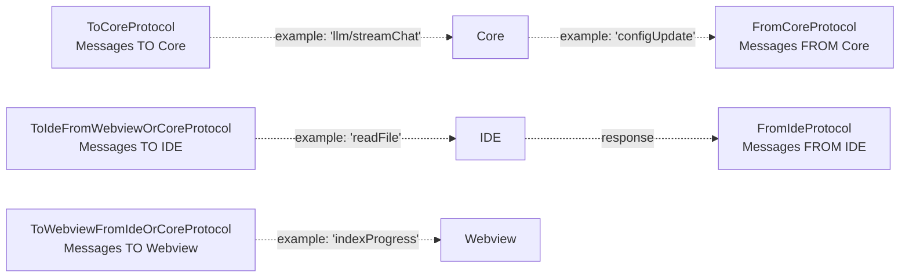
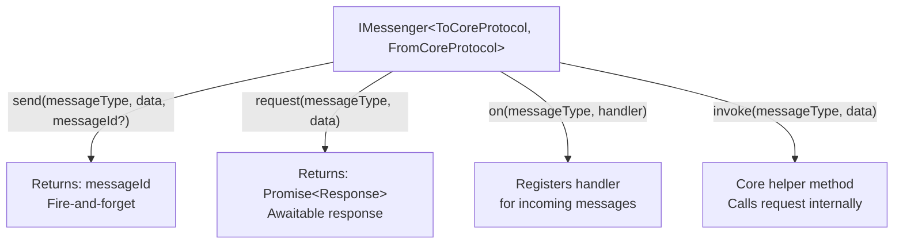
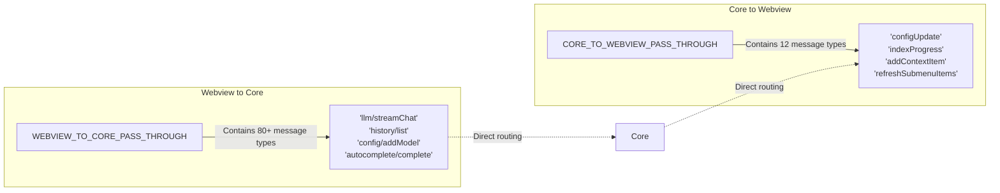
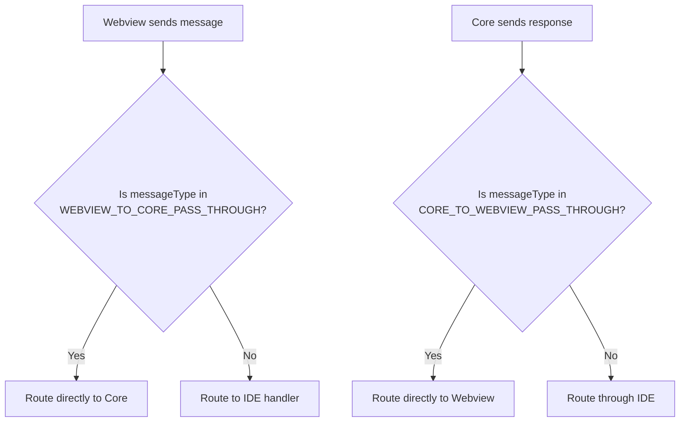
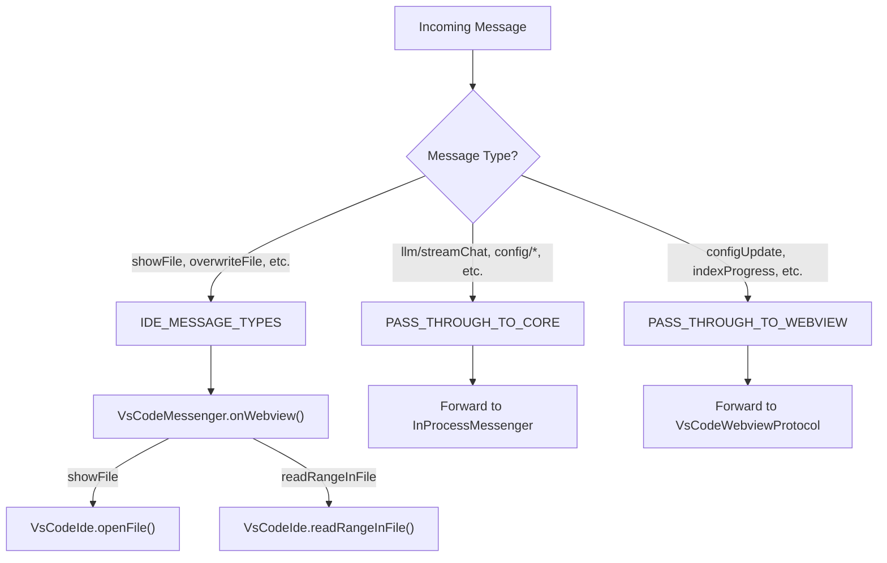

# Message Routing

<details>
<summary>Relevant source files</summary>

The following files were used as context for generating this wiki page:

- [core/core.ts](core/core.ts)
- [core/protocol/core.ts](core/protocol/core.ts)
- [core/protocol/ide.ts](core/protocol/ide.ts)
- [core/protocol/ideWebview.ts](core/protocol/ideWebview.ts)
- [core/protocol/messenger/messageIde.ts](core/protocol/messenger/messageIde.ts)
- [core/protocol/messenger/reverseMessageIde.ts](core/protocol/messenger/reverseMessageIde.ts)
- [core/protocol/passThrough.ts](core/protocol/passThrough.ts)
- [core/protocol/webview.ts](core/protocol/webview.ts)
- [core/util/filesystem.ts](core/util/filesystem.ts)
- [extensions/intellij/src/main/kotlin/com/github/continuedev/continueintellijextension/constants/MessageTypes.kt](extensions/intellij/src/main/kotlin/com/github/continuedev/continueintellijextension/constants/MessageTypes.kt)
- [extensions/vscode/src/VsCodeIde.ts](extensions/vscode/src/VsCodeIde.ts)
- [extensions/vscode/src/commands.ts](extensions/vscode/src/commands.ts)
- [extensions/vscode/src/extension/VsCodeExtension.ts](extensions/vscode/src/extension/VsCodeExtension.ts)
- [extensions/vscode/src/extension/VsCodeMessenger.ts](extensions/vscode/src/extension/VsCodeMessenger.ts)
- [extensions/vscode/src/util/ideUtils.ts](extensions/vscode/src/util/ideUtils.ts)
- [gui/src/components/Layout.tsx](gui/src/components/Layout.tsx)
- [gui/src/components/mainInput/ContinueInputBox.tsx](gui/src/components/mainInput/ContinueInputBox.tsx)
- [gui/src/components/mainInput/InputToolbar.tsx](gui/src/components/mainInput/InputToolbar.tsx)
- [gui/src/components/modelSelection/ModelSelect.tsx](gui/src/components/modelSelection/ModelSelect.tsx)
- [gui/src/pages/gui/Chat.tsx](gui/src/pages/gui/Chat.tsx)

</details>


This document details the message routing system that enables communication between Continue's three main architectural layers: the IDE extensions, the Core business logic module, and the GUI webview. It covers the `IMessenger` interface, protocol definitions, pass-through routing mechanisms, and handler registration patterns.

For information about the overall system architecture and how these components fit together, see [System Architecture](#2.1). For details on the communication protocols themselves, see [Communication Protocols](#2.3).

## Message Routing Architecture

Continue uses a message-passing architecture to maintain strict separation between the IDE layer, Core business logic, and GUI components. All communication flows through typed message protocols with specific routing rules.

### Three-Layer Communication Model

The following diagram illustrates how messages flow between the specialized IDE implementations, the central Core process, and the React-based GUI.

Title: Three-Layer Message Flow


**Sources:** [core/core.ts:128-131](), [extensions/vscode/src/extension/VsCodeMessenger.ts:39-84](), [extensions/vscode/src/extension/VsCodeExtension.ts:172-185]()

## Protocol Definitions

Message routing is governed by strictly-typed protocol definitions that specify the message types, their payloads, and return types.

### Core Protocol Types

Title: Protocol Data Flow


The protocol types are defined as TypeScript mapped types where each key is a message type and the value is a tuple of `[RequestPayload, ResponseType]`.

**Sources:** [core/protocol/core.ts:63-245](), [core/protocol/passThrough.ts:1-110]()

### Message Type Categories

Messages are categorized by their routing destination:

| Category | Description | Example Message Types |
|----------|-------------|----------------------|
| **IDE-bound** | Operations requiring IDE-specific APIs | `showFile`, `overwriteFile`, `insertAtCursor` |
| **Core-bound** | Business logic operations | `llm/streamChat`, `config/addModel`, `index/setPaused` |
| **Webview-bound** | UI state updates | `configUpdate`, `indexProgress`, `addContextItem` |
| **Pass-through** | Direct routing between layers | See Pass-Through Routing section |

**Sources:** [core/protocol/core.ts:63-245](), [core/protocol/passThrough.ts:9-109](), [core/protocol/ideWebview.ts:16-82]()

## The IMessenger Interface

The `IMessenger` interface provides the abstraction for all message routing operations. While the interface itself is defined in TypeScript, both VS Code and IntelliJ implement compatible message routing mechanisms.

### Core Messenger Methods

Title: IMessenger Interface Capabilities


The `Core` class uses the messenger through helper methods:

```typescript
// Core class usage (core/core.ts:111-124)
invoke<T extends keyof ToCoreProtocol>(
  messageType: T,
  data: ToCoreProtocol[T][0],
): ToCoreProtocol[T][1] {
  return this.messenger.invoke(messageType, data);
}

send<T extends keyof FromCoreProtocol>(
  messageType: T,
  data: FromCoreProtocol[T][0],
  messageId?: string,
): string {
  return this.messenger.send(messageType, data, messageId);
}
```

**Sources:** [core/core.ts:111-124](), [core/protocol/messenger/index.ts]()

## Pass-Through Routing

Pass-through routing allows messages to bypass intermediate layers for efficiency, enabling direct communication between the Webview and Core without going through the IDE messenger logic.

### Pass-Through Message Lists

Two critical lists define which messages can pass through:

Title: Pass-Through Logic Categories


The lists are maintained in `core/protocol/passThrough.ts` and must be kept synchronized with platform-specific implementations like the IntelliJ Kotlin extension.

**Sources:** [core/protocol/passThrough.ts:9-109]()

### Pass-Through Routing Logic

Title: Routing Decision Process


**Sources:** [extensions/vscode/src/extension/VsCodeMessenger.ts:13-16](), [core/protocol/passThrough.ts:9-109]()

## Message Handler Registration

The `Core` class registers handlers for incoming messages using the `on()` method of the messenger. This happens during Core initialization.

### Abort Controller Management

The `Core` class maintains abort controllers for cancellable operations such as streaming LLM responses or long-running indexing tasks.

```typescript
// Abort controller management (core/core.ts:98-109)
private messageAbortControllers = new Map<string, AbortController>();
private addMessageAbortController(id: string): AbortController {
  const controller = new AbortController();
  this.messageAbortControllers.set(id, controller);
  controller.signal.addEventListener("abort", () => {
    this.messageAbortControllers.delete(id);
  });
  return controller;
}
private abortById(messageId: string) {
  this.messageAbortControllers.get(messageId)?.abort();
}
```

**Sources:** [core/core.ts:98-109]()

## Platform-Specific Implementations

Message routing is implemented differently for VS Code (in-process) and IntelliJ (separate process).

### VS Code: VsCodeMessenger

In VS Code, the `VsCodeMessenger` acts as a shared hub between Core and Webview. It registers handlers for both `onWebview` and `onCore` events.

```typescript
// VsCodeMessenger handler registration (extensions/vscode/src/extension/VsCodeMessenger.ts:39-70)
export class VsCodeMessenger {
  onWebview<T extends keyof FromWebviewProtocol>(messageType: T, handler: ...): void {
    void this.webviewProtocol.on(messageType, handler);
  }

  onCore<T extends keyof ToIdeOrWebviewFromCoreProtocol>(messageType: T, handler: ...): void {
    this.inProcessMessenger.externalOn(messageType, handler);
  }
}
```

**Sources:** [extensions/vscode/src/extension/VsCodeMessenger.ts:39-70]()

### IDE Message Routing

Both platforms route IDE-specific messages to their respective IDE implementations (e.g., `VsCodeIde`).

Title: IDE-Specific Message Dispatch


**Sources:** [extensions/vscode/src/extension/VsCodeMessenger.ts:86-193](), [extensions/vscode/src/VsCodeIde.ts:212-221]()

## Message Flow Examples

### Example 1: Webview to Core Request (Pass-Through)

1. **GUI** sends a `config/getSerializedProfileInfo` message via `ideMessenger.post` or `request`.
2. **VsCodeMessenger** identifies this as a pass-through message for Core [core/protocol/passThrough.ts:26]().
3. **Core** receives the request and returns the serialized configuration [core/core.ts:171-178]().

**Sources:** [core/protocol/passThrough.ts:26](), [core/core.ts:171-178]()

### Example 2: File Reading (IDE Operation)

1. **Core** requests `readRangeInFile` from the IDE.
2. **Messenger** identifies this as an IDE-bound operation.
3. **VsCodeIde** performs the operation using VS Code APIs [extensions/vscode/src/VsCodeIde.ts:212-220]().
4. The result is returned to Core.

**Sources:** [extensions/vscode/src/VsCodeIde.ts:212-220](), [extensions/vscode/src/extension/VsCodeMessenger.ts:60-70]()