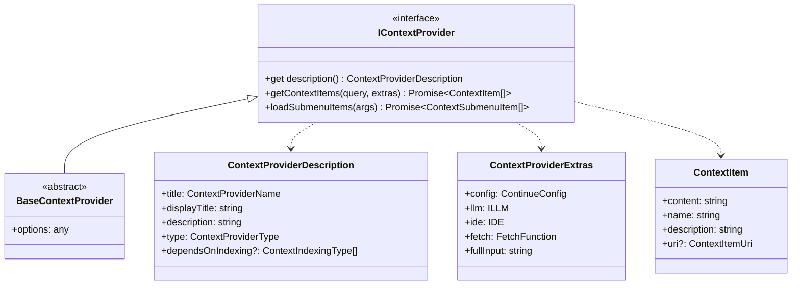
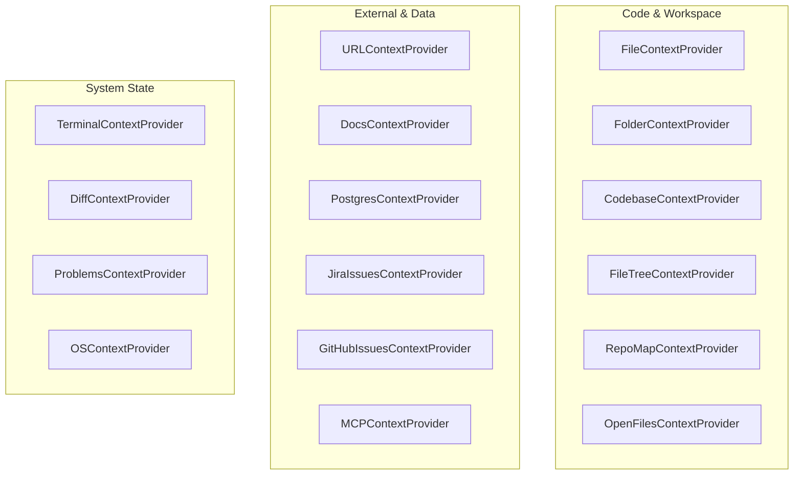
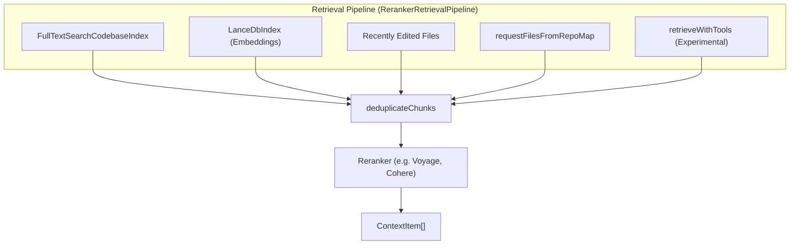
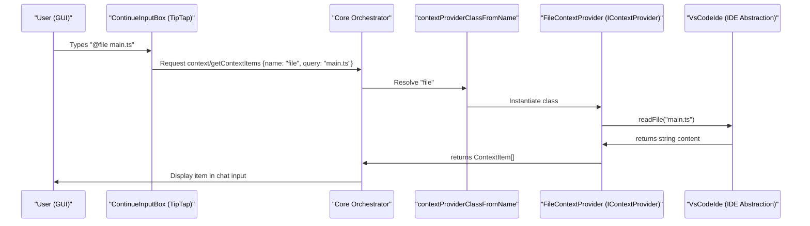
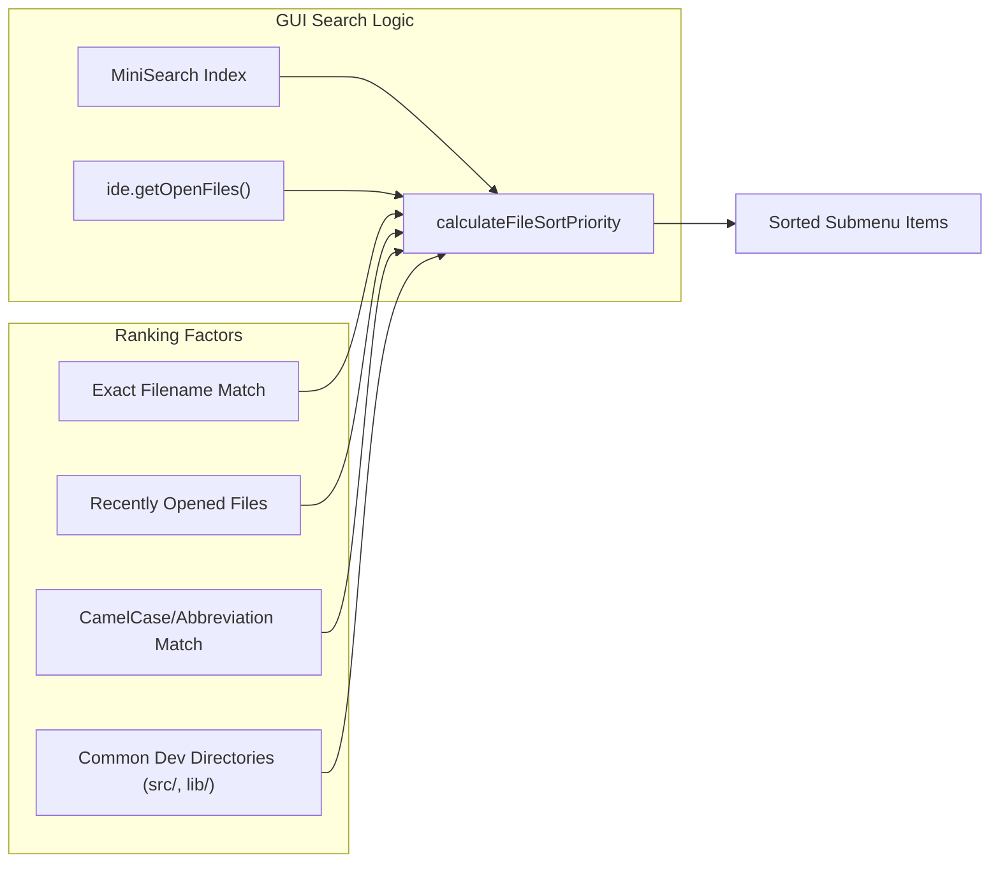

# Context Providers

<details>
<summary>Relevant source files</summary>

The following files were used as context for generating this wiki page:

- [core/context/index.ts](core/context/index.ts)
- [core/context/providers/CurrentFileContextProvider.ts](core/context/providers/CurrentFileContextProvider.ts)
- [core/context/providers/DatabaseContextProvider.ts](core/context/providers/DatabaseContextProvider.ts)
- [core/context/providers/DiffContextProvider.ts](core/context/providers/DiffContextProvider.ts)
- [core/context/providers/FileContextProvider.ts](core/context/providers/FileContextProvider.ts)
- [core/context/providers/FileTreeContextProvider.ts](core/context/providers/FileTreeContextProvider.ts)
- [core/context/providers/FolderContextProvider.ts](core/context/providers/FolderContextProvider.ts)
- [core/context/providers/GitHubIssuesContextProvider.ts](core/context/providers/GitHubIssuesContextProvider.ts)
- [core/context/providers/GitLabMergeRequestContextProvider.ts](core/context/providers/GitLabMergeRequestContextProvider.ts)
- [core/context/providers/GoogleContextProvider.ts](core/context/providers/GoogleContextProvider.ts)
- [core/context/providers/GreptileContextProvider.ts](core/context/providers/GreptileContextProvider.ts)
- [core/context/providers/JiraIssuesContextProvider/JiraClient.ts](core/context/providers/JiraIssuesContextProvider/JiraClient.ts)
- [core/context/providers/JiraIssuesContextProvider/index.ts](core/context/providers/JiraIssuesContextProvider/index.ts)
- [core/context/providers/OpenFilesContextProvider.ts](core/context/providers/OpenFilesContextProvider.ts)
- [core/context/providers/PostgresContextProvider.ts](core/context/providers/PostgresContextProvider.ts)
- [core/context/providers/ProblemsContextProvider.ts](core/context/providers/ProblemsContextProvider.ts)
- [core/context/providers/RepoMapContextProvider.ts](core/context/providers/RepoMapContextProvider.ts)
- [core/context/providers/SearchContextProvider.ts](core/context/providers/SearchContextProvider.ts)
- [core/context/providers/TerminalContextProvider.ts](core/context/providers/TerminalContextProvider.ts)
- [core/context/providers/URLContextProvider.ts](core/context/providers/URLContextProvider.ts)
- [core/context/providers/index.ts](core/context/providers/index.ts)
- [core/context/retrieval/pipelines/BaseRetrievalPipeline.ts](core/context/retrieval/pipelines/BaseRetrievalPipeline.ts)
- [core/context/retrieval/pipelines/NoRerankerRetrievalPipeline.ts](core/context/retrieval/pipelines/NoRerankerRetrievalPipeline.ts)
- [core/context/retrieval/pipelines/RerankerRetrievalPipeline.ts](core/context/retrieval/pipelines/RerankerRetrievalPipeline.ts)
- [core/context/retrieval/repoMapRequest.ts](core/context/retrieval/repoMapRequest.ts)
- [core/context/retrieval/retrieval.ts](core/context/retrieval/retrieval.ts)
- [core/util/generateRepoMap.ts](core/util/generateRepoMap.ts)
- [core/util/grepSearch.ts](core/util/grepSearch.ts)
- [extensions/vscode/src/lang-server/promptFileCompletions.ts](extensions/vscode/src/lang-server/promptFileCompletions.ts)
- [extensions/vscode/src/util/FileSearch.ts](extensions/vscode/src/util/FileSearch.ts)
- [gui/src/context/SubmenuContextProviders.tsx](gui/src/context/SubmenuContextProviders.tsx)

</details>


Context Providers are the mechanism for supplying relevant information to the LLM during conversations. They implement a standard interface for retrieving data from various sources—such as files, terminal output, documentation, or external APIs—and packaging it as `ContextItem` objects that are attached to chat messages.

This document covers the `IContextProvider` interface, built-in provider implementations, and the data flow between the IDE, Core, and GUI.

## Context Provider Interface

The core abstraction is the `IContextProvider` interface, which all context providers must implement. Most providers extend `BaseContextProvider` to inherit default behaviors.

Title: Context Provider Class Hierarchy


**Sources:** [core/index.d.ts:181-273](), [core/context/index.ts:10-30]()

### Provider Types and Interaction

Context providers are categorized by how users interact with them in the UI:

| Type | Interaction Pattern | Example |
| :--- | :--- | :--- |
| `normal` | Immediate attachment when mentioned. | `@terminal`, `@diff` |
| `query` | Requires user text input after the provider name. | `@url https://...`, `@google search query` |
| `submenu` | Triggers a searchable dropdown list of items. | `@file`, `@folder`, `@codebase` |

**Sources:** [core/index.d.ts:181-186](), [core/context/providers/URLContextProvider.ts:19-19](), [core/context/providers/FileContextProvider.ts:24-24]()

## Built-In Providers

Continue includes a wide array of built-in providers registered in the `Providers` array within `core/context/providers/index.ts`.

Title: Built-in Context Providers Categorization


**Sources:** [core/context/providers/index.ts:43-75]()

### Implementation Highlights

#### File and Folder Context
- **`FileContextProvider`**: Uses `walkDirs` to populate submenu items (up to 10,000 items) and `ide.readFile` to retrieve content. [core/context/providers/FileContextProvider.ts:17-77]()
- **`FolderContextProvider`**: Often relies on the retrieval pipeline. It uses `retrieveContextItemsFromEmbeddings` to perform semantic search restricted to a specific directory. [core/context/providers/FolderContextProvider.ts:16-30]()
- **`RepoMapContextProvider`**: Generates a high-level overview of the repository structure using `generateRepoMap`. It can be scoped to specific folders or the entire codebase. [core/context/providers/RepoMapContextProvider.ts:22-48]()
- **`FileTreeContextProvider`**: Recursively walks workspace directories via `walkDir` to build a string representation of the project structure. [core/context/providers/FileTreeContextProvider.ts:39-91]()

#### Retrieval Pipeline and Codebase Context
The `@codebase` provider (via `CodebaseContextProvider`) utilizes a sophisticated retrieval pipeline to find relevant snippets.

Title: Retrieval Pipeline Data Flow


- **Reranking**: If a reranker is configured, `RerankerRetrievalPipeline` is used to refine results from multiple sources. [core/context/retrieval/retrieval.ts:57-59]()
- **Repo Map Retrieval**: `requestFilesFromRepoMap` uses an LLM to look at the repo map and select the 5-10 most relevant files before reading them. [core/context/retrieval/repoMapRequest.ts:34-103]()

**Sources:** [core/context/retrieval/retrieval.ts:11-130](), [core/context/retrieval/pipelines/BaseRetrievalPipeline.ts:60-205](), [core/context/retrieval/pipelines/RerankerRetrievalPipeline.ts:12-90]()

#### Web and External Data
- **`URLContextProvider`**: Uses `jsdom` and `@mozilla/readability` to extract the main content from a webpage, converting it to Markdown via `node-html-markdown`. [core/context/providers/URLContextProvider.ts:32-72]()
- **`JiraIssuesContextProvider`**: Uses a `JiraClient` to fetch issue summaries, descriptions (converted from ADF to Markdown), and comments. [core/context/providers/JiraIssuesContextProvider/JiraClient.ts:67-185]()

#### IDE State
- **`TerminalContextProvider`**: Calls `ide.getTerminalContents()` to provide the LLM with recent command output. [core/context/providers/TerminalContextProvider.ts:8-30]()
- **`DiffContextProvider`**: Retrieves the current git diff via `ide.getDiff(includeUnstaged)`. [core/context/providers/DiffContextProvider.ts:8-32]()
- **`OpenFilesContextProvider`**: Fetches content from all currently open or pinned tabs using `ide.getOpenFiles` or `ide.getPinnedFiles`. [core/context/providers/OpenFilesContextProvider.ts:19-59]()

## Data Flow: Natural Language to Code Entity

The following diagram bridges the gap between the user's natural language input in the GUI and the underlying code entities that resolve context.

Title: Context Resolution Sequence


**Sources:** [gui/src/context/SubmenuContextProviders.tsx:144-217](), [core/context/providers/index.ts:77-83](), [core/context/providers/FileContextProvider.ts:27-51]()

## Submenu Search and Ranking

For providers like `@file`, the GUI implements intelligent sorting and searching using `MiniSearch` in the `SubmenuContextProvidersProvider`.

Title: GUI Context Submenu Ranking Logic


The GUI uses `getShortestUniqueRelativeUriPaths` to ensure that files with the same name in different directories are distinguishable in the submenu (e.g., `src/utils/index.ts` vs `lib/utils/index.ts`).

**Sources:** [gui/src/context/SubmenuContextProviders.tsx:25-137](), [gui/src/context/SubmenuContextProviders.tsx:224-255](), [core/util/uri.ts:12-15]()

## Loading and Registration

Context providers are resolved at runtime based on the `config.json` or `config.yaml`. The `contextProviderClassFromName` utility finds the correct class implementation.

```typescript
export function contextProviderClassFromName(
  name: ContextProviderName,
): typeof BaseContextProvider | undefined {
  const provider = Providers.find((cls) => cls.description.title === name);
  return provider;
}
```

**Sources:** [core/context/providers/index.ts:77-83]()

### MCP Integration

The `MCPContextProvider` acts as a bridge for the Model Context Protocol. It allows external MCP servers to provide resources that appear as context items. This enables a plugin-like architecture where third-party services can supply context without modifying the Continue core.

**Sources:** [core/context/providers/MCPContextProvider.ts:1-24](), [core/context/providers/index.ts:71-71]()