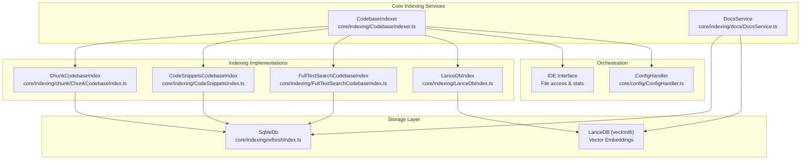
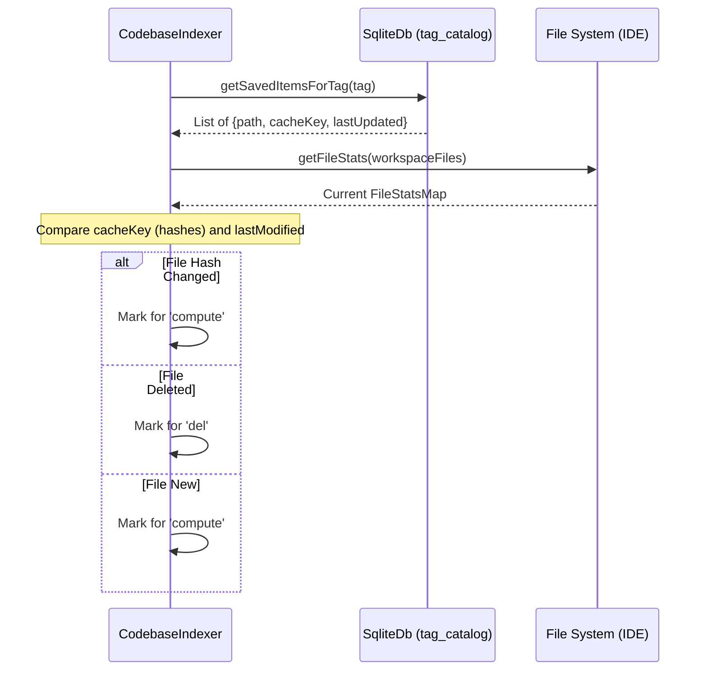
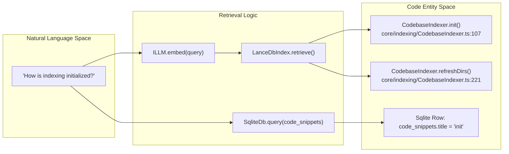

# Codebase Indexing

Relevant source files

The following files were used as context for generating this wiki page:

- [core/autocomplete/classification/shouldCompleteMultiline.ts](core/autocomplete/classification/shouldCompleteMultiline.ts)
- [core/autocomplete/constants/AutocompleteLanguageInfo.ts](core/autocomplete/constants/AutocompleteLanguageInfo.ts)
- [core/autocomplete/context/ImportDefinitionsService.ts](core/autocomplete/context/ImportDefinitionsService.ts)
- [core/autocomplete/context/root-path-context/RootPathContextService.ts](core/autocomplete/context/root-path-context/RootPathContextService.ts)
- [core/autocomplete/context/root-path-context/test/testUtils.ts](core/autocomplete/context/root-path-context/test/testUtils.ts)
- [core/autocomplete/generation/ListenableGenerator.ts](core/autocomplete/generation/ListenableGenerator.ts)
- [core/autocomplete/prefiltering/index.ts](core/autocomplete/prefiltering/index.ts)
- [core/autocomplete/templating/getStopTokens.ts](core/autocomplete/templating/getStopTokens.ts)
- [core/commands/slash/built-in-legacy/onboard.ts](core/commands/slash/built-in-legacy/onboard.ts)
- [core/context/providers/CodeContextProvider.ts](core/context/providers/CodeContextProvider.ts)
- [core/context/providers/DocsContextProvider.ts](core/context/providers/DocsContextProvider.ts)
- [core/continueServer/interface.ts](core/continueServer/interface.ts)
- [core/continueServer/stubs/client.ts](core/continueServer/stubs/client.ts)
- [core/indexing/CodeSnippetsIndex.test.ts](core/indexing/CodeSnippetsIndex.test.ts)
- [core/indexing/CodeSnippetsIndex.ts](core/indexing/CodeSnippetsIndex.ts)
- [core/indexing/CodebaseIndexer.test.ts](core/indexing/CodebaseIndexer.test.ts)
- [core/indexing/CodebaseIndexer.ts](core/indexing/CodebaseIndexer.ts)
- [core/indexing/LanceDbIndex.ts](core/indexing/LanceDbIndex.ts)
- [core/indexing/TestCodebaseIndex.ts](core/indexing/TestCodebaseIndex.ts)
- [core/indexing/chunk/ChunkCodebaseIndex.test.ts](core/indexing/chunk/ChunkCodebaseIndex.test.ts)
- [core/indexing/chunk/ChunkCodebaseIndex.ts](core/indexing/chunk/ChunkCodebaseIndex.ts)
- [core/indexing/chunk/basic.ts](core/indexing/chunk/basic.ts)
- [core/indexing/chunk/chunk.ts](core/indexing/chunk/chunk.ts)
- [core/indexing/chunk/code.ts](core/indexing/chunk/code.ts)
- [core/indexing/continueignore.ts](core/indexing/continueignore.ts)
- [core/indexing/docs/DocsService.ts](core/indexing/docs/DocsService.ts)
- [core/indexing/docs/article.ts](core/indexing/docs/article.ts)
- [core/indexing/ignore.ts](core/indexing/ignore.ts)
- [core/indexing/ignore.vitest.ts](core/indexing/ignore.vitest.ts)
- [core/indexing/refreshIndex.ts](core/indexing/refreshIndex.ts)
- [core/indexing/shouldIgnore.test.ts](core/indexing/shouldIgnore.test.ts)
- [core/indexing/shouldIgnore.ts](core/indexing/shouldIgnore.ts)
- [core/indexing/test/indexing.ts](core/indexing/test/indexing.ts)
- [core/indexing/types.ts](core/indexing/types.ts)
- [core/indexing/walkDir.test.ts](core/indexing/walkDir.test.ts)
- [core/indexing/walkDir.ts](core/indexing/walkDir.ts)
- [core/test/testDir.ts](core/test/testDir.ts)
- [core/util/LruCache.ts](core/util/LruCache.ts)
- [core/util/pathToUri.ts](core/util/pathToUri.ts)
- [core/util/treeSitter.ts](core/util/treeSitter.ts)
- [extensions/vscode/src/webviewProtocol.ts](extensions/vscode/src/webviewProtocol.ts)
- [gui/src/components/dialogs/AddDocsDialog.tsx](gui/src/components/dialogs/AddDocsDialog.tsx)
- [gui/src/components/dialogs/ConfirmationDialog.tsx](gui/src/components/dialogs/ConfirmationDialog.tsx)
- [gui/src/components/dialogs/index.tsx](gui/src/components/dialogs/index.tsx)
- [gui/src/components/indexing/ChatIndexingPeeks.tsx](gui/src/components/indexing/ChatIndexingPeeks.tsx)

## Purpose and Scope

The codebase indexing system provides semantic search and context retrieval capabilities across the user's workspace. It indexes code files using embeddings stored in vector databases, AST parsing via tree-sitter, and fast text search through SQL-based indexing. This enables the LLM to retrieve relevant code context when answering questions or generating code.

The system is designed for efficiency, utilizing a coordination layer for incremental indexing and supporting multiple backends like LanceDB for vector storage and SQLite for metadata and relational mapping.

## System Architecture

The indexing system consists of several coordinated components that work together to provide fast, accurate code search:

**Sources:** [core/indexing/CodebaseIndexer.ts:48-62](), [core/indexing/CodebaseIndexer.ts:178-197](), [core/indexing/refreshIndex.ts:21-109](), [core/indexing/docs/DocsService.ts:168-194]()

### CodebaseIndexer Class

The `CodebaseIndexer` manages the lifecycle of various indexes. It determines which indexes to build based on the user's configuration and coordinates the refresh process across workspace directories.

Key responsibilities:
- **Index Selection**: Maps `ContextIndexingType` (chunk, codeSnippets, fullTextSearch, embeddings) to specific `CodebaseIndex` implementations [core/indexing/CodebaseIndexer.ts:178-197]().
- **Batching**: Processes files in batches (default 200) to limit memory usage and optimize embedding provider requests [core/indexing/CodebaseIndexer.ts:54]().
- **Concurrency Control**: Uses an `IndexLock` to ensure only one indexing operation runs at a time for a given set of directories [core/indexing/refreshIndex.ts:384-413]().

**Sources:** [core/indexing/CodebaseIndexer.ts:48-104](), [core/indexing/refreshIndex.ts:384-413]()

## Indexing Pipeline

### 1. File Discovery and Filtering

The system walks the workspace using `DFSWalker`, which respects global ignores, `.gitignore`, and `.continueignore` files.

- **Security Filtering**: Files matching sensitive patterns (e.g., `.env`, `*.key`, `auth.json`) are strictly excluded via `DEFAULT_SECURITY_IGNORE_FILETYPES` [core/indexing/ignore.ts:8-61]().
- **Binary Filtering**: Non-text files (images, PDFs, binaries) are filtered out using `ADDITIONAL_INDEXING_IGNORE_FILETYPES` [core/indexing/ignore.ts:94-162]().
- **Size Limits**: Files larger than 5MB (`MAX_FILE_SIZE_BYTES`) are skipped during the indexing phase to prevent performance degradation [core/indexing/refreshIndex.ts:136-157]().

**Sources:** [core/indexing/walkDir.ts:74-82](), [core/indexing/ignore.ts:203-207](), [core/indexing/refreshIndex.ts:136-157]()

### 2. Incremental Sync Logic

The `getComputeDeleteAddRemove` function is the core of the incremental indexing logic. It compares the current file system state against the `tag_catalog` in SQLite [core/indexing/refreshIndex.ts:111-124]().

**Sources:** [core/indexing/refreshIndex.ts:138-250](), [core/indexing/refreshIndex.ts:252-320]()

### 3. Multi-Backend Indexing

| Backend | Implementation Class | Storage | Purpose |
|---------|----------------------|---------|---------|
| **Embeddings** | `LanceDbIndex` | LanceDB | Vector search for semantic similarity [core/indexing/LanceDbIndex.ts:41]() |
| **Code Snippets** | `CodeSnippetsCodebaseIndex` | SQLite | AST-based symbol extraction (functions, classes) using Tree-sitter [core/indexing/CodeSnippetsIndex.ts:36]() |
| **Full Text Search** | `FullTextSearchCodebaseIndex` | SQLite (FTS5) | Keyword-based search [core/indexing/CodebaseIndexer.ts:189]() |
| **Chunking** | `ChunkCodebaseIndex` | SQLite | Basic text chunking for context retrieval [core/indexing/chunk/ChunkCodebaseIndex.ts:20]() |

## Vector Indexing (LanceDB)

`LanceDbIndex` handles the generation and storage of embeddings. It dynamically imports the `vectordb` library via `LanceDbIndex.create` to avoid native module loading errors on incompatible platforms [core/indexing/LanceDbIndex.ts:58-73]().

- **Chunking**: Uses `chunkDocument` to split files into segments based on the embedding model's `maxEmbeddingChunkSize` [core/indexing/LanceDbIndex.ts:171-196]().
- **Embedding**: Calls `this.embeddingsProvider.embed` to generate vectors for chunks [core/indexing/LanceDbIndex.ts:198-210]().
- **Storage**: Rows are stored in LanceDB with schema defined in `LanceDbRow`: `uuid`, `path`, `cachekey`, `vector`, and additional metadata [core/indexing/LanceDbIndex.ts:29-35](), [core/indexing/LanceDbIndex.ts:212-235]().

**Sources:** [core/indexing/LanceDbIndex.ts:58-73](), [core/indexing/LanceDbIndex.ts:125-148](), [core/indexing/LanceDbIndex.ts:212-235]()

## Symbol Indexing (Tree-sitter)

The `CodeSnippetsCodebaseIndex` uses Tree-sitter queries (`.scm` files) to extract meaningful code entities like function definitions, interface declarations, and class structures.

- **Extraction**: The `getSnippetsInFile` method parses the AST and applies language-specific queries retrieved via `getQueryForFile` [core/indexing/CodeSnippetsIndex.ts:182-209]().
- **Metadata**: Stores the symbol's `title`, `signature`, and `content` in the `code_snippets` SQLite table [core/indexing/CodeSnippetsIndex.ts:44-53]().

**Sources:** [core/indexing/CodeSnippetsIndex.ts:126-180](), [core/indexing/CodeSnippetsIndex.ts:182-209]()

## Documentation Indexing

`DocsService` manages external documentation sites. It crawls URLs and indexes them into a dedicated `docs` table in LanceDB [core/indexing/docs/DocsService.ts:42-52]().

- **Crawling**: Uses `DocsCrawler` to traverse documentation sites [core/indexing/docs/DocsService.ts:35]().
- **Persistence**: Metadata (start URL, title, favicon) is stored in the `docs` table of the SQLite database, while chunked content and vectors are stored in LanceDB [core/indexing/docs/DocsService.ts:170-171]().

**Sources:** [core/indexing/docs/DocsService.ts:168-194](), [core/indexing/docs/DocsService.ts:233-255]()

## Data Flow: Natural Language to Code Entity

This diagram illustrates how a user query is resolved against the indexed code entities.

**Sources:** [core/indexing/CodebaseIndexer.ts:107](), [core/indexing/CodebaseIndexer.ts:221](), [core/indexing/CodeSnippetsIndex.ts:44-53](), [core/indexing/LanceDbIndex.ts:212-235]()

## Progress and State Management

Indexing progress is reported via the `messenger` using the `IndexingProgressUpdate` interface [core/indexing/CodebaseIndexer.ts:91-95]().

- **Status States**: `loading`, `indexing`, `paused`, `idle`.
- **Persistence**: The `SqliteDb` maintains a `tag_catalog` to track the last updated timestamp and hash for every indexed file per `IndexTag` (combination of directory, branch, and artifact ID) [core/indexing/refreshIndex.ts:28-37]().

**Sources:** [core/indexing/CodebaseIndexer.ts:91-95](), [core/indexing/refreshIndex.ts:28-37](), [core/indexing/refreshIndex.ts:111-124]()