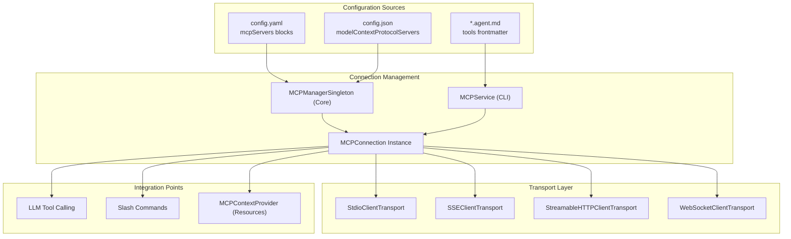
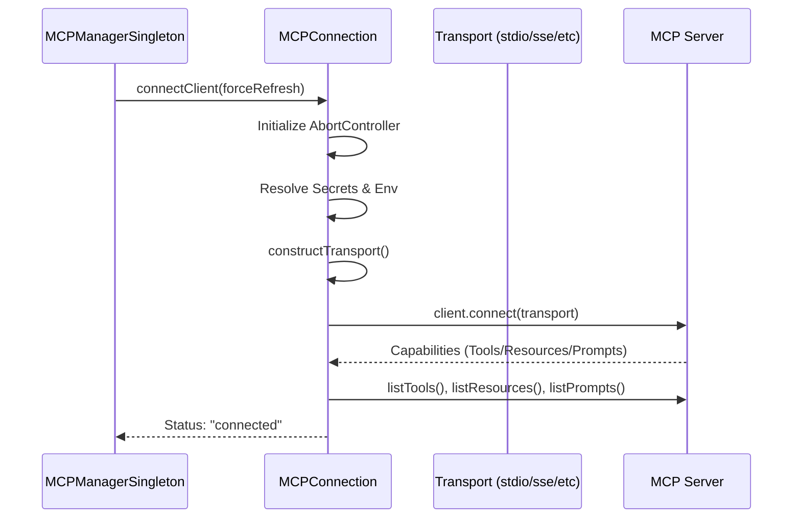

# MCP Integration

Relevant source files

The following files were used as context for generating this wiki page:

- [core/context/mcp/MCPConnection.ts](core/context/mcp/MCPConnection.ts)
- [core/context/mcp/MCPConnection.vitest.ts](core/context/mcp/MCPConnection.vitest.ts)
- [core/context/mcp/MCPManagerSingleton.ts](core/context/mcp/MCPManagerSingleton.ts)
- [core/context/mcp/MCPManagerSingleton.vitest.ts](core/context/mcp/MCPManagerSingleton.vitest.ts)
- [core/context/mcp/MCPOauth.ts](core/context/mcp/MCPOauth.ts)
- [core/context/mcp/MCPOauth.vitest.ts](core/context/mcp/MCPOauth.vitest.ts)
- [core/context/providers/RulesContextProvider.ts](core/context/providers/RulesContextProvider.ts)
- [core/llm/rules/rules-utils.ts](core/llm/rules/rules-utils.ts)
- [core/util/shellPath.ts](core/util/shellPath.ts)
- [extensions/cli/src/services/MCPService.test.ts](extensions/cli/src/services/MCPService.test.ts)
- [extensions/cli/src/services/MCPService.ts](extensions/cli/src/services/MCPService.ts)
- [extensions/cli/src/services/mcpTransports.ts](extensions/cli/src/services/mcpTransports.ts)
- [gui/src/components/dialogs/AddRuleDialog.tsx](gui/src/components/dialogs/AddRuleDialog.tsx)
- [gui/src/components/mainInput/Lump/useEditBlock.ts](gui/src/components/mainInput/Lump/useEditBlock.ts)
- [gui/src/components/mainInput/belowMainInput/RulesPeek.tsx](gui/src/components/mainInput/belowMainInput/RulesPeek.tsx)
- [gui/src/components/ui/TabButton.tsx](gui/src/components/ui/TabButton.tsx)
- [gui/src/pages/config/components/ToolPoliciesGroup.tsx](gui/src/pages/config/components/ToolPoliciesGroup.tsx)
- [gui/src/pages/config/components/ToolPolicyItem.tsx](gui/src/pages/config/components/ToolPolicyItem.tsx)
- [gui/src/pages/config/sections/RulesSection.tsx](gui/src/pages/config/sections/RulesSection.tsx)
- [gui/src/redux/thunks/evaluateToolPolicies.ts](gui/src/redux/thunks/evaluateToolPolicies.ts)
- [packages/config-yaml/src/markdown/agentFiles.test.ts](packages/config-yaml/src/markdown/agentFiles.test.ts)
- [packages/config-yaml/src/markdown/agentFiles.ts](packages/config-yaml/src/markdown/agentFiles.ts)

## Purpose and Scope

This document explains how Continue integrates with the Model Context Protocol (MCP), enabling third-party servers to extend Continue's functionality by providing tools, context, and prompts. MCP integration allows users to connect external services and data sources through standardized protocol servers across both the IDE extensions and the CLI.

For information about context providers in general, see [Context Providers](3.3). For configuration system details, see [Configuration System](5).

## Architecture Overview

MCP integration is managed by specialized service classes that maintain connections to multiple MCP servers. In the Core system, `MCPManagerSingleton` orchestrates these connections, while the CLI utilizes a dedicated `MCPService`. Each server can contribute tools, prompts (as slash commands), and resources (as context items).

### System Component Diagram

**Sources:** [core/context/mcp/MCPConnection.ts:13-24](), [extensions/cli/src/services/MCPService.ts:37-43](), [packages/config-yaml/src/markdown/agentFiles.ts:102-115]()

## MCP Connection Management

The `MCPConnection` class represents a single session with an MCP server. It handles the low-level protocol handshake, capability negotiation, and resource listing.

### Key Features
- **Transport Support**: Implements `stdio`, `sse`, `http`, and `websocket` via the `@modelcontextprotocol/sdk` [core/context/mcp/MCPConnection.ts:1-16]().
- **Secret Resolution**: Automatically decodes and injects secrets from the Continue Hub into environment variables or headers [core/context/mcp/MCPConnection.ts:171-187]().
- **Environment Scrubbing**: On Windows, it identifies batch commands (e.g., `npx`, `uv`, `bunx`) that require `cmd.exe` execution [core/context/mcp/MCPConnection.ts:39-47]().
- **Timeout Handling**: Implements a configurable timeout with a default of 20 seconds [core/context/mcp/MCPConnection.ts:36-36](), [core/context/mcp/MCPConnection.ts:205-205]().

### Connection Lifecycle

**Sources:** [core/context/mcp/MCPConnection.ts:122-223](), [core/context/mcp/MCPConnection.ts:246-270](), [core/context/mcp/MCPManagerSingleton.ts:144-153]()

## CLI Integration (`MCPService`)

The CLI provides a specialized `MCPService` to handle MCP servers in terminal environments, including headless mode support for agents.

- **Headless Validation**: In headless mode or when using agent files, the service throws an error if any configured MCP server fails to connect, ensuring tool availability for automated tasks [extensions/cli/src/services/MCPService.ts:83-99]().
- **Token Refresh**: Implements `withTokenRefresh` for SSE/HTTP connections, automatically attempting to retrieve fresh OAuth tokens from the Continue backend if a 401 error occurs [extensions/cli/src/services/MCPService.ts:161-178]().
- **Process Cleanup**: Registers shutdown handlers for `SIGINT` and `SIGTERM` to gracefully close all active server connections [extensions/cli/src/services/MCPService.ts:52-56]().

**Sources:** [extensions/cli/src/services/MCPService.ts:37-43](), [extensions/cli/src/services/MCPService.ts:183-203]()

## OAuth and Authentication

Continue supports OAuth 2.0 for MCP servers, primarily for SSE-based connections.

- **`MCPConnectionOauthProvider`**: Implements `OAuthClientProvider` from the MCP SDK to manage client metadata, tokens, and the authorization flow [core/context/mcp/MCPOauth.ts:70-78]().
- **Local Callback Server**: For local development/extensions, Continue starts a temporary HTTP server on port 3000 to capture the OAuth redirect `code` [core/context/mcp/MCPOauth.ts:29-65]().
- **Storage**: Authentication tokens and client information are persisted in `GlobalContext` under the `mcpOauthStorage` key [core/context/mcp/MCPOauth.ts:136-161]().

**Sources:** [core/context/mcp/MCPOauth.ts:18-24](), [core/context/mcp/MCPOauth.ts:207-226]()

## UI and Configuration Management

The GUI provides management interfaces for MCP servers and their associated tools and rules.

- **Tool Policies**: Users can enable/disable individual tools or entire groups (servers) via `ToolPoliciesGroup` and `ToolPolicyItem` components [gui/src/pages/config/components/ToolPoliciesGroup.tsx:22-42]().
- **Rule Management**: The `RulesSection` and `RulesPeek` components allow users to view, toggle, and add rules that guide agent behavior [gui/src/pages/config/sections/RulesSection.tsx:131-150](), [gui/src/components/mainInput/belowMainInput/RulesPeek.tsx:53-73]().
- **Dialogs**: The `AddRuleDialog` facilitates creating new global or workspace-specific rule files [gui/src/components/dialogs/AddRuleDialog.tsx:7-55]().

**Sources:** [gui/src/pages/config/components/ToolPoliciesGroup.tsx:63-103](), [gui/src/pages/config/sections/RulesSection.tsx:201-224]()

## Configuration and Agent Files

MCP servers are defined in the main configuration, while experimental `.agent.md` files allow referencing specific tools in their frontmatter.

### Agent Tool References
The `parseAgentFileTools` utility handles complex reference formats in agent markdown files:
- `owner/package`: All tools from a specific MCP server [packages/config-yaml/src/markdown/agentFiles.ts:187-192]().
- `owner/package:tool_name`: A specific tool from an MCP server [packages/config-yaml/src/markdown/agentFiles.ts:168-185]().
- `https://server.url`: All tools from a remote SSE/HTTP server [packages/config-yaml/src/markdown/agentFiles.ts:120-123]().
- `built_in`: Special keyword for all built-in tools [packages/config-yaml/src/markdown/agentFiles.ts:117-119]().

**Sources:** [packages/config-yaml/src/markdown/agentFiles.ts:8-20](), [packages/config-yaml/src/markdown/agentFiles.ts:102-204]()

## Platform Specifics

### Shell Environment Resolution
For `stdio` transports, Continue attempts to resolve the user's full shell environment (including `PATH`) to ensure MCP servers can find their required runtimes (like `node` or `python`). It sources common profile files (`.zshprofile`, `.zshrc`, `.bash_profile`, `.bashrc`) to replicate the user's terminal environment [core/util/shellPath.ts:5-30]().

### Path Resolution
The `resolveCwd` function in `MCPConnection` ensures that relative paths for a server's working directory are correctly resolved relative to the IDE workspace [core/context/mcp/MCPConnection.vitest.ts:166-177]().

**Sources:** [core/context/mcp/MCPConnection.ts:32-33](), [core/util/shellPath.ts:20-20]()