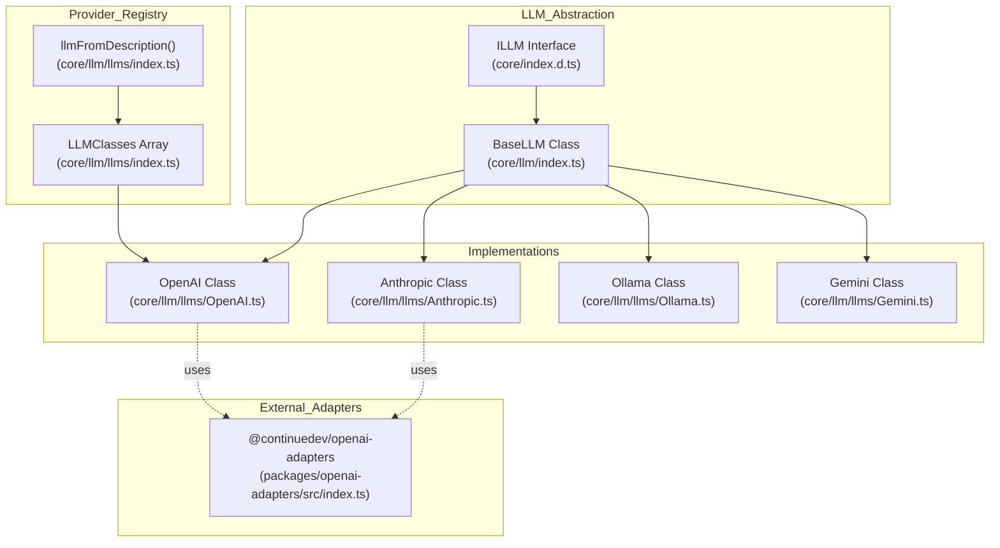
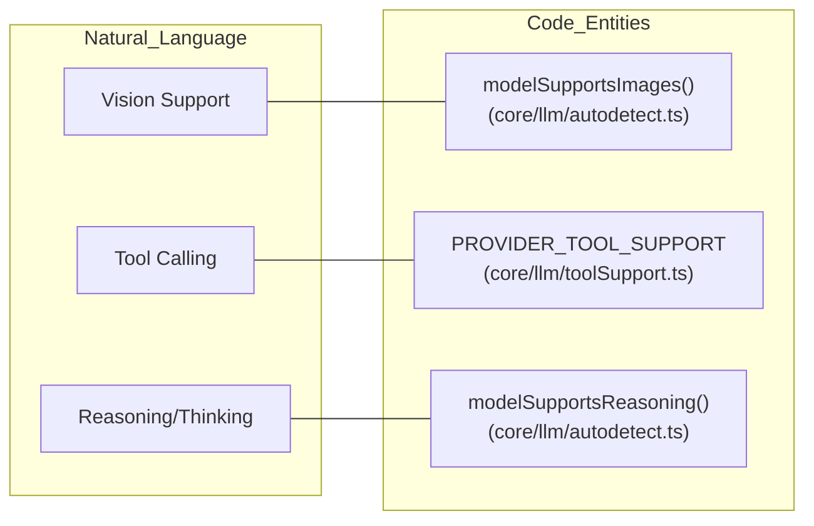

# LLM Integration

Relevant source files

The following files were used as context for generating this wiki page:

- [core/config/types.ts](core/config/types.ts)
- [core/index.d.ts](core/index.d.ts)
- [core/llm/autodetect.ts](core/llm/autodetect.ts)
- [core/llm/index.ts](core/llm/index.ts)
- [core/llm/llms/Anthropic.ts](core/llm/llms/Anthropic.ts)
- [core/llm/llms/ClawRouter.ts](core/llm/llms/ClawRouter.ts)
- [core/llm/llms/ClawRouter.vitest.ts](core/llm/llms/ClawRouter.vitest.ts)
- [core/llm/llms/Cohere.ts](core/llm/llms/Cohere.ts)
- [core/llm/llms/Gemini.ts](core/llm/llms/Gemini.ts)
- [core/llm/llms/Ollama.ts](core/llm/llms/Ollama.ts)
- [core/llm/llms/OpenAI.ts](core/llm/llms/OpenAI.ts)
- [core/llm/llms/VertexAI.ts](core/llm/llms/VertexAI.ts)
- [core/llm/llms/WatsonX.ts](core/llm/llms/WatsonX.ts)
- [core/llm/llms/gemini-types.ts](core/llm/llms/gemini-types.ts)
- [core/llm/llms/index.ts](core/llm/llms/index.ts)
- [core/llm/toolSupport.test.ts](core/llm/toolSupport.test.ts)
- [core/llm/toolSupport.ts](core/llm/toolSupport.ts)
- [docs/customize/model-providers/more/clawrouter.mdx](docs/customize/model-providers/more/clawrouter.mdx)
- [docs/customize/model-providers/overview.mdx](docs/customize/model-providers/overview.mdx)
- [extensions/vscode/config_schema.json](extensions/vscode/config_schema.json)
- [gui/public/logos/clawrouter.png](gui/public/logos/clawrouter.png)
- [gui/src/pages/AddNewModel/configs/models.ts](gui/src/pages/AddNewModel/configs/models.ts)
- [gui/src/pages/AddNewModel/configs/providers.ts](gui/src/pages/AddNewModel/configs/providers.ts)
- [packages/llm-info/src/providers/inception.ts](packages/llm-info/src/providers/inception.ts)
- [packages/openai-adapters/src/apis/Bedrock.ts](packages/openai-adapters/src/apis/Bedrock.ts)
- [packages/openai-adapters/src/apis/Gemini.test.ts](packages/openai-adapters/src/apis/Gemini.test.ts)
- [packages/openai-adapters/src/apis/Gemini.ts](packages/openai-adapters/src/apis/Gemini.ts)
- [packages/openai-adapters/src/index.ts](packages/openai-adapters/src/index.ts)
- [packages/openai-adapters/src/types.ts](packages/openai-adapters/src/types.ts)
- [packages/openai-adapters/src/util/gemini-types.ts](packages/openai-adapters/src/util/gemini-types.ts)

## Purpose and Scope

The LLM Integration system provides a unified abstraction layer for interacting with 40+ Large Language Model providers through a common interface. This document covers the architecture of the LLM integration layer, including the `ILLM` interface contract, the `BaseLLM` base class, provider implementations, and core features like streaming, tool calling, and capability detection.

For details on specific sub-topics, see the following child pages:
- [LLM Abstraction Layer](#4.1) — The `ILLM` interface and `BaseLLM` class.
- [Provider Implementations](#4.2) — Details on OpenAI, Anthropic, Ollama, Gemini, etc.
- [OpenAI Adapters Package](#4.3) — The `@continuedev/openai-adapters` package.
- [Message Compilation and Streaming](#4.4) — Token counting, pruning, and response handling.
- [Tool Calling](#4.5) — Tool definitions, provider formats, and execution.
- [Capability Detection](#4.6) — Autodetecting images, tools, and reasoning support.
- [Prompt Caching](#4.7) — Caching strategies for Anthropic and other providers.

## Architecture Overview

The LLM integration system uses an interface-based design with a factory pattern for provider instantiation. The `Core` orchestrator interacts with models through the `ILLM` interface, while specific providers inherit from `BaseLLM`.

**Code Entities to Natural Language Mapping:**
- **Provider Interface**: `ILLM` [core/index.d.ts:98-169]()
- **Base Implementation**: `BaseLLM` [core/llm/index.ts:91-314]()
- **Registry**: `LLMClasses` [core/llm/llms/index.ts:73-135]()
- **Factory**: `llmFromDescription` [core/llm/llms/index.ts:137-188]()

### System Hierarchy Diagram

**Sources:** [core/index.d.ts:98-169](), [core/llm/index.ts:91-314](), [core/llm/llms/index.ts:73-135]()

## LLM Abstraction Layer

The `ILLM` interface defines the contract for all providers, covering chat, completion, FIM (Fill-In-Middle), and embeddings [core/index.d.ts:108-147](). The `BaseLLM` class implements this interface and provides shared logic for token counting, template rendering, and request lifecycle management [core/llm/index.ts:91-212](). It also includes properties for managing `completionOptions`, `requestOptions`, and `contextLength` [core/llm/index.ts:152-157]().

For details, see [LLM Abstraction Layer](#4.1).

**Sources:** [core/index.d.ts:98-169](), [core/llm/index.ts:91-314]()

## Provider Implementations

Continue supports a vast array of providers. These range from local runners like `Ollama` [core/llm/llms/Ollama.ts:152-160]() (which implements `ModelInstaller` for local model management) to cloud APIs like `Anthropic`, `Gemini`, and `OpenAI` [core/llm/llms/index.ts:73-135](). Each provider implementation handles specific API authentication and endpoint mapping, such as the `useLegacyCompletionsEndpoint` toggle in the `OpenAI` class [core/llm/llms/OpenAI.ts:194-198]().

For details, see [Provider Implementations](#4.2).

**Sources:** [core/llm/llms/index.ts:73-135](), [gui/src/pages/AddNewModel/configs/providers.ts:56-230](), [core/llm/llms/Ollama.ts:152-160]()

## OpenAI Adapters Package

The `@continuedev/openai-adapters` package provides a unified OpenAI-compatible API for providers that don't natively support it. The `constructLlmApi` function [packages/openai-adapters/src/index.ts:84-195]() serves as a router to create specific adapter instances like `AnthropicApi`, `GeminiApi`, or `BedrockApi`. This allows Continue to interact with diverse backends using a standardized `BaseLlmApi` [packages/openai-adapters/src/apis/base.ts]().

For details, see [OpenAI Adapters Package](#4.3).

**Sources:** [packages/openai-adapters/src/index.ts:84-195](), [packages/openai-adapters/src/types.ts:26-26]()

## Message Compilation and Streaming

Before a request is sent, messages are compiled using `compileChatMessages` [core/llm/index.ts:57-60](). This process involves counting tokens with `countTokens`, pruning context with `pruneRawPromptFromTop`, and formatting the final payload. Responses are typically handled via `AsyncGenerator` for real-time streaming, specifically through `streamChat` [core/index.d.ts:127-132]() and `streamComplete` [core/index.d.ts:114-118]().

For details, see [Message Compilation and Streaming](#4.4).

**Sources:** [core/llm/index.ts:57-60](), [core/index.d.ts:140-143]()

## Tool Calling

Continue enables LLMs to execute tools (e.g., file system access, terminal commands). The system detects tool support via the `PROVIDER_TOOL_SUPPORT` registry [core/llm/toolSupport.ts:3-201](). Provider-specific implementations, such as `OpenAI.convertTool` [core/llm/llms/OpenAI.ts:239-245](), handle the conversion between Continue's `Tool` format and provider-specific schemas.

For details, see [Tool Calling](#4.5).

**Sources:** [core/llm/toolSupport.ts:3-201](), [core/llm/llms/OpenAI.ts:239-245]()

## Capability Detection

The `autodetect` system determines what a model can do without explicit user configuration. It checks for image support via `modelSupportsImages` [core/llm/autodetect.ts:160-187](), reasoning capabilities via `modelSupportsReasoning` [core/llm/autodetect.ts:189-232](), and determines the correct prompt templates based on model names [core/llm/autodetect.ts:266-283]().

For details, see [Capability Detection](#4.6).

**Sources:** [core/llm/autodetect.ts:160-232](), [core/llm/autodetect.ts:266-283]()

### Model Feature Mapping

**Sources:** [core/llm/autodetect.ts:160-232](), [core/llm/toolSupport.ts:3-201]()

## Prompt Caching

To reduce latency and cost, Continue supports prompt caching for compatible providers. This is managed via the `cacheBehavior` property on `BaseLLM` [core/llm/index.ts:169-169]() and can be configured through `BaseCompletionOptions` in the schema [extensions/vscode/config_schema.json:6-15](), specifically for providers like Anthropic.

For details, see [Prompt Caching](#4.7).

**Sources:** [core/llm/index.ts:169-169](), [extensions/vscode/config_schema.json:6-15]()