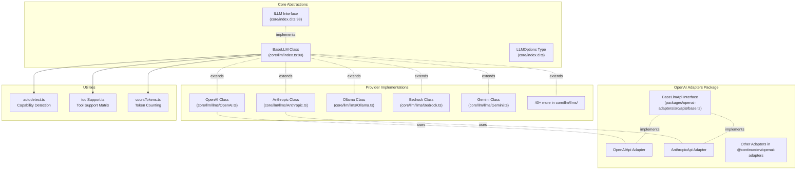
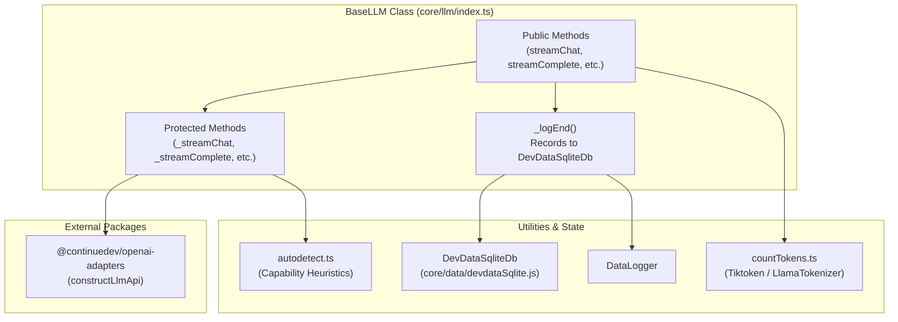

# LLM Abstraction Layer

Relevant source files

The following files were used as context for generating this wiki page:

- [core/config/types.ts](core/config/types.ts)
- [core/index.d.ts](core/index.d.ts)
- [core/llm/autodetect.ts](core/llm/autodetect.ts)
- [core/llm/index.ts](core/llm/index.ts)
- [core/llm/llms/Anthropic.ts](core/llm/llms/Anthropic.ts)
- [core/llm/llms/ClawRouter.ts](core/llm/llms/ClawRouter.ts)
- [core/llm/llms/ClawRouter.vitest.ts](core/llm/llms/ClawRouter.vitest.ts)
- [core/llm/llms/Cohere.ts](core/llm/llms/Cohere.ts)
- [core/llm/llms/Gemini.ts](core/llm/llms/Gemini.ts)
- [core/llm/llms/Ollama.ts](core/llm/llms/Ollama.ts)
- [core/llm/llms/OpenAI.ts](core/llm/llms/OpenAI.ts)
- [core/llm/llms/VertexAI.ts](core/llm/llms/VertexAI.ts)
- [core/llm/llms/WatsonX.ts](core/llm/llms/WatsonX.ts)
- [core/llm/llms/gemini-types.ts](core/llm/llms/gemini-types.ts)
- [core/llm/llms/index.ts](core/llm/llms/index.ts)
- [core/llm/toolSupport.test.ts](core/llm/toolSupport.test.ts)
- [core/llm/toolSupport.ts](core/llm/toolSupport.ts)
- [docs/customize/model-providers/more/clawrouter.mdx](docs/customize/model-providers/more/clawrouter.mdx)
- [docs/customize/model-providers/overview.mdx](docs/customize/model-providers/overview.mdx)
- [extensions/vscode/config_schema.json](extensions/vscode/config_schema.json)
- [gui/public/logos/clawrouter.png](gui/public/logos/clawrouter.png)
- [gui/src/pages/AddNewModel/configs/models.ts](gui/src/pages/AddNewModel/configs/models.ts)
- [gui/src/pages/AddNewModel/configs/providers.ts](gui/src/pages/AddNewModel/configs/providers.ts)
- [packages/llm-info/src/providers/inception.ts](packages/llm-info/src/providers/inception.ts)
- [packages/openai-adapters/src/apis/Bedrock.ts](packages/openai-adapters/src/apis/Bedrock.ts)
- [packages/openai-adapters/src/apis/Gemini.test.ts](packages/openai-adapters/src/apis/Gemini.test.ts)
- [packages/openai-adapters/src/apis/Gemini.ts](packages/openai-adapters/src/apis/Gemini.ts)
- [packages/openai-adapters/src/index.ts](packages/openai-adapters/src/index.ts)
- [packages/openai-adapters/src/types.ts](packages/openai-adapters/src/types.ts)
- [packages/openai-adapters/src/util/gemini-types.ts](packages/openai-adapters/src/util/gemini-types.ts)

The LLM Abstraction Layer provides a unified interface for interacting with over 40 large language model providers, enabling Continue to work seamlessly across OpenAI, Anthropic, Ollama, local models, and many others. This layer handles provider-specific API differences, message formatting, token counting, streaming, tool calling, and capability detection.

For configuration of models and providers, see [Configuration Architecture](#5.1). For how models are selected and used in different contexts (chat, agent, autocomplete), see [Model Selection](#8.5).

## Overview

The abstraction layer consists of three primary components:

1.  **ILLM Interface** - A provider-agnostic contract that all models must implement [[core/index.d.ts:98-169]]().
2.  **BaseLLM Class** - A base implementation providing common functionality like token counting, message compilation, and streaming [[core/llm/index.ts:90-314]]().
3.  **Provider Implementations** - Concrete classes extending `BaseLLM` to handle provider-specific APIs [[core/llm/llms/index.ts:73-135]]().

### System Architecture to Code Entity Mapping

The following diagram bridges the high-level conceptual space with the specific classes and files that implement the LLM abstraction.

Sources: [core/index.d.ts:98-169](), [core/llm/index.ts:90-314](), [core/llm/llms/index.ts:73-135](), [packages/openai-adapters/src/index.ts:84-195]()

## ILLM Interface

The `ILLM` interface defines the contract that all LLM providers must implement. It extends `LLMOptions` and requires specific properties and methods for model interaction.

### Core Properties

| Property | Type | Description |
| :--- | :--- | :--- |
| `providerName` | `string` | Provider identifier (e.g., "openai", "anthropic") [[core/index.d.ts:101]]() |
| `underlyingProviderName` | `string` | Actual provider when using proxies [[core/index.d.ts:102]]() |
| `model` | `string` | Model identifier [[core/llm/index.ts:146]]() |
| `uniqueId` | `string` | Unique instance identifier [[core/llm/index.ts:145]]() |
| `contextLength` | `number` | Maximum context window in tokens [[core/index.d.ts:92]]() |
| `completionOptions` | `CompletionOptions` | Default completion parameters [[core/index.d.ts:96]]() |
| `embeddingId` | `string` | Identifier for embeddings caching [[core/index.d.ts:93]]() |

Sources: [core/index.d.ts:98-169](), [core/llm/index.ts:145-161]()

### Core Methods

*   **complete**: Synchronous text completion [[core/index.d.ts:108]]().
*   **streamComplete**: Streaming text completion [[core/index.d.ts:114]]().
*   **streamFim**: Fill-in-the-middle completion for tab autocomplete [[core/index.d.ts:120]]().
*   **streamChat**: Streaming chat interface using `ChatMessage[]` [[core/index.d.ts:127]]().
*   **compileChatMessages**: Handles context pruning and message assembly [[core/index.d.ts:140]]().
*   **countTokens**: Calculates token usage for a string [[core/index.d.ts:149]]().
*   **supportsImages**: Returns true if the model/provider supports multimodal input [[core/index.d.ts:151]]().

Sources: [core/index.d.ts:108-169]()

## BaseLLM Class

The `BaseLLM` abstract class provides the foundation for all LLM providers. It implements `ILLM` and provides common functionality that can be overridden by specific providers.

### Class Structure and Data Flow

This diagram maps the `BaseLLM` methods to the internal utilities and external package calls.

Sources: [core/llm/index.ts:90-314](), [core/llm/countTokens.ts:57-60](), [core/llm/autodetect.ts:160-187](), [core/data/devdataSqlite.js:11]()

### Key Features

**Token Counting and Message Compilation**
The `BaseLLM` class integrates with `countTokens.ts` to provide accurate token counting for context management. It uses `Tiktoken` for OpenAI models and custom logic for others [[core/llm/countTokens.ts:58]]().

**Capability Detection**
The system uses heuristics to detect capabilities like image support, tool calling, and reasoning.
*   **Images**: Detected via `modelSupportsImages` which checks provider lists and regex patterns (e.g., `/gpt-4o/`, `/claude-3/`, `/llama-?3\.2/`, `/gemini/`) [[core/llm/autodetect.ts:138-158]]().
*   **Reasoning**: Detected via `modelSupportsReasoning` for models like `o1`, `deepseek-r`, `claude` (excluding 3/3.5), and `grok-4` [[core/llm/autodetect.ts:189-232]]().
*   **Tools**: Mapped in `PROVIDER_TOOL_SUPPORT` for various providers including `anthropic`, `openai`, `gemini`, `ollama`, and `mistral` [[core/llm/toolSupport.ts:3-201]]().

**Custom Fetch with Retries**
`BaseLLM` uses `withExponentialBackoff` to wrap HTTP requests, providing resilience against transient network failures [[core/llm/index.ts:40]](). It also handles custom `RequestOptions` like proxies, custom headers, and SSL verification [[core/llm/index.ts:28]]().

## Provider Registration and Factory

Providers are registered in a central array and instantiated via the `llmFromDescription` factory function.

### Provider Registry
The `LLMClasses` array in `core/llm/llms/index.ts` contains all available provider implementations [[core/llm/llms/index.ts:73-135]]().

### Factory Function
The `llmFromDescription` function converts a `JSONModelDescription` (from `config.json`) into a live `BaseLLM` instance [[core/llm/llms/index.ts:137-145]]().

| Step | Action | Code Reference |
| :--- | :--- | :--- |
| 1 | Find class by `provider` name | `LLMClasses.find(...)` [[core/llm/llms/index.ts:146]]() |
| 2 | Merge completion options | `...desc.completionOptions` [[core/llm/llms/index.ts:152]]() |
| 3 | Render system messages | `renderTemplatedString` [[core/llm/llms/index.ts:161]]() |
| 4 | Setup options object | Create `LLMOptions` with `uniqueId` and `logger` [[core/llm/llms/index.ts:171-185]]() |
| 5 | Instantiate | `new cls(options)` [[core/llm/llms/index.ts:187]]() |

Sources: [core/llm/llms/index.ts:137-188]()

## OpenAI Adapters Package

The `@continuedev/openai-adapters` package provides a compatibility layer that allows Continue to use a standardized OpenAI-like interface even for providers with unique APIs (like Anthropic, Gemini, or Bedrock).

*   **constructLlmApi**: The primary entry point that returns a `BaseLlmApi` implementation for a given provider [[packages/openai-adapters/src/index.ts:84]]().
*   **Supported Adapters**: Includes `AnthropicApi`, `GeminiApi`, `BedrockApi`, `AzureApi`, `CohereApi`, and many others [[packages/openai-adapters/src/index.ts:3-24]]().
*   **OpenAI Compatibility**: Many providers (e.g., Groq, Mistral, Together, Fireworks, xAI) are routed through the `openAICompatible` helper which points to their specific `apiBase` while using standard OpenAI formatting [[packages/openai-adapters/src/index.ts:131-180]]().

Sources: [packages/openai-adapters/src/index.ts:1-195](), [packages/openai-adapters/src/types.ts:26]()

## Usage Tracking and Logging

The abstraction layer ensures that every interaction is recorded for the user's local history and token usage statistics.

1.  **Interaction Logging**: `BaseLLM` handles logging through the `ILLMLogger` interface [[core/llm/index.ts:159]]().
2.  **Database Persistence**: Usage data is managed by `DevDataSqliteDb` [[core/llm/index.ts:11]]().
3.  **Data Logging**: The `DataLogger` class is used to record model interactions for telemetry and debugging [[core/llm/index.ts:12]]().

Sources: [core/llm/index.ts:11-159](), [core/data/devdataSqlite.js:11]()