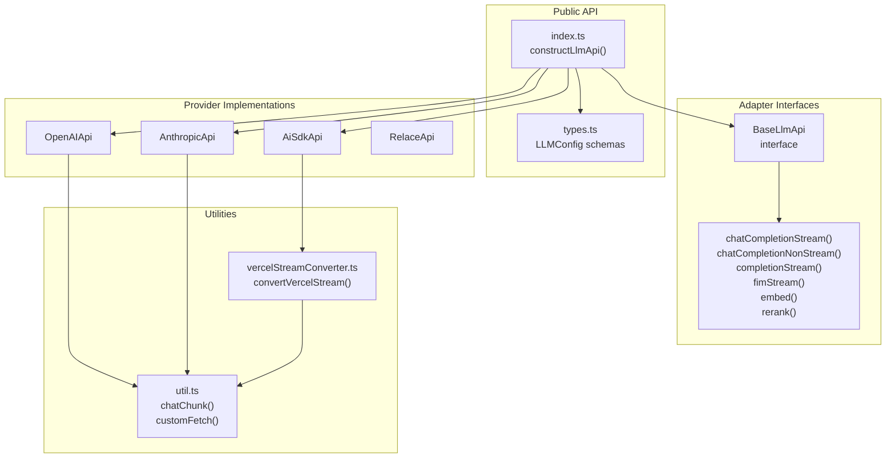
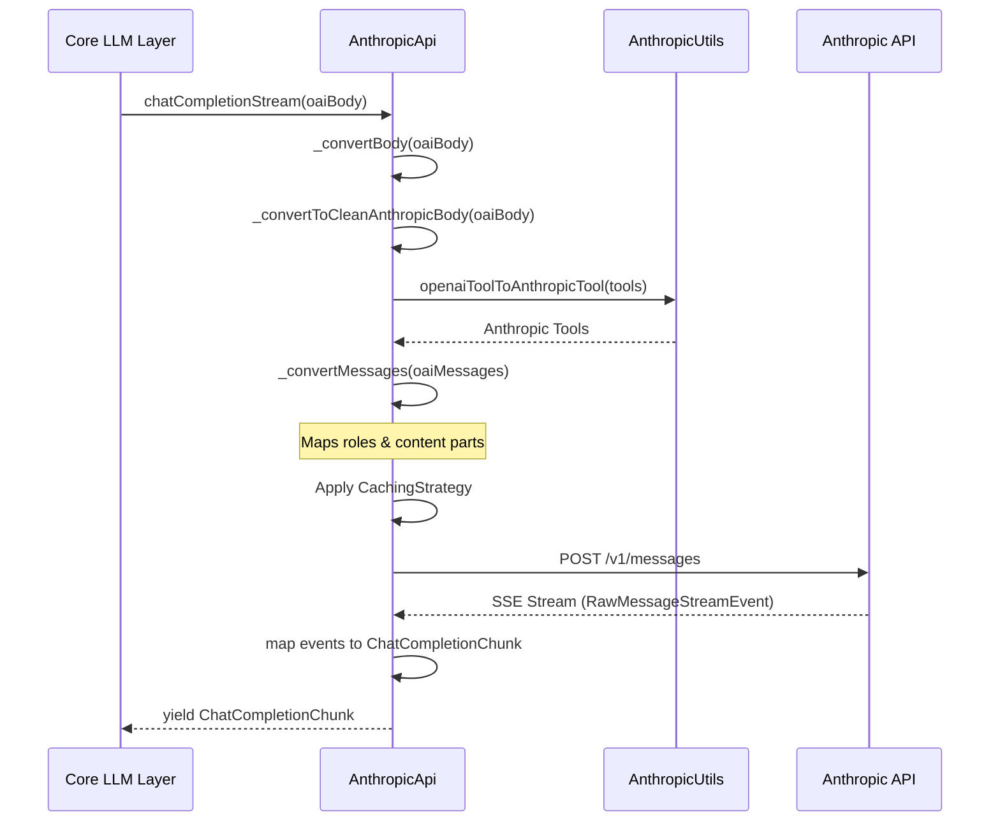
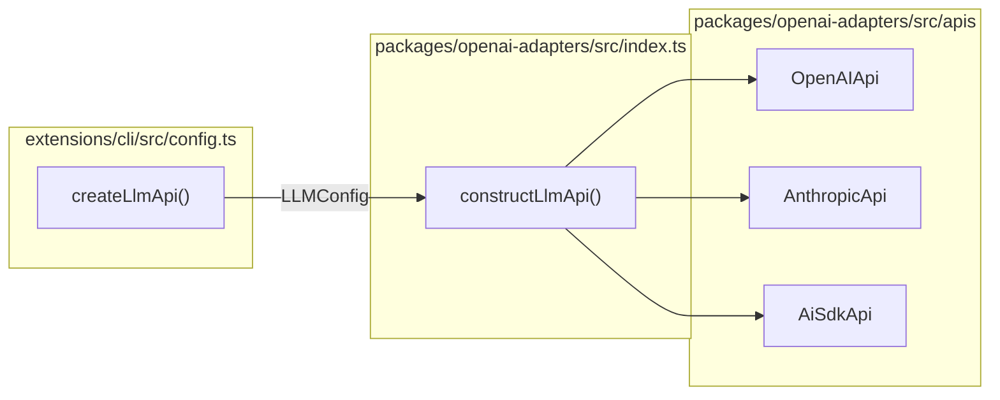

# OpenAI Adapters Package

Relevant source files

The following files were used as context for generating this wiki page:

- [core/config/selectedModels.ts](core/config/selectedModels.ts)
- [core/llm/llms/Relace.ts](core/llm/llms/Relace.ts)
- [extensions/cli/src/CLIPlatformClient.test.ts](extensions/cli/src/CLIPlatformClient.test.ts)
- [extensions/cli/src/CLIPlatformClient.ts](extensions/cli/src/CLIPlatformClient.ts)
- [extensions/cli/src/args.test.ts](extensions/cli/src/args.test.ts)
- [extensions/cli/src/auth/workos.ts](extensions/cli/src/auth/workos.ts)
- [extensions/cli/src/commands/review/resolveReviews.test.ts](extensions/cli/src/commands/review/resolveReviews.test.ts)
- [extensions/cli/src/commands/review/resolveReviews.ts](extensions/cli/src/commands/review/resolveReviews.ts)
- [extensions/cli/src/config.test.ts](extensions/cli/src/config.test.ts)
- [extensions/cli/src/config.ts](extensions/cli/src/config.ts)
- [extensions/cli/src/hubLoader.ts](extensions/cli/src/hubLoader.ts)
- [extensions/cli/src/integration/rule-duplication.test.ts](extensions/cli/src/integration/rule-duplication.test.ts)
- [extensions/cli/src/onboarding.test.ts](extensions/cli/src/onboarding.test.ts)
- [extensions/cli/src/services/AuthService.ts](extensions/cli/src/services/AuthService.ts)
- [extensions/cli/src/services/ModelService.test.ts](extensions/cli/src/services/ModelService.test.ts)
- [extensions/cli/src/services/ModelService.workflow-priority.test.ts](extensions/cli/src/services/ModelService.workflow-priority.test.ts)
- [extensions/cli/src/services/agent-file-integration.test.ts](extensions/cli/src/services/agent-file-integration.test.ts)
- [packages/config-yaml/src/load/injectBlocks.test.ts](packages/config-yaml/src/load/injectBlocks.test.ts)
- [packages/continue-sdk/package-lock.json](packages/continue-sdk/package-lock.json)
- [packages/continue-sdk/package.json](packages/continue-sdk/package.json)
- [packages/continue-sdk/tsconfig.json](packages/continue-sdk/tsconfig.json)
- [packages/openai-adapters/package-lock.json](packages/openai-adapters/package-lock.json)
- [packages/openai-adapters/package.json](packages/openai-adapters/package.json)
- [packages/openai-adapters/src/apis/AiSdk.ts](packages/openai-adapters/src/apis/AiSdk.ts)
- [packages/openai-adapters/src/apis/Anthropic.test.ts](packages/openai-adapters/src/apis/Anthropic.test.ts)
- [packages/openai-adapters/src/apis/Anthropic.ts](packages/openai-adapters/src/apis/Anthropic.ts)
- [packages/openai-adapters/src/apis/Cohere.ts](packages/openai-adapters/src/apis/Cohere.ts)
- [packages/openai-adapters/src/apis/DeepSeek.ts](packages/openai-adapters/src/apis/DeepSeek.ts)
- [packages/openai-adapters/src/apis/Inception.ts](packages/openai-adapters/src/apis/Inception.ts)
- [packages/openai-adapters/src/apis/Jina.ts](packages/openai-adapters/src/apis/Jina.ts)
- [packages/openai-adapters/src/apis/Moonshot.ts](packages/openai-adapters/src/apis/Moonshot.ts)
- [packages/openai-adapters/src/apis/OpenAI.ts](packages/openai-adapters/src/apis/OpenAI.ts)
- [packages/openai-adapters/src/apis/Relace.ts](packages/openai-adapters/src/apis/Relace.ts)
- [packages/openai-adapters/src/apis/WatsonX.ts](packages/openai-adapters/src/apis/WatsonX.ts)
- [packages/openai-adapters/src/apis/openaiResponses.ts](packages/openai-adapters/src/apis/openaiResponses.ts)
- [packages/openai-adapters/src/convertToolsToVercel.ts](packages/openai-adapters/src/convertToolsToVercel.ts)
- [packages/openai-adapters/src/openaiToVercelMessages.ts](packages/openai-adapters/src/openaiToVercelMessages.ts)
- [packages/openai-adapters/src/test/cli-tools.test.ts](packages/openai-adapters/src/test/cli-tools.test.ts)
- [packages/openai-adapters/src/test/convertToolsToVercel.test.ts](packages/openai-adapters/src/test/convertToolsToVercel.test.ts)
- [packages/openai-adapters/src/test/customFetch-auth-override.vitest.ts](packages/openai-adapters/src/test/customFetch-auth-override.vitest.ts)
- [packages/openai-adapters/src/test/main.test.ts](packages/openai-adapters/src/test/main.test.ts)
- [packages/openai-adapters/src/test/util.ts](packages/openai-adapters/src/test/util.ts)
- [packages/openai-adapters/src/test/vercel-sdk.test.ts](packages/openai-adapters/src/test/vercel-sdk.test.ts)
- [packages/openai-adapters/src/test/vercelStreamConverter.test.ts](packages/openai-adapters/src/test/vercelStreamConverter.test.ts)
- [packages/openai-adapters/src/util.ts](packages/openai-adapters/src/util.ts)
- [packages/openai-adapters/src/vercelStreamConverter.ts](packages/openai-adapters/src/vercelStreamConverter.ts)

## Purpose and Scope

The `@continuedev/openai-adapters` package provides OpenAI-compatible API adapters for 40+ LLM providers, enabling Continue to interact with diverse AI services through a unified interface. This package abstracts provider-specific API formats, authentication mechanisms, and streaming protocols behind a common `BaseLlmApi` interface that accepts and returns OpenAI-formatted requests and responses.

This package is critical for the "multi-provider" nature of Continue, allowing the core logic to treat various backends (Anthropic, Gemini, DeepSeek, etc.) as if they were OpenAI endpoints while handling the necessary translations internally.

**Sources:** [packages/openai-adapters/src/apis/base.ts:1-54](), [packages/openai-adapters/src/apis/OpenAI.ts:35-50]()

---

## Package Architecture

### Core Components

**Sources:** [packages/openai-adapters/src/apis/base.ts:56-115](), [packages/openai-adapters/src/apis/OpenAI.ts:35-50](), [packages/openai-adapters/src/apis/Anthropic.ts:56-68](), [packages/openai-adapters/src/apis/AiSdk.ts:51-67]()

---

## BaseLlmApi Interface

The `BaseLlmApi` interface defines the contract that all adapters must implement. It uses types imported from the `openai` SDK to ensure that inputs and outputs are perfectly compatible with standard OpenAI client expectations.

| Method | Purpose | Input Format | Output Format |
|--------|---------|--------------|---------------|
| `chatCompletionNonStream()` | Single chat completion | `ChatCompletionCreateParamsNonStreaming` | `ChatCompletion` |
| `chatCompletionStream()` | Streaming chat completion | `ChatCompletionCreateParamsStreaming` | `AsyncGenerator<ChatCompletionChunk>` |
| `completionNonStream()` | Single text completion | `CompletionCreateParamsNonStreaming` | `Completion` |
| `completionStream()` | Streaming text completion | `CompletionCreateParamsStreaming` | `AsyncGenerator<Completion>` |
| `fimStream()` | Fill-in-middle completion | `FimCreateParamsStreaming` | `AsyncGenerator<ChatCompletionChunk>` |
| `embed()` | Generate embeddings | `EmbeddingCreateParams` | `CreateEmbeddingResponse` |
| `rerank()` | Rerank documents | `RerankCreateParams` | `CreateRerankResponse` |

**Sources:** [packages/openai-adapters/src/apis/base.ts:56-115]()

---

## Key Provider Implementations

### OpenAI Adapter (`OpenAIApi`)

The `OpenAIApi` class handles standard OpenAI requests but includes specialized logic for the `o-series` (o1, o3), `gpt-5`, and DeepSeek models.

*   **Role Mapping:** Automatically converts `system` messages to `developer` roles for o-series models [packages/openai-adapters/src/apis/OpenAI.ts:75-81]().
*   **Token Management:** Maps `max_tokens` to `max_completion_tokens` for DeepSeek reasoner and OpenAI o-series models [packages/openai-adapters/src/apis/OpenAI.ts:58-65](), [packages/openai-adapters/src/apis/OpenAI.ts:71-73]().
*   **Responses Endpoint:** Detects if the model should use the newer OpenAI `/responses` API [packages/openai-adapters/src/apis/OpenAI.ts:90-96]().

### Anthropic Adapter (`AnthropicApi`)

The `AnthropicApi` translates OpenAI chat bodies into Anthropic's Messages API format.

*   **Message Conversion:** Converts OpenAI `messages` (including images and tool calls) into Anthropic `ContentBlockParam` arrays [packages/openai-adapters/src/apis/Anthropic.ts:184-230]().
*   **Prompt Caching:** Implements caching strategies (e.g., `systemAndTools`) and adds `cache_control` to the last two user messages [packages/openai-adapters/src/apis/Anthropic.ts:74-83]().
*   **Tool Choice:** Maps OpenAI `tool_choice` to Anthropic's tool choice structure [packages/openai-adapters/src/apis/Anthropic.ts:156-156]().

### AI SDK Adapter (`AiSdkApi`)

The `AiSdkApi` leverages the Vercel AI SDK to support providers like xAI and Google Generative AI. It maps a provider/model string (e.g., `openai/gpt-4o`) to the appropriate Vercel SDK provider creator [packages/openai-adapters/src/apis/AiSdk.ts:33-49]().

*   **Vercel Integration:** Uses `generateText` and `streamText` from the `ai` package [packages/openai-adapters/src/apis/AiSdk.ts:132-147](), [packages/openai-adapters/src/apis/AiSdk.ts:218-220]().
*   **Stream Conversion:** Uses `convertVercelStream` and `convertVercelStreamPart` to transform Vercel `VercelStreamPart` events (like `text-delta` or `reasoning-delta`) back into OpenAI `ChatCompletionChunk` format [packages/openai-adapters/src/vercelStreamConverter.ts:83-232](), [packages/openai-adapters/src/vercelStreamConverter.ts:237-247]().

**Sources:** [packages/openai-adapters/src/apis/OpenAI.ts:1-163](), [packages/openai-adapters/src/apis/Anthropic.ts:1-230](), [packages/openai-adapters/src/apis/AiSdk.ts:1-230](), [packages/openai-adapters/src/vercelStreamConverter.ts:1-248]()

---

## Data Flow: OpenAI to Provider

This diagram shows how a generic OpenAI request is transformed into a provider-specific request (using Anthropic as an example).

**Sources:** [packages/openai-adapters/src/apis/Anthropic.ts:70-160](), [packages/openai-adapters/src/apis/AnthropicUtils.ts:42-48]()

---

## Usage in Core and CLI

The `BaseLLM` class in the core package determines how to format messages before sending them to these adapters. In the CLI, the `createLlmApi` function initializes these adapters from a `ModelConfig` [extensions/cli/src/config.ts:44-58]().

**Sources:** [extensions/cli/src/config.ts:44-58](), [packages/openai-adapters/src/index.ts:1-50]()

---

## Utility Functions

The package provides several utilities to standardize response formats:

*   **`chatChunk`**: Standardizes the creation of a `ChatCompletionChunk` with choices and deltas [packages/openai-adapters/src/util.ts:13-38]().
*   **`usageChatChunk`**: Specifically for emitting token usage at the end of a stream [packages/openai-adapters/src/util.ts:40-53]().
*   **`customFetch`**: A wrapper that applies `requestOptions` (proxies, custom headers, timeouts) and handles authentication header overrides [packages/openai-adapters/src/util.ts:155-213]().
*   **`safeParseArgs`**: Attempts to parse JSON tool arguments, falling back to a raw string if parsing fails [packages/openai-adapters/src/util/parseArgs.ts:1-10]().
*   **`convertVercelStream`**: An async generator that iterates over Vercel AI SDK stream parts and yields OpenAI chunks [packages/openai-adapters/src/vercelStreamConverter.ts:237-247]().

**Sources:** [packages/openai-adapters/src/util.ts:1-213](), [packages/openai-adapters/src/util/parseArgs.ts:1-10](), [packages/openai-adapters/src/vercelStreamConverter.ts:237-247]()