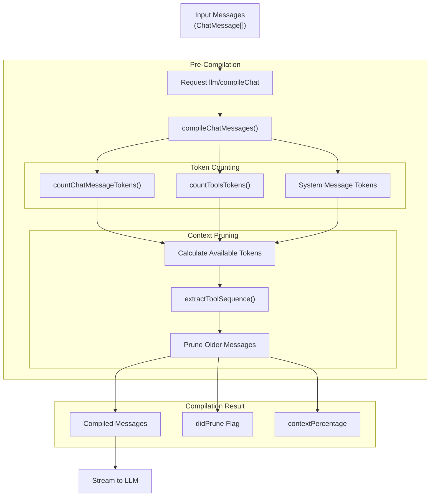
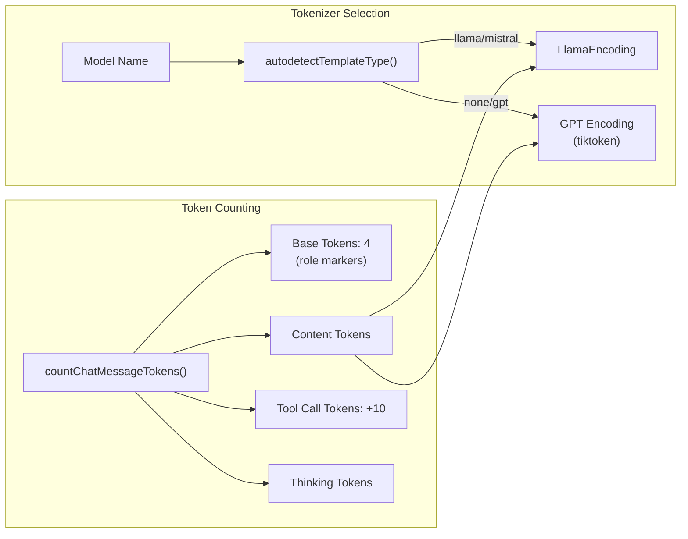
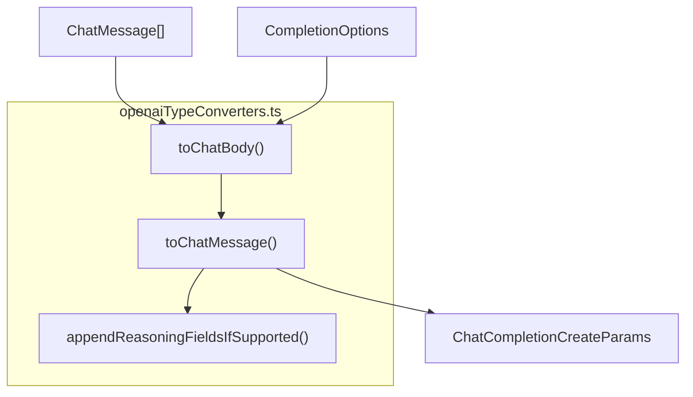
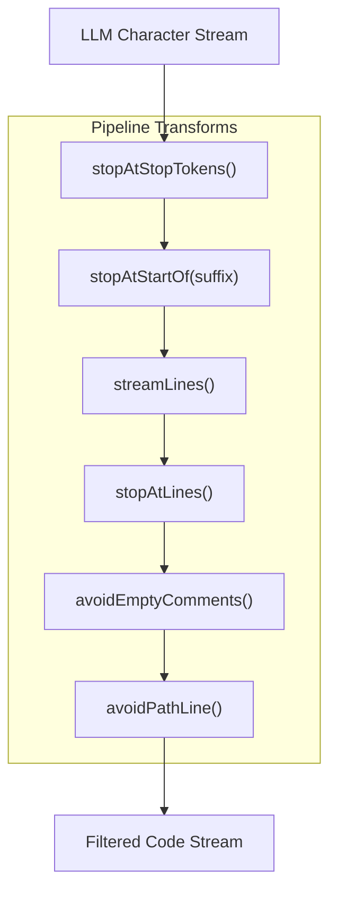
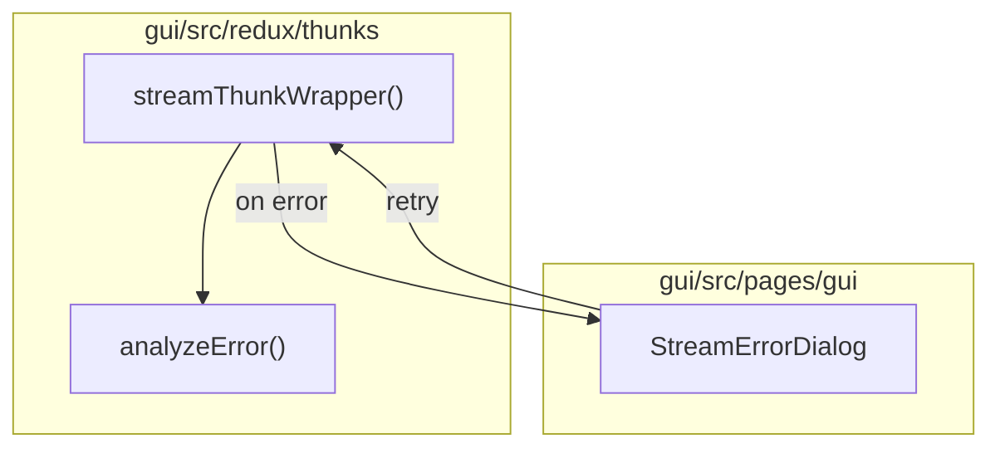

# Message Compilation and Streaming

Relevant source files

The following files were used as context for generating this wiki page:

- [core/indexing/chunk/chunk.test.ts](core/indexing/chunk/chunk.test.ts)
- [core/llm/countTokens.test.ts](core/llm/countTokens.test.ts)
- [core/llm/countTokens.ts](core/llm/countTokens.ts)
- [core/llm/getAdjustedTokenCount.test.ts](core/llm/getAdjustedTokenCount.test.ts)
- [core/llm/getAdjustedTokenCount.ts](core/llm/getAdjustedTokenCount.ts)
- [core/llm/llm.test.ts](core/llm/llm.test.ts)
- [core/llm/llms/Deepseek.ts](core/llm/llms/Deepseek.ts)
- [core/llm/messages.ts](core/llm/messages.ts)
- [core/llm/openaiTypeConverters.test.ts](core/llm/openaiTypeConverters.test.ts)
- [core/llm/openaiTypeConverters.ts](core/llm/openaiTypeConverters.ts)
- [core/llm/templates/chat.test.ts](core/llm/templates/chat.test.ts)
- [docs/customize/model-providers/top-level/openai.mdx](docs/customize/model-providers/top-level/openai.mdx)
- [gui/src/pages/gui/StreamError.tsx](gui/src/pages/gui/StreamError.tsx)
- [gui/src/redux/thunks/streamThunkWrapper.tsx](gui/src/redux/thunks/streamThunkWrapper.tsx)
- [gui/src/util/errorAnalysis.test.ts](gui/src/util/errorAnalysis.test.ts)
- [gui/src/util/errorAnalysis.ts](gui/src/util/errorAnalysis.ts)
- [packages/fetch/package-lock.json](packages/fetch/package-lock.json)
- [packages/fetch/package.json](packages/fetch/package.json)
- [packages/fetch/src/fetch.ts](packages/fetch/src/fetch.ts)
- [packages/fetch/src/stream.ts](packages/fetch/src/stream.ts)
- [packages/fetch/src/util.test.ts](packages/fetch/src/util.test.ts)
- [packages/fetch/src/util.ts](packages/fetch/src/util.ts)
- [packages/openai-adapters/src/apis/Azure.ts](packages/openai-adapters/src/apis/Azure.ts)
- [packages/openai-adapters/src/test/adapter-test-utils.ts](packages/openai-adapters/src/test/adapter-test-utils.ts)
- [packages/openai-adapters/src/test/anthropic-adapter.vitest.ts](packages/openai-adapters/src/test/anthropic-adapter.vitest.ts)
- [packages/openai-adapters/src/test/openai-adapter.vitest.ts](packages/openai-adapters/src/test/openai-adapter.vitest.ts)

## Purpose and Scope

This document explains how Continue compiles chat messages to fit within LLM context windows and streams responses back to the user interface. Message compilation involves token counting, context pruning, and formatting messages for specific LLM providers. Streaming handles real-time response updates, including text content, tool calls, and reasoning traces.

For information about tool calling and execution, see [Tool Calling](4.5). For LLM provider implementations, see [Provider Implementations](4.2). For Redux state management of sessions, see [State Management](8.3).

## Message Compilation Overview

Message compilation ensures that chat history fits within an LLM's context window while preserving critical conversation elements. The compilation process involves token counting, pruning older messages, and formatting for provider-specific APIs.

### Compilation Pipeline

Sources: [core/llm/countTokens.ts:413-520](), [core/llm/countTokens.test.ts:153-183]()

### Token Counting Implementation

The `countTokens` function uses model-specific tokenizers to accurately measure token usage. The system defaults to LLaMA tokenization for most models but uses GPT tokenization for OpenAI models via `js-tiktoken`.

**Token Counting Constants:**

| Constant | Value | Purpose |
|----------|-------|---------|
| `BASE_TOKENS` | 4 | Per-message overhead for role markers [core/llm/countTokens.ts:186]() |
| `TOOL_CALL_EXTRA_TOKENS` | 10 | Tokens for each tool call [core/llm/countTokens.ts:187]() |
| `TOOL_OUTPUT_EXTRA_TOKENS` | 10 | Tokens for tool outputs [core/llm/countTokens.ts:188]() |
| `DEFAULT_PRUNING_LENGTH` | 32000 | Default context length if not specified [core/llm/constants.ts:20-20]() |

Sources: [core/llm/countTokens.ts:179-218](), [core/llm/countTokens.ts:112-132](), [core/llm/countTokens.ts:73-85]()

### Context Pruning Strategy

The `compileChatMessages` function implements an intelligent pruning algorithm that preserves critical conversation elements while removing older messages to fit within the context window.

**Preservation Rules:**
1. Always preserve the system message.
2. Always preserve the last user/tool message sequence using `extractToolSequence` [core/llm/countTokens.ts:221-271]().
3. Never orphan tool responses without their tool calls.
4. Remove older messages first when pruning until the total count is under the limit [core/llm/countTokens.ts:413-520]().

Sources: [core/llm/countTokens.ts:413-520](), [core/llm/countTokens.ts:221-271]()

## Streaming Architecture

Continue uses async generators to stream LLM responses incrementally. The system handles both chat completions and autocomplete (FIM) streaming.

### Streaming Flow and Type Conversion

When streaming via OpenAI-compatible providers, the `toChatBody` and `toChatMessage` functions convert internal `ChatMessage` objects into `ChatCompletionCreateParams`.

Sources: [core/llm/openaiTypeConverters.ts:109-208](), [core/llm/openaiTypeConverters.ts:210-250]()

### Streaming Response Handling

The `@continuedev/fetch` package provides low-level utilities for consuming Server-Sent Events (SSE) and JSON streams from providers.

| Function | Description |
|----------|-------------|
| `streamResponse` | Converts a `node-fetch` Response into an async string generator, handling Node version differences [packages/fetch/src/stream.ts:10-73]() |
| `streamSse` | Parses SSE data lines (e.g., `data: {...}`) and yields parsed JSON objects [packages/fetch/src/stream.ts:124-150]() |
| `streamJSON` | Parses line-delimited JSON streams [packages/fetch/src/stream.ts:152-169]() |

Sources: [packages/fetch/src/stream.ts:10-169]()

## Autocomplete and Edit Streaming

Streaming for autocomplete (Fill-In-the-Middle) and "Lazy Apply" involves complex transformation pipelines to ensure code quality and stop conditions.

### Autocomplete Stream Transformation

The `StreamTransformPipeline` (referenced in autocomplete logic) applies a series of filters to the raw character stream from the LLM.

### Lazy Apply Streaming

The `streamLazyApply` function (referenced in edit logic) uses streaming to apply diffs incrementally. It uses a `replacementFunction` to fill in `UNCHANGED_CODE` markers by looking ahead in the stream.

## Reasoning and Thinking Support

Continue supports reasoning models (like Claude 3.7 or DeepSeek R1) by capturing reasoning details separately from the final response.

**Reasoning Logic:**
- `appendReasoningFieldsIfSupported` adds `reasoning_content`, `reasoning`, or `reasoning_details` to the assistant message based on provider flags [core/llm/openaiTypeConverters.ts:45-107]().
- DeepSeek Reasoner specifically requires `reasoning_content` on assistant messages to avoid 400 errors [core/llm/openaiTypeConverters.ts:70-75]().
- Claude requires a signed `reasoning_details` block; if missing, reasoning fields are omitted to prevent errors [core/llm/openaiTypeConverters.ts:87-99]().

Sources: [core/llm/openaiTypeConverters.ts:45-107](), [core/llm/countTokens.ts:202-209]()

## Error Handling and UI Feedback

Streaming operations in the GUI are wrapped in thunks that manage retries and error visualization.

### Stream Error Management

- **Overloaded Retries:** `streamThunkWrapper` automatically retries requests up to 3 times with exponential backoff if the provider is overloaded (HTTP 529 or "overloaded" message) [gui/src/redux/thunks/streamThunkWrapper.tsx:25-51]().
- **Error Analysis:** The `analyzeError` utility parses HTTP status codes and error messages to provide specific help URLs and instructions for common issues like invalid API keys (401), insufficient balance (402), or rate limits (429) [gui/src/util/errorAnalysis.ts:38-177]().
- **UI Feedback:** `StreamErrorDialog` allows users to resubmit the last message, check their API key, or refresh their configuration directly from the error state [gui/src/pages/gui/StreamError.tsx:26-129]().

Sources: [gui/src/redux/thunks/streamThunkWrapper.tsx:20-61](), [gui/src/util/errorAnalysis.ts:38-177](), [gui/src/pages/gui/StreamError.tsx:26-129](), [packages/fetch/src/fetch.ts:188-202]()