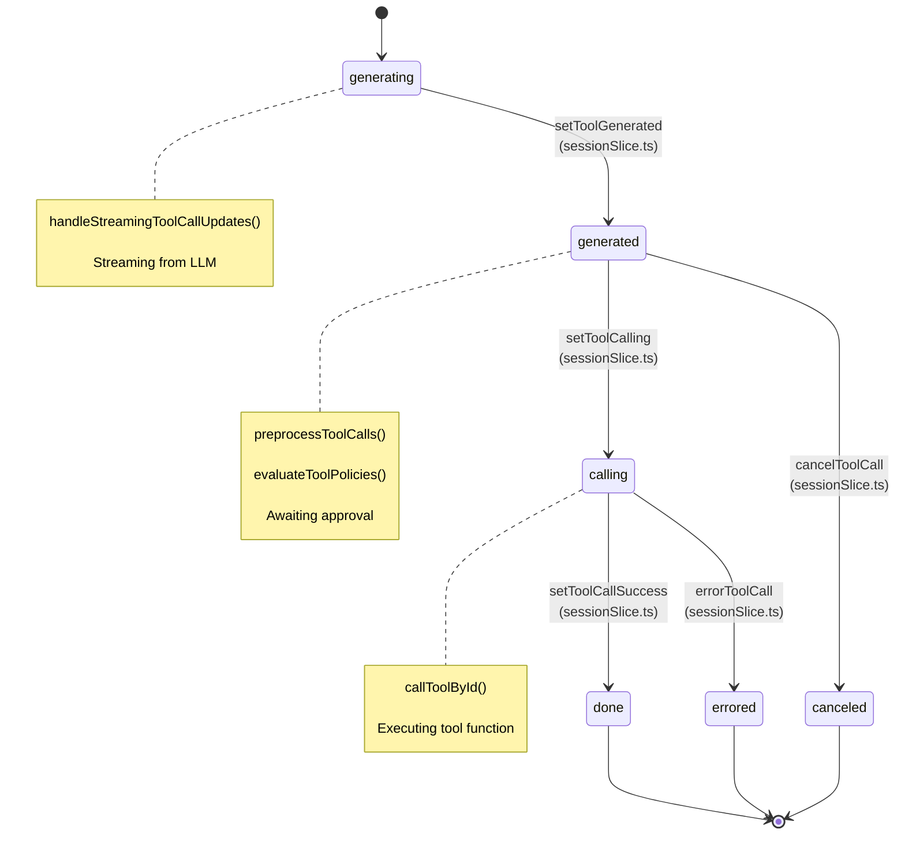
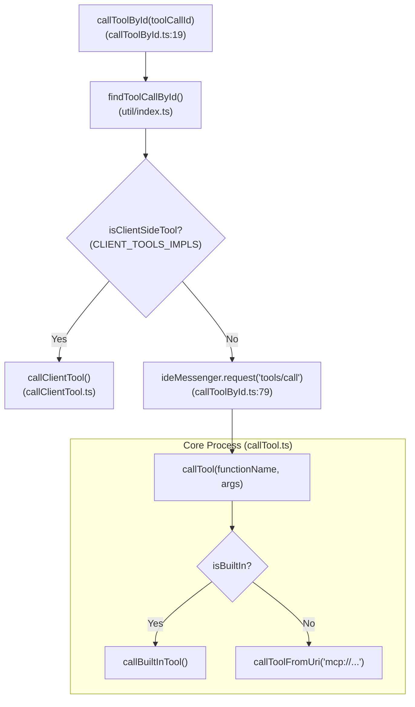

# Tool Calling

<details>
<summary>Relevant source files</summary>

The following files were used as context for generating this wiki page:

- [core/config/createNewAssistantFile.ts](core/config/createNewAssistantFile.ts)
- [core/tools/builtIn.ts](core/tools/builtIn.ts)
- [core/tools/callTool.ts](core/tools/callTool.ts)
- [core/tools/definitions/createNewFile.ts](core/tools/definitions/createNewFile.ts)
- [core/tools/definitions/fetchUrlContent.ts](core/tools/definitions/fetchUrlContent.ts)
- [core/tools/definitions/globSearch.ts](core/tools/definitions/globSearch.ts)
- [core/tools/definitions/grepSearch.ts](core/tools/definitions/grepSearch.ts)
- [core/tools/definitions/index.ts](core/tools/definitions/index.ts)
- [core/tools/definitions/ls.ts](core/tools/definitions/ls.ts)
- [core/tools/definitions/readCurrentlyOpenFile.ts](core/tools/definitions/readCurrentlyOpenFile.ts)
- [core/tools/definitions/readFile.ts](core/tools/definitions/readFile.ts)
- [core/tools/definitions/runTerminalCommand.ts](core/tools/definitions/runTerminalCommand.ts)
- [core/tools/definitions/searchWeb.ts](core/tools/definitions/searchWeb.ts)
- [core/tools/definitions/toolDefinitions.test.ts](core/tools/definitions/toolDefinitions.test.ts)
- [core/tools/definitions/viewDiff.ts](core/tools/definitions/viewDiff.ts)
- [core/tools/definitions/viewRepoMap.ts](core/tools/definitions/viewRepoMap.ts)
- [core/tools/definitions/viewSubdirectory.ts](core/tools/definitions/viewSubdirectory.ts)
- [core/tools/implementations/createNewFile.ts](core/tools/implementations/createNewFile.ts)
- [core/tools/implementations/grepSearch.ts](core/tools/implementations/grepSearch.ts)
- [core/tools/implementations/readCurrentlyOpenFile.ts](core/tools/implementations/readCurrentlyOpenFile.ts)
- [core/tools/implementations/readFile.ts](core/tools/implementations/readFile.ts)
- [core/tools/implementations/readFileLimit.ts](core/tools/implementations/readFileLimit.ts)
- [core/tools/implementations/requestRule.ts](core/tools/implementations/requestRule.ts)
- [core/tools/implementations/runTerminalCommand.timeout.vitest.ts](core/tools/implementations/runTerminalCommand.timeout.vitest.ts)
- [core/tools/implementations/runTerminalCommand.ts](core/tools/implementations/runTerminalCommand.ts)
- [core/tools/implementations/runTerminalCommand.vitest.ts](core/tools/implementations/runTerminalCommand.vitest.ts)
- [core/tools/implementations/viewSubdirectory.ts](core/tools/implementations/viewSubdirectory.ts)
- [core/tools/index.ts](core/tools/index.ts)
- [core/tools/searchWebGating.vitest.ts](core/tools/searchWebGating.vitest.ts)
- [core/util/processTerminalStates.test.ts](core/util/processTerminalStates.test.ts)
- [core/util/processTerminalStates.ts](core/util/processTerminalStates.ts)
- [core/vendor/package-lock.json](core/vendor/package-lock.json)
- [gui/src/components/DeprecationBanner.tsx](gui/src/components/DeprecationBanner.tsx)
- [gui/src/pages/gui/ToolCallDiv/CreateFile.tsx](gui/src/pages/gui/ToolCallDiv/CreateFile.tsx)
- [gui/src/pages/gui/ToolCallDiv/IndicatorBar.tsx](gui/src/pages/gui/ToolCallDiv/IndicatorBar.tsx)
- [gui/src/pages/gui/ToolCallDiv/RunTerminalCommand.tsx](gui/src/pages/gui/ToolCallDiv/RunTerminalCommand.tsx)
- [gui/src/pages/gui/ToolCallDiv/TerminalCollapsibleContainer.tsx](gui/src/pages/gui/ToolCallDiv/TerminalCollapsibleContainer.tsx)
- [gui/src/redux/slices/uiSlice.ts](gui/src/redux/slices/uiSlice.ts)
- [gui/src/redux/thunks/callToolById.ts](gui/src/redux/thunks/callToolById.ts)
- [gui/src/redux/thunks/cancelToolCall.ts](gui/src/redux/thunks/cancelToolCall.ts)
- [gui/src/redux/thunks/moveTerminalProcessToBackground.ts](gui/src/redux/thunks/moveTerminalProcessToBackground.ts)
- [gui/src/redux/thunks/streamResponse.test.ts](gui/src/redux/thunks/streamResponse.test.ts)
- [gui/src/redux/thunks/streamResponse_errorHandling.test.ts](gui/src/redux/thunks/streamResponse_errorHandling.test.ts)
- [gui/src/redux/thunks/streamResponse_toolCalls.test.ts](gui/src/redux/thunks/streamResponse_toolCalls.test.ts)
- [gui/src/util/localStorage.ts](gui/src/util/localStorage.ts)
- [gui/src/util/test/mockStore.ts](gui/src/util/test/mockStore.ts)

</details>


## Purpose and Scope

This document describes the tool calling system in Continue, which enables LLMs to invoke functions during chat interactions. Tool calling allows models to interact with the IDE, codebase, and external systems through a structured interface. The system handles tool definition, state management, execution lifecycle, policy evaluation, and provider-specific implementations.

## Tool Definition Structure

Tools in Continue are defined by the `Tool` interface at [core/index.d.ts:1133-1169](), which extends the OpenAI function calling schema while adding Continue-specific metadata for execution control and UI display.

### Tool Interface Structure

```mermaid
graph TB
    ToolInterface["Tool interface<br/>(core/index.d.ts:1133)"]
    
    FunctionDef["function: ToolFunction"]
    DisplayMeta["Display Metadata"]
    ExecutionControl["Execution Control"]
    McpMeta["MCP Integration"]
    
    ToolInterface --> FunctionDef
    ToolInterface --> DisplayMeta
    ToolInterface --> ExecutionControl
    ToolInterface --> McpMeta
    
    FunctionDef --> FnName["name: string"]
    FunctionDef --> FnDesc["description?: string"]
    FunctionDef --> FnParams["parameters?: Record<string, any>"]
    FunctionDef --> FnStrict["strict?: boolean | null"]
    
    DisplayMeta --> DTitle["displayTitle: string"]
    DisplayMeta --> DWouldLike["wouldLikeTo?: string"]
    DisplayMeta --> DCurrently["isCurrently?: string"]
    DisplayMeta --> DAlready["hasAlready?: string"]
    DisplayMeta --> DIcon["toolCallIcon?: string"]
    DisplayMeta --> DFavicon["faviconUrl?: string"]
    
    ExecutionControl --> ECReadonly["readonly: boolean"]
    ExecutionControl --> ECInstant["isInstant?: boolean"]
    ExecutionControl --> ECPolicy["defaultToolPolicy?: ToolPolicy"]
    ExecutionControl --> ECEvaluate["evaluateToolCallPolicy?: fn"]
    ExecutionControl --> ECPreprocess["preprocessArgs?: fn"]
    
    McpMeta --> McpUri["uri?: string"]
    McpMeta --> McpMeta2["mcpMeta?: McpToolMeta"]
```



**Sources:** [core/index.d.ts:1133-1169]()

### Core Tool Properties

| Property Group | Description | Key Properties | Type/Location |
|---------------|-------------|----------------|---------------|
| **Function Definition** | OpenAI-compatible function schema | `function.name`, `function.parameters`, `function.strict` | `type: "function"` at [core/index.d.ts:1134]() |
| **Display Metadata** | UI rendering properties | `displayTitle`, `wouldLikeTo`, `isCurrently`, `hasAlready`, `toolCallIcon` | [core/index.d.ts:1141-1144]() |
| **Execution Control** | Runtime behavior configuration | `readonly`, `isInstant`, `group` | [core/index.d.ts:1145-1149]() |
| **Security Policy** | Approval requirements | `defaultToolPolicy`, `evaluateToolCallPolicy` | [core/index.d.ts:1155, 1163-1167]() |
| **Preprocessing** | Argument validation/transformation | `preprocessArgs` | [core/index.d.ts:1157-1162]() |
| **System Message** | For non-native tool calling | `systemMessageDescription` | [core/index.d.ts:1151-1154]() |
| **MCP Integration** | Model Context Protocol metadata | `uri`, `faviconUrl`, `mcpMeta` | [core/index.d.ts:1147-1148, 1168]() |

**Sources:** [core/index.d.ts:1133-1169]()

## Tool Call Lifecycle

Tool calls progress through distinct phases tracked by the `ToolStatus` type at [core/index.d.ts:497-503](). The lifecycle is managed through Redux actions in `sessionSlice.ts` and orchestrated by the core orchestrator.

### Lifecycle State Diagram



**Sources:** [core/index.d.ts:497-503](), [gui/src/redux/slices/sessionSlice.ts](), [gui/src/redux/thunks/callToolById.ts:19-150]()

### Generation Phase

During LLM streaming, tool calls are incrementally built from `ToolCallDelta` fragments. The `streamResponseThunk` manages this flow, dispatching updates to the Redux store as deltas arrive. For models supporting native tools, Continue captures these structured outputs to populate the `toolCalls` array in the `AssistantChatMessage` [gui/src/redux/thunks/streamResponse_toolCalls.test.ts:142-153]().

**Sources:** [gui/src/redux/thunks/streamResponse.ts](), [gui/src/redux/thunks/streamResponse_toolCalls.test.ts:142-153]()

## Execution Phase

The `callToolById` thunk at [gui/src/redux/thunks/callToolById.ts:19-150]() coordinates the execution. It determines if the tool should be executed on the client (IDE extension) or on the Core side.

### Tool Dispatch Logic



**Sources:** [gui/src/redux/thunks/callToolById.ts:59-95](), [core/tools/callTool.ts:187-210](), [core/tools/builtIn.ts:28-32]()

### Built-in Tool Implementations

Continue provides built-in tools for IDE interaction, mapped in `callBuiltInTool` [core/tools/callTool.ts:187-210]():

| Tool Name | Implementation Function | Purpose |
|-----------|-------------------------|---------|
| `read_file` | `readFileImpl` | Reads file content [core/tools/implementations/readFile.ts:10]() |
| `run_terminal_command` | `runTerminalCommandImpl` | Executes shell commands [core/tools/implementations/runTerminalCommand.ts:109]() |
| `create_rule_block` | `createRuleBlockImpl` | Creates persistent standards in `.continue/rules` [core/tools/implementations/createRuleBlock.ts:5]() |
| `grep_search` | `grepSearchImpl` | Search codebase using grep [core/tools/implementations/grepSearch.ts:12]() |
| `ls` | `lsToolImpl` | List directory contents [core/tools/implementations/lsTool.ts:5]() |

**Sources:** [core/tools/callTool.ts:187-210](), [core/tools/builtIn.ts:1-24]()

## Policy and Security

Tool execution is governed by policies defined in `uiSlice.ts`.

### Tool Policies

The `ToolPolicy` type (imported from `@continuedev/terminal-security`) includes:
1. `allowedWithPermission`: User must click "Approve" in the UI [gui/src/redux/slices/uiSlice.ts:34]().
2. `allowedWithoutPermission`: Tool executes automatically.
3. `disabled`: Tool cannot be called.

The `uiSlice` manages these settings at [gui/src/redux/slices/uiSlice.ts:80-113]():

```typescript
// Default policy for tools
export const DEFAULT_TOOL_SETTING: ToolPolicy = "allowedWithPermission";

// Reducer for toggling policies
toggleToolSetting: (state, action: PayloadAction<string>) => {
  const setting = state.toolSettings[action.payload];
  switch (setting) {
    case "allowedWithPermission":
      state.toolSettings[action.payload] = "allowedWithoutPermission";
      break;
    case "allowedWithoutPermission":
      state.toolSettings[action.payload] = "disabled";
      break;
    case "disabled":
      state.toolSettings[action.payload] = "allowedWithPermission";
      break;
  }
}
```

**Sources:** [gui/src/redux/slices/uiSlice.ts:34, 96-113]()

### Terminal Security Evaluation

The `run_terminal_command` tool uses a specialized evaluation function to determine if a command requires higher scrutiny based on its content [core/tools/definitions/runTerminalCommand.ts:64-72]().

**Sources:** [core/tools/definitions/runTerminalCommand.ts:64-72]()

## Terminal Command Execution Detail

The `runTerminalCommandImpl` at [core/tools/implementations/runTerminalCommand.ts:109-201]() handles process spawning and output streaming.

1.  **Environment Resolution**: It determines the working directory using `resolveWorkingDirectory` [core/tools/implementations/runTerminalCommand.ts:54-88]().
2.  **Platform Abstraction**: It uses `getShellCommand` to select between `powershell.exe` on Windows and the user's login shell on Unix [core/tools/implementations/runTerminalCommand.ts:25-37]().
3.  **Process Management**: It tracks running processes using `markProcessAsRunning` [core/tools/implementations/runTerminalCommand.ts:156-162]().
4.  **Timeouts**: Default timeout is 2 minutes [core/tools/implementations/runTerminalCommand.ts:7](). If exceeded, it attempts `SIGTERM` followed by `SIGKILL` [core/tools/implementations/runTerminalCommand.ts:172-201]().
5.  **Output Decoding**: It decodes buffer output based on the platform (e.g., handling GBK on Windows) [core/tools/implementations/runTerminalCommand.ts:10-24]().

**Sources:** [core/tools/implementations/runTerminalCommand.ts:1-201]()

## UI Components

Tool calls are rendered in the chat interface using specialized React components.

### Status Rendering

The `ToolCallStatusMessage` component uses Mustache templates defined in the `Tool` object to generate descriptions:

- **wouldLikeTo**: Used when `status` is `generating` or `generated` [core/tools/definitions/runTerminalCommand.ts:38]().
- **isCurrently**: Used when `status` is `calling` [core/tools/definitions/runTerminalCommand.ts:39]().
- **hasAlready**: Used when `status` is `done` [core/tools/definitions/runTerminalCommand.ts:40]().

### RunTerminalCommand Component
The `RunTerminalCommand` component [gui/src/pages/gui/ToolCallDiv/RunTerminalCommand.tsx:10-43]() handles the visual state of terminal execution, determining if the command is `running`, `completed`, `failed`, or `background` based on the `toolCallState` [gui/src/pages/gui/ToolCallDiv/RunTerminalCommand.tsx:23-31]().

**Sources:** [core/tools/definitions/runTerminalCommand.ts:35-41](), [gui/src/pages/gui/ToolCallDiv/RunTerminalCommand.tsx:10-43]()

## Configuration and Selection

Tools are dynamically enabled based on configuration and model capabilities.

### Tool Selection Logic

```typescript
// core/tools/index.ts:18-51
export const getConfigDependentToolDefinitions = async (
  params: ConfigDependentToolParams,
): Promise<Tool[]> => {
  const { modelName, enableExperimentalTools, isRemote } = params;
  const tools: Tool[] = [];
  
  // ...
  tools.push(toolDefinitions.searchWebTool);

  if (enableExperimentalTools) {
    tools.push(
      toolDefinitions.viewRepoMapTool,
      toolDefinitions.viewSubdirectoryTool,
      toolDefinitions.codebaseTool,
      toolDefinitions.readFileRangeTool,
    );
  }
  
  if (modelName && isRecommendedAgentModel(modelName)) {
    tools.push(toolDefinitions.multiEditTool);
  } else {
    tools.push(toolDefinitions.editFileTool);
    tools.push(toolDefinitions.singleFindAndReplaceTool);
  }

  return tools;
};
```

**Sources:** [core/tools/index.ts:18-51](), [core/tools/builtIn.ts:28-32]()

### MCP Tool Loading

MCP tools are discovered from configured MCP servers. The `callToolFromUri` function at [core/tools/callTool.ts:67-185]() handles `mcp://` URIs by retrieving the connection from `MCPManagerSingleton` and invoking `client.client.callTool` [core/tools/callTool.ts:93-109]().

**Sources:** [core/tools/callTool.ts:87-110](), [core/context/mcp/MCPManagerSingleton.ts]()