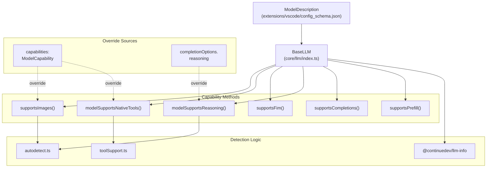
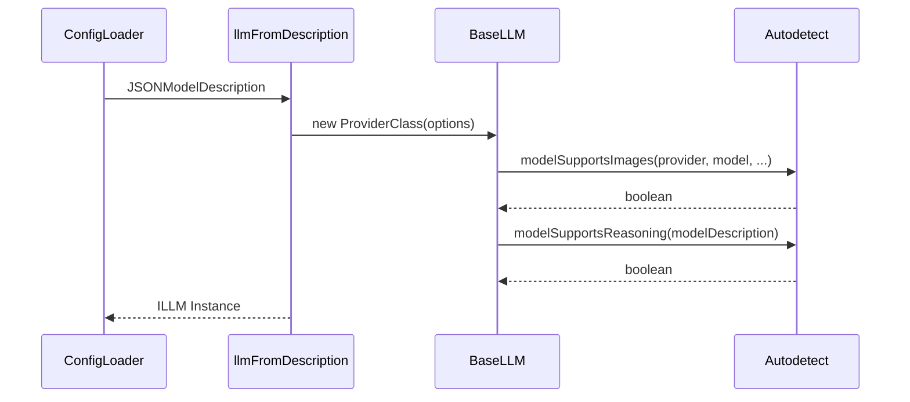

# Capability Detection

Relevant source files

The following files were used as context for generating this wiki page:

- [core/config/types.ts](core/config/types.ts)
- [core/index.d.ts](core/index.d.ts)
- [core/llm/autodetect.ts](core/llm/autodetect.ts)
- [core/llm/llms/ClawRouter.ts](core/llm/llms/ClawRouter.ts)
- [core/llm/llms/ClawRouter.vitest.ts](core/llm/llms/ClawRouter.vitest.ts)
- [core/llm/llms/WatsonX.ts](core/llm/llms/WatsonX.ts)
- [core/llm/llms/index.ts](core/llm/llms/index.ts)
- [core/llm/llms/xAI.ts](core/llm/llms/xAI.ts)
- [core/llm/toolSupport.test.ts](core/llm/toolSupport.test.ts)
- [core/llm/toolSupport.ts](core/llm/toolSupport.ts)
- [docs/customize/model-providers/more/clawrouter.mdx](docs/customize/model-providers/more/clawrouter.mdx)
- [docs/customize/model-providers/more/xAI.mdx](docs/customize/model-providers/more/xAI.mdx)
- [docs/customize/model-providers/overview.mdx](docs/customize/model-providers/overview.mdx)
- [extensions/vscode/config_schema.json](extensions/vscode/config_schema.json)
- [gui/public/logos/clawrouter.png](gui/public/logos/clawrouter.png)
- [gui/src/pages/AddNewModel/configs/models.ts](gui/src/pages/AddNewModel/configs/models.ts)
- [gui/src/pages/AddNewModel/configs/providers.ts](gui/src/pages/AddNewModel/configs/providers.ts)
- [packages/llm-info/README.md](packages/llm-info/README.md)
- [packages/llm-info/package-lock.json](packages/llm-info/package-lock.json)
- [packages/llm-info/package.json](packages/llm-info/package.json)
- [packages/llm-info/src/index.ts](packages/llm-info/src/index.ts)
- [packages/llm-info/src/providers/bedrock.ts](packages/llm-info/src/providers/bedrock.ts)
- [packages/llm-info/src/providers/gemini.ts](packages/llm-info/src/providers/gemini.ts)
- [packages/llm-info/src/providers/inception.ts](packages/llm-info/src/providers/inception.ts)
- [packages/llm-info/src/providers/mistral.ts](packages/llm-info/src/providers/mistral.ts)
- [packages/llm-info/src/providers/openai.ts](packages/llm-info/src/providers/openai.ts)
- [packages/llm-info/src/providers/os.ts](packages/llm-info/src/providers/os.ts)
- [packages/llm-info/src/providers/vertexai.ts](packages/llm-info/src/providers/vertexai.ts)
- [packages/llm-info/src/providers/xAI.ts](packages/llm-info/src/providers/xAI.ts)
- [packages/llm-info/src/types.ts](packages/llm-info/src/types.ts)
- [packages/openai-adapters/src/index.ts](packages/openai-adapters/src/index.ts)
- [packages/openai-adapters/src/types.ts](packages/openai-adapters/src/types.ts)

## Purpose and Scope

This document describes Continue's capability detection system, which automatically determines what features different LLM models and providers support. The system enables Continue to adapt its behavior based on whether a model supports images, tool calling, fill-in-the-middle (FIM) completions, reasoning, and other advanced capabilities. This detection happens during LLM initialization and is used throughout the application to enable or disable specific features.

## System Overview

Continue supports a vast array of LLM providers with varying levels of feature parity. Rather than requiring users to manually configure every capability, the system automatically detects features through provider-specific logic, model name pattern matching, and configuration overrides.

### Capability Detection Architecture

Sources: [core/llm/index.ts:91-210](), [core/llm/autodetect.ts:1-187](), [core/llm/toolSupport.ts:4-222]()

## Core Capability Types

### Image Support Detection

Image support (multimodal vision capabilities) is detected through the `supportsImages()` method in `BaseLLM`, which delegates to `modelSupportsImages()` in the autodetect module.

1.  **Explicit Override**: If `capabilities.uploadImage` is set in the configuration, it takes precedence [core/llm/autodetect.ts:166-168]().
2.  **Provider Validation**: The provider must be in the `PROVIDER_SUPPORTS_IMAGES` list (e.g., `openai`, `anthropic`, `gemini`, `ollama`, `cohere`) [core/llm/autodetect.ts:114-136]().
3.  **Pattern Matching**: The model name or title is checked against regex patterns in `MODEL_SUPPORTS_IMAGES`, covering models like `gpt-4o`, `claude-3`, `gemini-1.5`, `pixtral`, and `llama-3.2` [core/llm/autodetect.ts:138-158]().

Sources: [core/llm/index.ts:151-152](), [core/llm/autodetect.ts:114-187]()

### Tool Support Detection

Tool support (function calling) is managed by the `PROVIDER_TOOL_SUPPORT` record in `toolSupport.ts`. This is a mapping of provider names to detection functions that return a boolean based on the model string.

| Provider | Detection Logic |
| :--- | :--- |
| `openai` | Supports models starting with `gpt-[4-9]`, `o[1-9]`, `codex`, or containing `exaone`, `gpt-oss`, or `gemma` [core/llm/toolSupport.ts:19-60](). |
| `anthropic` | Supports Claude models excluding `claude-2` and `claude-instant` [core/llm/toolSupport.ts:5-13](). |
| `ollama` | Uses a complex heuristic checking for patterns like `llama3.1`, `qwen2`, `mistral`, `deepseek`, while excluding `vision` or `math` variants [core/llm/toolSupport.ts:126-201](). |
| `gemini` | All Gemini models are assumed to support function calling [core/llm/toolSupport.ts:68-71](). |
| `mistral` | Supports `codestral`, `mistral-large`, `pixtral`, `ministral`, and `devstral` [core/llm/toolSupport.ts:109-124](). |
| `bedrock` | Supports `claude` (3+), `nova` series, `llama4`, and `deepseek` [core/llm/toolSupport.ts:87-108](). |

Sources: [core/llm/toolSupport.ts:3-222]()

### Reasoning Support Detection

Reasoning support (extended thinking/chain-of-thought) is determined by `modelSupportsReasoning()`.

*   **Config Level**: Forced if `completionOptions.reasoning` is defined in the model configuration [core/llm/autodetect.ts:195-198]().
*   **Model Patterns**: Automatically enabled for `deepseek-r`, OpenAI `o1/o3/o4` series, `claude` (excluding 3.0/3.5 variants to avoid default reasoning on older models), `command-a-reasoning`, and `magistral` [core/llm/autodetect.ts:204-231]().

Sources: [core/llm/autodetect.ts:189-232](), [extensions/vscode/config_schema.json:79-83]()

### FIM and Prefill Support

*   **FIM (Fill-In-The-Middle)**: Determined by `supportsFim()`. It is disabled by default in the `ILLM` interface [core/index.d.ts:157]() but implemented by specific providers like `Ollama` or `TabAutocomplete` systems.
*   **Prefill**: `supportsPrefill()` signals if the model supports pre-filling the assistant response. It returns true for providers like `anthropic` and `mistral` [core/index.d.ts:155]().

Sources: [core/index.d.ts:151-157](), [extensions/vscode/config_schema.json:12-14]()

## Technical Implementation

### BaseLLM Initialization

When an LLM is instantiated, it uses the `@continuedev/llm-info` package and autodetect logic to populate its internal state. The `llmFromDescription` function orchestrates this by finding the correct provider class and applying configuration options.

Sources: [core/llm/llms/index.ts:137-188](), [core/llm/autodetect.ts:160-187]()

### Provider-Specific Overrides

Providers can override default detection behavior by implementing specific methods.

*   **WatsonX**: Implements custom message conversion logic in `_convertMessage` to handle tool calls and image URLs specifically for IBM's infrastructure [core/llm/llms/WatsonX.ts:95-133]().
*   **OpenAI Adapters**: The `@continuedev/openai-adapters` package provides a unified way to construct APIs for various providers, often defaulting to OpenAI-compatible endpoints but allowing for provider-specific logic like `isHuggingFaceOpenAICompatible` [packages/openai-adapters/src/index.ts:46-66]().

Sources: [core/llm/llms/WatsonX.ts:95-133](), [packages/openai-adapters/src/index.ts:84-196]()

## Configuration Schema

Capabilities can be manually tuned in `config.json` via the `ModelDescription` object.

| Property | Description | Source |
| :--- | :--- | :--- |
| `capabilities` | Object containing `uploadImage`, `tools`, and `nextEdit` booleans. | [extensions/vscode/config_schema.json:1010-1025]() |
| `completionOptions.reasoning` | Boolean to enable/disable reasoning for models that support it. | [extensions/vscode/config_schema.json:79-83]() |
| `completionOptions.reasoningBudgetTokens` | Integer setting the token budget for thinking. | [extensions/vscode/config_schema.json:84-88]() |

Sources: [extensions/vscode/config_schema.json:79-1025]()