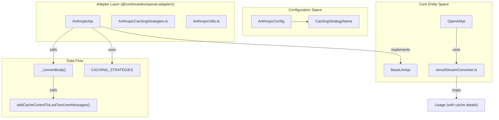
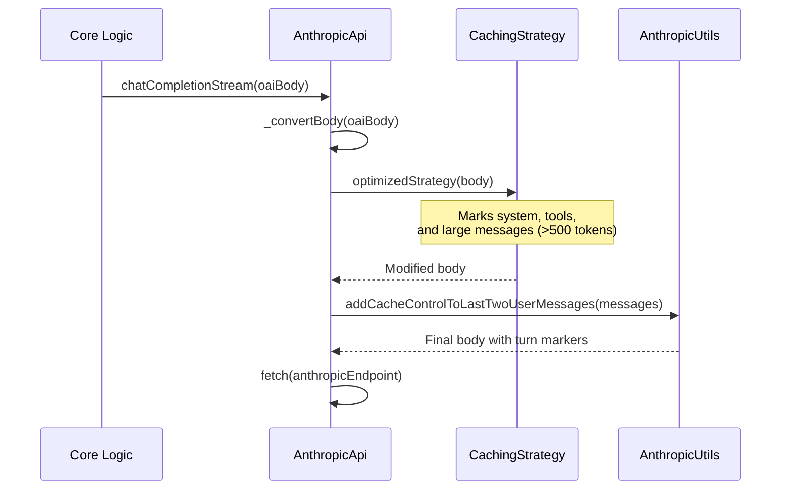
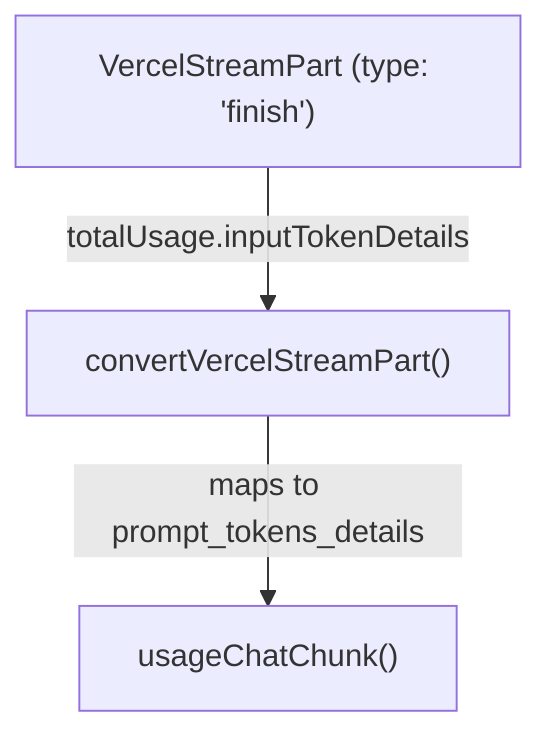

# Prompt Caching

Relevant source files

The following files were used as context for generating this wiki page:

- [core/llm/index.ts](core/llm/index.ts)
- [core/llm/llms/Anthropic.ts](core/llm/llms/Anthropic.ts)
- [core/llm/llms/Cohere.ts](core/llm/llms/Cohere.ts)
- [core/llm/llms/Gemini.ts](core/llm/llms/Gemini.ts)
- [core/llm/llms/Ollama.ts](core/llm/llms/Ollama.ts)
- [core/llm/llms/OpenAI.ts](core/llm/llms/OpenAI.ts)
- [core/llm/llms/VertexAI.ts](core/llm/llms/VertexAI.ts)
- [core/llm/llms/gemini-types.ts](core/llm/llms/gemini-types.ts)
- [packages/openai-adapters/src/apis/Anthropic.test.ts](packages/openai-adapters/src/apis/Anthropic.test.ts)
- [packages/openai-adapters/src/apis/Anthropic.ts](packages/openai-adapters/src/apis/Anthropic.ts)
- [packages/openai-adapters/src/apis/Bedrock.ts](packages/openai-adapters/src/apis/Bedrock.ts)
- [packages/openai-adapters/src/apis/Gemini.test.ts](packages/openai-adapters/src/apis/Gemini.test.ts)
- [packages/openai-adapters/src/apis/Gemini.ts](packages/openai-adapters/src/apis/Gemini.ts)
- [packages/openai-adapters/src/apis/OpenAI.ts](packages/openai-adapters/src/apis/OpenAI.ts)
- [packages/openai-adapters/src/convertToolsToVercel.ts](packages/openai-adapters/src/convertToolsToVercel.ts)
- [packages/openai-adapters/src/openaiToVercelMessages.ts](packages/openai-adapters/src/openaiToVercelMessages.ts)
- [packages/openai-adapters/src/test/cli-tools.test.ts](packages/openai-adapters/src/test/cli-tools.test.ts)
- [packages/openai-adapters/src/test/convertToolsToVercel.test.ts](packages/openai-adapters/src/test/convertToolsToVercel.test.ts)
- [packages/openai-adapters/src/test/vercel-sdk.test.ts](packages/openai-adapters/src/test/vercel-sdk.test.ts)
- [packages/openai-adapters/src/test/vercelStreamConverter.test.ts](packages/openai-adapters/src/test/vercelStreamConverter.test.ts)
- [packages/openai-adapters/src/util/gemini-types.ts](packages/openai-adapters/src/util/gemini-types.ts)
- [packages/openai-adapters/src/vercelStreamConverter.ts](packages/openai-adapters/src/vercelStreamConverter.ts)

This page documents the prompt caching system used to reduce costs and latency when making repeated LLM requests with similar context. Prompt caching allows providers like Anthropic to reuse previously processed prompts, charging reduced rates for cached portions of the input.

For information about general LLM configuration, see [LLM Abstraction Layer](4.1). For details on message compilation and token counting, see [Message Compilation and Streaming](4.4).

## Overview

Prompt caching enables LLM providers to cache frequently used portions of prompts (such as system messages, tool definitions, or conversation history) and reuse them across requests. This reduces:
- **Cost**: Cached tokens are charged at a lower rate than fresh tokens.
- **Latency**: Cached content doesn't need to be reprocessed.

The caching system is primarily implemented for Anthropic's Claude models, which support "ephemeral" cache control markers. The system is integrated into both the core LLM provider logic and the `@continuedev/openai-adapters` package.

## Architecture

Sources: [packages/openai-adapters/src/apis/Anthropic.ts:56-68](), [packages/openai-adapters/src/apis/Anthropic.ts:70-86](), [packages/openai-adapters/src/vercelStreamConverter.ts:180-207]()

## Anthropic Implementation

### Message Conversion with Caching

The `AnthropicApi` implements caching through its internal `_convertBody` pipeline, which transforms OpenAI-compatible request bodies into Anthropic's native format with cache markers.

**Implementation Flow:**
1. **Body Conversion**: `_convertToCleanAnthropicBody` creates a standard Anthropic `MessageCreateParams` object, converting OpenAI roles (like "system") to Anthropic's system field [packages/openai-adapters/src/apis/Anthropic.ts:95-160]().
2. **Strategy Application**: The selected `CachingStrategy` (defaulting to `systemAndTools`) is retrieved from `CACHING_STRATEGIES` and applied to the clean body [packages/openai-adapters/src/apis/Anthropic.ts:75-77]().
3. **Turn-Level Caching**: If caching is not explicitly disabled, the system automatically calls `addCacheControlToLastTwoUserMessages` to optimize back-and-forth chat [packages/openai-adapters/src/apis/Anthropic.ts:79-83]().

Sources: [packages/openai-adapters/src/apis/Anthropic.ts:70-86](), [packages/openai-adapters/src/apis/AnthropicUtils.ts:43-48]()

## Caching Strategies

The `@continuedev/openai-adapters` package provides a pluggable strategy system for Anthropic caching.

Sources: [packages/openai-adapters/src/apis/Anthropic.ts:70-86](), [packages/openai-adapters/src/apis/AnthropicUtils.ts:43-48]()

### Available Strategies

The system supports several strategies for placing cache markers, defined in `AnthropicCachingStrategies.ts`.

| Strategy | Description | Key Implementation Detail |
|----------|-------------|---------------------------|
| `none` | No caching | Returns body unchanged. |
| `systemOnly` | Caches system messages | Iterates `body.system` array and adds `cache_control` up to 4 markers. |
| `systemAndTools` | Caches system + tool definitions | Caches system array and the final tool definition. |
| `optimized` | Intelligent caching | Caches system, tools, and any individual messages exceeding a specific token threshold (e.g., 500 tokens). |

Sources: [packages/openai-adapters/src/apis/Anthropic.ts:75-77](), [packages/openai-adapters/src/apis/AnthropicUtils.ts:43-48]()

### Conversation Turn Caching

The `addCacheControlToLastTwoUserMessages()` utility implements Anthropic's recommended pattern for conversation caching. It identifies the last and second-to-last user messages in the `messages` array and attaches `cache_control: { type: "ephemeral" }` to their content blocks. This ensures that the context of the immediate conversation is cached for subsequent turns.

Sources: [packages/openai-adapters/src/apis/AnthropicUtils.ts:43-48](), [packages/openai-adapters/src/apis/Anthropic.ts:81-83]()

## Usage Tracking

### Token Metrics and Usage Flow

Anthropic returns detailed usage information for cached requests. The adapter layer ensures these are correctly mapped to a unified `Usage` format.

**Metrics Tracked:**
- `prompt_tokens`: Total tokens in the prompt.
- `cache_read_tokens`: Tokens successfully served from the cache.
- `cache_write_tokens`: New tokens added to the cache during the request.

Sources: [packages/openai-adapters/src/vercelStreamConverter.ts:180-207]()

### Integration with Vercel AI SDK

The `vercelStreamConverter.ts` handles the mapping of Vercel-specific stream parts to OpenAI-compatible chunks. When a `finish` part is received, the converter extracts detailed token usage, including cache-specific metrics.

Sources: [packages/openai-adapters/src/vercelStreamConverter.ts:165-207](), [packages/openai-adapters/src/vercelStreamConverter.ts:83-86]()

In `convertVercelStreamPart`, the `inputTokenDetails` are mapped to `prompt_tokens_details` containing `cached_tokens`, `cache_read_tokens`, and `cache_write_tokens` [packages/openai-adapters/src/vercelStreamConverter.ts:180-194](). This usage chunk is then yielded to the core logic via `usageChatChunk` [packages/openai-adapters/src/vercelStreamConverter.ts:196-206]().

## Other Provider Implementations

### Ollama and Anthropic Prefill
The `BaseLLM` class tracks `supportsPrefill()` for providers like `ollama`, `anthropic`, and `mistral` [core/llm/index.ts:141-143](). While not strictly prompt caching, prefill allows the model to continue from a specific assistant message prefix, which is often used in conjunction with caching strategies to steer model behavior.

### Bedrock Secure ID
The `BedrockApi` implementation includes a `getSecureID()` utility which generates a UUID for prompt caching purposes, potentially used to identify sessions or specific prompt segments in AWS Bedrock [packages/openai-adapters/src/apis/Bedrock.ts:46-52]().

Sources: [core/llm/index.ts:141-143](), [packages/openai-adapters/src/apis/Bedrock.ts:46-52]()