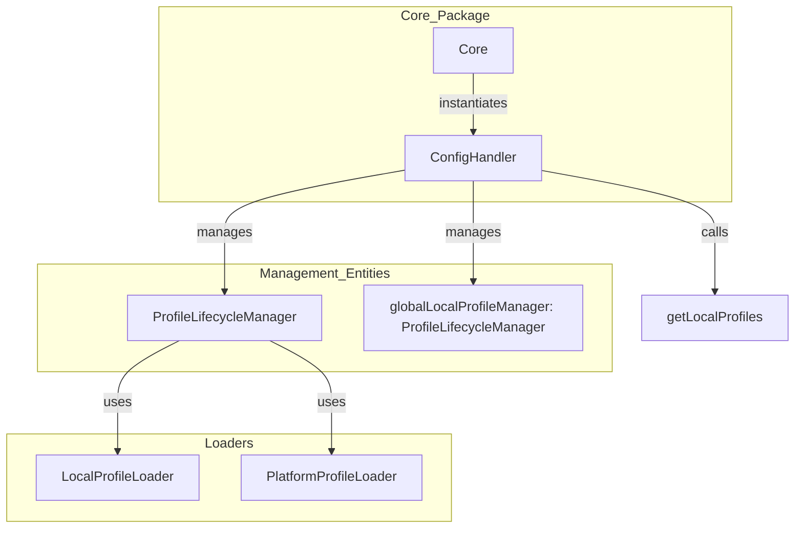
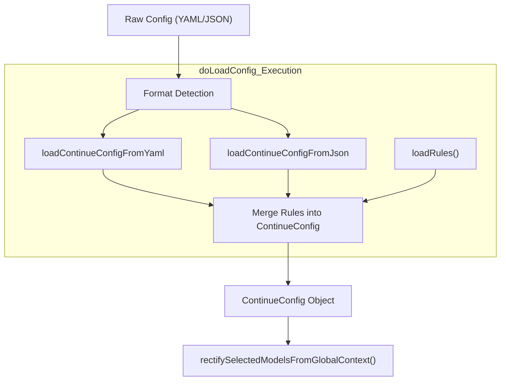

# Configuration System

Relevant source files

The following files were used as context for generating this wiki page:

- [core/config/ConfigHandler.ts](core/config/ConfigHandler.ts)
- [core/config/ProfileLifecycleManager.ts](core/config/ProfileLifecycleManager.ts)
- [core/config/load.ts](core/config/load.ts)
- [core/config/profile/LocalProfileLoader.ts](core/config/profile/LocalProfileLoader.ts)
- [core/config/profile/LocalProfileLoader.vitest.ts](core/config/profile/LocalProfileLoader.vitest.ts)
- [core/config/profile/doLoadConfig.ts](core/config/profile/doLoadConfig.ts)
- [core/config/profile/doLoadConfig.vitest.ts](core/config/profile/doLoadConfig.vitest.ts)
- [core/config/yaml/loadYaml.ts](core/config/yaml/loadYaml.ts)
- [core/util/paths.ts](core/util/paths.ts)

## Purpose and Scope

The Configuration System manages Continue's configuration loading, validation, and lifecycle management. It supports multiple configuration formats (modern YAML and legacy JSON), profile management for different workspaces and organizations, and remote synchronization via the Continue Hub. The system is orchestrated by the `ConfigHandler`, which coordinates profile loaders, configuration merging, and update notifications to the IDE and GUI.

Key capabilities:
- **Multiple format support**: Modern YAML (`config.yaml`) with block composition and legacy JSON (`config.json`) formats [core/config/profile/doLoadConfig.ts:107-137]().
- **Profile system**: Local and platform-based profiles managed via `ProfileLifecycleManager` [core/config/ProfileLifecycleManager.ts:28-36]().
- **Organization support**: determines the active organization and profile for a given workspace, persisting selections in `GlobalContext` [core/config/ConfigHandler.ts:92-125]().
- **Model role management**: Automatic selection and configuration of models for different tasks like chat, autocomplete, and embeddings [core/config/yaml/loadYaml.ts:167-191]().
- **Configuration updates**: Live reload system that manages transitions between profiles via `cascadeInit` [core/config/ConfigHandler.ts:83-136]().

---

## Configuration Architecture

The configuration architecture is built around a provider-consumer model where the `ConfigHandler` acts as the central authority. It manages `ProfileLifecycleManager` instances which in turn use specific `IProfileLoader` implementations to fetch data from different sources.

For details, see [Configuration Architecture](#5.1).

### ConfigHandler: Central Orchestrator

The `ConfigHandler` is instantiated by the `Core` and is responsible for determining which profile is currently active for a given workspace [core/config/ConfigHandler.ts:52-72](). It maintains a `GlobalContext` to persist user selections (like `lastSelectedProfileForWorkspace`) across sessions [core/config/ConfigHandler.ts:97-122]().

**Diagram: ConfigHandler Architecture**

**Sources:** [core/config/ConfigHandler.ts:31-72](), [core/config/ProfileLifecycleManager.ts:28-40](), [core/config/profile/LocalProfileLoader.ts:12-23]()

---

## YAML Blocks and Composition

Continue has moved towards a modern YAML-based configuration system that emphasizes modularity. Instead of a single monolithic file, configurations can be composed of "blocks" (models, context providers, rules, etc.) that are "unrolled" into a final configuration.

For details, see [YAML Blocks and Composition](#5.2).

- **Block System**: Allows using blocks that are unrolled into a final `AssistantUnrolled` object [core/config/yaml/loadYaml.ts:1-14]().
- **Unrolling**: The process of resolving local and remote blocks into a single configuration structure using `unrollAssistant` and `unrollLocalYamlBlocks` [core/config/yaml/loadYaml.ts:91-119]().
- **Local Blocks**: Support for `.continue/` directory to define reusable local components (assistants, agents, configs) [core/config/ConfigHandler.ts:171-180]().

---

## Schema Validation

To ensure stability and provide a good developer experience, Continue uses a robust validation layer.

For details, see [Schema Validation](#5.3).

- **Zod & JSON Schema**: The configuration is validated against schemas using `validateConfigYaml` and `validateConfig` [core/config/yaml/loadYaml.ts:122-131](), [core/config/load.ts:128-136]().
- **IDE Integration**: The system generates JSON Schemas used by IDEs to provide autocomplete and inline error highlighting in `config.json` and `config.yaml`.
- **Validation Errors**: Errors are categorized into `fatal` (prevents loading) and non-fatal (warnings) [core/config/profile/doLoadConfig.ts:148-154]().

---

## Configuration Loading Pipeline

The loading pipeline is the sequence of operations that transforms raw files or remote data into the runtime `ContinueConfig` object.

For details, see [Configuration Loading Pipeline](#5.4).

### The doLoadConfig Pipeline

The `doLoadConfig` function is the core of this pipeline. It orchestrates the following:
1. **Format Detection**: Decides whether to load from YAML via `loadContinueConfigFromYaml` or JSON via `loadContinueConfigFromJson` [core/config/profile/doLoadConfig.ts:107-137]().
2. **Rule Aggregation**: Collects rules from `.continuerules` and markdown files in `.continue/rules` [core/config/profile/doLoadConfig.ts:40-62]().
3. **MCP Integration**: Initializes Model Context Protocol servers and maps them to context providers and tools [core/config/profile/doLoadConfig.ts:194-212]().
4. **Tool Definitions**: Merges built-in tools with custom tools defined in the config [core/config/profile/doLoadConfig.ts:214-225]().

**Diagram: doLoadConfig Pipeline**

**Sources:** [core/config/profile/doLoadConfig.ts:64-156](), [core/config/yaml/loadYaml.ts:162-201]()

---

## Profile Management

Profiles allow users to switch between different sets of AI instructions, models, and tools quickly.

For details, see [Profile Management](#5.5).

- **ProfileLifecycleManager**: Handles the state transitions, caching, and loading of a specific profile [core/config/ProfileLifecycleManager.ts:28-36]().
- **LocalProfileLoader**: Loads configuration from the local filesystem, defaulting to the primary config path [core/config/profile/LocalProfileLoader.ts:12-41]().
- **IProfileLoader**: Interface defining the requirements for profile loaders, including the `doLoadConfig` method [core/config/profile/LocalProfileLoader.ts:12-13]().

---

## Organizations and Teams

For enterprise and team use cases, Continue supports organizational profiles that are synchronized from the Continue Hub.

For details, see [Organizations and Teams](#5.6).

- **Profile Selection**: Users can switch between different profiles. `ConfigHandler` determines the selection based on `workspaceId` and persists it [core/config/ConfigHandler.ts:95-125]().
- **Remote Configuration**: Supports loading configuration from a remote server URL if configured in `IdeSettings` [core/config/load.ts:142-151]().
- **Workspace Configuration**: Merges workspace-specific `.continuerc.json` settings into the global configuration [core/config/load.ts:153-160]().

**Sources:** [core/config/ConfigHandler.ts:92-136](), [core/config/load.ts:142-160]()