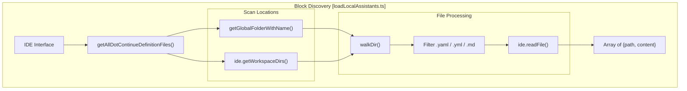
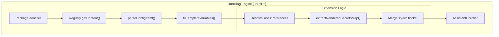
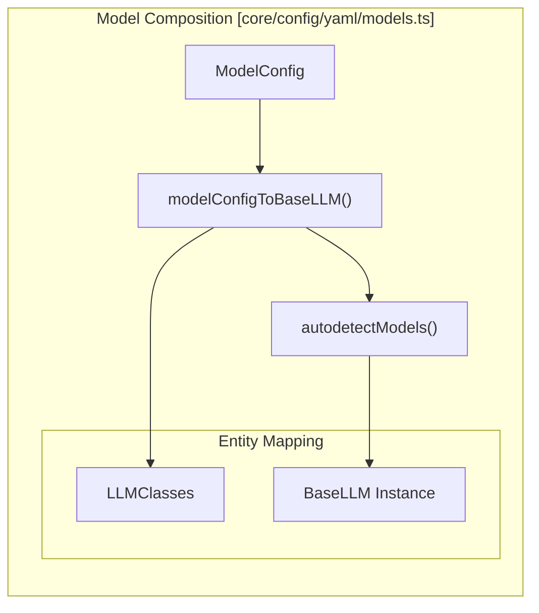
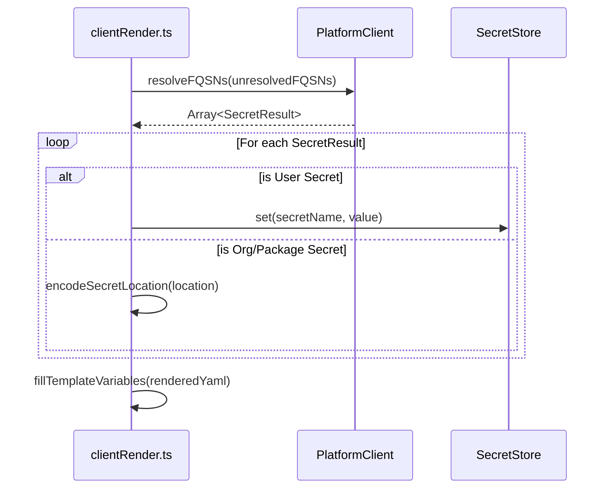

# YAML Blocks and Composition

<details>
<summary>Relevant source files</summary>

The following files were used as context for generating this wiki page:

- [core/config/loadLocalAssistants.ts](core/config/loadLocalAssistants.ts)
- [core/config/markdown/loadCodebaseRules.ts](core/config/markdown/loadCodebaseRules.ts)
- [core/config/markdown/loadMarkdownRules.ts](core/config/markdown/loadMarkdownRules.ts)
- [core/config/yaml/LocalPlatformClient.ts](core/config/yaml/LocalPlatformClient.ts)
- [core/config/yaml/loadLocalYamlBlocks.ts](core/config/yaml/loadLocalYamlBlocks.ts)
- [core/config/yaml/models.ts](core/config/yaml/models.ts)
- [core/llm/llms/SambaNova.ts](core/llm/llms/SambaNova.ts)
- [core/llm/rules/constants.ts](core/llm/rules/constants.ts)
- [core/promptFiles/createNewPromptFile.ts](core/promptFiles/createNewPromptFile.ts)
- [core/promptFiles/getPromptFiles.ts](core/promptFiles/getPromptFiles.ts)
- [core/promptFiles/index.ts](core/promptFiles/index.ts)
- [docs/customize/model-providers/more/SambaNova.mdx](docs/customize/model-providers/more/SambaNova.mdx)
- [docs/customize/model-providers/more/cerebras.mdx](docs/customize/model-providers/more/cerebras.mdx)
- [docs/customize/model-providers/more/cloudflare.mdx](docs/customize/model-providers/more/cloudflare.mdx)
- [docs/customize/model-providers/more/flowise.mdx](docs/customize/model-providers/more/flowise.mdx)
- [docs/customize/model-providers/top-level/azure.mdx](docs/customize/model-providers/top-level/azure.mdx)
- [docs/customize/model-providers/top-level/ollama.mdx](docs/customize/model-providers/top-level/ollama.mdx)
- [docs/guides/ollama-guide.mdx](docs/guides/ollama-guide.mdx)
- [packages/config-yaml/package-lock.json](packages/config-yaml/package-lock.json)
- [packages/config-yaml/src/__tests__/index.test.ts](packages/config-yaml/src/__tests__/index.test.ts)
- [packages/config-yaml/src/converter.ts](packages/config-yaml/src/converter.ts)
- [packages/config-yaml/src/index.ts](packages/config-yaml/src/index.ts)
- [packages/config-yaml/src/interfaces/SecretResult.ts](packages/config-yaml/src/interfaces/SecretResult.ts)
- [packages/config-yaml/src/interfaces/index.ts](packages/config-yaml/src/interfaces/index.ts)
- [packages/config-yaml/src/interfaces/slugs.test.ts](packages/config-yaml/src/interfaces/slugs.test.ts)
- [packages/config-yaml/src/interfaces/slugs.ts](packages/config-yaml/src/interfaces/slugs.ts)
- [packages/config-yaml/src/load/clientRender.ts](packages/config-yaml/src/load/clientRender.ts)
- [packages/config-yaml/src/load/merge.ts](packages/config-yaml/src/load/merge.ts)
- [packages/config-yaml/src/load/unroll.test.ts](packages/config-yaml/src/load/unroll.test.ts)
- [packages/config-yaml/src/load/unroll.ts](packages/config-yaml/src/load/unroll.ts)
- [packages/config-yaml/src/markdown/createMarkdownRule.test.ts](packages/config-yaml/src/markdown/createMarkdownRule.test.ts)
- [packages/config-yaml/src/markdown/createMarkdownRule.ts](packages/config-yaml/src/markdown/createMarkdownRule.ts)
- [packages/config-yaml/src/markdown/markdownToRule.test.ts](packages/config-yaml/src/markdown/markdownToRule.test.ts)
- [packages/config-yaml/src/markdown/markdownToRule.ts](packages/config-yaml/src/markdown/markdownToRule.ts)
- [packages/config-yaml/src/registryClient.test.ts](packages/config-yaml/src/registryClient.test.ts)
- [packages/config-yaml/src/registryClient.ts](packages/config-yaml/src/registryClient.ts)
- [packages/config-yaml/src/schemas/index.ts](packages/config-yaml/src/schemas/index.ts)
- [packages/config-yaml/src/schemas/models.ts](packages/config-yaml/src/schemas/models.ts)
- [packages/config-yaml/src/validation.ts](packages/config-yaml/src/validation.ts)

</details>


## Purpose and Scope

This document details Continue's modern YAML-based configuration system, which utilizes a modular "blocks and composition" architecture. YAML blocks are self-contained configuration units—such as assistants, agents, rules, and prompts—that can be defined locally in a workspace or loaded from Continue Hub. These units are composed through an "unrolling" process to create the final runtime configuration used by the Core.

The YAML configuration is governed by Zod schemas in `@continuedev/config-yaml`, providing strict validation and type safety for the composition logic.

---

## Block Types and Structure

The system recognizes several block types defined as YAML files. These are categorized by the `BLOCK_TYPES` constant and managed through specialized loaders.

| Block Type | Purpose | Local Directory |
|------------|---------|----------------|
| `assistants` | Full assistant configurations | `.continue/agents/` or `.continue/assistants/` |
| `agents` | Alias for assistants | `.continue/agents/` |
| `rules` | Natural language instructions/constraints | `.continue/rules/` |
| `prompts` | Prompt templates and slash commands | `.continue/prompts/` |
| `docs` | Documentation site indexing | `.continue/docs/` |
| `mcpServers` | Model Context Protocol server configs | `.continue/mcpServers/` |

Sources: [core/config/loadLocalAssistants.ts:1-30](), [packages/config-yaml/src/schemas/index.ts:113-153]()

### Block Schema
Blocks are validated using Zod schemas. A `Block` is defined as a base configuration (name, version, env) extended with exactly one of the supported fields (models, context, data, mcpServers, rules, prompts, or docs).

Sources: [packages/config-yaml/src/schemas/index.ts:194-208]()

---

## Package Identifiers and Slugs

Blocks are referenced using a `PackageIdentifier`, which abstracts the source of the configuration. This allows the system to treat local files and remote Hub packages uniformly during composition.

```typescript
export type PackageIdentifier =
  | { uriType: "file"; fileUri: string; content?: string }
  | { uriType: "slug"; fullSlug: FullSlug };

export interface FullSlug {
  ownerSlug: string;
  packageSlug: string;
  versionSlug: string;
}
```

**Identification Schemes:**
- **File URI**: Points to a local filesystem path. The `content` field is used when the file has already been read by the IDE layer.
- **Slug**: Points to a package on Continue Hub (e.g., `continue/python-expert@latest`).

Sources: [packages/config-yaml/src/interfaces/slugs.ts:18-36](), [packages/config-yaml/src/load/unroll.ts:6-16]()

---

## Block Discovery and Loading

### Local Block Discovery
The `getAllDotContinueDefinitionFiles` function scans both the global `~/.continue` directory and the local workspace `.continue` folder for YAML and Markdown files.

**Block Discovery Flow**



Sources: [core/config/loadLocalAssistants.ts:103-155](), [core/config/loadLocalAssistants.ts:49-95]()

### Rules and Agent Files
Continue specifically looks for "Agent Files" at the workspace root (e.g., `AGENT.md`, `CLAUDE.md`) and converts them into rules using `markdownToRule`.

Sources: [core/config/markdown/loadMarkdownRules.ts:10-45](), [core/config/markdown/loadCodebaseRules.ts:67-129](), [packages/config-yaml/src/markdown/index.ts:17-17]()

---

## The Unrolling Process

"Unrolling" is the core logic that transforms a modular YAML block into a flattened `AssistantUnrolled` object. It resolves variables, handles inheritance (`uses`), and merges injected blocks.

### Unrolling Pipeline
The `unrollAssistant` function orchestrates the expansion of a configuration package.

**Unrolling Engine Data Flow**



**Key Steps in Unrolling:**
1. **Template Resolution**: Variables like `${{ inputs.key }}` or `${{ secrets.KEY }}` are identified using `TEMPLATE_VAR_REGEX` and replaced using `fillTemplateVariables`.
2. **Secret Rendering**: If `renderSecrets` is true, the `PlatformClient` resolves secret names to actual values or proxy locations via `extractRenderedSecretsMap`.
3. **Reference Resolution**: Blocks using the `uses` keyword (defined via `blockItemWrapperSchema`) are fetched from the `Registry` and merged with local `override` values.
4. **Markdown Conversion**: Markdown rules are parsed for YAML frontmatter and converted to `RuleObject` types.

Sources: [packages/config-yaml/src/load/unroll.ts:238-300](), [packages/config-yaml/src/load/unroll.ts:83-116](), [packages/config-yaml/src/load/unroll.ts:173-206](), [packages/config-yaml/src/schemas/index.ts:71-79]()

---

## Model Configuration Composition

When unrolling models, the system maps YAML `ModelConfig` objects to `BaseLLM` instances. This includes handling role assignments, capability detection, and provider-specific environment variables.

### Model Loading Flow



**Autodetection Logic:**
If a model is configured with `model: AUTODETECT`, Continue calls `llm.listModels()` to fetch available models from the provider (e.g., Ollama) and dynamically creates model configurations for each.

Sources: [core/config/yaml/models.ts:189-222](), [core/config/yaml/models.ts:50-146](), [core/config/yaml/models.ts:148-187]()

---

## Secret Management and Composition

Secrets are handled through a tiered resolution strategy during unrolling and rendering.

1. **User Secrets**: Resolved locally from the environment or secret store.
2. **Org Secrets**: Resolved via the `PlatformClient`.
3. **Proxy Locations**: For security, some secrets are rendered as "locations" (e.g., `organization:slug/KEY`) which are resolved at request time.

### Secret Rendering Pipeline
The `renderSecrets` function in `clientRender.ts` converts FQSNs (Fully Qualified Secret Names) into values or proxy references.



Sources: [packages/config-yaml/src/load/clientRender.ts:20-70](), [packages/config-yaml/src/load/unroll.ts:173-206](), [packages/config-yaml/src/__tests__/index.test.ts:122-165]()

---

## Validation and Merging

### Schema Validation
The `parseConfigYaml` function ensures that the composed YAML meets structural requirements using `configYamlSchema`. `validateConfigYaml` provides additional semantic checks, such as ensuring API keys do not contain Unicode characters.

Sources: [packages/config-yaml/src/load/unroll.ts:32-58](), [packages/config-yaml/src/validation.ts:21-99]()

### Merging Logic
When multiple assistants or blocks are combined (e.g., workspace blocks injected into a global assistant), the system performs a deep merge. The `BlockDuplicationDetector` is used to prevent duplicate configurations during unrolling by tracking block hashes or identifiers.

Sources: [packages/config-yaml/src/load/unroll.ts:28-30](), [packages/config-yaml/src/load/merge.ts](), [packages/config-yaml/src/load/blockDuplicationDetector.ts]()