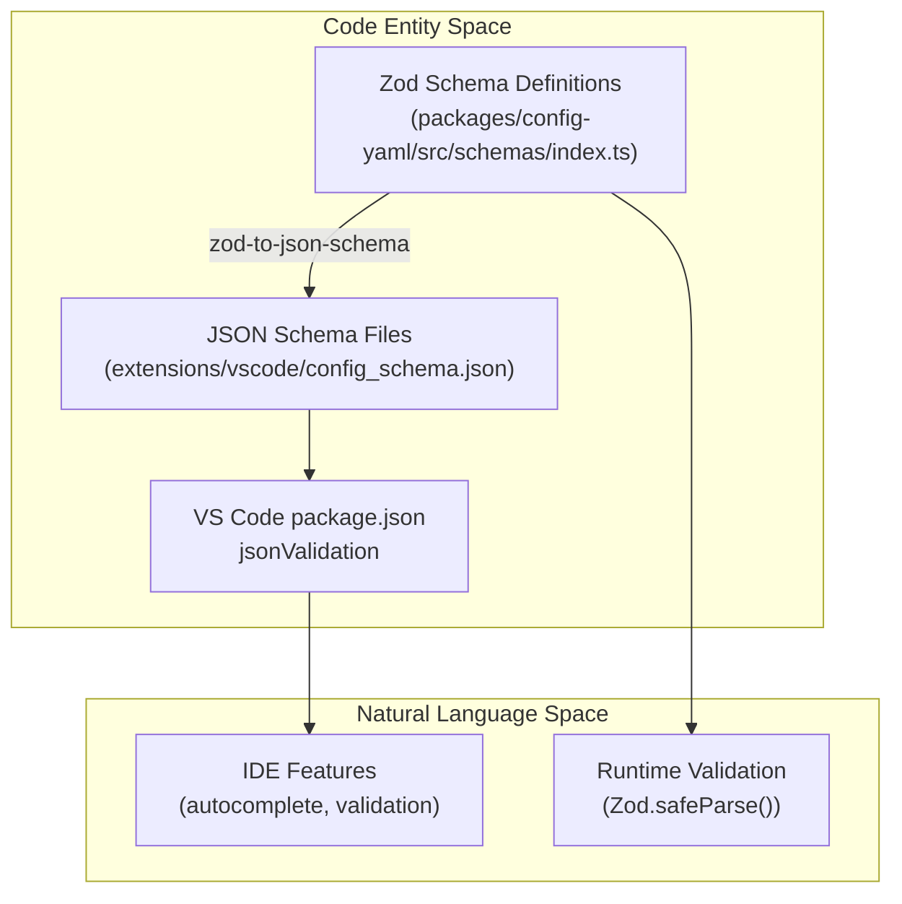
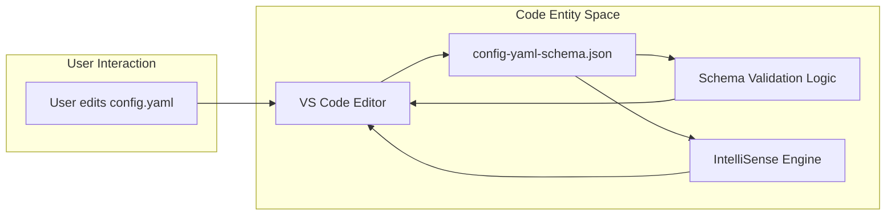
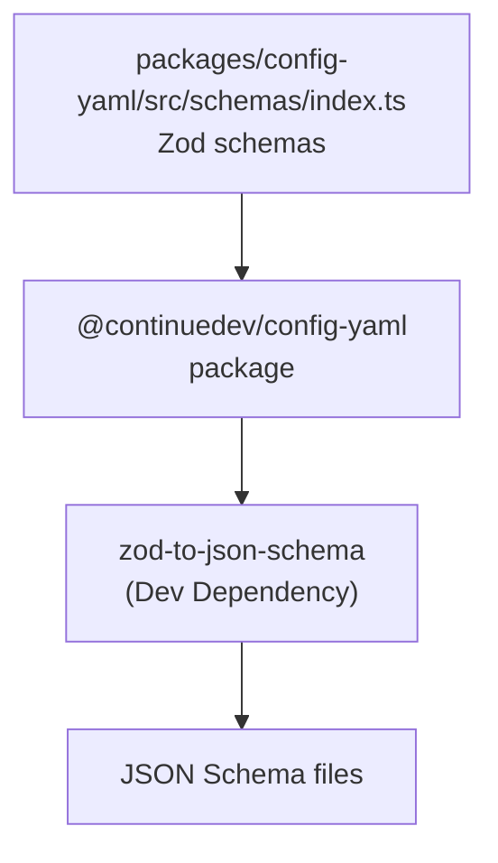
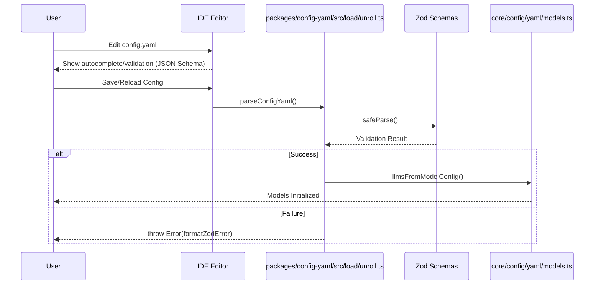

# Schema Validation

Relevant source files

The following files were used as context for generating this wiki page:

- [core/config/yaml/LocalPlatformClient.ts](core/config/yaml/LocalPlatformClient.ts)
- [core/config/yaml/loadLocalYamlBlocks.ts](core/config/yaml/loadLocalYamlBlocks.ts)
- [core/config/yaml/models.ts](core/config/yaml/models.ts)
- [core/llm/llms/SambaNova.ts](core/llm/llms/SambaNova.ts)
- [docs/customize/model-providers/more/SambaNova.mdx](docs/customize/model-providers/more/SambaNova.mdx)
- [docs/customize/model-providers/more/cerebras.mdx](docs/customize/model-providers/more/cerebras.mdx)
- [docs/customize/model-providers/more/cloudflare.mdx](docs/customize/model-providers/more/cloudflare.mdx)
- [docs/customize/model-providers/more/flowise.mdx](docs/customize/model-providers/more/flowise.mdx)
- [docs/customize/model-providers/top-level/azure.mdx](docs/customize/model-providers/top-level/azure.mdx)
- [docs/customize/model-providers/top-level/ollama.mdx](docs/customize/model-providers/top-level/ollama.mdx)
- [docs/guides/ollama-guide.mdx](docs/guides/ollama-guide.mdx)
- [packages/config-yaml/package-lock.json](packages/config-yaml/package-lock.json)
- [packages/config-yaml/src/__tests__/index.test.ts](packages/config-yaml/src/__tests__/index.test.ts)
- [packages/config-yaml/src/converter.ts](packages/config-yaml/src/converter.ts)
- [packages/config-yaml/src/index.ts](packages/config-yaml/src/index.ts)
- [packages/config-yaml/src/interfaces/SecretResult.ts](packages/config-yaml/src/interfaces/SecretResult.ts)
- [packages/config-yaml/src/interfaces/index.ts](packages/config-yaml/src/interfaces/index.ts)
- [packages/config-yaml/src/interfaces/slugs.test.ts](packages/config-yaml/src/interfaces/slugs.test.ts)
- [packages/config-yaml/src/interfaces/slugs.ts](packages/config-yaml/src/interfaces/slugs.ts)
- [packages/config-yaml/src/load/clientRender.ts](packages/config-yaml/src/load/clientRender.ts)
- [packages/config-yaml/src/load/merge.ts](packages/config-yaml/src/load/merge.ts)
- [packages/config-yaml/src/load/unroll.ts](packages/config-yaml/src/load/unroll.ts)
- [packages/config-yaml/src/registryClient.test.ts](packages/config-yaml/src/registryClient.test.ts)
- [packages/config-yaml/src/registryClient.ts](packages/config-yaml/src/registryClient.ts)
- [packages/config-yaml/src/schemas/index.ts](packages/config-yaml/src/schemas/index.ts)
- [packages/config-yaml/src/schemas/models.ts](packages/config-yaml/src/schemas/models.ts)
- [packages/config-yaml/src/validation.ts](packages/config-yaml/src/validation.ts)

## Purpose and Scope

This document describes how Continue validates configuration files using Zod schemas and JSON Schema, and how schema-based IDE integration provides autocomplete and validation in editors. For information about the overall configuration architecture, see [Configuration Architecture](5.1). For details on loading and processing configurations, see [Configuration Loading Pipeline](5.4).

The schema validation system serves two primary purposes:
1. **Runtime validation**: Using Zod to validate configuration objects in TypeScript/JavaScript during the configuration loading process.
2. **IDE integration**: Using JSON Schema to provide IntelliSense, autocomplete, and inline error checking in VS Code and other supported editors.

## Schema Technologies Overview

Continue uses a dual-schema approach to provide both runtime safety and developer experience:

Title: Schema Validation Data Flow

**Sources**: [packages/config-yaml/src/schemas/index.ts:1-206](), [packages/config-yaml/package-lock.json:31]()

## VS Code JSON Validation Configuration

VS Code's `jsonValidation` contribution point maps configuration file patterns to their corresponding JSON Schema files. This mapping is defined in the extension's manifest.

| File Pattern | Schema File | Purpose |
|--------------|-------------|---------|
| `**/.continue*/config.json` | `config_schema.json` | Main configuration schema |
| `.continuerc.json` | `continue_rc_schema.json` | User override configuration |
| `**/config.yaml` | `config-yaml-schema.json` | YAML configuration schema |

Title: IDE Configuration Validation

**Sources**: [packages/config-yaml/src/schemas/index.ts:103-113]()

## JSON Schema Structure

The configuration schemas define the valid structure for models, context providers, and other services.

### Schema Definitions

The schema definitions in `packages/config-yaml` are built using Zod and exported for both runtime use and schema generation:

- **`completionOptionsSchema`**: Defines temperature, topP, topK, stop tokens, maxTokens, and reasoning parameters [packages/config-yaml/src/schemas/models.ts:47-63]().
- **`requestOptionsSchema`**: Covers timeout, SSL verification, proxy settings, and custom headers [packages/config-yaml/src/schemas/models.ts:12-21]().
- **`modelSchema`**: Defines the structure for LLM providers, including model names, providers, and capabilities [packages/config-yaml/src/schemas/models.ts:201-205]().

**Sources**: [packages/config-yaml/src/schemas/models.ts:12-205]()

### Model Capabilities

The schema explicitly validates model capabilities such as `tool_use`, `image_input`, and `next_edit` [packages/config-yaml/src/schemas/models.ts:37-42](). These are used during the configuration unrolling process to map YAML flags to the `ILLM` capabilities used by the core orchestrator [core/config/yaml/models.ts:103-107]().

## Schema Generation Pipeline

The schema generation process converts Zod schemas to JSON Schema files during the build process to ensure the IDE schema always matches the code.

Title: Build Pipeline for Schemas

**Sources**: [packages/config-yaml/package-lock.json:31](), [packages/config-yaml/src/schemas/index.ts:1-153]()

## Zod Schema Validation

### Runtime Validation with Zod

Zod is used for strict runtime type validation when Continue loads configuration files. The `config-yaml` package defines these schemas.

- **`configYamlSchema`**: Validates the structure of the YAML configuration, including `models`, `context`, `mcpServers`, and `rules` [packages/config-yaml/src/schemas/index.ts:113-153]().
- **`assistantUnrolledSchema`**: Validates the final "unrolled" state of an assistant after composition and secret resolution [packages/config-yaml/src/schemas/index.ts:157-165]().
- **`blockSchema`**: Validates individual configuration blocks (e.g., a single model or tool) [packages/config-yaml/src/schemas/index.ts:194-206]().

### Parsing and Validation Functions

The `unroll.ts` file provides helper functions that wrap Zod parsing and handle formatting errors:

- **`parseConfigYaml(configYaml: string)`**: Parses a YAML string and validates it against `configYamlSchema` [packages/config-yaml/src/load/unroll.ts:32-58]().
- **`parseAssistantUnrolled(configYaml: string)`**: Validates against `assistantUnrolledSchema` [packages/config-yaml/src/load/unroll.ts:60-71]().
- **`parseBlock(configYaml: string)`**: Validates a single configuration block against `blockSchema` [packages/config-yaml/src/load/unroll.ts:73-81]().

**Sources**: [packages/config-yaml/src/load/unroll.ts:32-81](), [packages/config-yaml/src/schemas/index.ts:113-206]()

## Validation Rules and Logic

Beyond structural validation, `validateConfigYaml` performs semantic checks:

- **ASCII Validation**: Ensures API keys and headers do not contain Unicode characters [packages/config-yaml/src/validation.ts:43-59]().
- **Context Length Safety**: Checks if `maxTokens` is too close to `contextLength`, warning if input context might be truncated [packages/config-yaml/src/validation.ts:61-73]().
- **Autocomplete Suitability**: Warns if a model selected for the `autocomplete` role is not typically trained for FIM (Fill-In-the-Middle) tasks [packages/config-yaml/src/validation.ts:75-95]().

**Sources**: [packages/config-yaml/src/validation.ts:21-99]()

## Validation Flow

Title: End-to-End Validation Flow

**Sources**: [packages/config-yaml/src/load/unroll.ts:32-58](), [core/config/yaml/models.ts:189-222](), [packages/config-yaml/src/validation.ts:21-35]()

## Relationship to Configuration Loading

Schema validation is integrated into the loading and rendering process.

- **Secret Rendering**: After a YAML is unrolled, it is rendered with secrets. The resulting string is re-parsed and validated via `parseAssistantUnrolled` to ensure secret injection didn't break the structure [packages/config-yaml/src/load/clientRender.ts:61-69]().
- **Model Mapping**: Validated `ModelConfig` objects are converted into `BaseLLM` instances. This process maps schema fields (like `model.chatOptions.toolOverrides`) to internal `LLMOptions` [core/config/yaml/models.ts:50-111]().
- **Template Variables**: The schema allows for template variables like `${{ secrets.KEY }}`. While the schema validates the overall string, `getTemplateVariables` and `fillTemplateVariables` handle the logic for these placeholders [packages/config-yaml/src/load/unroll.ts:83-116]().

**Sources**: [packages/config-yaml/src/load/clientRender.ts:20-70](), [core/config/yaml/models.ts:50-146](), [packages/config-yaml/src/load/unroll.ts:83-116]()