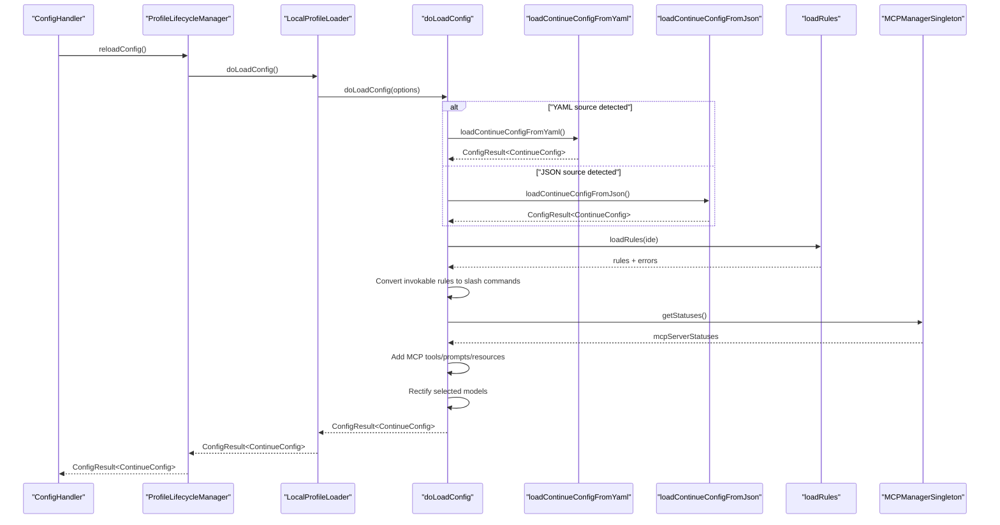
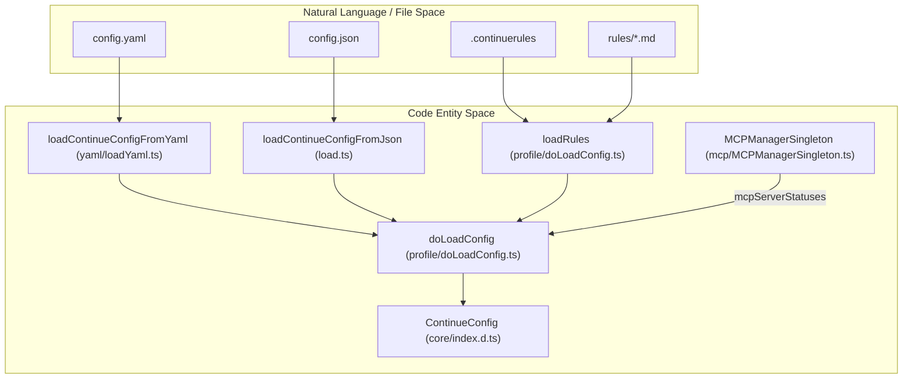
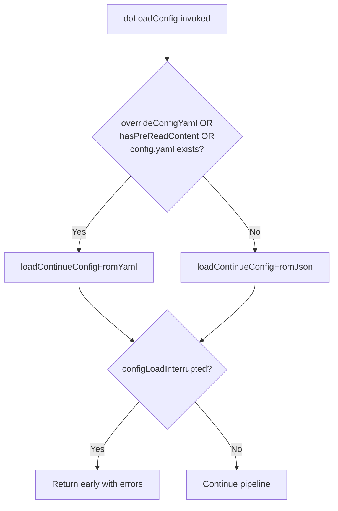
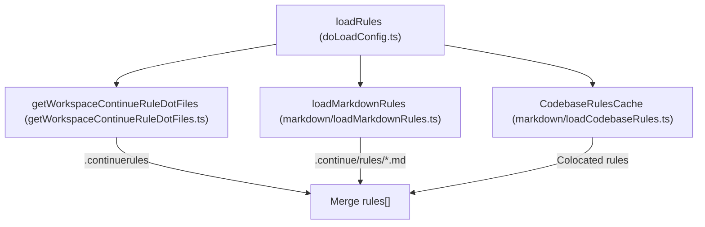
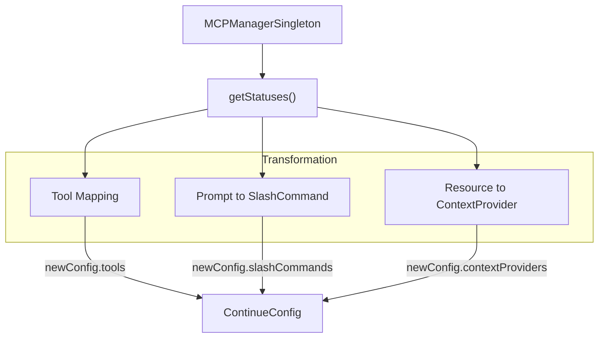

# Configuration Loading Pipeline

Relevant source files

The following files were used as context for generating this wiki page:

- [core/.eslintrc.json](core/.eslintrc.json)
- [core/config/ConfigHandler.ts](core/config/ConfigHandler.ts)
- [core/config/ProfileLifecycleManager.ts](core/config/ProfileLifecycleManager.ts)
- [core/config/load.ts](core/config/load.ts)
- [core/config/migrateSharedConfig.ts](core/config/migrateSharedConfig.ts)
- [core/config/profile/LocalProfileLoader.ts](core/config/profile/LocalProfileLoader.ts)
- [core/config/profile/LocalProfileLoader.vitest.ts](core/config/profile/LocalProfileLoader.vitest.ts)
- [core/config/profile/doLoadConfig.ts](core/config/profile/doLoadConfig.ts)
- [core/config/profile/doLoadConfig.vitest.ts](core/config/profile/doLoadConfig.vitest.ts)
- [core/config/sharedConfig.ts](core/config/sharedConfig.ts)
- [core/config/yaml/loadYaml.ts](core/config/yaml/loadYaml.ts)
- [core/util/paths.ts](core/util/paths.ts)

## Purpose and Scope

The Configuration Loading Pipeline is the system responsible for orchestrating the complete loading and assembly of a `ContinueConfig` object from various sources. This includes loading the base configuration (YAML or JSON), loading rules from multiple locations, integrating MCP server capabilities, and applying post-processing steps like shared configuration and model rectification.

**Key Entry Point:** `doLoadConfig` in [core/config/profile/doLoadConfig.ts:64-72]().

## Overview

The configuration loading pipeline is implemented as a multi-stage process coordinated by the `doLoadConfig` function. This function acts as the central orchestrator, delegating to specialized loaders for different configuration sources and then assembling the final configuration object.

The pipeline is invoked through the profile loading system:
- `ConfigHandler` manages the high-level initialization and selection of profiles [core/config/ConfigHandler.ts:31-41]().
- `ProfileLifecycleManager` manages the lifecycle and caching of a single profile's configuration [core/config/ProfileLifecycleManager.ts:28-36]().
- `IProfileLoader` implementations (like `LocalProfileLoader`) delegate the actual work to `doLoadConfig` [core/config/profile/LocalProfileLoader.ts:43-56]().

Sources: [core/config/profile/doLoadConfig.ts:64-72](), [core/config/ConfigHandler.ts:31-41](), [core/config/profile/LocalProfileLoader.ts:43-56](), [core/config/ProfileLifecycleManager.ts:28-36]()

## Loading Sequence

The following diagram illustrates the sequence of operations when a configuration reload is triggered.

Title: Configuration Loading Sequence

Sources: [core/config/profile/doLoadConfig.ts:72-137](), [core/config/ConfigHandler.ts:196-198](), [core/config/profile/LocalProfileLoader.ts:43-67](), [core/config/ProfileLifecycleManager.ts:49-57]()

## Architecture Overview

The configuration system bridges the gap between raw file content and the runtime `ContinueConfig` entity used by the Core.

Title: Configuration Entity Mapping

Sources: [core/config/profile/doLoadConfig.ts:64-137](), [core/config/yaml/loadYaml.ts:156-162](), [core/config/load.ts:112-118]()

## Base Configuration Loading

The pipeline first determines which configuration format to load based on file existence or pre-read content.

### Format Selection Logic

Title: Configuration Format Selection

Sources: [core/config/profile/doLoadConfig.ts:107-137]()

### YAML Loading Path
When loading from YAML, the pipeline calls `loadContinueConfigFromYaml` [core/config/profile/doLoadConfig.ts:112](). The underlying `loadConfigYaml` function:
1. Gathers local blocks from `.continue` directories using `getAllDotContinueDefinitionFiles` [core/config/yaml/loadYaml.ts:57-68]().
2. Unrolls assistant blocks and compositions using `unrollAssistant` or `unrollLocalYamlBlocks` [core/config/yaml/loadYaml.ts:105-119]().
3. Converts YAML structures to `ContinueConfig` via `configYamlToContinueConfig` [core/config/yaml/loadYaml.ts:156-162]().

### JSON Loading Path
When loading from JSON, the pipeline calls `loadContinueConfigFromJson` [core/config/profile/doLoadConfig.ts:126](). The underlying `loadSerializedConfig` function:
1. Resolves the `config.json` path via `getConfigJsonPath` and parses content [core/config/load.ts:122]().
2. Merges remote configurations if a `remoteConfigServerUrl` is specified [core/config/load.ts:142-151]().
3. Merges workspace-specific `.continuerc.json` files via `workspaceConfigs` [core/config/load.ts:153-160]().

Sources: [core/config/yaml/loadYaml.ts:46-139](), [core/config/load.ts:112-167](), [core/config/profile/doLoadConfig.ts:107-137]()

## Rules Loading

After loading the base configuration, `doLoadConfig` loads rules from three sources via the `loadRules` function [core/config/profile/doLoadConfig.ts:40-62]().

Title: Rules Loading Architecture

Rules marked as `invokable` are automatically converted to slash commands using `convertRuleBlockToSlashCommand` [core/config/profile/doLoadConfig.ts:158-170]().

Sources: [core/config/profile/doLoadConfig.ts:40-62](), [core/config/profile/doLoadConfig.ts:153-170]()

## MCP Integration

The pipeline integrates Model Context Protocol (MCP) server capabilities into the configuration via the `MCPManagerSingleton`.

Title: MCP Integration Pipeline

### MCP Tools
Tools from connected MCP servers are converted to Continue's `Tool` format. The system uses `getMCPToolName` and `encodeMCPToolUri` to ensure unique identification and routing [core/config/profile/doLoadConfig.ts:213-226]().

### MCP Prompts
MCP prompts are fetched and converted to slash commands using `stringifyMcpPrompt` [core/config/profile/doLoadConfig.ts:233-241]().

### MCP Resources
MCP resources and templates are exposed as context providers via the `MCPContextProvider` class [core/config/profile/doLoadConfig.ts:243-251]().

Sources: [core/config/profile/doLoadConfig.ts:195-251](), [core/context/mcp/MCPManagerSingleton.ts:25]()

## Configuration Post-Processing

The final stages of `doLoadConfig` involve validation and environment setup:

1.  **Migration**: Migrates old JSON shared configuration settings if they exist via `migrateJsonSharedConfig` [core/config/profile/doLoadConfig.ts:89-92]().
2.  **Model Rectification**: Ensures selected models are correctly mapped from global context via `rectifySelectedModelsFromGlobalContext` [core/config/profile/doLoadConfig.ts:192]().
3.  **Shared Configuration**: Applies global settings (telemetry, indexing, UI) via `modifyAnyConfigWithSharedConfig` [core/config/sharedConfig.ts:91-97]().

Sources: [core/config/profile/doLoadConfig.ts:89-92](), [core/config/profile/doLoadConfig.ts:192](), [core/config/sharedConfig.ts:91-97]()

## Error Handling and Interruption

The loading process distinguishes between fatal and non-fatal errors.

-   **Fatal Errors**: If any error has `fatal: true` (e.g., from `validateConfig`), the pipeline returns early with `configLoadInterrupted: true` [core/config/profile/doLoadConfig.ts:139-146]().
-   **Non-Fatal Errors**: Errors collected during the unrolling of YAML blocks or loading of rules are aggregated in the `errors` array but allow the configuration to proceed [core/config/profile/doLoadConfig.ts:150-156]().

The `ProfileLifecycleManager` wraps the entire call in a try-catch block to ensure that even unexpected exceptions result in a valid `ConfigResult` with a fatal error [core/config/ProfileLifecycleManager.ts:79-100]().

Sources: [core/config/profile/doLoadConfig.ts:139-156](), [core/config/ProfileLifecycleManager.ts:79-100](), [core/config/load.ts:130-136]()