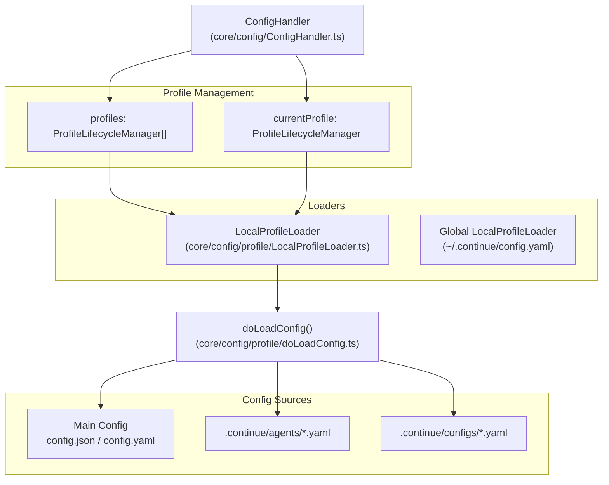
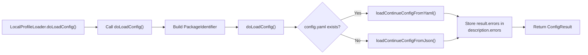
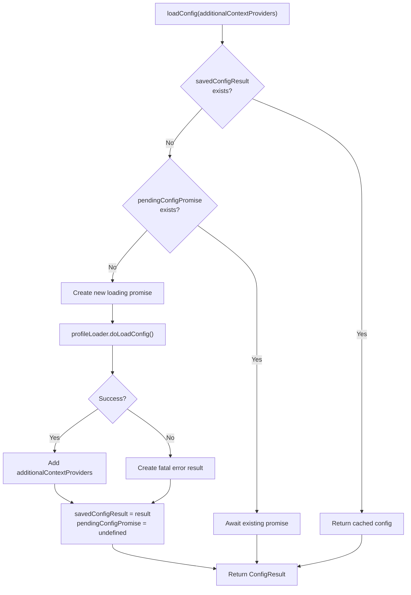

# Profile Management

<details>
<summary>Relevant source files</summary>

The following files were used as context for generating this wiki page:

- [core/config/ConfigHandler.ts](core/config/ConfigHandler.ts)
- [core/config/ProfileLifecycleManager.ts](core/config/ProfileLifecycleManager.ts)
- [core/config/load.ts](core/config/load.ts)
- [core/config/profile/LocalProfileLoader.ts](core/config/profile/LocalProfileLoader.ts)
- [core/config/profile/LocalProfileLoader.vitest.ts](core/config/profile/LocalProfileLoader.vitest.ts)
- [core/config/profile/doLoadConfig.ts](core/config/profile/doLoadConfig.ts)
- [core/config/profile/doLoadConfig.vitest.ts](core/config/profile/doLoadConfig.vitest.ts)
- [core/config/util.ts](core/config/util.ts)
- [core/config/yaml/loadYaml.ts](core/config/yaml/loadYaml.ts)
- [core/util/GlobalContext.test.ts](core/util/GlobalContext.test.ts)
- [core/util/GlobalContext.ts](core/util/GlobalContext.ts)
- [core/util/paths.ts](core/util/paths.ts)

</details>


## Purpose and Scope

This document explains Continue's profile management system, which enables users to switch between different AI assistant configurations. A **profile** represents a complete configuration for Continue, including models, context providers, tools, and rules. Continue tracks which profile is active for each workspace and manages the lifecycle of these configurations through a unified interface.

The system is designed to handle local configuration files (JSON/YAML) and workspace-specific "agents" or "assistants" defined within the `.continue` directory.

---

## Profile Architecture

Continue's profile system consists of three main components that orchestrate the transition from raw configuration files to active `ContinueConfig` objects.

| Component | File | Purpose |
|-----------|------|---------|
| `ProfileLifecycleManager` | [core/config/ProfileLifecycleManager.ts:28-28]() | Manages the lifecycle of a single profile, including loading, caching, and reloading. |
| `IProfileLoader` | [core/config/profile/IProfileLoader.ts:10-10]() | Interface for profile loading strategies (currently primarily `LocalProfileLoader`). |
| `ConfigHandler` | [core/config/ConfigHandler.ts:31-31]() | Orchestrates multiple profiles, handles selection, and maintains the global state of available configurations. |

### IProfileLoader Interface

Profile loaders implement a common interface that defines how configurations are loaded:

```typescript
export interface IProfileLoader {
  description: ProfileDescription;
  doLoadConfig(): Promise<ConfigResult<ContinueConfig>>;
  setIsActive(isActive: boolean): void;
}
```

This interface enables the strategy pattern, allowing `ProfileLifecycleManager` to work with different profile sources without knowing their implementation details.

### Profile System Architecture

The diagram below illustrates the relationship between the `ConfigHandler`, the loaders, and the underlying configuration files.



**Sources**: [core/config/ConfigHandler.ts:31-40](), [core/config/ProfileLifecycleManager.ts:28-36](), [core/config/profile/LocalProfileLoader.ts:12-12]()

---

## Profile Types and Loaders

### Profile Description Structure

Every profile has a `ProfileDescription` that contains metadata used by the GUI for rendering and selection:

```typescript
export interface ProfileDescription {
  fullSlug: FullSlug;
  title: string;
  id: string;
  iconUrl: string;
  errors: ConfigValidationError[] | undefined;
  uri: string;
  rawYaml?: string;
}
```

**Sources**: [core/config/ProfileLifecycleManager.ts:18-26]()

### Local Profile Loader

The `LocalProfileLoader` loads profiles from local configuration files. It handles both the global `~/.continue/config.yaml` and workspace-specific profiles found in `.continue/agents`, `.continue/assistants`, or `.continue/configs`.

**Key Characteristics**:
- **Profile ID**: Either `LocalProfileLoader.ID` (`"local"`) or the specific file path [core/config/profile/LocalProfileLoader.ts:25-25]().
- **File Resolution**: Uses `getPrimaryConfigFilePath()` to find the user's global config [core/config/profile/LocalProfileLoader.ts:38-38]().
- **WSL/Remote Support**: Passes pre-read `content` to `doLoadConfig` to bypass `fs.readFileSync` issues in VS Code Remote/WSL environments [core/config/profile/LocalProfileLoader.ts:49-55]().

**Loading Process**:


**Sources**: [core/config/profile/LocalProfileLoader.ts:43-67](), [core/config/profile/doLoadConfig.ts:107-137](), [core/util/paths.ts:132-138]()

---

## Profile Selection and Persistence

Continue persists profile selections in `GlobalContext` using workspace-specific keys to ensure project-specific settings are maintained.

### Selection Keys

- **Workspace ID**: Generated by joining all active workspace directories with an `&` separator [core/config/ConfigHandler.ts:76-81]().
- **Profile Persistence**: Stored under the key `lastSelectedProfileForWorkspace` in the `globalContext.json` file [core/config/ConfigHandler.ts:97-100]().
- **Role-based Selection**: Specific model selections for each role (chat, edit, etc.) are persisted per profile ID [core/util/GlobalContext.ts:170-184]().

**Sources**: [core/config/ConfigHandler.ts:76-100](), [core/util/GlobalContext.ts:24-32]()

---

## Configuration Loading Pipeline

The `ProfileLifecycleManager` manages the loading lifecycle for a single profile, ensuring that expensive configuration parsing and unrolling are cached.

### Loading and Caching

The `ProfileLifecycleManager` implements a promise-based caching strategy to prevent duplicate loads and handle concurrent requests:



**Sources**: [core/config/ProfileLifecycleManager.ts:59-117]()

### The `doLoadConfig` Function

The `doLoadConfig` function is the core logic shared by loaders. It performs the following steps:
1. **Migration**: Runs migrations for old configuration formats (e.g., `migrateJsonSharedConfig`) [core/config/profile/doLoadConfig.ts:89-92]().
2. **Format Detection**: Checks for `config.yaml` vs `config.json` [core/config/profile/doLoadConfig.ts:107-111]().
3. **Rule Loading**: Loads workspace rules from `.continuerules` and markdown files in `.continue/rules` [core/config/profile/doLoadConfig.ts:40-62]().
4. **Slash Command Conversion**: Converts invokable rules into slash commands [core/config/profile/doLoadConfig.ts:158-170]().
5. **Model Rectification**: Synchronizes selected models for each role based on `GlobalContext` for the specific `profileId` [core/config/profile/doLoadConfig.ts:192-192]().
6. **MCP Integration**: Fetches tool definitions and statuses from the `MCPManagerSingleton` [core/config/profile/doLoadConfig.ts:195-212]().

**Sources**: [core/config/profile/doLoadConfig.ts:64-137](), [core/config/profile/doLoadConfig.ts:152-192]()

---

## Cascade Initialization

The `ConfigHandler.cascadeInit()` method performs a full re-initialization of the profile system. This is triggered when the extension first loads, when IDE settings change, or when workspace directories are updated.

- **Abort Control**: Uses a `cascadeAbortController` to cancel stale initialization attempts if a new one is triggered [core/config/ConfigHandler.ts:47-50]().
- **Sequence**:
    1. Resets workspace directories [core/config/ConfigHandler.ts:85-85]().
    2. Refreshes `globalLocalProfileManager` [core/config/ConfigHandler.ts:87-90]().
    3. Loads all local profiles from global and workspace directories via `loadProfiles()` [core/config/ConfigHandler.ts:93-93]().
    4. Resolves the selected profile for the current workspace project [core/config/ConfigHandler.ts:96-111]().
    5. Updates the `GlobalContext` with the final selection [core/config/ConfigHandler.ts:117-122]().
    6. Triggers `reloadConfig()` to refresh the active configuration [core/config/ConfigHandler.ts:127-127]().

**Sources**: [core/config/ConfigHandler.ts:83-136]()