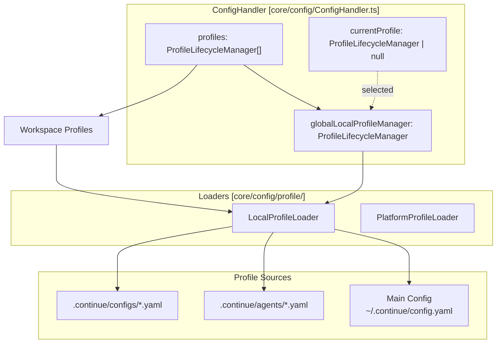
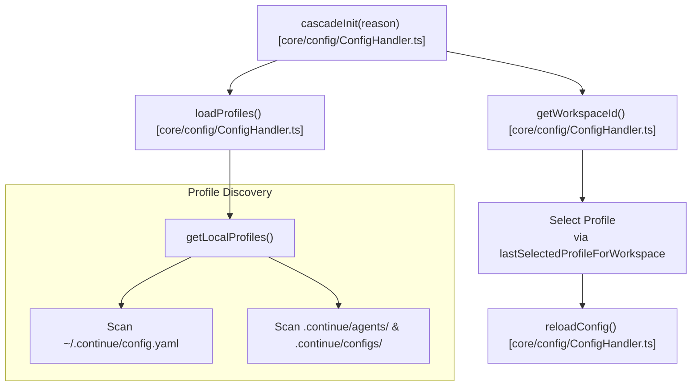
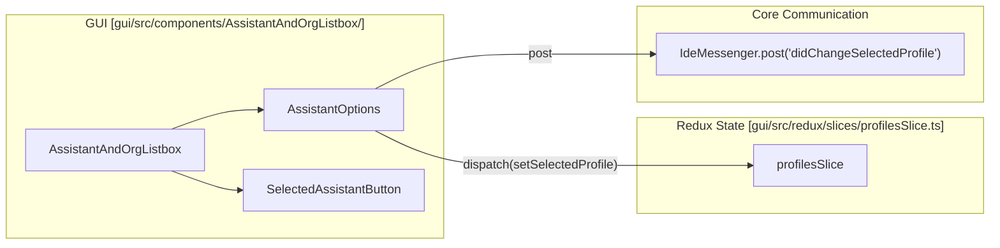

# Organizations and Teams

<details>
<summary>Relevant source files</summary>

The following files were used as context for generating this wiki page:

- [core/config/ConfigHandler.ts](core/config/ConfigHandler.ts)
- [core/config/ProfileLifecycleManager.ts](core/config/ProfileLifecycleManager.ts)
- [core/config/load.ts](core/config/load.ts)
- [core/config/profile/LocalProfileLoader.ts](core/config/profile/LocalProfileLoader.ts)
- [core/config/profile/LocalProfileLoader.vitest.ts](core/config/profile/LocalProfileLoader.vitest.ts)
- [core/config/profile/doLoadConfig.ts](core/config/profile/doLoadConfig.ts)
- [core/config/profile/doLoadConfig.vitest.ts](core/config/profile/doLoadConfig.vitest.ts)
- [core/config/yaml/loadYaml.ts](core/config/yaml/loadYaml.ts)
- [core/llm/streamChat.ts](core/llm/streamChat.ts)
- [core/util/paths.ts](core/util/paths.ts)
- [gui/src/components/AssistantAndOrgListbox/AssistantIcon.tsx](gui/src/components/AssistantAndOrgListbox/AssistantIcon.tsx)
- [gui/src/components/AssistantAndOrgListbox/AssistantOption.tsx](gui/src/components/AssistantAndOrgListbox/AssistantOption.tsx)
- [gui/src/components/AssistantAndOrgListbox/AssistantOptions.tsx](gui/src/components/AssistantAndOrgListbox/AssistantOptions.tsx)
- [gui/src/components/AssistantAndOrgListbox/SelectedAssistantButton.tsx](gui/src/components/AssistantAndOrgListbox/SelectedAssistantButton.tsx)
- [gui/src/components/AssistantAndOrgListbox/index.tsx](gui/src/components/AssistantAndOrgListbox/index.tsx)
- [gui/src/components/AssistantAndOrgListbox/shared.tsx](gui/src/components/AssistantAndOrgListbox/shared.tsx)
- [gui/src/components/gui/Alert.tsx](gui/src/components/gui/Alert.tsx)
- [gui/src/components/mainInput/Lump/LumpToolbar/BlockSettingsTopToolbar.tsx](gui/src/components/mainInput/Lump/LumpToolbar/BlockSettingsTopToolbar.tsx)
- [gui/src/components/ui/Button.tsx](gui/src/components/ui/Button.tsx)
- [gui/src/pages/config/components/ConfigHeader.tsx](gui/src/pages/config/components/ConfigHeader.tsx)
- [gui/src/pages/config/components/ModelRoleRow.tsx](gui/src/pages/config/components/ModelRoleRow.tsx)
- [gui/src/pages/config/sections/IndexingSettingsSection.tsx](gui/src/pages/config/sections/IndexingSettingsSection.tsx)
- [gui/src/pages/config/sections/ModelsSection.tsx](gui/src/pages/config/sections/ModelsSection.tsx)
- [gui/src/pages/config/sections/UserSettingsSection.tsx](gui/src/pages/config/sections/UserSettingsSection.tsx)
- [gui/src/pages/config/sections/docs/DocsIndexingStatus.test.tsx](gui/src/pages/config/sections/docs/DocsIndexingStatus.test.tsx)

</details>


This document describes the multi-organization and profile system in Continue, which allows users to access different configurations (assistants) from multiple sources including Continue Hub, team organizations, and local workspaces. This system provides workspace-specific profile selection with a configuration cascade model.

For information about the configuration loading pipeline and format, see [Configuration Loading Pipeline](#5.4). For details about profile lifecycle management, see [Profile Management](#5.5).

## Purpose and Scope

The organizations and teams system enables:
- Access to Continue Hub assistants in a personal organization.
- Team-level shared assistants through Hub organizations.
- Local workspace-specific assistants via `.continue/agents/*.yaml`.
- Workspace-aware profile selection.
- Seamless switching between different configuration sources in the GUI.

## Profile and Assistant Model

In the current architecture, "Assistants" and "Configs" are managed as Profiles. The `ConfigHandler` manages the lifecycle of these profiles, which can be sourced locally or from the platform.

### Profile Data Structure

Profiles are represented by `ProfileDescription` and managed by a `ProfileLifecycleManager`.

```typescript
export interface ProfileDescription {
  fullSlug: FullSlug;
  title: string;
  id: string;
  iconUrl: string;
  errors: ConfigValidationError[] | undefined;
  uri: string;
  rawYaml?: string;
}
```

Sources: [core/config/ProfileLifecycleManager.ts:18-26]()

## Architecture and Data Flow

The `ConfigHandler` acts as the central coordinator. It maintains the list of available `ProfileLifecycleManager` instances and the currently active selection for the current workspace.

### Component Relationship



Sources: [core/config/ConfigHandler.ts:31-40](), [core/config/ConfigHandler.ts:52-72](), [core/config/ConfigHandler.ts:161-190]()

## Configuration Loading Flow

### Cascade Initialization

The loading process follows a cascade pattern initiated by `cascadeInit()`. This function determines the workspace context and selects the appropriate profile based on persisted user preferences.



Sources: [core/config/ConfigHandler.ts:83-136](), [core/config/ConfigHandler.ts:161-190]()

### Profile Loading Implementation

Profiles are instantiated via `IProfileLoader` implementations:

*   **`LocalProfileLoader`**: Responsible for loading configurations from the local filesystem. It uses `doLoadConfig` with a `packageIdentifier` of type `file`. [core/config/profile/LocalProfileLoader.ts:12-70]()
*   **`doLoadConfig`**: The core loading function that orchestrates reading from YAML or JSON. It handles migrations, rule loading, and model rectification. [core/config/profile/doLoadConfig.ts:64-137]()

## Workspace-Specific Selection

Selections are workspace-specific to ensure developers can have different active assistants for different projects.

*   **Workspace ID**: Generated based on workspace directories joined by `&`. [core/config/ConfigHandler.ts:76-81]()
*   **Selection Persistence**: Selections are persisted in `GlobalContext` under the key `lastSelectedProfileForWorkspace`. [core/config/ConfigHandler.ts:98-122]()

## GUI Integration

The GUI provides interfaces for switching between profiles and viewing configuration status.

### Config Selection Components
The `AssistantAndOrgListbox` component in the React GUI renders the dropdown for switching between assistants. It uses the `useAuth` hook to access available profiles. [gui/src/components/AssistantAndOrgListbox/index.tsx:29-38]()



Sources: [gui/src/components/AssistantAndOrgListbox/index.tsx:98-182](), [gui/src/components/AssistantAndOrgListbox/SelectedAssistantButton.tsx:15-66]()

### Profile Switching Logic
The GUI supports a keyboard shortcut (`Cmd/Ctrl + Shift + '`) to toggle between available profiles. This triggers an optimistic update in Redux and notifies the Core via the `didChangeSelectedProfile` message. [gui/src/components/AssistantAndOrgListbox/index.tsx:60-89]()

## Communication Protocol

The IDE and Core communicate changes via specific protocol messages:

| Message | Direction | Purpose |
| :--- | :--- | :--- |
| `didChangeSelectedProfile` | GUI -> Core | Notifies Core to switch the active profile. [gui/src/components/AssistantAndOrgListbox/index.tsx:84-86]() |
| `config/refreshProfiles` | GUI -> Core | Triggers a full reload of all profiles. [gui/src/components/AssistantAndOrgListbox/index.tsx:150]() |
| `config/newAssistantFile` | GUI -> Core | Requests the creation of a new local assistant YAML file. [gui/src/components/AssistantAndOrgListbox/index.tsx:47]() |

Sources: [gui/src/components/AssistantAndOrgListbox/index.tsx:46-49](), [gui/src/components/AssistantAndOrgListbox/index.tsx:82-87]()