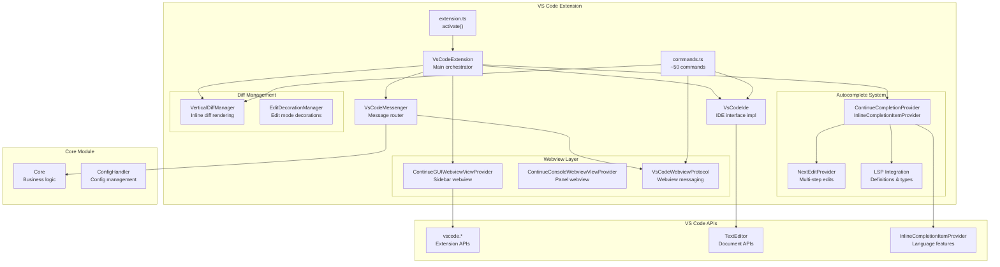
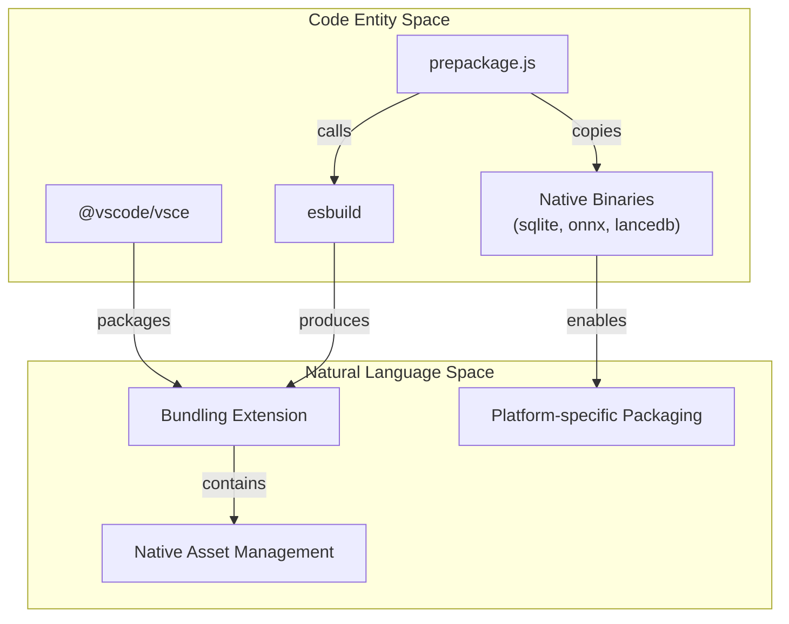

# VS Code Extension

Relevant source files

The following files were used as context for generating this wiki page:

- [binary/package-lock.json](binary/package-lock.json)
- [core/package-lock.json](core/package-lock.json)
- [core/package.json](core/package.json)
- [core/protocol/ideWebview.ts](core/protocol/ideWebview.ts)
- [extensions/vscode/package-lock.json](extensions/vscode/package-lock.json)
- [extensions/vscode/package.json](extensions/vscode/package.json)
- [extensions/vscode/src/commands.ts](extensions/vscode/src/commands.ts)
- [extensions/vscode/src/extension/VsCodeMessenger.ts](extensions/vscode/src/extension/VsCodeMessenger.ts)
- [gui/package-lock.json](gui/package-lock.json)
- [gui/package.json](gui/package.json)
- [gui/src/components/Layout.tsx](gui/src/components/Layout.tsx)
- [gui/src/components/mainInput/ContinueInputBox.tsx](gui/src/components/mainInput/ContinueInputBox.tsx)
- [gui/src/components/mainInput/InputToolbar.tsx](gui/src/components/mainInput/InputToolbar.tsx)
- [gui/src/components/modelSelection/ModelSelect.tsx](gui/src/components/modelSelection/ModelSelect.tsx)
- [gui/src/pages/gui/Chat.tsx](gui/src/pages/gui/Chat.tsx)
- [packages/config-yaml/package.json](packages/config-yaml/package.json)

The VS Code extension provides the primary IDE integration for Continue within Visual Studio Code. It handles extension lifecycle management, command registration, webview hosting, autocomplete/inline edit functionality, and bidirectional communication between VS Code APIs, the Core orchestrator, and the GUI webview.

For information about the IntelliJ plugin implementation, see [IntelliJ Plugin](#7). For details on the React-based GUI that runs within the webview, see [User Interface](#8). For the Core module that contains shared business logic, see [Core System](#3).

## Overview

The VS Code extension acts as an adapter layer that connects VS Code's extension APIs to Continue's cross-platform architecture. It implements the `IDE` interface defined in Core, manages the webview lifecycle, handles command registration, and provides VS Code-specific features like autocomplete and diff rendering.

### Architecture Overview

Sources: [extensions/vscode/package.json:1-78](), [extensions/vscode/package.json:153-205](), [extensions/vscode/src/extension/VsCodeExtension.ts:1-50]()

## Extension Metadata and Configuration

The extension is defined in `package.json` with properties that govern its behavior and user-facing settings.

| Property | Value | Description |
|----------|-------|-------------|
| `name` | `"continue"` | Extension identifier [extensions/vscode/package.json:2]() |
| `displayName` | `"Continue - open-source AI code agent"` | Marketplace display name [extensions/vscode/package.json:21]() |
| `main` | `"./out/extension.js"` | Entry point after compilation [extensions/vscode/package.json:58]() |
| `engines.vscode` | `"^1.70.0"` | Minimum VS Code version [extensions/vscode/package.json:26]() |
| `activationEvents` | `["onUri", "onStartupFinished", "onView:continueGUIView"]` | When to activate [extensions/vscode/package.json:53-57]() |

### Configuration Properties
Key settings contributed by the extension include:
- `continue.enableTabAutocomplete`: Toggle for the autocomplete feature [extensions/vscode/package.json:111-115]().
- `continue.enableNextEdit`: Toggle for the experimental next edit feature [extensions/vscode/package.json:116-120]().
- `continue.remoteConfigServerUrl`: URL for team-based shared configuration [extensions/vscode/package.json:136-140]().
- `continue.userToken`: Authentication token for remote configuration [extensions/vscode/package.json:141-145]().

Sources: [extensions/vscode/package.json:1-152]()

## Activation and Extension Lifecycle

The extension activation flow begins in the `activate()` function and follows these steps:

1.  **Context Initialization**: Extension context is stored for later use.
2.  **VsCodeExtension Creation**: The `VsCodeExtension` class is instantiated as the main orchestrator [extensions/vscode/src/extension/VsCodeExtension.ts:1-50]().
3.  **Core Initialization**: The `Core` orchestrator is initialized with the `VsCodeIde` implementation [extensions/vscode/src/extension/VsCodeExtension.ts:100-150]().
4.  **Provider Registration**: Webview providers like `ContinueGUIWebviewViewProvider` and `ContinueConsoleWebviewViewProvider` are registered [extensions/vscode/src/commands.ts:36-37]().
5.  **Command Registration**: Commands defined in `getCommandsMap` are registered with VS Code [extensions/vscode/src/commands.ts:108-130]().

The webview is lazy-loaded when the user first opens the Continue sidebar view. For details, see [Extension Architecture](#6.1).

Sources: [extensions/vscode/package.json:53-57](), [extensions/vscode/src/commands.ts:108-130]()

## Message Routing Architecture

The `VsCodeMessenger` class serves as the central message router between the GUI Webview, the Core Module, and the VS Code IDE.

**Key Message Handlers:**
- **Webview Listeners**: Handlers registered via `onWebview` for messages like `showFile`, `acceptDiff`, and `applyToFile` [extensions/vscode/src/extension/VsCodeMessenger.ts:86-145]().
- **Core Listeners**: Handlers registered via `onCore` to receive updates from the Core orchestrator [extensions/vscode/src/extension/VsCodeMessenger.ts:49-58]().
- **IDE Operations**: Messages routed to `VsCodeIde` for file system or editor operations.

For details on the messaging implementation, see [Webview Integration](#6.3).

Sources: [extensions/vscode/src/extension/VsCodeMessenger.ts:39-145]()

## Command System

The extension registers approximately 50 commands that provide the user interface for Continue's features. These include chat focus, edit mode, and diff management.

| Command | Title | Description |
|---------|-------|-------------|
| `continue.focusContinueInput` | Add Highlighted Code to Context and Clear Chat | Focus chat input with new session [extensions/vscode/package.json:192-196]() |
| `continue.focusEdit` | Add to Edit | Focus the edit input for code modifications [extensions/vscode/package.json:186-190]() |
| `continue.acceptDiff` | Accept Diff | Accept an inline diff block [extensions/vscode/package.json:161-165]() |
| `continue.rejectDiff` | Reject Diff | Reject an inline diff block [extensions/vscode/package.json:167-172]() |

For details, see [Command System](#6.2).

Sources: [extensions/vscode/package.json:153-205](), [extensions/vscode/src/commands.ts:172-220]()

## Autocomplete and Next Edit

Continue provides advanced code completion through the `ContinueCompletionProvider`. This system integrates with VS Code's `InlineCompletionItemProvider` API.

*   **Autocomplete**: Context-aware code completions gathered from open files and LSP information. For details, see [Autocomplete System](#6.4).
*   **Next Edit**: An experimental feature that predicts and suggests the next logical edit location in a multi-file workflow [extensions/vscode/package.json:116-120](). For details, see [Next Edit Feature](#6.5).
*   **LSP Integration**: Uses Language Server Protocol data to improve suggestion quality. For details, see [LSP Context Integration](#6.6).

Sources: [extensions/vscode/package.json:111-120]()

## IDE Operations and Diff Management

The extension implements the `IDE` interface through `VsCodeIde`, providing Core with access to VS Code-specific functionality.

*   **IDE Operations**: File system access, terminal control, and workspace management. For details, see [IDE Operations](#6.7).
*   **Diff Management**: Continue uses a `VerticalDiffManager` to render inline diffs directly in the editor, allowing users to review and apply AI-generated changes block-by-block [extensions/vscode/src/commands.ts:196-201](). For details, see [Diff Management](#6.8).

Sources: [extensions/vscode/src/commands.ts:38-41]()

## Build and Packaging Pipeline

The build process involves several scripts that prepare the extension for different platforms, specifically handling native binaries and webview assets.

### Build Entity Relationship

**Prepackage Steps**:
The `prepackage.js` script handles:
1.  **GUI Distribution**: Copying the React build from `gui/dist` to the extension.
2.  **Native Binaries**: Copying native binaries like `onnxruntime-node` to the extension's target folders.
3.  **Target Detection**: Detecting the target platform (OS and Architecture) to include the correct native modules [extensions/vscode/package-lock.json:14-16]().

Sources: [extensions/vscode/package.json:25-29](), [extensions/vscode/package-lock.json:1-61]()