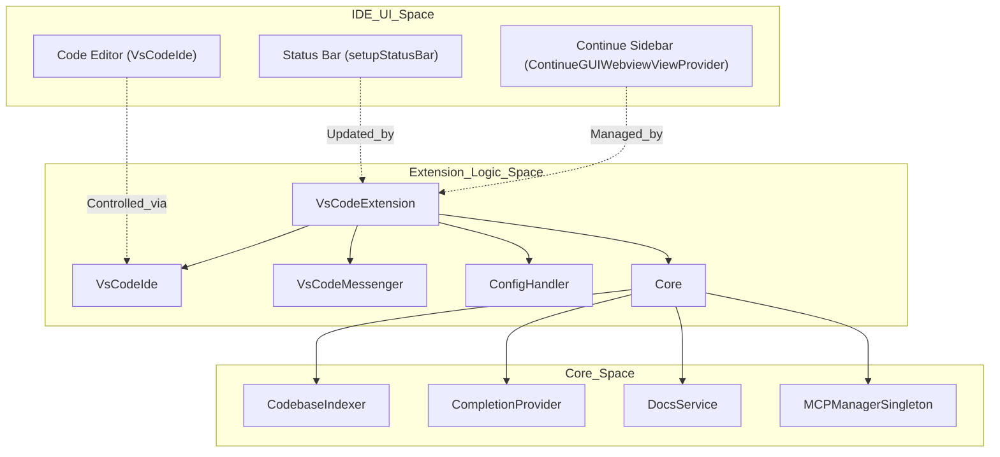
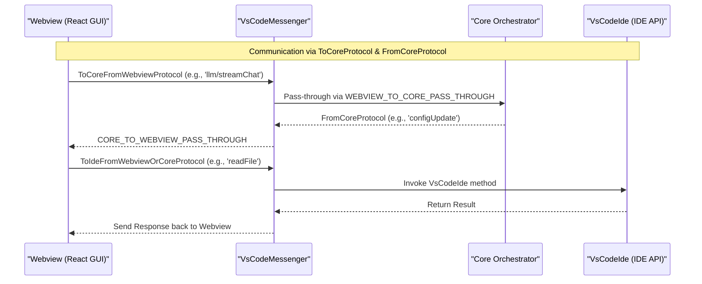

# Extension Architecture

Relevant source files

The following files were used as context for generating this wiki page:

- [TESTING.md](TESTING.md)
- [binary/.idea/vcs.xml](binary/.idea/vcs.xml)
- [binary/build.js](binary/build.js)
- [binary/package.json](binary/package.json)
- [core/core.ts](core/core.ts)
- [core/protocol/core.ts](core/protocol/core.ts)
- [core/protocol/ide.ts](core/protocol/ide.ts)
- [core/protocol/messenger/messageIde.ts](core/protocol/messenger/messageIde.ts)
- [core/protocol/messenger/reverseMessageIde.ts](core/protocol/messenger/reverseMessageIde.ts)
- [core/protocol/passThrough.ts](core/protocol/passThrough.ts)
- [core/protocol/webview.ts](core/protocol/webview.ts)
- [core/util/filesystem.ts](core/util/filesystem.ts)
- [core/util/start_ollama.sh](core/util/start_ollama.sh)
- [extensions/intellij/src/main/kotlin/com/github/continuedev/continueintellijextension/constants/MessageTypes.kt](extensions/intellij/src/main/kotlin/com/github/continuedev/continueintellijextension/constants/MessageTypes.kt)
- [extensions/vscode/.gitignore](extensions/vscode/.gitignore)
- [extensions/vscode/.vscodeignore](extensions/vscode/.vscodeignore)
- [extensions/vscode/e2e/get-latest-vsix.sh](extensions/vscode/e2e/get-latest-vsix.sh)
- [extensions/vscode/scripts/generate-copy-config.js](extensions/vscode/scripts/generate-copy-config.js)
- [extensions/vscode/scripts/importMetaUrl.js](extensions/vscode/scripts/importMetaUrl.js)
- [extensions/vscode/scripts/npm-install.js](extensions/vscode/scripts/npm-install.js)
- [extensions/vscode/scripts/package-all.js](extensions/vscode/scripts/package-all.js)
- [extensions/vscode/scripts/prepackage-cross-platform.js](extensions/vscode/scripts/prepackage-cross-platform.js)
- [extensions/vscode/scripts/prepackage.js](extensions/vscode/scripts/prepackage.js)
- [extensions/vscode/scripts/utils.js](extensions/vscode/scripts/utils.js)
- [extensions/vscode/scripts/versionCheck.js](extensions/vscode/scripts/versionCheck.js)
- [extensions/vscode/src/VsCodeIde.ts](extensions/vscode/src/VsCodeIde.ts)
- [extensions/vscode/src/activation/activate.ts](extensions/vscode/src/activation/activate.ts)
- [extensions/vscode/src/apply/utils.ts](extensions/vscode/src/apply/utils.ts)
- [extensions/vscode/src/extension/VsCodeExtension.ts](extensions/vscode/src/extension/VsCodeExtension.ts)
- [extensions/vscode/src/util/ideUtils.ts](extensions/vscode/src/util/ideUtils.ts)
- [extensions/vscode/tsconfig.e2e.json](extensions/vscode/tsconfig.e2e.json)
- [scripts/util/index.js](scripts/util/index.js)

This page documents the architecture of the VS Code extension, focusing on the `VsCodeExtension` class, initialization flow, Core instantiation, and webview setup.

## Overview

The VS Code extension serves as the IDE-specific adapter layer that bridges VS Code's API with Continue's cross-platform Core module. It manages the extension lifecycle, instantiates the `Core` orchestrator, sets up the webview GUI, and routes messages between all components. The extension's entry point is handled by the `activateExtension` function, which initializes the `VsCodeExtension` class.

**Sources:** [extensions/vscode/src/activation/activate.ts:11-34](), [extensions/vscode/src/extension/VsCodeExtension.ts:63-72]()

## Extension Activation and Initialization

The extension activation is triggered by VS Code. The `activateExtension` function performs initial environment checks (such as platform compatibility) before instantiating the main extension class.

**Sources:** [extensions/vscode/src/activation/activate.ts:11-34](), [extensions/vscode/src/extension/VsCodeExtension.ts:172-184]()

### Initialization Sequence

1.  **IDE Abstraction**: `VsCodeIde` is instantiated to provide Core with access to VS Code APIs. It requires a promise of the webview protocol and the extension context [extensions/vscode/src/extension/VsCodeExtension.ts:181]().
2.  **Core and Config Handler**: The extension initializes the `Core` class, which manages the central business logic. It also sets up the `ConfigHandler` to manage configuration loading [extensions/vscode/src/extension/VsCodeExtension.ts:66-76]().
3.  **Webview Providers**: `ContinueGUIWebviewViewProvider` (Sidebar) and `ContinueConsoleWebviewViewProvider` are registered to manage the React-based GUI [extensions/vscode/src/extension/VsCodeExtension.ts:70-71]().
4.  **Feature Managers**: Managers for diffs (`VerticalDiffManager`) and decorations (`EditDecorationManager`) are initialized to handle inline code changes and UI feedback [extensions/vscode/src/extension/VsCodeExtension.ts:73-74]().
5.  **Next Edit State**: The extension evaluates whether "Next Edit" features should be enabled based on the current model configuration and user settings [extensions/vscode/src/extension/VsCodeExtension.ts:90-170]().

### Component Relationship Diagram

The following diagram bridges the IDE's "Natural Language Space" (UI components) to the "Code Entity Space" (Class names and files).

Title: Extension Component Architecture

**Sources:** [extensions/vscode/src/extension/VsCodeExtension.ts:63-81](), [core/core.ts:90-96](), [extensions/vscode/src/VsCodeIde.ts:38-48]()

## Core Instantiation

The `Core` class is the central orchestrator for business logic. It is instantiated within the extension process and acts as the bridge between the IDE and AI services.

| Component | Responsibility | Source |
| :--- | :--- | :--- |
| `ConfigHandler` | Manages loading and reloading of configuration profiles | [core/core.ts:90]() |
| `CodebaseIndexer` | Handles local indexing of the codebase for semantic search | [core/core.ts:91]() |
| `CompletionProvider` | Orchestrates tab-autocomplete logic and context gathering | [core/core.ts:92]() |
| `DocsService` | Manages external documentation indexing and retrieval | [core/core.ts:94]() |
| `MCPManagerSingleton` | Manages Model Context Protocol (MCP) server connections | [core/core.ts:146-160]() |

The `Core` constructor requires an `IMessenger` and an `IDE` implementation. In VS Code, it uses an `InProcessMessenger` to communicate between the extension host and the core logic [core/core.ts:128-131]().

**Sources:** [core/core.ts:89-131](), [extensions/vscode/src/extension/VsCodeExtension.ts:76]()

## Webview Integration and Messaging

The GUI runs in a VS Code Webview. Communication is handled by a specialized messaging protocol that routes messages between the Webview, the Extension (IDE), and the Core.

### Data Flow Diagram

Title: Cross-Component Message Flow

**Sources:** [core/protocol/passThrough.ts:9-90](), [core/protocol/passThrough.ts:95-109](), [extensions/vscode/src/extension/VsCodeMessenger.ts:40-42]()

### Pass-Through Architecture
To minimize latency and logic duplication, many messages from the webview are marked as "pass-through". These messages are routed directly to `Core` without being intercepted by the IDE logic.

*   **Webview to Core**: Includes LLM requests (`llm/streamChat`), history management (`history/list`), and indexing operations (`context/indexDocs`) [core/protocol/passThrough.ts:9-90]().
*   **Core to Webview**: Includes configuration updates (`configUpdate`), indexing progress (`indexProgress`), and session updates (`sessionUpdate`) [core/protocol/passThrough.ts:95-109]().

**Sources:** [core/protocol/passThrough.ts:1-110]()

## Configuration Loading Pipeline

The `VsCodeExtension` triggers configuration loading via the `ConfigHandler`. This process merges multiple sources and updates the system state.

1.  **Discovery**: The system looks for `config.json`, `config.yaml`, or `.continuerc.json` using paths defined in the core utility [core/util/paths.ts:11-15]().
2.  **ConfigHandler Update**: When the configuration updates, the `ConfigHandler` triggers its `onConfigUpdate` listeners [core/core.ts:169-170]().
3.  **Messenger Broadcast**: `Core` uses the messenger to send the `configUpdate` message to the webview, including the serialized result and available profiles [core/core.ts:171-178]().

**Sources:** [core/core.ts:169-179](), [extensions/vscode/src/extension/VsCodeExtension.ts:66]()

## Next Edit Architecture

The `VsCodeExtension` manages the lifecycle of the `NextEditProvider` based on the selected model's capabilities and user settings.

*   **Capability Detection**: It uses `modelSupportsNextEdit` to determine if the current autocomplete model supports the next-edit feature [extensions/vscode/src/extension/VsCodeExtension.ts:97-103]().
*   **State Management**: The `updateNextEditState` function checks the `enableNextEdit` VS Code setting and prompts the user if the model is incompatible [extensions/vscode/src/extension/VsCodeExtension.ts:106-143]().
*   **Activation**: When active, it initializes the `NextEditWindowManager`, `JumpManager`, and `GhostTextAcceptanceTracker` to monitor editor interactions and provide predictive edits [extensions/vscode/src/extension/VsCodeExtension.ts:148-161]().

**Sources:** [extensions/vscode/src/extension/VsCodeExtension.ts:90-170](), [core/protocol/core.ts:174-185]()