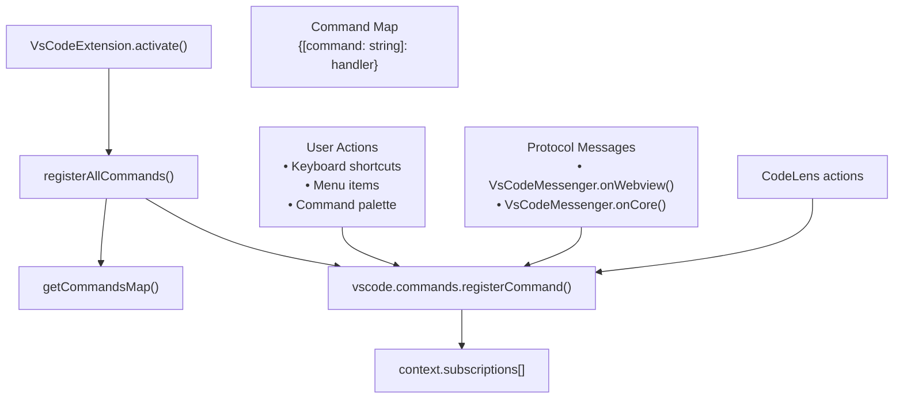
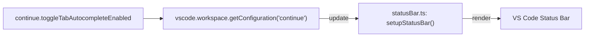
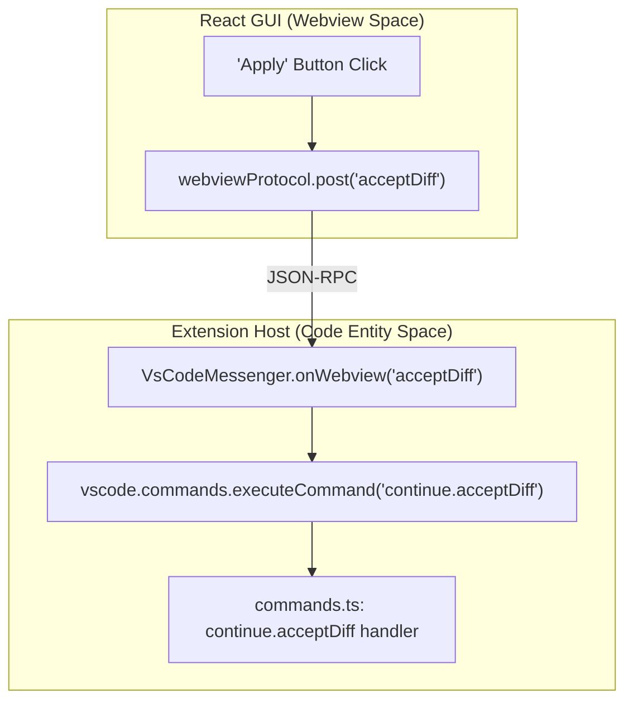

# Command System

Relevant source files

The following files were used as context for generating this wiki page:

- [binary/package-lock.json](binary/package-lock.json)
- [core/package-lock.json](core/package-lock.json)
- [core/package.json](core/package.json)
- [core/protocol/ideWebview.ts](core/protocol/ideWebview.ts)
- [extensions/vscode/package-lock.json](extensions/vscode/package-lock.json)
- [extensions/vscode/package.json](extensions/vscode/package.json)
- [extensions/vscode/src/commands.ts](extensions/vscode/src/commands.ts)
- [extensions/vscode/src/extension/VsCodeMessenger.ts](extensions/vscode/src/extension/VsCodeMessenger.ts)
- [gui/package-lock.json](gui/package-lock.json)
- [gui/package.json](gui/package.json)
- [gui/src/components/Layout.tsx](gui/src/components/Layout.tsx)
- [gui/src/components/mainInput/ContinueInputBox.tsx](gui/src/components/mainInput/ContinueInputBox.tsx)
- [gui/src/components/mainInput/InputToolbar.tsx](gui/src/components/mainInput/InputToolbar.tsx)
- [gui/src/components/modelSelection/ModelSelect.tsx](gui/src/components/modelSelection/ModelSelect.tsx)
- [gui/src/pages/gui/Chat.tsx](gui/src/pages/gui/Chat.tsx)
- [packages/config-yaml/package.json](packages/config-yaml/package.json)

## Purpose and Scope

The Command System serves as the primary interface between user actions (keyboard shortcuts, menu selections, UI interactions) and the Continue extension's logic. It defines approximately 50 `continue.*` commands that orchestrate code editing, diff management, chat sessions, autocomplete settings, and background agent workflows. The system is designed to be IDE-agnostic at the core but provides specific registrations for the VS Code environment.

## Command Registration Architecture

Continue uses a centralized registration pattern where all commands are mapped to handlers and injected with necessary dependencies during extension activation.

### Registration Flow

Sources: [extensions/vscode/src/commands.ts:121-130](), [extensions/vscode/src/extension/VsCodeMessenger.ts:115-129]()

The `registerAllCommands` function iterates through the map returned by `getCommandsMap`, binding each command name to its handler while ensuring they are properly disposed of when the extension deactivates.

## Command Map Structure

The `getCommandsMap` function is a higher-order function that accepts core service instances (dependencies) and returns a dictionary of command handlers. This closure-based approach ensures handlers have access to the IDE abstraction, configuration handler, and diff managers without relying on global state.

### Key Dependencies
*   **VsCodeIde**: Implementation of the IDE interface for file and terminal operations [extensions/vscode/src/VsCodeIde.ts:1-50]().
*   **VerticalDiffManager**: Manages inline diff rendering and block acceptance [extensions/vscode/src/diff/vertical/manager.ts:1-40]().
*   **ConfigHandler**: Orchestrates loading of JSON/YAML configurations and profiles [core/config/ConfigHandler.ts:1-100]().
*   **VsCodeWebviewProtocol**: Handles JSON-RPC communication with the React GUI [extensions/vscode/src/webviewProtocol.ts:1-30]().

Sources: [extensions/vscode/src/commands.ts:108-130]()

## Command Categories

### Diff and Edit Management
These commands handle the lifecycle of AI-generated code changes.

| Command | Code Entity | Purpose |
| :--- | :--- | :--- |
| `continue.acceptDiff` | `processDiff("accept", ...)` | Commits all changes in a stream to the file. |
| `continue.rejectDiff` | `processDiff("reject", ...)` | Reverts all changes in a stream. |
| `continue.acceptVerticalDiffBlock` | `verticalDiffManager.acceptRejectVerticalDiffBlock(true, ...)` | Accepts a specific hunk in a multi-block diff. |
| `continue.streamInlineEdit` | `verticalDiffManager.streamEdit(...)` | Internal helper to route prompts to the Edit model. |

Sources: [extensions/vscode/src/commands.ts:173-201](), [extensions/vscode/src/commands.ts:143-170]()

### GUI and Chat Interaction
Commands that control the visibility and state of the React-based chat interface.

| Command | Logic |
| :--- | :--- |
| `continue.focusContinueInput` | Calls `focusGUI()` and sends `focusContinueInputWithNewSession` to the webview. |
| `continue.focusEdit` | Switches the sidebar to Edit Mode and adds current selection to context. |
| `continue.applyCodeFromChat` | Extracts code blocks from the chat history and streams them to the editor. |
| `continue.quickFix` | Captures diagnostic messages (errors/warnings) and sends them as chat context. |

Sources: [extensions/vscode/src/commands.ts:61-83](), [extensions/vscode/src/commands.ts:202-211](), [extensions/vscode/src/commands.ts:266-290]()

### Autocomplete and Next Edit
These commands manage the status bar and configuration for the `ContinueCompletionProvider`.

Title: Autocomplete Status Management

Sources: [extensions/vscode/src/commands.ts:537-572](), [extensions/vscode/src/autocomplete/statusBar.ts:1-50]()

## Protocol-to-Command Mapping

The `VsCodeMessenger` class acts as a router, converting webview protocol messages into VS Code command executions. This allows the React GUI to trigger complex IDE actions like diff acceptance or file opening.

Title: Webview Message Routing

Sources: [extensions/vscode/src/extension/VsCodeMessenger.ts:115-129](), [gui/src/pages/gui/Chat.tsx:160-190]()

## Background Agent Commands

The system supports Control Plane integration for background agents. These commands are typically invoked via the `VsCodeMessenger` to handle long-running tasks.

*   **`createBackgroundAgent`**: Gathers workspace info (repo name, branch, remote URL) and calls `controlPlaneClient.createBackgroundAgent`.
*   **`openAgentLocally`**: Synchronizes local git state with an agent's remote state, checking out the appropriate branch and loading agent history.

Sources: [extensions/vscode/src/extension/VsCodeMessenger.ts:272-419](), [extensions/vscode/src/extension/VsCodeMessenger.ts:438-652]()

## Telemetry Integration

Telemetry is integrated directly into the command execution flow. The extension uses `captureCommandTelemetry` to log command usage, providing insights into which features (e.g., `fixCode`, `optimizeCode`) are most utilized.

Sources: [extensions/vscode/src/commands.ts:62-72](), [extensions/vscode/src/commands.ts:187]()