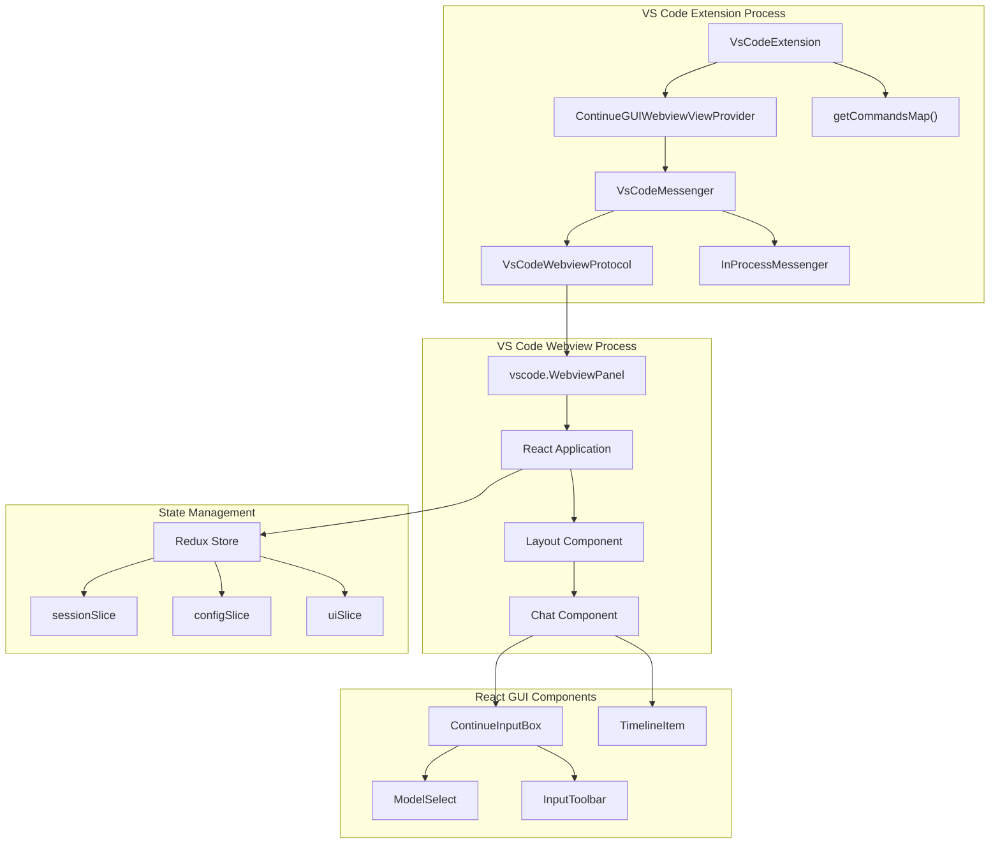
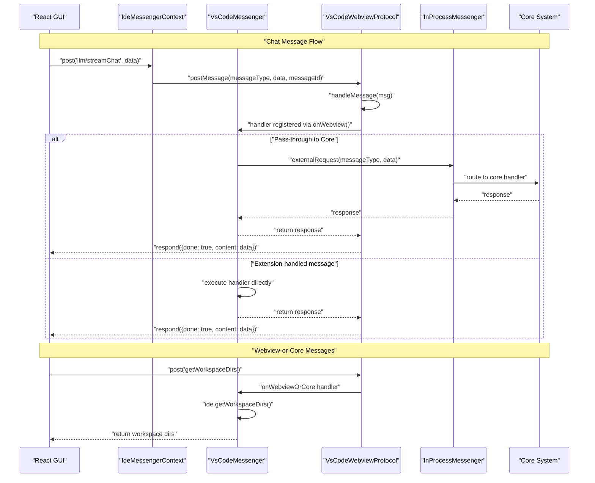
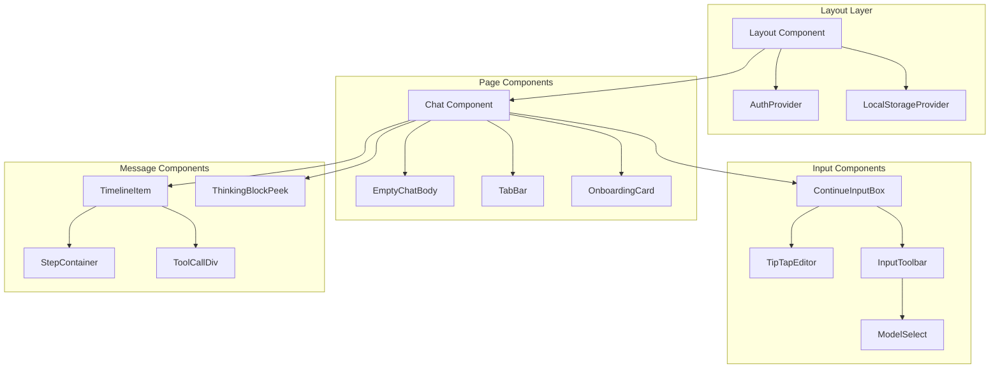
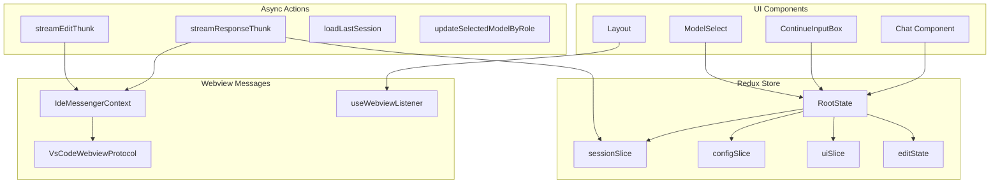
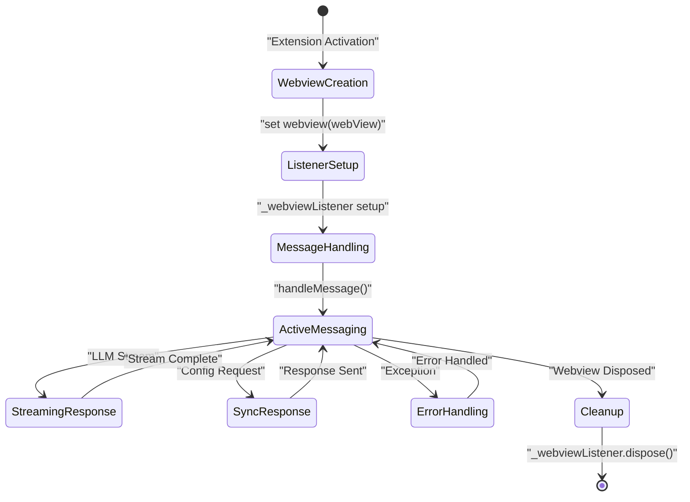
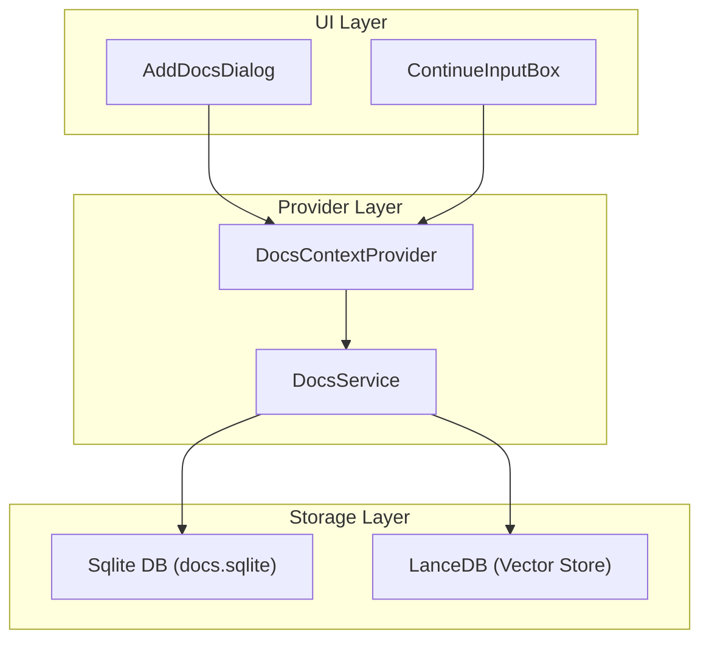

# Webview Integration

<details>
<summary>Relevant source files</summary>

The following files were used as context for generating this wiki page:

- [core/context/providers/DocsContextProvider.ts](core/context/providers/DocsContextProvider.ts)
- [core/indexing/docs/DocsService.ts](core/indexing/docs/DocsService.ts)
- [core/indexing/docs/article.ts](core/indexing/docs/article.ts)
- [core/protocol/ideWebview.ts](core/protocol/ideWebview.ts)
- [extensions/vscode/src/commands.ts](extensions/vscode/src/commands.ts)
- [extensions/vscode/src/extension/VsCodeMessenger.ts](extensions/vscode/src/extension/VsCodeMessenger.ts)
- [extensions/vscode/src/webviewProtocol.ts](extensions/vscode/src/webviewProtocol.ts)
- [gui/src/components/Layout.tsx](gui/src/components/Layout.tsx)
- [gui/src/components/dialogs/AddDocsDialog.tsx](gui/src/components/dialogs/AddDocsDialog.tsx)
- [gui/src/components/dialogs/ConfirmationDialog.tsx](gui/src/components/dialogs/ConfirmationDialog.tsx)
- [gui/src/components/dialogs/index.tsx](gui/src/components/dialogs/index.tsx)
- [gui/src/components/indexing/ChatIndexingPeeks.tsx](gui/src/components/indexing/ChatIndexingPeeks.tsx)
- [gui/src/components/mainInput/ContinueInputBox.tsx](gui/src/components/mainInput/ContinueInputBox.tsx)
- [gui/src/components/mainInput/InputToolbar.tsx](gui/src/components/mainInput/InputToolbar.tsx)
- [gui/src/components/modelSelection/ModelSelect.tsx](gui/src/components/modelSelection/ModelSelect.tsx)
- [gui/src/pages/gui/Chat.tsx](gui/src/pages/gui/Chat.tsx)

</details>


This document covers how the React GUI is embedded and communicates within VS Code through webviews. The webview integration enables the Continue chat interface to run as a web-based UI inside VS Code while maintaining secure bidirectional communication with the extension and core system.

For information about the VS Code extension architecture, see [Extension Architecture](). For details about the chat interface components, see [Chat Interface]().

## Webview Architecture

The webview integration embeds a React-based GUI within VS Code using the webview API. The `ContinueGUIWebviewViewProvider` creates and manages the webview, while `VsCodeMessenger` handles bidirectional message routing between the extension process, core system, and webview process.

**Webview Integration Overview**


**Sources:** [extensions/vscode/src/extension/VsCodeMessenger.ts:39-84](), [extensions/vscode/src/commands.ts:108-130]()

## Message Protocol Flow

The `VsCodeMessenger` class orchestrates message routing between three layers: the React GUI webview, the VS Code extension, and the Core system. It uses `onWebview()`, `onCore()`, and `onWebviewOrCore()` methods to register handlers for different message sources.

**Message Communication Sequence**


**Sources:** [extensions/vscode/src/extension/VsCodeMessenger.ts:40-70](), [extensions/vscode/src/webviewProtocol.ts:51-117]()

## React GUI Components

The webview embeds a React application built with Redux state management. The main components handle chat interactions, configuration, and real-time updates from the extension.

### Core Component Architecture



### Webview Listener Integration

The React components use the `useWebviewListener` hook to handle messages from the VS Code extension:

| Hook Usage | Component | Message Types |
|------------|-----------|---------------|
| `useWebviewListener('newSession')` | Layout | Session management [gui/src/components/Layout.tsx:57-72]() |
| `useWebviewListener('focusContinueInputWithNewSession')` | Layout | Input focus control [gui/src/components/Layout.tsx:84-104]() |
| `useWebviewListener('addModel')` | Layout | Configuration updates [gui/src/components/Layout.tsx:107-112]() |
| `useWebviewListener('setCodeToEdit')` | Layout | Edit mode state sync [gui/src/components/Layout.tsx:153-162]() |
| `useWebviewListener('focusEdit')` | Layout | Focus and prepare edit mode [gui/src/components/Layout.tsx:143-150]() |

**Sources:** [gui/src/components/Layout.tsx:56-170]()

## Redux State Management

The React GUI uses Redux for state management with specialized slices for different aspects of the chat interface. The webview protocol integrates with Redux through thunks and message dispatching.

### State Architecture

**Redux Store Integration with Webview**


**Sources:** [gui/src/pages/gui/Chat.tsx:107-124](), [gui/src/components/Layout.tsx:41-51]()

## Webview Lifecycle Management

The webview protocol manages the complete lifecycle of the VS Code webview, including creation, message handling, and cleanup.

**Webview Setup and Message Handling**


### Message Retry Logic

The protocol implements retry logic for communication reliability in `VsCodeWebviewProtocol.request()` to ensure messages aren't lost if the webview is still initializing:

```typescript
// Request retry pattern from VsCodeWebviewProtocol
let i = 0;
while (!this.webview) {
  if (i >= 10) {
    resolve(undefined);
    return;
  } else {
    await new Promise((res) => setTimeout(res, i >= 5 ? 1000 : 500));
    i++;
  }
}
```

**Sources:** [extensions/vscode/src/webviewProtocol.ts:47-50](), [extensions/vscode/src/webviewProtocol.ts:143-153]()

## Error Handling and User Feedback

The webview integration implements specialized error handling for different error types with appropriate user feedback mechanisms.

### Error Classification and Handling

| Error Type | Handler | User Impact | Recovery Action |
|------------|---------|-------------|-----------------|
| `LLMError` | `handleLLMError()` | Error notice | Automatic retry or configuration prompt [extensions/vscode/src/webviewProtocol.ts:87-90]() |
| `ConnectTimeoutError` | `VsCodeWebviewProtocol` | Timeout guidance | Suggest timeout config increase [extensions/vscode/src/webviewProtocol.ts:107-108]() |
| `ECONNREFUSED` | `VsCodeWebviewProtocol` | Connection help | Provide server setup guidance [extensions/vscode/src/webviewProtocol.ts:109-110]() |

**Sources:** [extensions/vscode/src/webviewProtocol.ts:86-116]()

## Protocol Message Types

The webview protocol defines strongly-typed message interfaces for communication between the VS Code extension and React GUI.

### Key Message Types

**From Webview to IDE (`ToIdeFromWebviewProtocol`)**

| Message Type | Request Payload | Purpose |
|--------------|-----------------|---------|
| `applyToFile` | `ApplyToFilePayload` | Apply suggested changes to a file [core/protocol/ideWebview.ts:18]() |
| `acceptDiff` | `AcceptOrRejectDiffPayload` | Accept a pending diff block [core/protocol/ideWebview.ts:41]() |
| `rejectDiff` | `AcceptOrRejectDiffPayload` | Reject a pending diff block [core/protocol/ideWebview.ts:42]() |
| `edit/sendPrompt` | `{prompt, range}` | Trigger an inline edit stream [core/protocol/ideWebview.ts:43-49]() |
| `showFile` | `ShowFilePayload` | Open a specific file in the editor [core/protocol/ideWebview.ts:21]() |

**From IDE to Webview (`ToWebviewFromIdeProtocol`)**

| Message Type | Request Payload | Purpose |
|--------------|-----------------|---------|
| `newSession` | `undefined` | Clear chat and start new session [core/protocol/ideWebview.ts:68]() |
| `focusContinueInput` | `undefined` | Focus the input box [core/protocol/ideWebview.ts:59]() |
| `highlightedCode` | `HighlightedCodePayload` | Add code selection to context [core/protocol/ideWebview.ts:62]() |
| `setCodeToEdit` | `SetCodeToEditPayload` | Set current file/range for edit mode [core/protocol/ideWebview.ts:63]() |
| `updateApplyState` | `ApplyState` | Update diff apply status [core/protocol/ideWebview.ts:78]() |

**Sources:** [core/protocol/ideWebview.ts:16-53](), [core/protocol/ideWebview.ts:55-82]()

## Context Provider Integration

The webview integrates with context providers, such as the `DocsContextProvider`, to enable documentation search and snippet retrieval through the indexing system.

### Documentation Context Flow



**Sources:** [core/context/providers/DocsContextProvider.ts:15-186](), [core/indexing/docs/DocsService.ts:167-230](), [gui/src/components/dialogs/AddDocsDialog.tsx:13-76]()