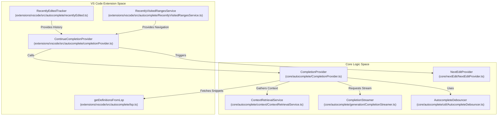
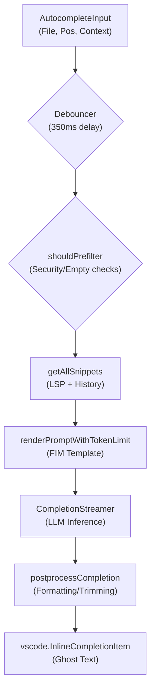

# Autocomplete System

Relevant source files

The following files were used as context for generating this wiki page:

- [core/autocomplete/CompletionProvider.ts](core/autocomplete/CompletionProvider.ts)
- [core/autocomplete/context/ContextRetrievalService.ts](core/autocomplete/context/ContextRetrievalService.ts)
- [core/autocomplete/context/ranking/index.ts](core/autocomplete/context/ranking/index.ts)
- [core/autocomplete/context/static-context/StaticContextService.ts](core/autocomplete/context/static-context/StaticContextService.ts)
- [core/autocomplete/context/static-context/types.ts](core/autocomplete/context/static-context/types.ts)
- [core/autocomplete/filtering/streamTransforms/StreamTransformPipeline.ts](core/autocomplete/filtering/streamTransforms/StreamTransformPipeline.ts)
- [core/autocomplete/filtering/streamTransforms/charStream.ts](core/autocomplete/filtering/streamTransforms/charStream.ts)
- [core/autocomplete/filtering/streamTransforms/filterCodeBlock.ts](core/autocomplete/filtering/streamTransforms/filterCodeBlock.ts)
- [core/autocomplete/filtering/streamTransforms/filterCodeBlock.vitest.ts](core/autocomplete/filtering/streamTransforms/filterCodeBlock.vitest.ts)
- [core/autocomplete/filtering/streamTransforms/lineStream.ts](core/autocomplete/filtering/streamTransforms/lineStream.ts)
- [core/autocomplete/filtering/streamTransforms/lineStream.vitest.ts](core/autocomplete/filtering/streamTransforms/lineStream.vitest.ts)
- [core/autocomplete/filtering/test/testCases.ts](core/autocomplete/filtering/test/testCases.ts)
- [core/autocomplete/filtering/test/util.ts](core/autocomplete/filtering/test/util.ts)
- [core/autocomplete/postprocessing/index.ts](core/autocomplete/postprocessing/index.ts)
- [core/autocomplete/snippets/getAllSnippets.ts](core/autocomplete/snippets/getAllSnippets.ts)
- [core/autocomplete/snippets/types.ts](core/autocomplete/snippets/types.ts)
- [core/autocomplete/templating/AutocompleteTemplate.ts](core/autocomplete/templating/AutocompleteTemplate.ts)
- [core/autocomplete/templating/index.ts](core/autocomplete/templating/index.ts)
- [core/autocomplete/util/types.ts](core/autocomplete/util/types.ts)
- [core/edit/constants.ts](core/edit/constants.ts)
- [core/edit/lazy/prompts.ts](core/edit/lazy/prompts.ts)
- [core/edit/lazy/replace.ts](core/edit/lazy/replace.ts)
- [core/edit/lazy/streamLazyApply.ts](core/edit/lazy/streamLazyApply.ts)
- [core/llm/autodetect.vitest.ts](core/llm/autodetect.vitest.ts)
- [core/llm/templates/edit/gpt.ts](core/llm/templates/edit/gpt.ts)
- [core/nextEdit/DocumentHistoryTracker.ts](core/nextEdit/DocumentHistoryTracker.ts)
- [core/nextEdit/NextEditEditableRegionCalculator.ts](core/nextEdit/NextEditEditableRegionCalculator.ts)
- [core/nextEdit/NextEditLoggingService.ts](core/nextEdit/NextEditLoggingService.ts)
- [core/nextEdit/NextEditPrefetchQueue.ts](core/nextEdit/NextEditPrefetchQueue.ts)
- [core/nextEdit/NextEditProvider.ts](core/nextEdit/NextEditProvider.ts)
- [core/nextEdit/NextEditProviderFactory.ts](core/nextEdit/NextEditProviderFactory.ts)
- [core/nextEdit/constants.ts](core/nextEdit/constants.ts)
- [core/nextEdit/providers/BaseNextEditProvider.ts](core/nextEdit/providers/BaseNextEditProvider.ts)
- [core/nextEdit/providers/InstinctNextEditProvider.ts](core/nextEdit/providers/InstinctNextEditProvider.ts)
- [core/nextEdit/providers/MercuryCoderNextEditProvider.ts](core/nextEdit/providers/MercuryCoderNextEditProvider.ts)
- [core/nextEdit/templating/NextEditPromptEngine.ts](core/nextEdit/templating/NextEditPromptEngine.ts)
- [core/nextEdit/templating/NextEditPromptEngine.vitest.ts](core/nextEdit/templating/NextEditPromptEngine.vitest.ts)
- [core/nextEdit/types.ts](core/nextEdit/types.ts)
- [core/util/parameters.ts](core/util/parameters.ts)
- [core/utils/markdownUtils.ts](core/utils/markdownUtils.ts)
- [core/utils/markdownUtils.vitest.ts](core/utils/markdownUtils.vitest.ts)
- [core/utils/streamMarkdownUtils.ts](core/utils/streamMarkdownUtils.ts)
- [extensions/vscode/src/activation/SelectionChangeManager.ts](extensions/vscode/src/activation/SelectionChangeManager.ts)
- [extensions/vscode/src/autocomplete/GhostTextAcceptanceTracker.ts](extensions/vscode/src/autocomplete/GhostTextAcceptanceTracker.ts)
- [extensions/vscode/src/autocomplete/completionProvider.ts](extensions/vscode/src/autocomplete/completionProvider.ts)
- [extensions/vscode/src/autocomplete/lsp.ts](extensions/vscode/src/autocomplete/lsp.ts)
- [extensions/vscode/src/suggestions.ts](extensions/vscode/src/suggestions.ts)
- [extensions/vscode/src/util/util.ts](extensions/vscode/src/util/util.ts)
- [extensions/vscode/src/util/vscode.ts](extensions/vscode/src/util/vscode.ts)
- [packages/config-types/package-lock.json](packages/config-types/package-lock.json)
- [packages/config-types/package.json](packages/config-types/package.json)
- [packages/config-types/src/index.ts](packages/config-types/src/index.ts)
- [packages/config-yaml/src/schemas/data/nextEditOutcome/index.ts](packages/config-yaml/src/schemas/data/nextEditOutcome/index.ts)
- [packages/config-yaml/src/schemas/data/nextEditOutcome/v0.2.0.ts](packages/config-yaml/src/schemas/data/nextEditOutcome/v0.2.0.ts)

## Purpose and Scope

This document describes the autocomplete system in Continue, focusing on the `ContinueCompletionProvider` in the VS Code extension and its coordination with the core `CompletionProvider`. The system provides low-latency, context-aware inline code suggestions using a combination of Language Server Protocol (LSP) data, Tree-sitter AST parsing, and recent user activity.

The system also integrates with the **Next Edit** feature, which predicts the next logical edit location following a completion.

## System Overview

The autocomplete system operates as a VS Code `InlineCompletionItemProvider`. It intercepts keystrokes and coordinates between the IDE's local context and LLM inference.

### High-Level Data Flow

The diagram below bridges the "Natural Language Space" (User Intent/Context) to the "Code Entity Space" (Classes and Functions) by showing how the `ContinueCompletionProvider` orchestrates data.

**Autocomplete Orchestration**

**Sources**: [extensions/vscode/src/autocomplete/completionProvider.ts:40-123](), [core/autocomplete/CompletionProvider.ts:33-52](), [core/nextEdit/NextEditProvider.ts:57-90]()

## Entry Point: ContinueCompletionProvider

The `ContinueCompletionProvider` class implements `vscode.InlineCompletionItemProvider` [extensions/vscode/src/autocomplete/completionProvider.ts:40-42](). It manages the lifecycle of an autocomplete request, including debouncing, cancellation, and error handling.

### Trigger and Early Exit
The `provideInlineCompletionItems` method is triggered on every keystroke [extensions/vscode/src/autocomplete/completionProvider.ts:157-158](). It performs several checks before proceeding:
1. **Status Check**: Verifies if tab autocomplete is enabled via `getStatusBarStatus()` [extensions/vscode/src/autocomplete/completionProvider.ts:168-172]().
2. **Multi-cursor**: Returns `null` if multiple cursors are active [extensions/vscode/src/autocomplete/completionProvider.ts:183-185]().
3. **Trigger Logic**: Analyzes `selectedCompletionInfo` to see if the user has already typed enough (at least 4 characters) to justify a new suggestion [extensions/vscode/src/autocomplete/completionProvider.ts:192-205]().

### Configuration and Model Selection
The provider uses the `ConfigHandler` to load the specific model assigned to the `autocomplete` role [extensions/vscode/src/autocomplete/completionProvider.ts:91-97](). It defaults to `0.01` temperature if not specified [core/autocomplete/CompletionProvider.ts:88-90]().

**Sources**: [extensions/vscode/src/autocomplete/completionProvider.ts:150-205](), [core/autocomplete/CompletionProvider.ts:69-97]()

## Context Gathering and Snippet Retrieval

Continue uses a multi-layered approach to gather context, moving from the immediate cursor position to project-wide symbols.

### Snippet Payload Structure
The system constructs a `SnippetPayload` containing various types of context [core/autocomplete/snippets/getAllSnippets.ts:19-29]():

| Snippet Type | Source | Description |
| :--- | :--- | :--- |
| `importDefinitionSnippets` | `ContextRetrievalService` | Definitions of symbols imported in the current file [core/autocomplete/snippets/getAllSnippets.ts:193-195](). |
| `recentlyEditedRangeSnippets`| `RecentlyEditedTracker` | Code from recently modified blocks [core/autocomplete/snippets/getAllSnippets.ts:180-181](). |
| `recentlyVisitedRanges` | `RecentlyVisitedRangesService` | Code from ranges the user recently viewed [core/autocomplete/snippets/getAllSnippets.ts:214](). |
| `ideSnippets` | `getDefinitionsFromLsp` | Symbols retrieved via LSP (Definitions, Type Definitions) [core/autocomplete/snippets/getAllSnippets.ts:46-52](). |
| `clipboardSnippets` | `ide.getClipboardContent` | Recent contents of the system clipboard [core/autocomplete/snippets/getAllSnippets.ts:83-95](). |
| `recentlyOpenedFileSnippets` | `openedFilesLruCache` | Contents of files recently opened in the editor [core/autocomplete/snippets/getAllSnippets.ts:110-167](). |

**Sources**: [core/autocomplete/snippets/getAllSnippets.ts:169-218](), [core/autocomplete/CompletionProvider.ts:200-208]()

### LSP Integration (`getDefinitionsFromLsp`)
This utility bridges the IDE's Language Server with the completion engine. It performs the following:
1. **AST Parsing**: Uses `getAst` and `getTreePathAtCursor` to understand the code structure around the cursor [extensions/vscode/src/autocomplete/lsp.ts:7-11]().
2. **Goto Provider**: Executes VS Code commands like `vscode.executeDefinitionProvider` to find where symbols are defined [extensions/vscode/src/autocomplete/lsp.ts:59-97]().
3. **Recursive Type Crawling**: The `crawlTypes` function follows type identifiers to resolve complex nested types (e.g., finding the definition of a class used as a parameter) [extensions/vscode/src/autocomplete/lsp.ts:146-152]().

**Sources**: [extensions/vscode/src/autocomplete/lsp.ts:1-233]()

## Prompt Engineering and Templating

Once context is gathered, the system must format it for the LLM. This is handled by `renderPromptWithTokenLimit` [core/autocomplete/templating/index.ts:212-217]().

### Fill-In-The-Middle (FIM) Templates
Continue supports specialized FIM templates for various models to improve completion quality [core/autocomplete/templating/AutocompleteTemplate.ts:14-35]().

**FIM Template Examples**
| Model/Family | Template Pattern | Stop Tokens |
| :--- | :--- | :--- |
| **StableCode** | `<fim_prefix>{{{prefix}}}<fim_suffix>{{{suffix}}}<fim_middle>` | `<fim_prefix>`, `<file_sep>`, `<|endoftext|>` |
| **Qwen Coder** | `<|fim_prefix|>{{{prefix}}}<|fim_suffix|>{{{suffix}}}<|fim_middle|>` | `<|endoftext|>`, `<|file_sep|>` |
| **Codestral** | `[SUFFIX]{{{suffix}}}[PREFIX]{{{prefix}}}` | `[PREFIX]`, `[SUFFIX]` |
| **Mercury** | Multi-file FIM using `+++++` path markers | `[PREFIX]`, `[SUFFIX]`, `\n+++++ ` |

**Sources**: [core/autocomplete/templating/AutocompleteTemplate.ts:38-240](), [core/autocomplete/templating/index.ts:158-201]()

### Token Management
The system enforces limits to ensure the prompt fits within the model's context window. It calculates a `maxAllowedPromptTokens` by subtracting the `maxTokens` (completion length) and a safety buffer from the model's total `contextLength` [core/autocomplete/templating/index.ts:203-210](). If the prompt is too long, it prunes lines from the top of the prefix and the bottom of the suffix [core/autocomplete/templating/index.ts:258-270]().

**Sources**: [core/autocomplete/templating/index.ts:203-270](), [core/util/parameters.ts:3-29]()

## Completion Rendering and Lifecycle

The final stage involves streaming the response and rendering it as "Ghost Text" in the editor.

### Debouncing
To avoid overwhelming the LLM, the `AutocompleteDebouncer` introduces a delay (default 350ms) before sending the request [core/autocomplete/CompletionProvider.ts:177-183](). If the user types during this window, the previous request is cancelled.

### Implementation Flow
**Completion Provider Data Flow**

**Sources**: [core/autocomplete/CompletionProvider.ts:150-230](), [extensions/vscode/src/autocomplete/completionProvider.ts:150-205]()

### Stream Transformation Pipeline
Before the text reaches the editor, it passes through a `StreamTransformPipeline` that applies several filters [core/autocomplete/filtering/streamTransforms/StreamTransformPipeline.ts:21-29]():
- `stopAtStopTokens`: Terminates generation on model-specific stop sequences [core/autocomplete/filtering/streamTransforms/StreamTransformPipeline.ts:32-35]().
- `stopAtStartOf`: Stops if the model begins repeating the existing suffix [core/autocomplete/filtering/streamTransforms/StreamTransformPipeline.ts:36]().
- `avoidPathLine`: Filters out accidental "Path: ..." lines often hallucinated by models [core/autocomplete/filtering/streamTransforms/StreamTransformPipeline.ts:61]().
- `showWhateverWeHaveAtXMs`: Ensures the user sees partial results within a strict time limit (default 300ms) [core/autocomplete/filtering/streamTransforms/StreamTransformPipeline.ts:77](), [core/util/parameters.ts:22]().

**Sources**: [core/autocomplete/filtering/streamTransforms/StreamTransformPipeline.ts:1-100](), [core/autocomplete/filtering/streamTransforms/lineStream.ts:228-240]()

### Acceptance and Logging
When a user accepts a completion (usually via the `Tab` key), Continue triggers the `accept` method in the `CompletionProvider` [core/autocomplete/CompletionProvider.ts:119-121](). This information is passed to the `AutocompleteLoggingService` to track telemetry [core/autocomplete/CompletionProvider.ts:120-128]().

**Sources**: [core/autocomplete/CompletionProvider.ts:119-133](), [extensions/vscode/src/autocomplete/completionProvider.ts:82-123]()