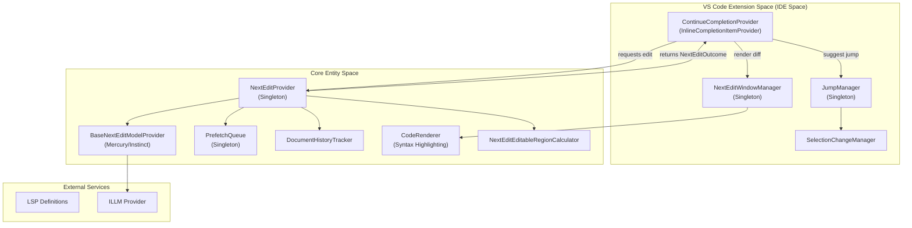
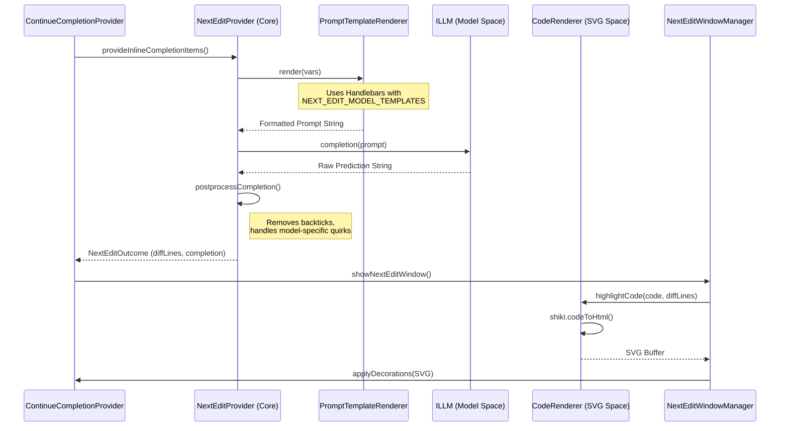

# Next Edit Feature

Relevant source files

The following files were used as context for generating this wiki page:

- [core/autocomplete/postprocessing/index.ts](core/autocomplete/postprocessing/index.ts)
- [core/autocomplete/templating/constructPrefixSuffix.ts](core/autocomplete/templating/constructPrefixSuffix.ts)
- [core/autocomplete/util/HelperVars.ts](core/autocomplete/util/HelperVars.ts)
- [core/codeRenderer/CodeRenderer.ts](core/codeRenderer/CodeRenderer.ts)
- [core/llm/autodetect.vitest.ts](core/llm/autodetect.vitest.ts)
- [core/nextEdit/DocumentHistoryTracker.ts](core/nextEdit/DocumentHistoryTracker.ts)
- [core/nextEdit/NextEditEditableRegionCalculator.ts](core/nextEdit/NextEditEditableRegionCalculator.ts)
- [core/nextEdit/NextEditLoggingService.ts](core/nextEdit/NextEditLoggingService.ts)
- [core/nextEdit/NextEditPrefetchQueue.ts](core/nextEdit/NextEditPrefetchQueue.ts)
- [core/nextEdit/NextEditProvider.ts](core/nextEdit/NextEditProvider.ts)
- [core/nextEdit/NextEditProviderFactory.ts](core/nextEdit/NextEditProviderFactory.ts)
- [core/nextEdit/constants.ts](core/nextEdit/constants.ts)
- [core/nextEdit/context/aggregateEdits.ts](core/nextEdit/context/aggregateEdits.ts)
- [core/nextEdit/context/autocompleteContextFetching.ts](core/nextEdit/context/autocompleteContextFetching.ts)
- [core/nextEdit/context/diffFormatting.ts](core/nextEdit/context/diffFormatting.ts)
- [core/nextEdit/context/processNextEditData.ts](core/nextEdit/context/processNextEditData.ts)
- [core/nextEdit/context/processSmallEdit.ts](core/nextEdit/context/processSmallEdit.ts)
- [core/nextEdit/providers/BaseNextEditProvider.ts](core/nextEdit/providers/BaseNextEditProvider.ts)
- [core/nextEdit/providers/InstinctNextEditProvider.ts](core/nextEdit/providers/InstinctNextEditProvider.ts)
- [core/nextEdit/providers/MercuryCoderNextEditProvider.ts](core/nextEdit/providers/MercuryCoderNextEditProvider.ts)
- [core/nextEdit/templating/NextEditPromptEngine.ts](core/nextEdit/templating/NextEditPromptEngine.ts)
- [core/nextEdit/templating/NextEditPromptEngine.vitest.ts](core/nextEdit/templating/NextEditPromptEngine.vitest.ts)
- [core/nextEdit/types.ts](core/nextEdit/types.ts)
- [core/util/text.ts](core/util/text.ts)
- [core/util/text.vitest.ts](core/util/text.vitest.ts)
- [extensions/vscode/src/activation/JumpManager.ts](extensions/vscode/src/activation/JumpManager.ts)
- [extensions/vscode/src/activation/NextEditWindowManager.ts](extensions/vscode/src/activation/NextEditWindowManager.ts)
- [extensions/vscode/src/activation/SelectionChangeManager.ts](extensions/vscode/src/activation/SelectionChangeManager.ts)
- [extensions/vscode/src/autocomplete/GhostTextAcceptanceTracker.ts](extensions/vscode/src/autocomplete/GhostTextAcceptanceTracker.ts)
- [extensions/vscode/src/autocomplete/__tests__/ContinueCompletionProvider.vitest.ts](extensions/vscode/src/autocomplete/__tests__/ContinueCompletionProvider.vitest.ts)
- [extensions/vscode/src/autocomplete/completionProvider.ts](extensions/vscode/src/autocomplete/completionProvider.ts)
- [extensions/vscode/src/autocomplete/statusBar.ts](extensions/vscode/src/autocomplete/statusBar.ts)
- [extensions/vscode/src/util/editLoggingUtils.ts](extensions/vscode/src/util/editLoggingUtils.ts)
- [packages/config-yaml/src/schemas/data/nextEditOutcome/index.ts](packages/config-yaml/src/schemas/data/nextEditOutcome/index.ts)
- [packages/config-yaml/src/schemas/data/nextEditOutcome/v0.2.0.ts](packages/config-yaml/src/schemas/data/nextEditOutcome/v0.2.0.ts)
- [packages/config-yaml/src/schemas/data/nextEditWithHistory/index.ts](packages/config-yaml/src/schemas/data/nextEditWithHistory/index.ts)
- [packages/config-yaml/src/schemas/data/nextEditWithHistory/v0.2.0.ts](packages/config-yaml/src/schemas/data/nextEditWithHistory/v0.2.0.ts)

## Purpose and Scope

This document describes the Next Edit system, an advanced code completion feature that predicts and suggests multi-step code edits across multiple file locations. Unlike standard autocomplete which provides single-line or multi-line completions at the cursor position, Next Edit can suggest larger structural changes (full function rewrites, multi-location edits) and chain multiple edit suggestions together.

For standard tab autocomplete functionality, see [Autocomplete System](#6.4). For the underlying LLM provider abstraction, see [LLM Abstraction Layer](#4.1).

## Overview

The Next Edit feature extends Continue's autocomplete capabilities by:

- Supporting full-file diff predictions in addition to Fill-in-Middle (FIM) completions. [core/nextEdit/NextEditProvider.ts:50-56]()
- Creating "chains" of edit suggestions across multiple code locations. [core/nextEdit/NextEditProvider.ts:54-56]()
- Enabling "jumps" between suggested edit locations using the `JumpManager`. [extensions/vscode/src/activation/JumpManager.ts:75-89]()
- Prefetching potential next edit locations in the background via `PrefetchQueue`. [core/nextEdit/NextEditPrefetchQueue.ts:13-17]()
- Providing richer UI feedback through SVG decorations and the `NextEditWindowManager`. [extensions/vscode/src/activation/NextEditWindowManager.ts:102-105]()

Next Edit is managed by the `NextEditProvider` singleton in the core and integrated into VS Code via the `ContinueCompletionProvider`. [extensions/vscode/src/autocomplete/completionProvider.ts:107-116]()

## System Architecture

The Next Edit architecture bridges the IDE's inline completion system with a specialized edit prediction engine.

Title: Next Edit System Architecture

Sources: [core/nextEdit/NextEditProvider.ts:57-90](), [extensions/vscode/src/activation/NextEditWindowManager.ts:106-145](), [core/nextEdit/NextEditPrefetchQueue.ts:18-39](), [extensions/vscode/src/autocomplete/completionProvider.ts:109-123]()

## Core Components

### NextEditProvider
The central orchestrator for next edit logic. It handles abort signals, manages the state machine for edit chains, and coordinates with model-specific providers. [core/nextEdit/NextEditProvider.ts:50-56]()

- **Initialization**: Initialized via `initialize()` and accessed via `getInstance()`. [core/nextEdit/NextEditProvider.ts:92-120]()
- **Model Providers**: Delegates prompt building and processing to specialized classes like `MercuryCoderNextEditProvider` or `InstinctNextEditProvider` via the `NextEditProviderFactory`. [core/nextEdit/NextEditProvider.ts:75-76](), [core/nextEdit/NextEditProviderFactory.ts:1-10]()
- **Context**: Maintains `diffContext` (recent changes) and `autocompleteContext`. [core/nextEdit/NextEditProvider.ts:122-132]()

### NextEditWindowManager
Responsible for rendering non-FIM (Fill-in-Middle) edit suggestions using SVG overlays and deletion decorations. [extensions/vscode/src/activation/NextEditWindowManager.ts:102-105]()

- **SVG Rendering**: Uses `CodeRenderer` to generate syntax-highlighted SVGs of the proposed code changes. [extensions/vscode/src/activation/NextEditWindowManager.ts:113-113]()
- **Command Integration**: Registers `continue.nextEditWindow.acceptNextEditSuggestion` and `continue.nextEditWindow.hideNextEditSuggestion`. [extensions/vscode/src/activation/NextEditWindowManager.ts:96-99]()
- **Decoration Management**: Controls the lifetime of `vscode.TextEditorDecorationType` for inline diffs. [extensions/vscode/src/activation/NextEditWindowManager.ts:115-121]()

### JumpManager
Manages "jump chains" where the user is guided from one edit location to the next. [extensions/vscode/src/activation/JumpManager.ts:69-74]()

- **Jump Suggestions**: Displays a "📍 Press Tab to jump" tooltip using SVG decorations. [extensions/vscode/src/activation/JumpManager.ts:21-21]()
- **State Tracking**: Tracks `_jumpInProgress` and `_jumpAccepted` to determine if a chain should continue or be deleted. [extensions/vscode/src/activation/JumpManager.ts:85-86]()
- **Deduplication**: Logic in `suggestJump` checks if the content at the destination already matches the suggestion before showing the UI. [extensions/vscode/src/activation/JumpManager.ts:185-221]()

Sources: [core/nextEdit/NextEditProvider.ts:57-90](), [extensions/vscode/src/activation/NextEditWindowManager.ts:106-145](), [extensions/vscode/src/activation/JumpManager.ts:75-117]()

## Data Flow: Prediction to Rendering

The following diagram illustrates how a natural language intent (captured through code context and history) is transformed into a code edit and rendered in the IDE.

Title: Next Edit Data Flow Sequence

Sources: [core/nextEdit/NextEditProvider.ts:78-90](), [core/nextEdit/templating/NextEditPromptEngine.ts:28-38](), [core/codeRenderer/CodeRenderer.ts:169-184](), [extensions/vscode/src/activation/NextEditWindowManager.ts:101-113](), [core/autocomplete/postprocessing/index.ts:92-102]()

## Prompt Engineering and Templating

Next Edit uses specialized templates for different models, defined in `NextEditPromptEngine.ts`. [core/nextEdit/templating/NextEditPromptEngine.ts:15-25]()

| Model | Template Components | Purpose |
| :--- | :--- | :--- |
| `mercury-coder` | Recent Snippets, File Content, Diff History | Full-file context for structural edits. [core/nextEdit/templating/NextEditPromptEngine.ts:19-21]() |
| `instinct` | Context Snippets, User Edits, File Excerpt | Focused edits on specific "editable regions". [core/nextEdit/templating/NextEditPromptEngine.ts:22-24]() |

Templates utilize "magic tokens" to guide the model:
- `<|editable_region_start|>` / `<|editable_region_end|>`: Marks the target area. [core/nextEdit/constants.ts:22-23]()
- `<|user_cursor_is_here|>`: Indicates focal point. [core/nextEdit/constants.ts:21]()
- `<|edit_diff_history|>`: Provides context on recent user changes. [core/nextEdit/constants.ts:65]()

Sources: [core/nextEdit/templating/NextEditPromptEngine.ts:15-25](), [core/nextEdit/constants.ts:20-25]()

## Prefetch Queue and Multi-Location Edits

The `PrefetchQueue` is designed to handle background processing of multiple predicted edit locations. [core/nextEdit/NextEditPrefetchQueue.ts:13-17]()

- **Mechanism**: Stores `unprocessedQueue` (locations to visit) and `processedQueue` (results ready for display). [core/nextEdit/NextEditPrefetchQueue.ts:21-22]()
- **Chain Processing**: `process(ctx)` iterates through locations, calling `provideInlineCompletionItemsWithChain` to get outcomes before the user even reaches the location. [core/nextEdit/NextEditPrefetchQueue.ts:63-109]()
- **Limit**: Defaults to a `prefetchLimit` of 3 items to balance latency and utility. [core/nextEdit/NextEditPrefetchQueue.ts:28-29]()

Sources: [core/nextEdit/NextEditPrefetchQueue.ts:18-60](), [core/nextEdit/NextEditPrefetchQueue.ts:63-109]()

## Rendering Logic (CodeRenderer)

The `CodeRenderer` class transforms code strings into syntax-highlighted SVGs for the `NextEditWindowManager`. [core/codeRenderer/CodeRenderer.ts:2-10]()

- **Syntax Highlighting**: Uses `shiki` with `transformerNotationDiff` and `transformerNotationHighlight`. [core/codeRenderer/CodeRenderer.ts:218-222]()
- **Diff Annotation**: Automatically injects `// [!code ++]` or `// [!code highlight]` comments into the code before rendering to trigger shiki's diff styling. [core/codeRenderer/CodeRenderer.ts:191-213]()
- **SVG Conversion**: Wraps the highlighted HTML in an SVG container with calculated dimensions and font settings. [core/codeRenderer/CodeRenderer.ts:225-245]()

Sources: [core/codeRenderer/CodeRenderer.ts:54-96](), [core/codeRenderer/CodeRenderer.ts:169-223]()

## Editable Region Calculation

To minimize token usage and improve model focus, the system calculates "editable regions" using various strategies in `NextEditEditableRegionCalculator.ts`. [core/nextEdit/NextEditEditableRegionCalculator.ts:20-38]()

| Strategy | Implementation |
| :--- | :--- |
| `Naive` | Assumes the entire file is editable. [core/nextEdit/NextEditEditableRegionCalculator.ts:42-60]() |
| `Sliding` | Creates a window centered around the cursor with configurable margins based on `MODEL_WINDOW_SIZES`. [core/nextEdit/NextEditEditableRegionCalculator.ts:64-110]() |
| `Rerank` | Uses a reranker model to score file chunks against a query to find the most relevant edit location. [core/nextEdit/NextEditEditableRegionCalculator.ts:167-207]() |

Sources: [core/nextEdit/NextEditEditableRegionCalculator.ts:8-14](), [core/nextEdit/NextEditEditableRegionCalculator.ts:20-38](), [core/nextEdit/constants.ts:7-16]()