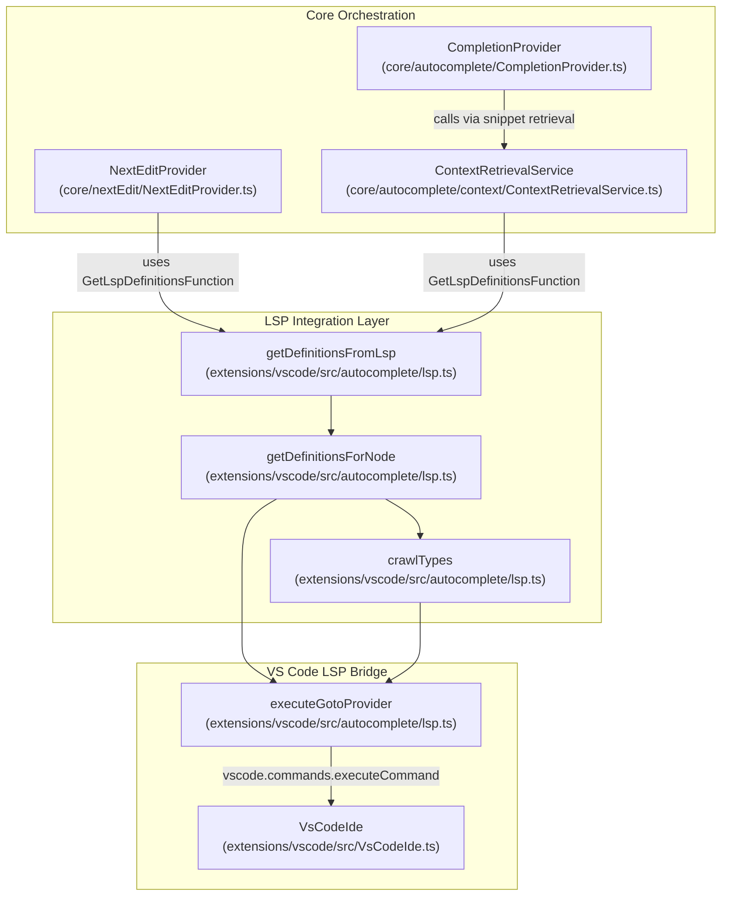
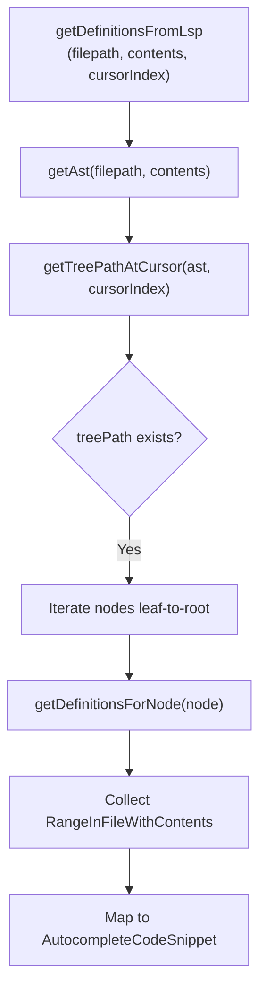

# LSP Context Integration

Relevant source files

The following files were used as context for generating this wiki page:

- [core/autocomplete/CompletionProvider.ts](core/autocomplete/CompletionProvider.ts)
- [core/autocomplete/context/ContextRetrievalService.ts](core/autocomplete/context/ContextRetrievalService.ts)
- [core/autocomplete/context/ranking/index.ts](core/autocomplete/context/ranking/index.ts)
- [core/autocomplete/context/static-context/StaticContextService.ts](core/autocomplete/context/static-context/StaticContextService.ts)
- [core/autocomplete/context/static-context/types.ts](core/autocomplete/context/static-context/types.ts)
- [core/autocomplete/postprocessing/index.ts](core/autocomplete/postprocessing/index.ts)
- [core/autocomplete/snippets/getAllSnippets.ts](core/autocomplete/snippets/getAllSnippets.ts)
- [core/autocomplete/snippets/types.ts](core/autocomplete/snippets/types.ts)
- [core/autocomplete/templating/AutocompleteTemplate.ts](core/autocomplete/templating/AutocompleteTemplate.ts)
- [core/autocomplete/templating/index.ts](core/autocomplete/templating/index.ts)
- [core/autocomplete/util/types.ts](core/autocomplete/util/types.ts)
- [core/llm/autodetect.vitest.ts](core/llm/autodetect.vitest.ts)
- [core/nextEdit/DocumentHistoryTracker.ts](core/nextEdit/DocumentHistoryTracker.ts)
- [core/nextEdit/NextEditEditableRegionCalculator.ts](core/nextEdit/NextEditEditableRegionCalculator.ts)
- [core/nextEdit/NextEditLoggingService.ts](core/nextEdit/NextEditLoggingService.ts)
- [core/nextEdit/NextEditPrefetchQueue.ts](core/nextEdit/NextEditPrefetchQueue.ts)
- [core/nextEdit/NextEditProvider.ts](core/nextEdit/NextEditProvider.ts)
- [core/nextEdit/NextEditProviderFactory.ts](core/nextEdit/NextEditProviderFactory.ts)
- [core/nextEdit/constants.ts](core/nextEdit/constants.ts)
- [core/nextEdit/providers/BaseNextEditProvider.ts](core/nextEdit/providers/BaseNextEditProvider.ts)
- [core/nextEdit/providers/InstinctNextEditProvider.ts](core/nextEdit/providers/InstinctNextEditProvider.ts)
- [core/nextEdit/providers/MercuryCoderNextEditProvider.ts](core/nextEdit/providers/MercuryCoderNextEditProvider.ts)
- [core/nextEdit/templating/NextEditPromptEngine.ts](core/nextEdit/templating/NextEditPromptEngine.ts)
- [core/nextEdit/templating/NextEditPromptEngine.vitest.ts](core/nextEdit/templating/NextEditPromptEngine.vitest.ts)
- [core/nextEdit/types.ts](core/nextEdit/types.ts)
- [core/util/parameters.ts](core/util/parameters.ts)
- [extensions/vscode/src/activation/SelectionChangeManager.ts](extensions/vscode/src/activation/SelectionChangeManager.ts)
- [extensions/vscode/src/autocomplete/GhostTextAcceptanceTracker.ts](extensions/vscode/src/autocomplete/GhostTextAcceptanceTracker.ts)
- [extensions/vscode/src/autocomplete/completionProvider.ts](extensions/vscode/src/autocomplete/completionProvider.ts)
- [extensions/vscode/src/autocomplete/lsp.ts](extensions/vscode/src/autocomplete/lsp.ts)
- [extensions/vscode/src/suggestions.ts](extensions/vscode/src/suggestions.ts)
- [extensions/vscode/src/util/util.ts](extensions/vscode/src/util/util.ts)
- [extensions/vscode/src/util/vscode.ts](extensions/vscode/src/util/vscode.ts)
- [packages/config-types/package-lock.json](packages/config-types/package-lock.json)
- [packages/config-types/package.json](packages/config-types/package.json)
- [packages/config-types/src/index.ts](packages/config-types/src/index.ts)
- [packages/config-yaml/src/schemas/data/nextEditOutcome/index.ts](packages/config-yaml/src/schemas/data/nextEditOutcome/index.ts)
- [packages/config-yaml/src/schemas/data/nextEditOutcome/v0.2.0.ts](packages/config-yaml/src/schemas/data/nextEditOutcome/v0.2.0.ts)

This document describes how the VS Code extension retrieves code definitions, type information, and symbols from Language Server Protocol (LSP) providers to enhance autocomplete and next edit suggestions. This context gathering is a critical component of the autocomplete system's ability to understand the codebase structure.

For general autocomplete functionality, see [Autocomplete System](6.4). For next edit features, see [Next Edit Feature](6.5).

## Purpose and Scope

The LSP Context Integration system leverages VS Code's built-in Language Server Protocol providers to gather rich contextual information about code at the cursor position. This includes:

- **Function definitions** and their signatures
- **Type definitions** and class structures
- **Document symbols** (functions, classes, variables)
- **Signature help** for function calls

This contextual information is passed to LLM models to improve the quality of autocomplete suggestions by providing relevant code snippets that inform the model about types, function signatures, and related code structures.

Sources: [extensions/vscode/src/autocomplete/lsp.ts:1-33]()

## System Architecture

The following diagram bridges the high-level autocomplete and next edit request flows to the specific code entities responsible for LSP communication.

### Natural Language Space to Code Entity Space

Sources: [extensions/vscode/src/autocomplete/lsp.ts:366-404](), [core/autocomplete/CompletionProvider.ts:42-52](), [core/nextEdit/NextEditProvider.ts:101-108](), [core/autocomplete/context/ContextRetrievalService.ts:50-50]()

## LSP Provider Types

The system interacts with multiple VS Code LSP command providers. These are used to resolve symbols and find definitions during the snippet generation phase.

| Provider Type | VS Code Command | Purpose |
|--------------|-----------------|---------|
| Definition | `vscode.executeDefinitionProvider` | Find where a symbol is defined |
| Type Definition | `vscode.executeTypeDefinitionProvider` | Find the type of a symbol |
| Declaration | `vscode.executeDeclarationProvider` | Find the declaration of a symbol |
| Implementation | `vscode.executeImplementationProvider` | Find implementations of an interface/class |
| Reference | `vscode.executeReferenceProvider` | Find all references to a symbol |
| Signature Help | `vscode.executeSignatureHelpProvider` | Get function signature at cursor |

Sources: [extensions/vscode/src/autocomplete/lsp.ts:26-33](), [extensions/vscode/src/autocomplete/lsp.ts:69-73]()

## Main Entry Point: getDefinitionsFromLsp

The `getDefinitionsFromLsp` function is the primary interface used by the autocomplete system. It implements the `GetLspDefinitionsFunction` type from the core package.

The function follows this algorithm:

1. **Parse the file** into an Abstract Syntax Tree (AST) using `getAst` [extensions/vscode/src/autocomplete/lsp.ts:371-371]().
2. **Find the path** from the AST root to the node at the cursor using `getTreePathAtCursor` [extensions/vscode/src/autocomplete/lsp.ts:377-377]().
3. **Iterate the path in reverse** (from leaf to root) to get definitions for each node [extensions/vscode/src/autocomplete/lsp.ts:383-383]().
4. **Call `getDefinitionsForNode`** for each AST node in the path [extensions/vscode/src/autocomplete/lsp.ts:384-384]().
5. **Convert results** to `AutocompleteCodeSnippet` format with `AutocompleteSnippetType.Code` [extensions/vscode/src/autocomplete/lsp.ts:391-402]().

Sources: [extensions/vscode/src/autocomplete/lsp.ts:366-404]()

## AST Node Processing

The `getDefinitionsForNode` function handles different AST node types differently, extracting relevant context based on the code construct.

### Function Call Handling

For `call_expression` nodes (function calls):

1. **Execute definition provider** at the function name position [extensions/vscode/src/autocomplete/lsp.ts:238-243]().
2. **Read function definition** from the returned location.
3. **Truncate long functions**: If the function exceeds 15 lines, it attempts to extract just the signature by identifying the function declaration and stripping the statement block [extensions/vscode/src/autocomplete/lsp.ts:252-284]().
4. **Crawl types**: It uses `crawlTypes` to resolve types found within the function signature [extensions/vscode/src/autocomplete/lsp.ts:288-288]().

### Class Instantiation Handling

For `new_expression` nodes:

1. **Find the class name identifier** in the node's children [extensions/vscode/src/autocomplete/lsp.ts:302-306]().
2. **Execute definition provider** to get the class definition location [extensions/vscode/src/autocomplete/lsp.ts:311-316]().
3. **Read class contents** from the definition.
4. **Crawl types** within the class definition to find related types [extensions/vscode/src/autocomplete/lsp.ts:328-328]().

Sources: [extensions/vscode/src/autocomplete/lsp.ts:228-364]()

## Type Crawling System

The `crawlTypes` function recursively discovers type definitions referenced in a piece of code, building a comprehensive type context.

### Type Identifier Detection

The `findTypeIdentifiers` function locates type references in the AST. It looks for nodes of type `type_identifier` or identifiers that appear to be types based on capitalization when inside an `ERROR` node (often seen during active typing) [extensions/vscode/src/autocomplete/lsp.ts:135-144]().

### Recursive Depth Control

The `crawlTypes` function uses a depth parameter (default 1) to control recursion:

- **Depth 1**: Find types directly referenced in the code.
- **Depth 2**: Also find types referenced by those types.
- A `searchedLabels` Set prevents infinite recursion when types have circular dependencies [extensions/vscode/src/autocomplete/lsp.ts:151-151]().

Sources: [extensions/vscode/src/autocomplete/lsp.ts:146-226]()

## Integration with Autocomplete and Next Edit

The LSP integration is wired into both the `CompletionProvider` and `NextEditProvider` during their initialization in the VS Code extension.

- **CompletionProvider**: Receives `getDefinitionsFromLsp` in its constructor [extensions/vscode/src/autocomplete/completionProvider.ts:104-105]().
- **NextEditProvider**: Receives it during static initialization [extensions/vscode/src/autocomplete/completionProvider.ts:114-114]().

During the completion flow in `provideInlineCompletionItems`:
1. `getAllSnippetsWithoutRace` is called [core/autocomplete/CompletionProvider.ts:201-208]().
2. This invokes `getIdeSnippets` within `getAllSnippets.ts` [core/autocomplete/snippets/getAllSnippets.ts:41-65]().
3. The `getDefinitionsFromLsp` function is executed to gather context from the current file and cursor position [core/autocomplete/snippets/getAllSnippets.ts:46-52]().

Sources: [extensions/vscode/src/autocomplete/completionProvider.ts:82-123](), [core/autocomplete/snippets/getAllSnippets.ts:169-218]()

## Caching Strategy

All LSP queries are cached within the VS Code extension layer to minimize redundant calls to VS Code's LSP providers:

- **gotoCache**: Stores results for definitions, declarations, and implementations [extensions/vscode/src/autocomplete/lsp.ts:56-56]().
- **signatureHelpCache**: Stores function signature help results [extensions/vscode/src/autocomplete/lsp.ts:57-57]().
- **MAX_CACHE_SIZE**: Limits the cache to 500 entries, using a FIFO eviction policy [extensions/vscode/src/autocomplete/lsp.ts:55-89]().

Sources: [extensions/vscode/src/autocomplete/lsp.ts:55-97]()