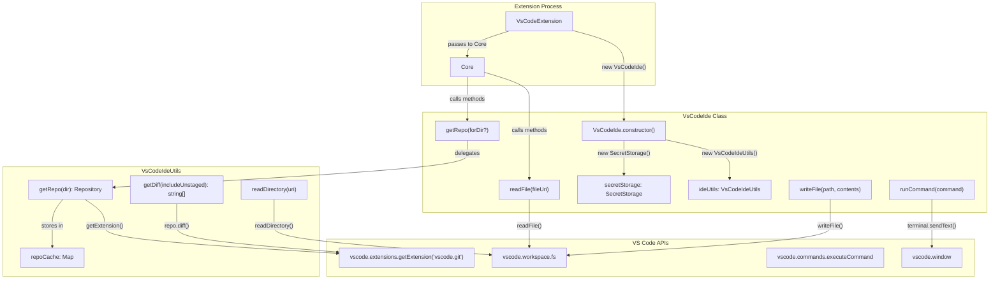
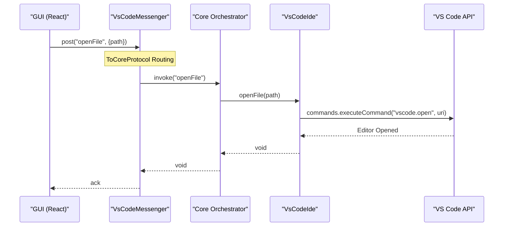

# IDE Operations

Relevant source files

The following files were used as context for generating this wiki page:

- [core/commands/util.ts](core/commands/util.ts)
- [core/core.ts](core/core.ts)
- [core/protocol/core.ts](core/protocol/core.ts)
- [core/protocol/ide.ts](core/protocol/ide.ts)
- [core/protocol/messenger/messageIde.ts](core/protocol/messenger/messageIde.ts)
- [core/protocol/messenger/reverseMessageIde.ts](core/protocol/messenger/reverseMessageIde.ts)
- [core/protocol/passThrough.ts](core/protocol/passThrough.ts)
- [core/protocol/webview.ts](core/protocol/webview.ts)
- [core/util/filesystem.ts](core/util/filesystem.ts)
- [core/util/ideUtils.ts](core/util/ideUtils.ts)
- [core/util/uri.test.ts](core/util/uri.test.ts)
- [core/util/uri.ts](core/util/uri.ts)
- [extensions/intellij/src/main/kotlin/com/github/continuedev/continueintellijextension/constants/MessageTypes.kt](extensions/intellij/src/main/kotlin/com/github/continuedev/continueintellijextension/constants/MessageTypes.kt)
- [extensions/vscode/src/VsCodeIde.ts](extensions/vscode/src/VsCodeIde.ts)
- [extensions/vscode/src/extension/VsCodeExtension.ts](extensions/vscode/src/extension/VsCodeExtension.ts)
- [extensions/vscode/src/util/ideUtils.ts](extensions/vscode/src/util/ideUtils.ts)

This page documents the `VsCodeIde` implementation of the `IDE` interface for VS Code, showing how file operations, git interactions, terminal access, and LSP queries are implemented using VS Code APIs.

For information about how the IDE interface is used by Core, see [IDE Integration Patterns](2.4). For information about the protocol definitions, see [Communication Protocols](2.3).

## IDE Interface Implementations

Continue provides a platform-agnostic `IDE` interface that abstracts IDE-specific operations. Multiple implementations exist for different execution contexts:

| Implementation | Context | Purpose |
|----------------|---------|---------|
| `VsCodeIde` | VS Code extension process | Direct VS Code API access via `vscode` namespace. |
| `IntelliJIde` | IntelliJ plugin process | Kotlin-based implementation using IntelliJ Platform SDK. |
| `MessageIde` | Core process (Remote) | Proxies IDE calls via JSON-RPC protocol. |
| `FileSystemIde` | Testing/CLI | Implementation using Node.js `fs` for local file access. |

The `VsCodeIde` class is instantiated during extension activation [extensions/vscode/src/extension/VsCodeExtension.ts:181]() and passed to the `Core` instance [extensions/vscode/src/extension/VsCodeExtension.ts:76](), enabling Core to perform IDE operations without depending on VS Code-specific APIs.

Sources: [core/protocol/ide.ts:21-91](), [extensions/vscode/src/VsCodeIde.ts:38-48](), [core/util/filesystem.ts:22-23](), [core/protocol/messenger/messageIde.ts:21-31]()

## VsCodeIde Architecture

The `VsCodeIde` class serves as the primary bridge between the platform-agnostic Core and the VS Code environment. It delegates complex logic to `VsCodeIdeUtils` and handles secure storage via `SecretStorage`.

Title: VsCodeIde Component Relationship

**VsCodeIde Initialization**
The `VsCodeIde` constructor [extensions/vscode/src/VsCodeIde.ts:42-48]() receives the `vscode.ExtensionContext` and a promise for the webview protocol. It initializes `VsCodeIdeUtils` [extensions/vscode/src/VsCodeIde.ts:46]() for file system and Git helpers, and `SecretStorage` [extensions/vscode/src/VsCodeIde.ts:47]() for handling API keys and credentials.

Sources: [extensions/vscode/src/VsCodeIde.ts:38-48](), [extensions/vscode/src/util/ideUtils.ts:27-28]()

## File System Operations

### Read and Write Operations

The `readFile` method in `VsCodeIde` implements a priority system to ensure that unsaved changes (dirty buffers) are prioritized over disk content.

1.  **Open Document Check**: `VsCodeIdeUtils.readFile` first iterates through `vscode.workspace.textDocuments` [extensions/vscode/src/util/ideUtils.ts:133-141](). If the URI matches an open document, it returns the current text from the editor buffer using `document.getText()`.
2.  **Notebook Handling**: `VsCodeIde` contains specific logic for reading VS Code Notebooks (`.ipynb`), concatenating cell contents into a single string [extensions/vscode/src/VsCodeIde.ts:366-378]().
3.  **File System Read**: If no open document found, it falls back to `vscode.workspace.fs.readFile()` [extensions/vscode/src/util/ideUtils.ts:144-151]().

**File System Provider Handling**
`VsCodeIdeUtils` uses a wrapper `fsOperation` [extensions/vscode/src/util/ideUtils.ts:205-229]() to handle cases where a file system provider might be missing (e.g., virtual file systems or remote URIs not yet connected), specifically catching the `ENOPRO` error [extensions/vscode/src/util/ideUtils.ts:24]().

Sources: [extensions/vscode/src/VsCodeIde.ts:360-405](), [extensions/vscode/src/util/ideUtils.ts:128-229]()

### Directory Listing and File Stats

*   **listDir**: Delegates to `VsCodeIdeUtils.readDirectory()` [extensions/vscode/src/VsCodeIde.ts:670-673](), which uses `vscode.workspace.fs.readDirectory()` to return an array of `[name, FileType]` tuples.
*   **getFileStats**: Iterates through requested file URIs and returns a `FileStatsMap` [extensions/vscode/src/VsCodeIde.ts:222-238](), providing `lastModified` (mtime) and `size`. This metadata is essential for the `CodebaseIndexer` to perform incremental updates.

Sources: [extensions/vscode/src/VsCodeIde.ts:222-238](), [extensions/vscode/src/util/ideUtils.ts:161-193]()

## Git Integration

### Repository Access and Diffs

`VsCodeIde` integrates with the official VS Code Git extension (`vscode.git`) to provide repository information.

**Repository Lookup**
The `getRepo` helper [extensions/vscode/src/VsCodeIde.ts:184-200]() performs the following:
1.  Accesses the Git extension API via `vscode.extensions.getExtension("vscode.git")`.
2.  Retrieves the API instance.
3.  Caches `Repository` objects to avoid redundant lookups.

**Diff Operations**
The `getDiff` method [extensions/vscode/src/VsCodeIde.ts:240-272]() retrieves diffs for all active repositories in the workspace. It supports both staged and unstaged changes. Diffs are processed using a regex to separate the multi-file git output into individual file diff strings.

Sources: [extensions/vscode/src/VsCodeIde.ts:167-183](), [extensions/vscode/src/VsCodeIde.ts:240-272](), [extensions/vscode/src/otherExtensions/git.d.ts:1-20]()

## LSP Integration

`VsCodeIde` leverages VS Code's Language Server Protocol (LSP) providers to offer code intelligence to the LLM.

| IDE Method | VS Code Command | Implementation Site |
| :--- | :--- | :--- |
| `gotoDefinition` | `vscode.executeDefinitionProvider` | [extensions/vscode/src/VsCodeIde.ts:90]() |
| `gotoTypeDefinition` | `vscode.executeTypeDefinitionProvider` | [extensions/vscode/src/VsCodeIde.ts:101]() |
| `getReferences` | `vscode.executeReferenceProvider` | [extensions/vscode/src/VsCodeIde.ts:123]() |
| `getDocumentSymbols` | `vscode.executeDocumentSymbolProvider` | [extensions/vscode/src/VsCodeIde.ts:134]() |
| `getSignatureHelp` | `vscode.executeSignatureHelpProvider` | [extensions/vscode/src/VsCodeIde.ts:112]() |

These methods allow the LLM to "navigate" the codebase semantically, finding where functions are defined or where types are used. These are routed through `executeGotoProvider` and `executeSymbolProvider` helpers [extensions/vscode/src/VsCodeIde.ts:10-14]().

Sources: [extensions/vscode/src/VsCodeIde.ts:85-138](), [extensions/vscode/src/autocomplete/lsp.ts:1-50]()

## Terminal and Debug Operations

### Terminal Access
The `runCommand` method [extensions/vscode/src/VsCodeIde.ts:332-352]() allows the Core to execute shell commands. It can target specific terminals by name or reuse existing ones.

To retrieve terminal content (e.g., for the `@terminal` context provider), `VsCodeIde.getTerminalContents` [extensions/vscode/src/VsCodeIde.ts:274-307]() uses a workaround involving the `workbench.action.terminal.selectAll` and `workbench.action.terminal.copySelection` commands, as VS Code does not provide a direct API to read the terminal buffer.

### Debug State
Continue can inspect active debug sessions to provide context during troubleshooting:
*   **getAvailableThreads**: Lists all threads stopped at breakpoints [extensions/vscode/src/VsCodeIde.ts:317-321]().
*   **getDebugLocals**: Retrieves local variables for a specific thread by communicating with the `vscode.debug.activeDebugSession` [extensions/vscode/src/VsCodeIde.ts:309-315]().

Sources: [extensions/vscode/src/VsCodeIde.ts:274-352](), [extensions/vscode/src/util/ideUtils.ts:322-420]()

## Communication Data Flow

The following diagram illustrates how a request from the GUI triggers a file operation in the IDE.

Title: GUI to IDE Operation Data Flow

Sources: [core/protocol/ide.ts:28](), [extensions/vscode/src/VsCodeIde.ts:241-255](), [core/core.ts:128-131]()