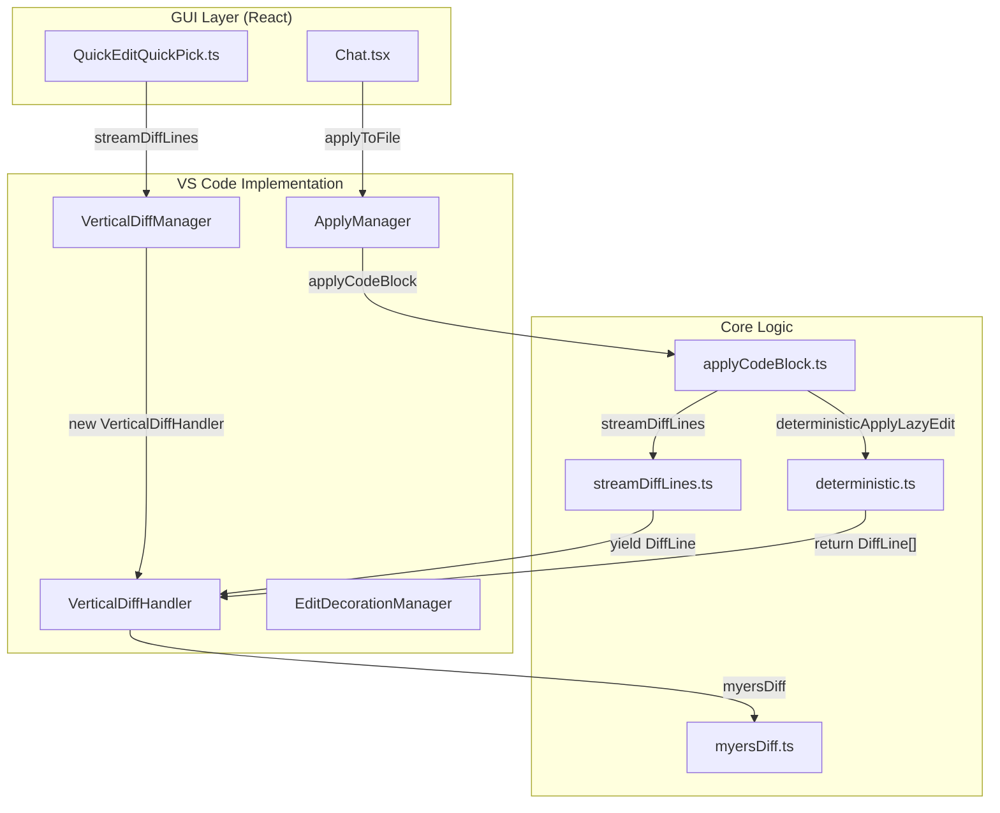
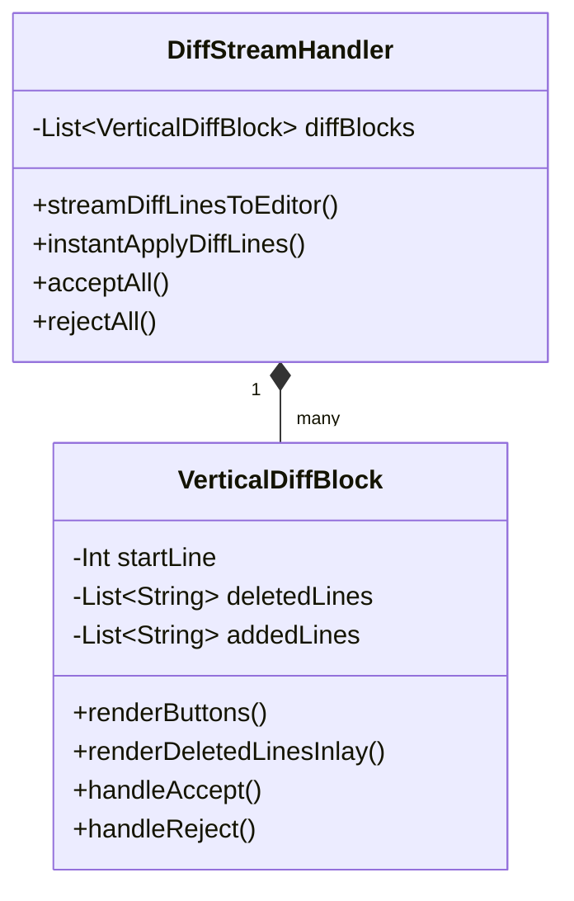
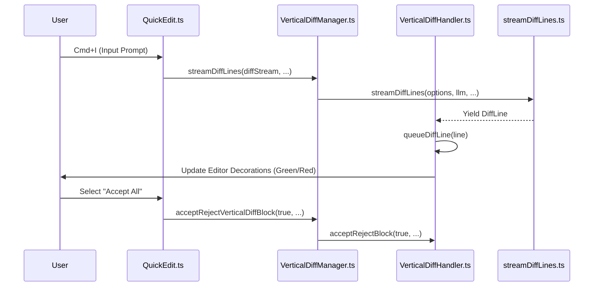

# Diff Management

Relevant source files

The following files were used as context for generating this wiki page:

- [core/diff/streamDiff.ts](core/diff/streamDiff.ts)
- [core/diff/util.ts](core/diff/util.ts)
- [core/edit/lazy/applyCodeBlock.ts](core/edit/lazy/applyCodeBlock.ts)
- [core/edit/lazy/deterministic.test.ts](core/edit/lazy/deterministic.test.ts)
- [core/edit/lazy/deterministic.ts](core/edit/lazy/deterministic.ts)
- [core/edit/lazy/findInAst.ts](core/edit/lazy/findInAst.ts)
- [core/edit/lazy/test-examples/calculator-class-neglected.js.diff](core/edit/lazy/test-examples/calculator-class-neglected.js.diff)
- [core/edit/lazy/test-examples/calculator-comments.js.diff](core/edit/lazy/test-examples/calculator-comments.js.diff)
- [core/edit/lazy/test-examples/calculator-exp.js.diff](core/edit/lazy/test-examples/calculator-exp.js.diff)
- [core/edit/lazy/test-examples/calculator-exp2.js.diff](core/edit/lazy/test-examples/calculator-exp2.js.diff)
- [core/edit/lazy/test-examples/calculator-only-method.js.diff](core/edit/lazy/test-examples/calculator-only-method.js.diff)
- [core/edit/lazy/test-examples/calculator-stateless.js.diff](core/edit/lazy/test-examples/calculator-stateless.js.diff)
- [core/edit/lazy/test-examples/fastapi.py.diff](core/edit/lazy/test-examples/fastapi.py.diff)
- [core/edit/lazy/unifiedDiffApply.test.ts](core/edit/lazy/unifiedDiffApply.test.ts)
- [core/edit/lazy/unifiedDiffApply.ts](core/edit/lazy/unifiedDiffApply.ts)
- [core/edit/streamDiffLines.ts](core/edit/streamDiffLines.ts)
- [extensions/intellij/src/main/kotlin/com/github/continuedev/continueintellijextension/continue/ApplyToFileHandler.kt](extensions/intellij/src/main/kotlin/com/github/continuedev/continueintellijextension/continue/ApplyToFileHandler.kt)
- [extensions/intellij/src/main/kotlin/com/github/continuedev/continueintellijextension/editor/DiffStreamHandler.kt](extensions/intellij/src/main/kotlin/com/github/continuedev/continueintellijextension/editor/DiffStreamHandler.kt)
- [extensions/intellij/src/main/kotlin/com/github/continuedev/continueintellijextension/editor/EditorComponentInlaysManager.kt](extensions/intellij/src/main/kotlin/com/github/continuedev/continueintellijextension/editor/EditorComponentInlaysManager.kt)
- [extensions/intellij/src/main/kotlin/com/github/continuedev/continueintellijextension/editor/EditorUtils.kt](extensions/intellij/src/main/kotlin/com/github/continuedev/continueintellijextension/editor/EditorUtils.kt)
- [extensions/intellij/src/main/kotlin/com/github/continuedev/continueintellijextension/editor/InlineEditAction.kt](extensions/intellij/src/main/kotlin/com/github/continuedev/continueintellijextension/editor/InlineEditAction.kt)
- [extensions/intellij/src/main/kotlin/com/github/continuedev/continueintellijextension/editor/RangeInFileWithContents.kt](extensions/intellij/src/main/kotlin/com/github/continuedev/continueintellijextension/editor/RangeInFileWithContents.kt)
- [extensions/intellij/src/main/kotlin/com/github/continuedev/continueintellijextension/editor/VerticalDiffBlock.kt](extensions/intellij/src/main/kotlin/com/github/continuedev/continueintellijextension/editor/VerticalDiffBlock.kt)
- [extensions/intellij/src/main/kotlin/com/github/continuedev/continueintellijextension/protocol/ideWebview.kt](extensions/intellij/src/main/kotlin/com/github/continuedev/continueintellijextension/protocol/ideWebview.kt)
- [extensions/intellij/src/main/kotlin/com/github/continuedev/continueintellijextension/utils/Utils.kt](extensions/intellij/src/main/kotlin/com/github/continuedev/continueintellijextension/utils/Utils.kt)
- [extensions/vscode/src/apply/ApplyManager.ts](extensions/vscode/src/apply/ApplyManager.ts)
- [extensions/vscode/src/diff/vertical/decorations.ts](extensions/vscode/src/diff/vertical/decorations.ts)
- [extensions/vscode/src/diff/vertical/handler.ts](extensions/vscode/src/diff/vertical/handler.ts)
- [extensions/vscode/src/diff/vertical/manager.ts](extensions/vscode/src/diff/vertical/manager.ts)
- [extensions/vscode/src/quickEdit/QuickEditQuickPick.ts](extensions/vscode/src/quickEdit/QuickEditQuickPick.ts)

## Purpose and Scope

This document describes the diff management system in the Continue extension, which handles displaying, tracking, and applying code changes generated by LLMs. The system manages two primary types of visual feedback: **vertical inline diffs** shown directly in the editor, and **edit mode decorations** that highlight code being modified.

The implementation utilizes a shared logic layer in the `core` for diff generation while providing platform-specific rendering via `VerticalDiffManager` (VS Code) and `DiffStreamHandler` (IntelliJ). It supports both real-time streaming diffs and "Instant Apply" for deterministic full-file rewrites.

## System Architecture

The diff management system coordinates between the GUI (React), the Extension host, and the IDE's native editor APIs.

Title: Diff Management Data Flow

**Sources:** [extensions/vscode/src/diff/vertical/manager.ts:28-44](), [core/edit/streamDiffLines.ts:77-83](), [core/edit/lazy/applyCodeBlock.ts:14-23](), [extensions/vscode/src/apply/ApplyManager.ts:20-26]()

## Vertical Diff Management (VS Code)

The `VerticalDiffManager` is the primary orchestrator for inline diffs in VS Code. It manages `VerticalDiffHandler` instances mapped to specific file URIs.

### Key Components

1.  **VerticalDiffManager**: Manages the lifecycle of diffs across multiple files. It tracks active handlers in a `fileUriToHandler` map and coordinates global commands like "Accept All" or "Reject All". [extensions/vscode/src/diff/vertical/manager.ts:28-44]()
2.  **VerticalDiffHandler**: Handles the rendering for a single file. It uses `vscode.TextEditorDecorationType` to draw added (green) and removed (red) lines. It maintains a `_diffLinesQueue` to process incoming diff lines asynchronously while ensuring the editor remains responsive. [extensions/vscode/src/diff/vertical/handler.ts:27-54](), [extensions/vscode/src/diff/vertical/handler.ts:159-186]()
3.  **Decoration Managers**: `AddedLineDecorationManager` and `RemovedLineDecorationManager` wrap the native VS Code decoration APIs to manage ranges for green (inserted) and red (ghost text) lines respectively. [extensions/vscode/src/diff/vertical/decorations.ts:53-191]()

### Diff Execution Flow

When an edit is triggered (e.g., via Quick Edit or Apply from Chat), the following sequence occurs:

1.  **Initialization**: `VerticalDiffManager.createVerticalDiffHandler` is called for the target file. [extensions/vscode/src/diff/vertical/manager.ts:46-72]()
2.  **Streaming/Generation**: The system either streams lines via `streamDiffLines` or calculates a deterministic diff via `deterministicApplyLazyEdit`. [core/edit/streamDiffLines.ts:77-83](), [core/edit/lazy/deterministic.ts:129-145]()
3.  **Queuing**: The handler receives these lines via `queueDiffLine`, ensuring edits are applied sequentially to the VS Code document. [extensions/vscode/src/diff/vertical/handler.ts:159-186]()
4.  **Refinement**: Once streaming finishes, `reapplyWithMyersDiff` is called to produce a cleaner, more human-readable diff using the Myers algorithm. [extensions/vscode/src/diff/vertical/handler.ts:206-206]()

**Sources:** [extensions/vscode/src/diff/vertical/manager.ts:208-213](), [extensions/vscode/src/diff/vertical/handler.ts:188-232]()

## IntelliJ Implementation

In IntelliJ, diff management is handled by `DiffStreamHandler` and `VerticalDiffBlock`.

1.  **DiffStreamHandler**: Coordinates the communication with the core via `CoreMessenger` to request `streamDiffLines` or `getDiffLines`. It manages a list of `VerticalDiffBlock` objects representing changed sections. [extensions/intellij/src/main/kotlin/com/github/continuedev/continueintellijextension/editor/DiffStreamHandler.kt:28-48]()
2.  **VerticalDiffBlock**: A platform-specific component that renders the "Accept/Reject" buttons and manages line highlighters. It uses `EditorComponentInlaysManager` to render deleted lines as "ghost text" inlays. [extensions/intellij/src/main/kotlin/com/github/continuedev/continueintellijextension/editor/VerticalDiffBlock.kt:23-36](), [extensions/intellij/src/main/kotlin/com/github/continuedev/continueintellijextension/editor/VerticalDiffBlock.kt:137-145]()

Title: IntelliJ Diff Management Structure

**Sources:** [extensions/intellij/src/main/kotlin/com/github/continuedev/continueintellijextension/editor/DiffStreamHandler.kt:28-48](), [extensions/intellij/src/main/kotlin/com/github/continuedev/continueintellijextension/editor/VerticalDiffBlock.kt:23-36]()

## Apply Logic and State

The `ApplyManager` bridges the gap between generated text (often containing "lazy" comments like `// ... existing code ...`) and the diff rendering system.

### Apply Workflow

1.  **File Preparation**: Ensures the target file is open and focused using `ensureFileOpen`. [extensions/vscode/src/apply/ApplyManager.ts:85-92]()
2.  **Diff Strategy**: Calls `applyCodeBlock` in the core. If the file extension is supported by tree-sitter, it attempts `deterministicApplyLazyEdit` for instant application. [core/edit/lazy/applyCodeBlock.ts:24-38](), [extensions/vscode/src/apply/ApplyManager.ts:142-148]()
3.  **Deterministic Apply**: Uses `web-tree-sitter` to parse the old file and the new "lazy" file. It identifies which AST nodes were modified and reconstructs the full file content without needing to stream every line from the LLM. [core/edit/lazy/deterministic.ts:146-167]()
4.  **State Updates**: Communicates status (`streaming`, `done`, `closed`) back to the GUI via the `updateApplyState` protocol message. [extensions/vscode/src/apply/ApplyManager.ts:48-54]()

| Status | Description |
| :--- | :--- |
| `streaming` | The LLM is currently generating code and diffs are appearing in the editor. |
| `done` | Generation is complete; diff blocks are visible for review. |
| `closed` | The user has accepted or rejected all changes. |

**Sources:** [extensions/vscode/src/apply/ApplyManager.ts:28-34](), [core/edit/lazy/applyCodeBlock.ts:14-23]()

## Quick Edit (Cmd/Ctrl + I)

The Quick Edit feature uses `QuickEditQuickPick` to capture user intent and immediately trigger the diff system. It manages its own state to track if a file already has active changes, in which case it opens an "Accept/Reject" menu instead of a new prompt input.

Title: Quick Edit to Code Interaction

**Sources:** [extensions/vscode/src/quickEdit/QuickEditQuickPick.ts:116-135](), [extensions/vscode/src/diff/vertical/manager.ts:208-213](), [extensions/vscode/src/diff/vertical/handler.ts:234-240]()

## Core Diff Utilities

The `core` package provides the mathematical and logical foundation for diffing:

-   **`streamDiffLines`**: Orchestrates the LLM prompt construction, streaming completion, and transformation into a line-by-line diff. It handles indentation stripping/re-adding and filters out LLM "chatter" (English lines at start/end). [core/edit/streamDiffLines.ts:77-100](), [core/edit/streamDiffLines.ts:178-189]()
-   **`deterministicApplyLazyEdit`**: Uses AST parsing to handle "lazy" LLM outputs. It searches for similar nodes between the `oldTree` and `newTree` to determine exactly where code was inserted or replaced. [core/edit/lazy/deterministic.ts:171-209]()
-   **`myersDiff`**: Standard implementation of the Myers diff algorithm used to post-process results for final rendering. [core/diff/myers.ts:1](), [core/edit/lazy/deterministic.ts:8]()
-   **`matchLine`**: A fuzzy matching utility used to align new lines with existing code, accounting for minor changes or indentation shifts. [core/diff/util.ts:48-95]()

**Sources:** [core/edit/streamDiffLines.ts:77-83](), [core/edit/lazy/deterministic.ts:129-145](), [core/diff/util.ts:48-52]()