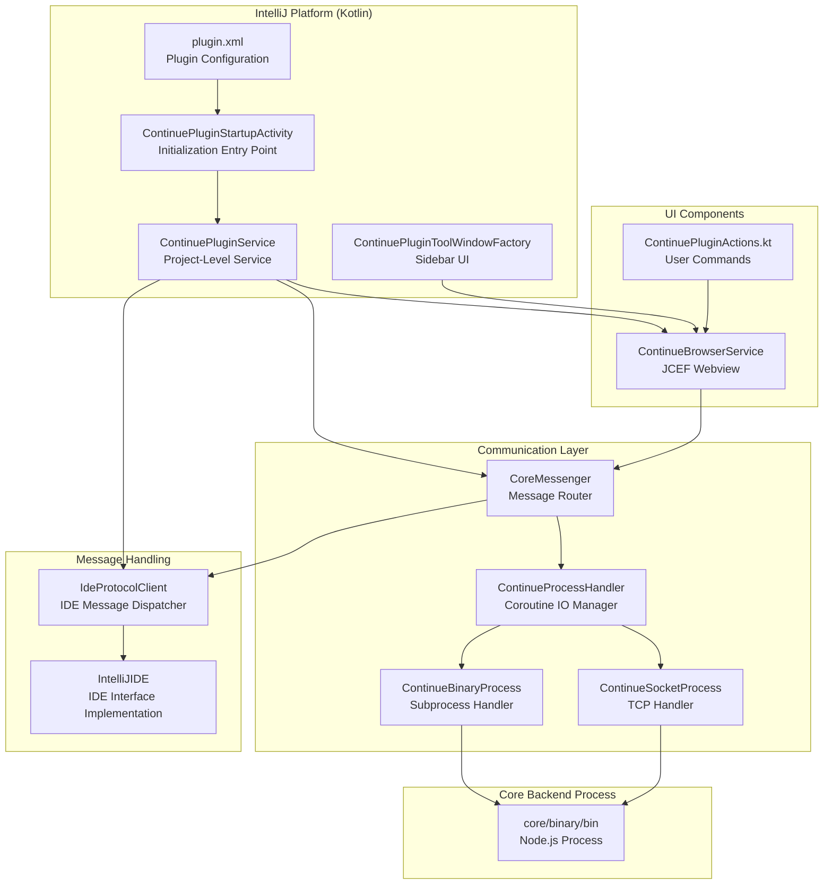
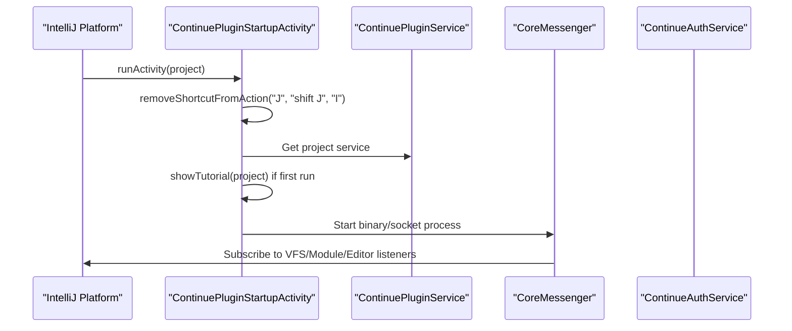
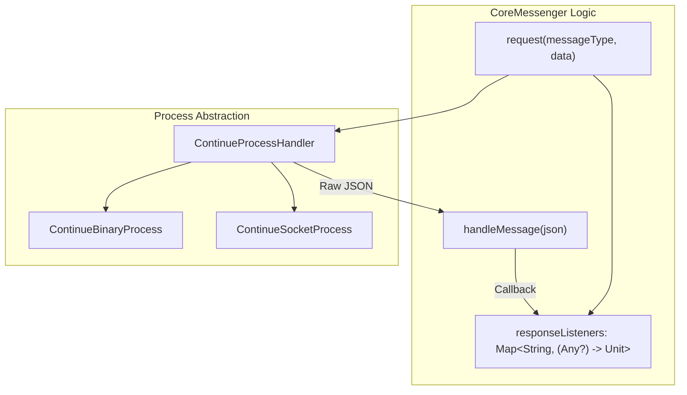

# IntelliJ Plugin

Relevant source files

The following files were used as context for generating this wiki page:

- [extensions/intellij/build.gradle.kts](extensions/intellij/build.gradle.kts)
- [extensions/intellij/gradle.properties](extensions/intellij/gradle.properties)
- [extensions/intellij/src/main/kotlin/com/github/continuedev/continueintellijextension/actions/ContinuePluginActions.kt](extensions/intellij/src/main/kotlin/com/github/continuedev/continueintellijextension/actions/ContinuePluginActions.kt)
- [extensions/intellij/src/main/kotlin/com/github/continuedev/continueintellijextension/activities/ContinuePluginStartupActivity.kt](extensions/intellij/src/main/kotlin/com/github/continuedev/continueintellijextension/activities/ContinuePluginStartupActivity.kt)
- [extensions/intellij/src/main/kotlin/com/github/continuedev/continueintellijextension/auth/ContinueAuthDialog.kt](extensions/intellij/src/main/kotlin/com/github/continuedev/continueintellijextension/auth/ContinueAuthDialog.kt)
- [extensions/intellij/src/main/kotlin/com/github/continuedev/continueintellijextension/auth/ContinueAuthService.kt](extensions/intellij/src/main/kotlin/com/github/continuedev/continueintellijextension/auth/ContinueAuthService.kt)
- [extensions/intellij/src/main/kotlin/com/github/continuedev/continueintellijextension/continue/CoreMessenger.kt](extensions/intellij/src/main/kotlin/com/github/continuedev/continueintellijextension/continue/CoreMessenger.kt)
- [extensions/intellij/src/main/kotlin/com/github/continuedev/continueintellijextension/continue/IdeProtocolClient.kt](extensions/intellij/src/main/kotlin/com/github/continuedev/continueintellijextension/continue/IdeProtocolClient.kt)
- [extensions/intellij/src/main/kotlin/com/github/continuedev/continueintellijextension/continue/IntelliJIde.kt](extensions/intellij/src/main/kotlin/com/github/continuedev/continueintellijextension/continue/IntelliJIde.kt)
- [extensions/intellij/src/main/kotlin/com/github/continuedev/continueintellijextension/protocol/ide.kt](extensions/intellij/src/main/kotlin/com/github/continuedev/continueintellijextension/protocol/ide.kt)
- [extensions/intellij/src/main/kotlin/com/github/continuedev/continueintellijextension/services/ContinueExtensionSettingsService.kt](extensions/intellij/src/main/kotlin/com/github/continuedev/continueintellijextension/services/ContinueExtensionSettingsService.kt)
- [extensions/intellij/src/main/kotlin/com/github/continuedev/continueintellijextension/services/ContinuePluginService.kt](extensions/intellij/src/main/kotlin/com/github/continuedev/continueintellijextension/services/ContinuePluginService.kt)
- [extensions/intellij/src/main/kotlin/com/github/continuedev/continueintellijextension/toolWindow/ContinuePluginToolWindowFactory.kt](extensions/intellij/src/main/kotlin/com/github/continuedev/continueintellijextension/toolWindow/ContinuePluginToolWindowFactory.kt)
- [extensions/intellij/src/main/kotlin/com/github/continuedev/continueintellijextension/types.kt](extensions/intellij/src/main/kotlin/com/github/continuedev/continueintellijextension/types.kt)
- [extensions/intellij/src/main/resources/META-INF/plugin.xml](extensions/intellij/src/main/resources/META-INF/plugin.xml)

The IntelliJ Plugin provides Continue's functionality for JetBrains IDEs (IntelliJ IDEA, PyCharm, WebStorm, etc.). It is implemented in Kotlin and serves as the platform-specific interface between the Continue core backend and JetBrains Platform APIs.

This document covers the plugin architecture, communication protocols, IDE integration patterns, and platform-specific implementations. For the shared core backend logic, see [Core System](#3). For the VS Code extension equivalent, see [VS Code Extension](#6). For the shared GUI interface, see [User Interface](#8).

## Plugin Architecture

The IntelliJ Plugin follows the JetBrains plugin architecture pattern with services, actions, and extension points. The plugin communicates with the Continue core backend through a binary process using JSON messages over TCP or stdin/stdout.

### System Mapping: Kotlin Space to Core Logic

Sources: [extensions/intellij/src/main/kotlin/com/github/continuedev/continueintellijextension/activities/ContinuePluginStartupActivity.kt:88-165](), [extensions/intellij/src/main/kotlin/com/github/continuedev/continueintellijextension/continue/CoreMessenger.kt:17-43](), [extensions/intellij/src/main/resources/META-INF/plugin.xml:17-54](), [extensions/intellij/src/main/kotlin/com/github/continuedev/continueintellijextension/toolWindow/ContinuePluginToolWindowFactory.kt:11-25]()

### Key Components

| Component | Type | Responsibility |
|-----------|------|----------------|
| `ContinuePluginStartupActivity` | Startup Activity | Plugin initialization, shortcut removal, and service setup [extensions/intellij/src/main/kotlin/com/github/continuedev/continueintellijextension/activities/ContinuePluginStartupActivity.kt:88-97]() |
| `ContinuePluginService` | Project Service | Central state holder for `IdeProtocolClient` and `CoreMessenger` [extensions/intellij/src/main/resources/META-INF/plugin.xml:20-21]() |
| `CoreMessenger` | Communication | Manages the `ContinueProcessHandler` and JSON routing [extensions/intellij/src/main/kotlin/com/github/continuedev/continueintellijextension/continue/CoreMessenger.kt:17-27]() |
| `IdeProtocolClient` | Protocol Handler | Dispatches message types (e.g., `readFile`, `showDiff`) to the IDE [extensions/intellij/src/main/kotlin/com/github/continuedev/continueintellijextension/continue/IdeProtocolClient.kt:53-163]() |
| `IntelliJIDE` | IDE Implementation | Implements `IDE` interface using JetBrains APIs and ripgrep [extensions/intellij/src/main/kotlin/com/github/continuedev/continueintellijextension/continue/IntelliJIde.kt:43-162]() |
| `ContinueBrowserService` | Project Service | Manages JCEF-based webview hosting the React GUI [extensions/intellij/src/main/kotlin/com/github/continuedev/continueintellijextension/toolWindow/ContinuePluginToolWindowFactory.kt:13-16]() |
| `ContinueAuthService` | Application Service | WorkOS OAuth flow management [extensions/intellij/src/main/kotlin/com/github/continuedev/continueintellijextension/auth/ContinueAuthService.kt:6-7]() |

## Plugin Initialization and Lifecycle

The plugin initializes through `ContinuePluginStartupActivity`, which runs after IDE startup. It handles the "First Run" experience by showing a tutorial and setting up the core process.

Sources: [extensions/intellij/src/main/kotlin/com/github/continuedev/continueintellijextension/activities/ContinuePluginStartupActivity.kt:88-165](), [extensions/intellij/src/main/kotlin/com/github/continuedev/continueintellijextension/activities/ContinuePluginStartupActivity.kt:46-86]()

### Keyboard Shortcut Management

The plugin proactively removes default IntelliJ shortcuts for `J` and `I` keys (modified by `Cmd` or `Ctrl`) to ensure Continue's features like Chat and Inline Edit function correctly without collision. This is handled by `removeShortcutFromAction` during startup.

Sources: [extensions/intellij/src/main/kotlin/com/github/continuedev/continueintellijextension/activities/ContinuePluginStartupActivity.kt:99-126]()

## Binary Process Communication

`CoreMessenger` manages the lifecycle of the Node.js core process. It supports standard `ContinueBinaryProcess` (stdin/stdout) and `ContinueSocketProcess` (TCP) for development, which is toggled via the `USE_TCP` environment variable.

For details, see [Core Process Communication](#7.2).

Sources: [extensions/intellij/src/main/kotlin/com/github/continuedev/continueintellijextension/continue/CoreMessenger.kt:29-43](), [extensions/intellij/src/main/kotlin/com/github/continuedev/continueintellijextension/continue/CoreMessenger.kt:45-74]()

## IDE Protocol Client

`IdeProtocolClient` is the primary dispatcher for requests coming from the Core or Webview. It translates JSON commands into calls to the `IntelliJIDE` implementation.

For details, see [IDE Protocol Client](#7.3).

### Parallelism Control
To prevent UI freezing, the client uses a `limitedDispatcher` with 4 threads, ensuring heavy IO operations (like file reads or indexing) do not saturate the IDE's thread pool. Note that there are 64 total threads available to the IDE.

Sources: [extensions/intellij/src/main/kotlin/com/github/continuedev/continueintellijextension/continue/IdeProtocolClient.kt:50-54]()

## IntelliJ IDE Implementation

`IntelliJIDE` implements the `IDE` interface, providing concrete implementations for file system access, terminal control, and code intelligence.

For details, see [IntelliJ IDE Implementation](#7.4).

### Security and Ignore Patterns
The implementation includes a robust list of security-focused ignore patterns (`DEFAULT_SECURITY_IGNORE_FILETYPES`) such as `*.env`, `*.key`, and `*.secret`, as well as general search ignores (`ADDITIONAL_SEARCH_IGNORE_DIRS`) like `node_modules/` and `.git/`.

Sources: [extensions/intellij/src/main/kotlin/com/github/continuedev/continueintellijextension/continue/IntelliJIde.kt:49-117]()

## Authentication Integration

The `ContinueAuthService` is defined as an application service to manage authentication states.

For details, see [Authentication Integration](#7.5).

Sources: [extensions/intellij/src/main/kotlin/com/github/continuedev/continueintellijextension/auth/ContinueAuthService.kt:5-7]()

## Build and Packaging

The plugin is built using Gradle and the IntelliJ Platform Gradle Plugin. The build process packages the core binary into the plugin distribution.

| Task | Description |
|------|-------------|
| `patchPluginXml` | Injects the README description into the plugin metadata [extensions/intellij/build.gradle.kts:113-119]() |
| `prepareSandbox` | Copies the `binary/bin` core process into the plugin sandbox [extensions/intellij/build.gradle.kts:107-111]() |
| `runIde` | Launches a development instance with a testing sandbox project [extensions/intellij/build.gradle.kts:121-126]() |

Sources: [extensions/intellij/build.gradle.kts:106-133](), [extensions/intellij/gradle.properties:1-6]()