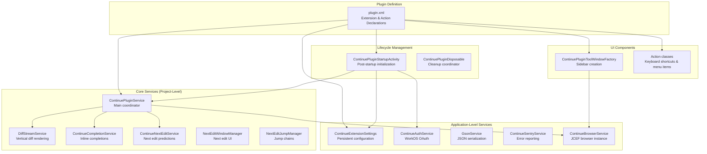
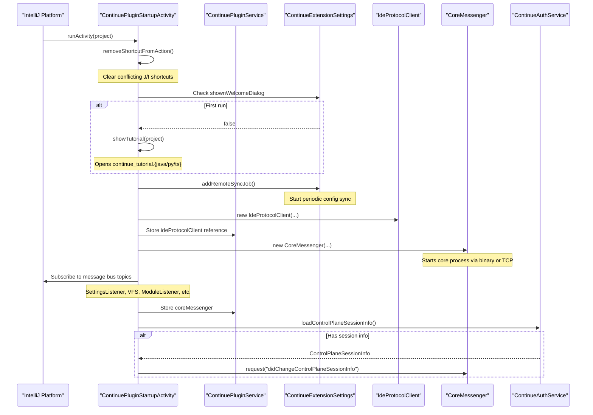
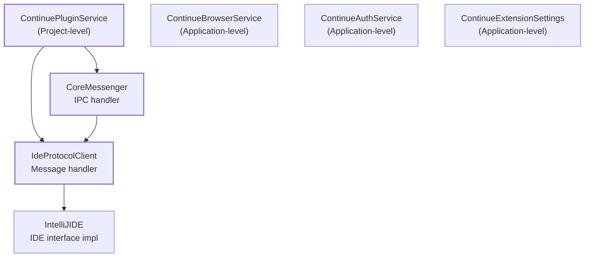
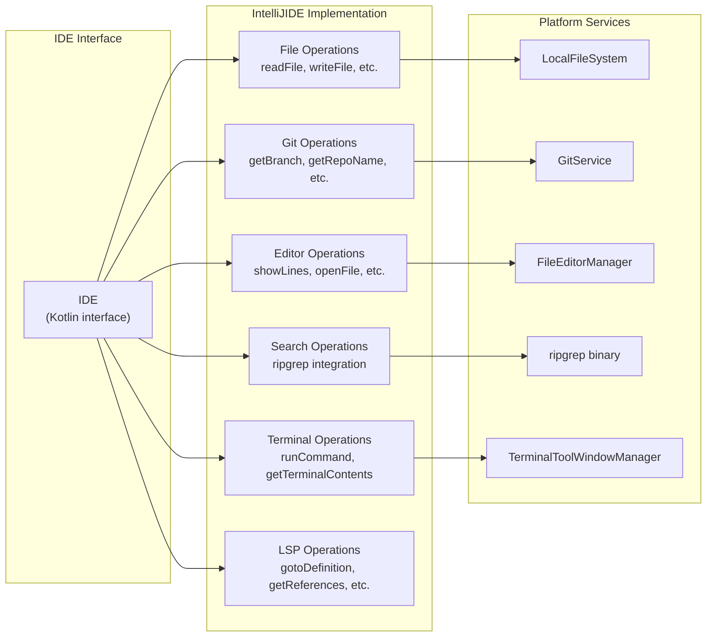

# Plugin Architecture

Relevant source files

The following files were used as context for generating this wiki page:

- [extensions/intellij/build.gradle.kts](extensions/intellij/build.gradle.kts)
- [extensions/intellij/gradle.properties](extensions/intellij/gradle.properties)
- [extensions/intellij/src/main/kotlin/com/github/continuedev/continueintellijextension/actions/ContinuePluginActions.kt](extensions/intellij/src/main/kotlin/com/github/continuedev/continueintellijextension/actions/ContinuePluginActions.kt)
- [extensions/intellij/src/main/kotlin/com/github/continuedev/continueintellijextension/activities/ContinuePluginStartupActivity.kt](extensions/intellij/src/main/kotlin/com/github/continuedev/continueintellijextension/activities/ContinuePluginStartupActivity.kt)
- [extensions/intellij/src/main/kotlin/com/github/continuedev/continueintellijextension/auth/ContinueAuthDialog.kt](extensions/intellij/src/main/kotlin/com/github/continuedev/continueintellijextension/auth/ContinueAuthDialog.kt)
- [extensions/intellij/src/main/kotlin/com/github/continuedev/continueintellijextension/auth/ContinueAuthService.kt](extensions/intellij/src/main/kotlin/com/github/continuedev/continueintellijextension/auth/ContinueAuthService.kt)
- [extensions/intellij/src/main/kotlin/com/github/continuedev/continueintellijextension/continue/CoreMessenger.kt](extensions/intellij/src/main/kotlin/com/github/continuedev/continueintellijextension/continue/CoreMessenger.kt)
- [extensions/intellij/src/main/kotlin/com/github/continuedev/continueintellijextension/continue/IdeProtocolClient.kt](extensions/intellij/src/main/kotlin/com/github/continuedev/continueintellijextension/continue/IdeProtocolClient.kt)
- [extensions/intellij/src/main/kotlin/com/github/continuedev/continueintellijextension/continue/IntelliJIde.kt](extensions/intellij/src/main/kotlin/com/github/continuedev/continueintellijextension/continue/IntelliJIde.kt)
- [extensions/intellij/src/main/kotlin/com/github/continuedev/continueintellijextension/protocol/ide.kt](extensions/intellij/src/main/kotlin/com/github/continuedev/continueintellijextension/protocol/ide.kt)
- [extensions/intellij/src/main/kotlin/com/github/continuedev/continueintellijextension/services/ContinueExtensionSettingsService.kt](extensions/intellij/src/main/kotlin/com/github/continuedev/continueintellijextension/services/ContinueExtensionSettingsService.kt)
- [extensions/intellij/src/main/kotlin/com/github/continuedev/continueintellijextension/services/ContinuePluginService.kt](extensions/intellij/src/main/kotlin/com/github/continuedev/continueintellijextension/services/ContinuePluginService.kt)
- [extensions/intellij/src/main/kotlin/com/github/continuedev/continueintellijextension/toolWindow/ContinuePluginToolWindowFactory.kt](extensions/intellij/src/main/kotlin/com/github/continuedev/continueintellijextension/toolWindow/ContinuePluginToolWindowFactory.kt)
- [extensions/intellij/src/main/kotlin/com/github/continuedev/continueintellijextension/types.kt](extensions/intellij/src/main/kotlin/com/github/continuedev/continueintellijextension/types.kt)
- [extensions/intellij/src/main/resources/META-INF/plugin.xml](extensions/intellij/src/main/resources/META-INF/plugin.xml)

This page documents the IntelliJ IDEA plugin architecture for Continue, covering the plugin structure, component lifecycle, service dependencies, and integration points with the IntelliJ Platform. For the core process communication mechanisms, see [Core Process Communication](7.2). For the IDE protocol implementation details, see [IDE Protocol Client](7.3). For the browser/webview integration, see the GUI architecture discussion in [GUI Architecture](8.1).

## Plugin Structure

The Continue IntelliJ plugin is organized as a standard IntelliJ Platform plugin with several key architectural components:

Sources: [extensions/intellij/src/main/resources/META-INF/plugin.xml:1-130](), [extensions/intellij/src/main/kotlin/com/github/continuedev/continueintellijextension/activities/ContinuePluginStartupActivity.kt:88-152](), [extensions/intellij/src/main/kotlin/com/github/continuedev/continueintellijextension/services/ContinuePluginService.kt:1-25]()

### Plugin Declaration

The `plugin.xml` file defines all extensions, services, and actions:

| Extension Point | Implementation | Purpose |
|----------------|----------------|---------|
| `toolWindow` | `ContinuePluginToolWindowFactory` | Creates the Continue sidebar with JCEF browser [extensions/intellij/src/main/resources/META-INF/plugin.xml:18-19]() |
| `projectService` | `ContinuePluginService` | Main project-level coordinator service [extensions/intellij/src/main/resources/META-INF/plugin.xml:20-21]() |
| `projectService` | `DiffStreamService` | Manages vertical diff streaming and rendering [extensions/intellij/src/main/resources/META-INF/plugin.xml:22-24]() |
| `projectService` | `ContinueCompletionService` | Provides inline code completions [extensions/intellij/src/main/resources/META-INF/plugin.xml:26-27]() |
| `projectService` | `ContinueNextEditService` | Handles next edit predictions [extensions/intellij/src/main/resources/META-INF/plugin.xml:29-30]() |
| `inline.completion.provider` | `ContinueInlineCompletionProvider` | Integrates with IntelliJ's inline completion API [extensions/intellij/src/main/resources/META-INF/plugin.xml:38]() |
| `applicationService` | `ContinueExtensionSettings` | Stores persistent configuration [extensions/intellij/src/main/resources/META-INF/plugin.xml:52-53]() |
| `applicationConfigurable` | `ContinueExtensionConfigurable` | Settings UI in preferences [extensions/intellij/src/main/resources/META-INF/plugin.xml:47-51]() |
| `postStartupActivity` | `ContinuePluginStartupActivity` | Initializes plugin after IDE startup [extensions/intellij/src/main/resources/META-INF/plugin.xml:44-45]() |
| `notificationGroup` | `Continue` | Defines notification display behavior [extensions/intellij/src/main/resources/META-INF/plugin.xml:40-41]() |

Sources: [extensions/intellij/src/main/resources/META-INF/plugin.xml:17-54]()

### Key Services

**ContinuePluginService** ([extensions/intellij/src/main/resources/META-INF/plugin.xml:20-21]()) is the central project-level service that:
- Holds references to `IdeProtocolClient`, `CoreMessenger`, and `DiffManager`.
- Manages the `workspacePaths` array for the current project.
- Provides a unique `windowId` for each IDE window.
- Implements `Disposable` to clean up resources on project close.

**ContinueExtensionSettings** ([extensions/intellij/src/main/resources/META-INF/plugin.xml:52-53]()) is an application-level service that:
- Stores configuration in `ContinueExtensionSettings.xml` [extensions/intellij/src/main/kotlin/com/github/continuedev/continueintellijextension/services/ContinueExtensionSettingsService.kt:75-78]().
- Maintains settings like `remoteConfigServerUrl`, `remoteConfigSyncPeriod`, and `userToken` [extensions/intellij/src/main/kotlin/com/github/continuedev/continueintellijextension/services/ContinueExtensionSettingsService.kt:81-91]().
- Provides `addRemoteSyncJob()` to schedule periodic remote config synchronization [extensions/intellij/src/main/kotlin/com/github/continuedev/continueintellijextension/services/ContinueExtensionSettingsService.kt:142-156]().
- Broadcasts settings changes via the `SettingsListener.TOPIC` message bus [extensions/intellij/src/main/kotlin/com/github/continuedev/continueintellijextension/services/ContinueExtensionSettingsService.kt:159-165]().

Sources: [extensions/intellij/src/main/resources/META-INF/plugin.xml:17-54](), [extensions/intellij/src/main/kotlin/com/github/continuedev/continueintellijextension/activities/ContinuePluginStartupActivity.kt:130-165](), [extensions/intellij/src/main/kotlin/com/github/continuedev/continueintellijextension/services/ContinueExtensionSettingsService.kt:75-165]()

## Plugin Initialization Flow

Sources: [extensions/intellij/src/main/kotlin/com/github/continuedev/continueintellijextension/activities/ContinuePluginStartupActivity.kt:88-165](), [extensions/intellij/src/main/kotlin/com/github/continuedev/continueintellijextension/continue/CoreMessenger.kt:17-43]()

### Startup Activity Details

The `ContinuePluginStartupActivity.runActivity()` method ([extensions/intellij/src/main/kotlin/com/github/continuedev/continueintellijextension/activities/ContinuePluginStartupActivity.kt:88-95]()) performs initialization in this order:

1. **Keyboard Shortcut Management**: Removes conflicting shortcuts for Cmd/Ctrl+J, Cmd/Ctrl+Shift+J, and Cmd/Ctrl+I to ensure Continue can use them ([extensions/intellij/src/main/kotlin/com/github/continuedev/continueintellijextension/activities/ContinuePluginStartupActivity.kt:90-93](), [extensions/intellij/src/main/kotlin/com/github/continuedev/continueintellijextension/activities/ContinuePluginStartupActivity.kt:103-124]()).

2. **Tutorial Display**: On first run, displays a language-specific tutorial file (Java/Python/TypeScript) determined by the IDE product name ([extensions/intellij/src/main/kotlin/com/github/continuedev/continueintellijextension/activities/ContinuePluginStartupActivity.kt:76-84](), [extensions/intellij/src/main/kotlin/com/github/continuedev/continueintellijextension/activities/ContinuePluginStartupActivity.kt:132-136]()).

3. **Remote Config Sync**: Initiates periodic synchronization if `remoteConfigServerUrl` is configured ([extensions/intellij/src/main/kotlin/com/github/continuedev/continueintellijextension/activities/ContinuePluginStartupActivity.kt:138](), [extensions/intellij/src/main/kotlin/com/github/continuedev/continueintellijextension/services/ContinueExtensionSettingsService.kt:142-156]()).

4. **Protocol Client Creation**: Instantiates `IdeProtocolClient` with project, coroutine scope, and service references ([extensions/intellij/src/main/kotlin/com/github/continuedev/continueintellijextension/activities/ContinuePluginStartupActivity.kt:140-144]()).

5. **Message Bus Subscriptions**: Registers listeners for settings changes, file system events, and module changes ([extensions/intellij/src/main/kotlin/com/github/continuedev/continueintellijextension/activities/ContinuePluginStartupActivity.kt:152-165]()).

6. **Core Process Initialization**: Creates `CoreMessenger` which starts the Continue core binary or connects via TCP [extensions/intellij/src/main/kotlin/com/github/continuedev/continueintellijextension/continue/CoreMessenger.kt:36-43]().

Sources: [extensions/intellij/src/main/kotlin/com/github/continuedev/continueintellijextension/activities/ContinuePluginStartupActivity.kt:44-165](), [extensions/intellij/src/main/kotlin/com/github/continuedev/continueintellijextension/continue/CoreMessenger.kt:17-43]()

## Component Dependencies

Sources: [extensions/intellij/src/main/kotlin/com/github/continuedev/continueintellijextension/continue/IdeProtocolClient.kt:33-40](), [extensions/intellij/src/main/kotlin/com/github/continuedev/continueintellijextension/continue/CoreMessenger.kt:17-23]()

## IDE Interface Implementation

The plugin implements the `IDE` interface ([extensions/intellij/src/main/kotlin/com/github/continuedev/continueintellijextension/types.kt:150-255]()) through the `IntelliJIDE` class, providing platform-specific implementations of all IDE operations:

Sources: [extensions/intellij/src/main/kotlin/com/github/continuedev/continueintellijextension/continue/IntelliJIde.kt:42-261](), [extensions/intellij/src/main/kotlin/com/github/continuedev/continueintellijextension/types.kt:150-255]()

### Ripgrep Integration

The `IntelliJIDE` class uses ripgrep for fast code search operations. Key implementation details:

- **Binary Location**: Ripgrep binary path is determined by `getRipgrepPath()` and made executable on startup for Unix-based systems ([extensions/intellij/src/main/kotlin/com/github/continuedev/continueintellijextension/continue/IntelliJIde.kt:120-135]()).
- **Default Ignores**: Maintains extensive lists for security-focused ignores (secrets, keys, environment files) and general search ignores (build artifacts, temporary files, binary formats) ([extensions/intellij/src/main/kotlin/com/github/continuedev/continueintellijextension/continue/IntelliJIde.kt:49-116]()).

Sources: [extensions/intellij/src/main/kotlin/com/github/continuedev/continueintellijextension/continue/IntelliJIde.kt:49-135]()

## Actions and Keyboard Shortcuts

The plugin registers numerous actions in `plugin.xml` ([extensions/intellij/src/main/resources/META-INF/plugin.xml:56-199]()) with keyboard shortcuts:

| Action ID | Shortcut (Mac) | Shortcut (Other) | Implementation |
|-----------|---------------|------------------|----------------|
| `continue.focusContinueInput` | Cmd+J | Ctrl+J | `FocusContinueInputAction` [extensions/intellij/src/main/resources/META-INF/plugin.xml:126-130]() |
| `continue.focusContinueInputWithoutClear` | Cmd+Shift+J | Ctrl+Shift+J | `FocusContinueInputWithoutClearAction` [extensions/intellij/src/main/resources/META-INF/plugin.xml:122-125]() |
| `continue.inlineEdit` | Cmd+I | Ctrl+I | `InlineEditAction` [extensions/intellij/src/main/resources/META-INF/plugin.xml:57-66]() |
| `continue.acceptDiff` | Shift+Cmd+Enter | Shift+Ctrl+Enter | `AcceptDiffAction` [extensions/intellij/src/main/resources/META-INF/plugin.xml:68-76]() |
| `continue.rejectDiff` | Shift+Cmd+Backspace | Shift+Ctrl+Backspace | `RejectDiffAction` [extensions/intellij/src/main/resources/META-INF/plugin.xml:85-93]() |
| `continue.acceptVerticalDiffBlock` | Alt+Shift+Y | Alt+Shift+Y | `AcceptDiffAction` [extensions/intellij/src/main/resources/META-INF/plugin.xml:95-103]() |
| `continue.rejectVerticalDiffBlock` | Alt+Shift+N | Alt+Shift+N | `RejectDiffAction` [extensions/intellij/src/main/resources/META-INF/plugin.xml:105-113]() |

Sources: [extensions/intellij/src/main/resources/META-INF/plugin.xml:56-130](), [extensions/intellij/src/main/kotlin/com/github/continuedev/continueintellijextension/actions/ContinuePluginActions.kt:26-63]()

## Build Configuration

The plugin uses Gradle with the IntelliJ Platform Gradle Plugin ([extensions/intellij/build.gradle.kts:15]()):

**Platform Compatibility** ([extensions/intellij/build.gradle.kts:69-74]()):
- `sinceBuild = "241"` (2024.1) [extensions/intellij/build.gradle.kts:72]()
- Verified against IC versions 2024.1 through 2025.2 ([extensions/intellij/build.gradle.kts:88-93]()).

**Binary Packaging** ([extensions/intellij/build.gradle.kts:105-109]()):
The `PrepareSandboxTask` copies the Continue core binary from `../../binary/bin` into the plugin's `core` directory during build, ensuring the sidecar process is available to the extension.

Sources: [extensions/intellij/build.gradle.kts:1-142](), [extensions/intellij/gradle.properties:1-7]()