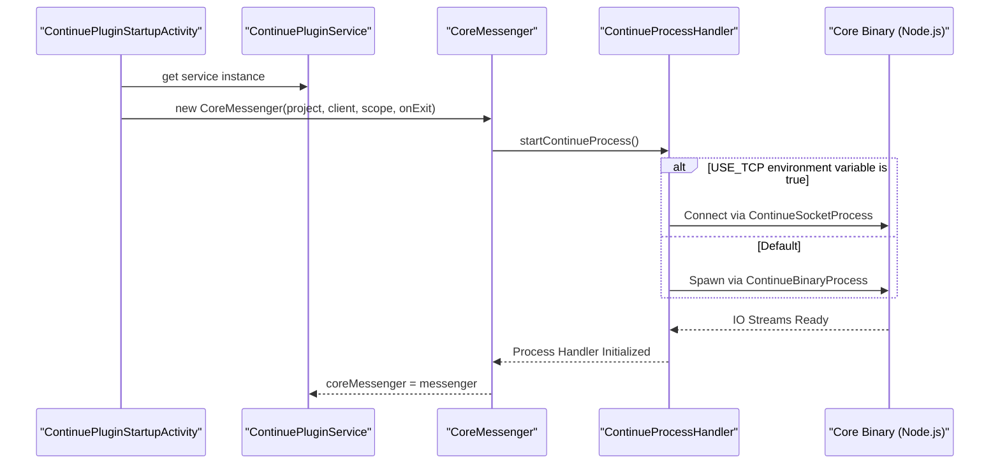

# Core Process Communication

<details>
<summary>Relevant source files</summary>

The following files were used as context for generating this wiki page:

- [extensions/intellij/build.gradle.kts](extensions/intellij/build.gradle.kts)
- [extensions/intellij/gradle.properties](extensions/intellij/gradle.properties)
- [extensions/intellij/src/main/kotlin/com/github/continuedev/continueintellijextension/actions/ContinuePluginActions.kt](extensions/intellij/src/main/kotlin/com/github/continuedev/continueintellijextension/actions/ContinuePluginActions.kt)
- [extensions/intellij/src/main/kotlin/com/github/continuedev/continueintellijextension/activities/ContinuePluginStartupActivity.kt](extensions/intellij/src/main/kotlin/com/github/continuedev/continueintellijextension/activities/ContinuePluginStartupActivity.kt)
- [extensions/intellij/src/main/kotlin/com/github/continuedev/continueintellijextension/auth/ContinueAuthDialog.kt](extensions/intellij/src/main/kotlin/com/github/continuedev/continueintellijextension/auth/ContinueAuthDialog.kt)
- [extensions/intellij/src/main/kotlin/com/github/continuedev/continueintellijextension/auth/ContinueAuthService.kt](extensions/intellij/src/main/kotlin/com/github/continuedev/continueintellijextension/auth/ContinueAuthService.kt)
- [extensions/intellij/src/main/kotlin/com/github/continuedev/continueintellijextension/continue/CoreMessenger.kt](extensions/intellij/src/main/kotlin/com/github/continuedev/continueintellijextension/continue/CoreMessenger.kt)
- [extensions/intellij/src/main/kotlin/com/github/continuedev/continueintellijextension/continue/IdeProtocolClient.kt](extensions/intellij/src/main/kotlin/com/github/continuedev/continueintellijextension/continue/IdeProtocolClient.kt)
- [extensions/intellij/src/main/kotlin/com/github/continuedev/continueintellijextension/continue/IntelliJIde.kt](extensions/intellij/src/main/kotlin/com/github/continuedev/continueintellijextension/continue/IntelliJIde.kt)
- [extensions/intellij/src/main/kotlin/com/github/continuedev/continueintellijextension/protocol/ide.kt](extensions/intellij/src/main/kotlin/com/github/continuedev/continueintellijextension/protocol/ide.kt)
- [extensions/intellij/src/main/kotlin/com/github/continuedev/continueintellijextension/services/ContinueExtensionSettingsService.kt](extensions/intellij/src/main/kotlin/com/github/continuedev/continueintellijextension/services/ContinueExtensionSettingsService.kt)
- [extensions/intellij/src/main/kotlin/com/github/continuedev/continueintellijextension/services/ContinuePluginService.kt](extensions/intellij/src/main/kotlin/com/github/continuedev/continueintellijextension/services/ContinuePluginService.kt)
- [extensions/intellij/src/main/kotlin/com/github/continuedev/continueintellijextension/toolWindow/ContinuePluginToolWindowFactory.kt](extensions/intellij/src/main/kotlin/com/github/continuedev/continueintellijextension/toolWindow/ContinuePluginToolWindowFactory.kt)
- [extensions/intellij/src/main/kotlin/com/github/continuedev/continueintellijextension/types.kt](extensions/intellij/src/main/kotlin/com/github/continuedev/continueintellijextension/types.kt)
- [extensions/intellij/src/main/resources/META-INF/plugin.xml](extensions/intellij/src/main/resources/META-INF/plugin.xml)

</details>


## Purpose and Scope

This document describes how the IntelliJ plugin communicates with the Continue core process. The core process runs as a separate Node.js application that handles business logic, LLM interactions, and configuration management. Communication occurs via `stdin`/`stdout` (binary mode) or TCP sockets, using JSON-based message passing managed by the `CoreMessenger` [extensions/intellij/src/main/kotlin/com/github/continuedev/continueintellijextension/continue/CoreMessenger.kt:17-27]().

## Architecture Overview

The IntelliJ plugin spawns and manages a separate Continue core process, communicating through structured message passing.

Title: Core Communication Architecture
```mermaid
graph TB
    subgraph "IntelliJ Plugin (JVM)"
        "ContinuePluginStartupActivity"["ContinuePluginStartupActivity"]
        "ContinuePluginService"["ContinuePluginService"]
        "CoreMessenger"["CoreMessenger"]
        "IdeProtocolClient"["IdeProtocolClient"]
        
        subgraph "Process Handlers"
            "ContinueProcessHandler"["ContinueProcessHandler"]
            "ContinueBinaryProcess"["ContinueBinaryProcess"]
            "ContinueSocketProcess"["ContinueSocketProcess"]
        end
        
        subgraph "Communication Targets"
            "JCEF"["JCEF Browser (Webview)"]
            "IntelliJIDE"["IntelliJIDE"]
        end
    end
    
    subgraph "External Process"
        "CoreProcess"["Continue Core (Node.js)"]
    end
    
    "ContinuePluginStartupActivity" -->|initializes| "ContinuePluginService"
    "ContinuePluginService" -->|holds| "CoreMessenger"
    "CoreMessenger" -->|uses| "ContinueProcessHandler"
    "ContinueProcessHandler" -->|delegates to| "ContinueBinaryProcess"
    "ContinueProcessHandler" -->|or| "ContinueSocketProcess"
    
    "ContinueBinaryProcess" -->|stdin/stdout| "CoreProcess"
    "ContinueSocketProcess" -->|TCP socket| "CoreProcess"
    
    "CoreMessenger" -->|handleMessage| "IdeProtocolClient"
    "IdeProtocolClient" -->|routes to| "JCEF"
    "IdeProtocolClient" -->|routes to| "IntelliJIDE"
```

**Sources:** [extensions/intellij/src/main/kotlin/com/github/continuedev/continueintellijextension/continue/CoreMessenger.kt:17-27](), [extensions/intellij/src/main/kotlin/com/github/continuedev/continueintellijextension/activities/ContinuePluginStartupActivity.kt:126-150]()

## Process Initialization

The core process is initialized during plugin startup within the `ContinuePluginStartupActivity` [extensions/intellij/src/main/kotlin/com/github/continuedev/continueintellijextension/activities/ContinuePluginStartupActivity.kt:126-150]().

Title: Core Process Startup Sequence


**Sources:** [extensions/intellij/src/main/kotlin/com/github/continuedev/continueintellijextension/activities/ContinuePluginStartupActivity.kt:126-150](), [extensions/intellij/src/main/kotlin/com/github/continuedev/continueintellijextension/continue/CoreMessenger.kt:36-43]()

### Binary Location and Startup

The Continue core binary is packaged with the plugin and managed by platform-specific logic:

- The plugin ensures the binary is executable on Linux and macOS by setting file permissions [extensions/intellij/src/main/kotlin/com/github/continuedev/continueintellijextension/continue/IntelliJIde.kt:126-131]().
- Communication mode defaults to `stdin`/`stdout` unless the `USE_TCP` environment variable is set to `true` [extensions/intellij/src/main/kotlin/com/github/continuedev/continueintellijextension/continue/CoreMessenger.kt:37-41]().
- The core binary is bundled into the plugin sandbox during the build process under the `core` directory [extensions/intellij/build.gradle.kts:106-109]().

## Message Format and Routing

All messages exchanged follow a JSON structure parsed into a `Map` or a `Message` object [extensions/intellij/src/main/kotlin/com/github/continuedev/continueintellijextension/continue/IdeProtocolClient.kt:54-56]().

| Field | Type | Description |
|-------|------|-------------|
| `messageId` | `String` | Unique UUID for request/response correlation [extensions/intellij/src/main/kotlin/com/github/continuedev/continueintellijextension/continue/CoreMessenger.kt:30-31](). |
| `messageType` | `String` | Determines the handler (e.g., `readFile`, `configUpdate`) [extensions/intellij/src/main/kotlin/com/github/continuedev/continueintellijextension/continue/CoreMessenger.kt:48](). |
| `data` | `Any?` | Payload specific to the message type [extensions/intellij/src/main/kotlin/com/github/continuedev/continueintellijextension/continue/CoreMessenger.kt:49](). |

### Message Handling Logic

The `CoreMessenger.handleMessage` function routes incoming traffic based on the `messageType`:

1.  **IDE Messages:** If the type is in `MessageTypes.IDE_MESSAGE_TYPES`, it is routed to `IdeProtocolClient.handleMessage`. The result is then sent back to the core as a response [extensions/intellij/src/main/kotlin/com/github/continuedev/continueintellijextension/continue/CoreMessenger.kt:52-57]().
2.  **Webview Pass-through:** If the type is in `MessageTypes.PASS_THROUGH_TO_WEBVIEW`, the data is forwarded directly to the JCEF browser via `sendToWebview` [extensions/intellij/src/main/kotlin/com/github/continuedev/continueintellijextension/continue/CoreMessenger.kt:60-62]().
3.  **Core Responses:** If a `messageId` exists in the `responseListeners` map, the associated callback is invoked [extensions/intellij/src/main/kotlin/com/github/continuedev/continueintellijextension/continue/CoreMessenger.kt:65-74]().

**Sources:** [extensions/intellij/src/main/kotlin/com/github/continuedev/continueintellijextension/continue/CoreMessenger.kt:45-75](), [extensions/intellij/src/main/kotlin/com/github/continuedev/continueintellijextension/continue/IdeProtocolClient.kt:52-59]()

## IDE Protocol Client

The `IdeProtocolClient` acts as the bridge between the Core process and the IntelliJ platform APIs [extensions/intellij/src/main/kotlin/com/github/continuedev/continueintellijextension/continue/IdeProtocolClient.kt:33-40]().

Title: IDE Protocol Routing
```mermaid
graph LR
    subgraph "Core Process"
        "Core"["Core Logic"]
    end
    
    subgraph "IdeProtocolClient"
        "Handler"["handleMessage()"]
        "Dispatcher"["limitedDispatcher (4 threads)"]
    end
    
    subgraph "IntelliJ Platform"
        "IntelliJIDE"["IntelliJIDE (Implementation)"]
        "VirtualFileManager"["VirtualFileManager"]
        "FileEditorManager"["FileEditorManager"]
    end
    
    "Core" -->|JSON Request| "Handler"
    "Handler" --> "Dispatcher"
    "Dispatcher" -->|Call| "IntelliJIDE"
    "IntelliJIDE" --> "VirtualFileManager"
    "IntelliJIDE" --> "FileEditorManager"
    "IntelliJIDE" -->|Return Data| "Core"
```

**Sources:** [extensions/intellij/src/main/kotlin/com/github/continuedev/continueintellijextension/continue/IdeProtocolClient.kt:52-59](), [extensions/intellij/src/main/kotlin/com/github/continuedev/continueintellijextension/continue/IntelliJIde.kt:42-46]()

### Concurrency Management

To prevent UI freezing and manage the limited thread pool (64 threads total in the IDE), the `IdeProtocolClient` uses a `limitedDispatcher` with a parallelism limit of 4 [extensions/intellij/src/main/kotlin/com/github/continuedev/continueintellijextension/continue/IdeProtocolClient.kt:44-51]().

### Supported IDE Operations

The `IdeProtocolClient` handles message types including:
- **File System:** `readFile` [extensions/intellij/src/main/kotlin/com/github/continuedev/continueintellijextension/continue/IdeProtocolClient.kt:140-147](), `showFile` [extensions/intellij/src/main/kotlin/com/github/continuedev/continueintellijextension/continue/IdeProtocolClient.kt:87-94](), and `getWorkspaceDirs` [extensions/intellij/src/main/kotlin/com/github/continuedev/continueintellijextension/continue/IdeProtocolClient.kt:158-161]().
- **Configuration:** `getIdeSettings` [extensions/intellij/src/main/kotlin/com/github/continuedev/continueintellijextension/continue/IdeProtocolClient.kt:96-99]() and `jetbrains/getColors` [extensions/intellij/src/main/kotlin/com/github/continuedev/continueintellijextension/continue/IdeProtocolClient.kt:72-75]().
- **UI:** `showDiff` [extensions/intellij/src/main/kotlin/com/github/continuedev/continueintellijextension/continue/IdeProtocolClient.kt:131-138]() and `copyText` [extensions/intellij/src/main/kotlin/com/github/continuedev/continueintellijextension/continue/IdeProtocolClient.kt:119-129]().

## Process Lifecycle Management

### Restarting the Core

The `CoreMessenger` provides a `restart()` method that clears active listeners, closes the existing process connection, and spawns a new instance [extensions/intellij/src/main/kotlin/com/github/continuedev/continueintellijextension/continue/CoreMessenger.kt:86-91](). This can be triggered manually via the `RestartContinueProcess` action [extensions/intellij/src/main/kotlin/com/github/continuedev/continueintellijextension/actions/ContinuePluginActions.kt:20-24]().

### Shutdown

When the plugin or project is closed, `CoreMessenger.close()` is called to terminate the background process and its associated streams [extensions/intellij/src/main/kotlin/com/github/continuedev/continueintellijextension/continue/CoreMessenger.kt:93-96]().

## Settings and Synchronization

The plugin monitors settings changes via the `SettingsListener` topic. When settings are updated, the `CoreMessenger` sends a `config/ideSettingsUpdate` request to the core to ensure remote configuration and local state remain in sync [extensions/intellij/src/main/kotlin/com/github/continuedev/continueintellijextension/activities/ContinuePluginStartupActivity.kt:152-158]().

**Sources:** [extensions/intellij/src/main/kotlin/com/github/continuedev/continueintellijextension/continue/CoreMessenger.kt:86-97](), [extensions/intellij/src/main/kotlin/com/github/continuedev/continueintellijextension/services/ContinueExtensionSettingsService.kt:159-165]()