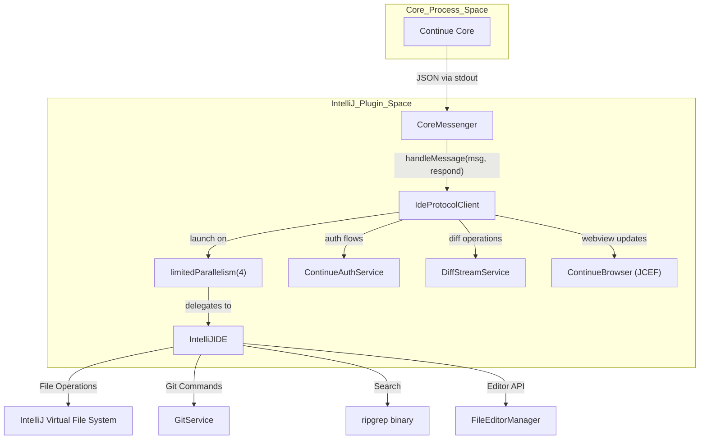
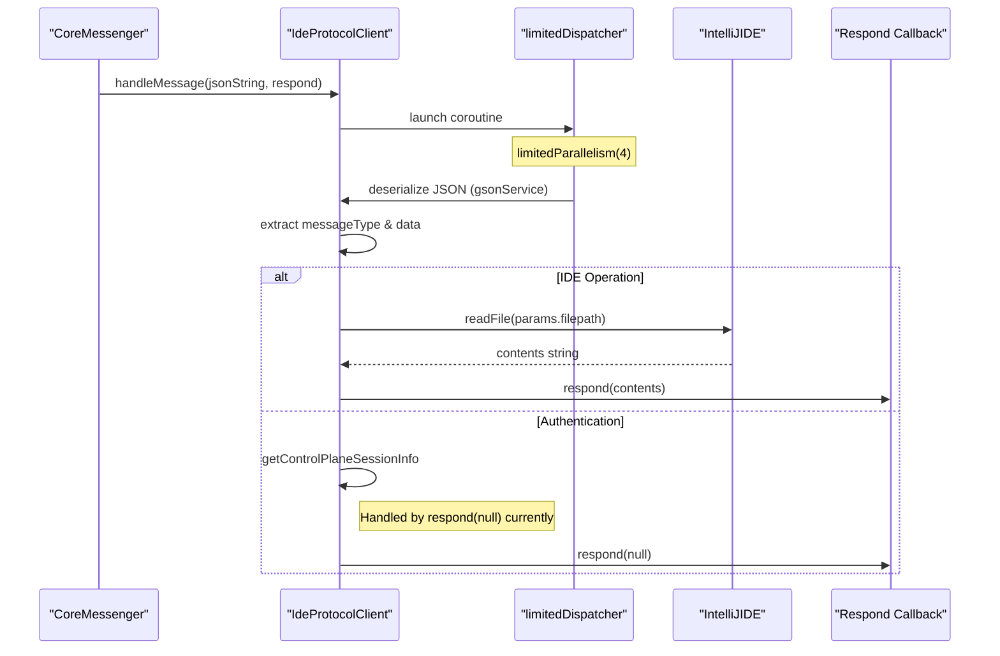
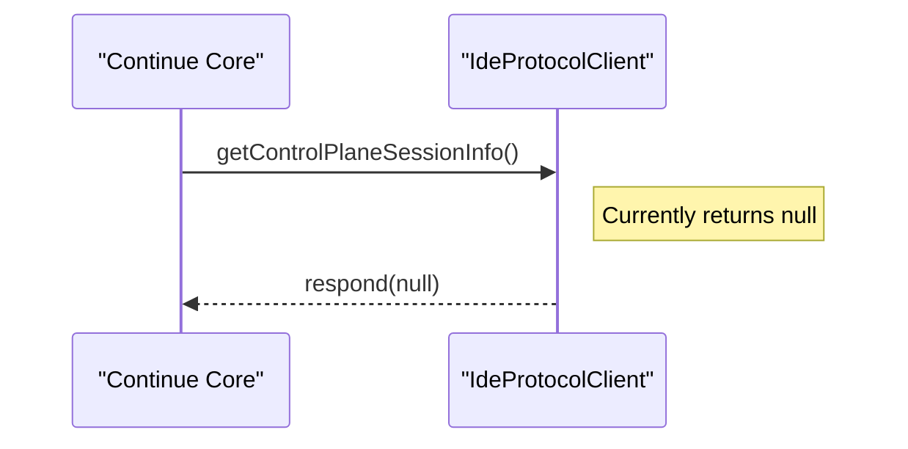

# IDE Protocol Client

<details>
<summary>Relevant source files</summary>

The following files were used as context for generating this wiki page:

- [extensions/intellij/build.gradle.kts](extensions/intellij/build.gradle.kts)
- [extensions/intellij/gradle.properties](extensions/intellij/gradle.properties)
- [extensions/intellij/src/main/kotlin/com/github/continuedev/continueintellijextension/actions/ContinuePluginActions.kt](extensions/intellij/src/main/kotlin/com/github/continuedev/continueintellijextension/actions/ContinuePluginActions.kt)
- [extensions/intellij/src/main/kotlin/com/github/continuedev/continueintellijextension/activities/ContinuePluginStartupActivity.kt](extensions/intellij/src/main/kotlin/com/github/continuedev/continueintellijextension/activities/ContinuePluginStartupActivity.kt)
- [extensions/intellij/src/main/kotlin/com/github/continuedev/continueintellijextension/auth/ContinueAuthDialog.kt](extensions/intellij/src/main/kotlin/com/github/continuedev/continueintellijextension/auth/ContinueAuthDialog.kt)
- [extensions/intellij/src/main/kotlin/com/github/continuedev/continueintellijextension/auth/ContinueAuthService.kt](extensions/intellij/src/main/kotlin/com/github/continuedev/continueintellijextension/auth/ContinueAuthService.kt)
- [extensions/intellij/src/main/kotlin/com/github/continuedev/continueintellijextension/continue/CoreMessenger.kt](extensions/intellij/src/main/kotlin/com/github/continuedev/continueintellijextension/continue/CoreMessenger.kt)
- [extensions/intellij/src/main/kotlin/com/github/continuedev/continueintellijextension/continue/IdeProtocolClient.kt](extensions/intellij/src/main/kotlin/com/github/continuedev/continueintellijextension/continue/IdeProtocolClient.kt)
- [extensions/intellij/src/main/kotlin/com/github/continuedev/continueintellijextension/continue/IntelliJIde.kt](extensions/intellij/src/main/kotlin/com/github/continuedev/continueintellijextension/continue/IntelliJIde.kt)
- [extensions/intellij/src/main/kotlin/com/github/continuedev/continueintellijextension/protocol/ide.kt](extensions/intellij/src/main/kotlin/com/github/continuedev/continueintellijextension/protocol/ide.kt)
- [extensions/intellij/src/main/kotlin/com/github/continuedev/continueintellijextension/services/ContinueExtensionSettingsService.kt](extensions/intellij/src/main/kotlin/com/github/continuedev/continueintellijextension/services/ContinueExtensionSettingsService.kt)
- [extensions/intellij/src/main/kotlin/com/github/continuedev/continueintellijextension/services/ContinuePluginService.kt](extensions/intellij/src/main/kotlin/com/github/continuedev/continueintellijextension/services/ContinuePluginService.kt)
- [extensions/intellij/src/main/kotlin/com/github/continuedev/continueintellijextension/toolWindow/ContinuePluginToolWindowFactory.kt](extensions/intellij/src/main/kotlin/com/github/continuedev/continueintellijextension/toolWindow/ContinuePluginToolWindowFactory.kt)
- [extensions/intellij/src/main/kotlin/com/github/continuedev/continueintellijextension/types.kt](extensions/intellij/src/main/kotlin/com/github/continuedev/continueintellijextension/types.kt)
- [extensions/intellij/src/main/resources/META-INF/plugin.xml](extensions/intellij/src/main/resources/META-INF/plugin.xml)

</details>


The `IdeProtocolClient` is the central message handler for the IntelliJ plugin that processes incoming requests from the Continue core backend and routes them to appropriate IDE operations. It serves as the bridge between the core's protocol messages and the IntelliJ Platform API.

For information about the message protocol definitions, see [Communication Protocols](#2.3). For the IntelliJ IDE implementation that executes the actual operations, see [IntelliJ IDE Implementation](#7.4). For the binary process communication that delivers messages to this client, see [Core Process Communication](#7.2).

## Purpose and Scope

The `IdeProtocolClient` handles approximately 50 different message types sent from the core backend, including:
- File system operations (read, write, list, search)
- Git operations (branch, diff, repo info)
- Editor operations (open file, show lines, insert at cursor)
- Terminal operations (run commands, get contents)
- Authentication flows (Control Plane sign-in)
- Diff management (accept/reject code changes)
- IDE metadata (settings, info, workspace directories)

**Sources**: [extensions/intellij/src/main/kotlin/com/github/continuedev/continueintellijextension/continue/IdeProtocolClient.kt:33-479]()

## Architecture Overview



**Sources**: [extensions/intellij/src/main/kotlin/com/github/continuedev/continueintellijextension/continue/IdeProtocolClient.kt:33-51](), [extensions/intellij/src/main/kotlin/com/github/continuedev/continueintellijextension/activities/ContinuePluginStartupActivity.kt:140-150](), [extensions/intellij/src/main/kotlin/com/github/continuedev/continueintellijextension/continue/CoreMessenger.kt:17-43]()

## Initialization and Lifecycle

The `IdeProtocolClient` is created during plugin startup in `ContinuePluginStartupActivity` and injected with required dependencies. It is then stored in the `ContinuePluginService` for global access within the project scope.

| Dependency | Type | Purpose |
|------------|------|---------|
| `continuePluginService` | `ContinuePluginService` | Access to plugin state and managers [extensions/intellij/src/main/kotlin/com/github/continuedev/continueintellijextension/services/ContinuePluginService.kt:1-25]() |
| `coroutineScope` | `CoroutineScope` | Async operation management [extensions/intellij/src/main/kotlin/com/github/continuedev/continueintellijextension/continue/IdeProtocolClient.kt:35-35]() |
| `project` | `Project` | IntelliJ project context [extensions/intellij/src/main/kotlin/com/github/continuedev/continueintellijextension/continue/IdeProtocolClient.kt:36-36]() |
| `gsonService` | `GsonService` | JSON serialization/deserialization via `com.google.gson.Gson` [extensions/intellij/src/main/kotlin/com/github/continuedev/continueintellijextension/services/GsonService.kt:1-15]() |

**Sources**: [extensions/intellij/src/main/kotlin/com/github/continuedev/continueintellijextension/continue/IdeProtocolClient.kt:33-39](), [extensions/intellij/src/main/kotlin/com/github/continuedev/continueintellijextension/activities/ContinuePluginStartupActivity.kt:140-150]()

## Message Handling Flow



**Sources**: [extensions/intellij/src/main/kotlin/com/github/continuedev/continueintellijextension/continue/IdeProtocolClient.kt:52-68](), [extensions/intellij/src/main/kotlin/com/github/continuedev/continueintellijextension/continue/CoreMessenger.kt:45-75]()

## Threading Model

The `IdeProtocolClient` uses a **limited parallelism dispatcher** to prevent IDE freezing. This is a critical architectural choice because IntelliJ provides a limited number of threads available to the entire IDE. Allowing unlimited parallel protocol operations from the AI core could exhaust this pool, leading to UI lag or deadlocks.

```kotlin
@OptIn(ExperimentalCoroutinesApi::class)
private val limitedDispatcher = Dispatchers.IO.limitedParallelism(4)
```

The dispatcher limits concurrent message handling to **4 operations**, ensuring the UI remains responsive even during heavy background processing like codebase indexing or large file searches.

**Sources**: [extensions/intellij/src/main/kotlin/com/github/continuedev/continueintellijextension/continue/IdeProtocolClient.kt:44-50]()

## Message Type Categories

### File System Operations

The client maps protocol messages to the `IDE` interface methods implemented by `IntelliJIDE`.

| Message Type | Parameters | Implementation Detail |
|--------------|------------|-----------------------|
| `readFile` | `ReadFileParams` | Uses `ide.readFile(params.filepath)` [extensions/intellij/src/main/kotlin/com/github/continuedev/continueintellijextension/continue/IdeProtocolClient.kt:140-147]() |
| `writeFile` | `WriteFileParams` | Uses `ide.writeFile(params.path, params.contents)` [extensions/intellij/src/main/kotlin/com/github/continuedev/continueintellijextension/continue/IdeProtocolClient.kt:173-180]() |
| `fileExists` | `FileExistsParams` | Uses `ide.fileExists(params.filepath)` [extensions/intellij/src/main/kotlin/com/github/continuedev/continueintellijextension/continue/IdeProtocolClient.kt:182-189]() |
| `listDir` | `ListDirParams` | Returns `List<List<Any>>` for JS compatibility [extensions/intellij/src/main/kotlin/com/github/continuedev/continueintellijextension/continue/IdeProtocolClient.kt:216-223]() |
| `getFileStats` | `GetFileStatsParams` | Uses `ide.getFileStats(params.files)` [extensions/intellij/src/main/kotlin/com/github/continuedev/continueintellijextension/continue/IdeProtocolClient.kt:225-232]() |

### Git and Search Operations

| Message Type | Implementation |
|--------------|----------------|
| `getBranch` | Delegates to `GitService` via `ide.getBranch(params.dir)` [extensions/intellij/src/main/kotlin/com/github/continuedev/continueintellijextension/continue/IdeProtocolClient.kt:253-260]() |
| `getDiff` | Retrieves staged/unstaged changes via `ide.getDiff()` [extensions/intellij/src/main/kotlin/com/github/continuedev/continueintellijextension/continue/IdeProtocolClient.kt:282-289]() |
| `getSearchResults` | Uses bundled `ripgrep` binary via `ide.getSearchResults()` [extensions/intellij/src/main/kotlin/com/github/continuedev/continueintellijextension/continue/IdeProtocolClient.kt:359-367]() |

**Sources**: [extensions/intellij/src/main/kotlin/com/github/continuedev/continueintellijextension/continue/IdeProtocolClient.kt:253-367](), [extensions/intellij/src/main/kotlin/com/github/continuedev/continueintellijextension/continue/IntelliJIde.kt:118-120]()

### Authentication Flow

The authentication messages currently serve as placeholders or triggers for Control Plane interactions.



**Sources**: [extensions/intellij/src/main/kotlin/com/github/continuedev/continueintellijextension/continue/IdeProtocolClient.kt:101-103](), [extensions/intellij/src/main/kotlin/com/github/continuedev/continueintellijextension/auth/ContinueAuthService.kt:1-7]()

## Diff and Apply Operations

The client handles diff rendering and state management.

- **showDiff**: Triggers the `IntelliJIDE` to render a diff view for a specific file [extensions/intellij/src/main/kotlin/com/github/continuedev/continueintellijextension/continue/IdeProtocolClient.kt:131-138]().
- **acceptDiff / rejectDiff**: Interaction logic is often routed through actions like `AcceptDiffAction` and `RejectDiffAction` which interface with `DiffStreamService` [extensions/intellij/src/main/kotlin/com/github/continuedev/continueintellijextension/actions/ContinuePluginActions.kt:26-63]().

**Sources**: [extensions/intellij/src/main/kotlin/com/github/continuedev/continueintellijextension/continue/IdeProtocolClient.kt:131-138](), [extensions/intellij/src/main/kotlin/com/github/continuedev/continueintellijextension/actions/ContinuePluginActions.kt:26-63]()

## Error Handling

All message processing in `handleMessage` is wrapped in a try-catch block. When an error occurs:
1. The exception is caught.
2. The error is logged and reported (implementation details for Sentry reporting are typically in the truncated portions or related services).
3. A toast notification is shown to the user via `ide.showToast` [extensions/intellij/src/main/kotlin/com/github/continuedev/continueintellijextension/continue/IdeProtocolClient.kt:472-474]().
4. The protocol response is sent back (often `null`) to unblock the core.

**Sources**: [extensions/intellij/src/main/kotlin/com/github/continuedev/continueintellijextension/continue/IdeProtocolClient.kt:58-477]()

## Integration with CoreMessenger

The `CoreMessenger` acts as the router. It receives raw JSON from the core process, determines if it is an IDE-bound message by checking `MessageTypes.IDE_MESSAGE_TYPES`, and if so, passes it to the `IdeProtocolClient`.

```kotlin
// In CoreMessenger.handleMessage
if (messageType in MessageTypes.IDE_MESSAGE_TYPES) {
    ideProtocolClient.handleMessage(json) { data ->
        val message = gson.toJson(mapOf("messageId" to messageId, "messageType" to messageType, "data" to data))
        process.write(message)
    }
}
```

**Sources**: [extensions/intellij/src/main/kotlin/com/github/continuedev/continueintellijextension/continue/CoreMessenger.kt:52-57]()