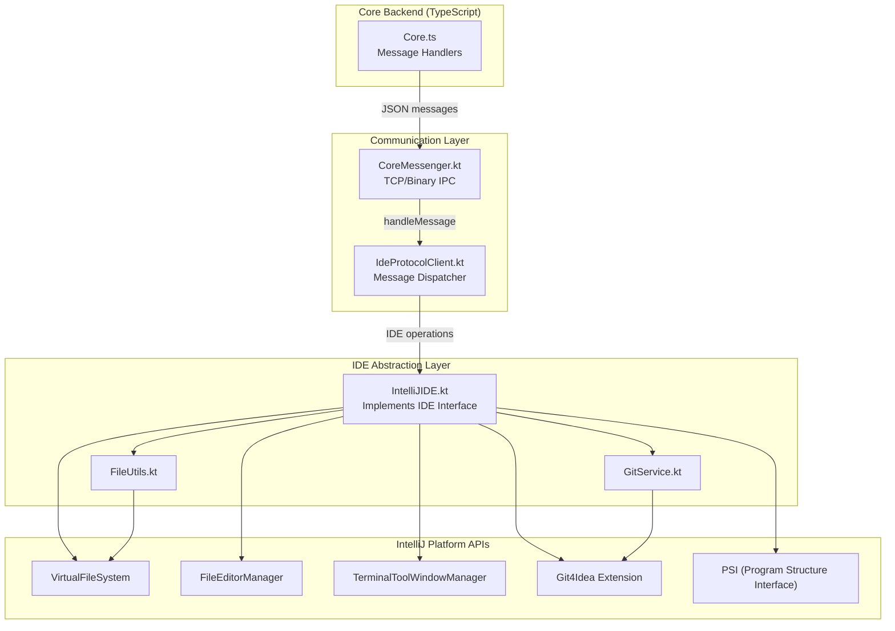
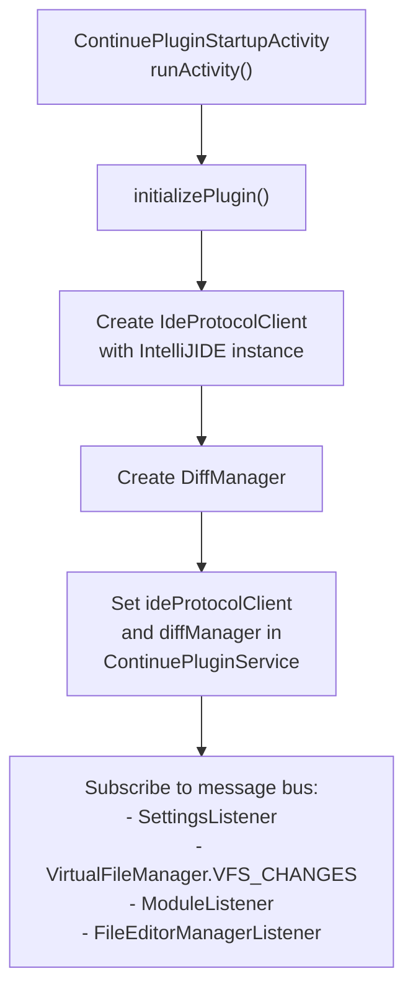

# IntelliJ IDE Implementation

<details>
<summary>Relevant source files</summary>

The following files were used as context for generating this wiki page:

- [core/diff/streamDiff.ts](core/diff/streamDiff.ts)
- [core/diff/util.ts](core/diff/util.ts)
- [core/edit/streamDiffLines.ts](core/edit/streamDiffLines.ts)
- [extensions/intellij/build.gradle.kts](extensions/intellij/build.gradle.kts)
- [extensions/intellij/gradle.properties](extensions/intellij/gradle.properties)
- [extensions/intellij/src/main/kotlin/com/github/continuedev/continueintellijextension/actions/ContinuePluginActions.kt](extensions/intellij/src/main/kotlin/com/github/continuedev/continueintellijextension/actions/ContinuePluginActions.kt)
- [extensions/intellij/src/main/kotlin/com/github/continuedev/continueintellijextension/activities/ContinuePluginStartupActivity.kt](extensions/intellij/src/main/kotlin/com/github/continuedev/continueintellijextension/activities/ContinuePluginStartupActivity.kt)
- [extensions/intellij/src/main/kotlin/com/github/continuedev/continueintellijextension/auth/ContinueAuthDialog.kt](extensions/intellij/src/main/kotlin/com/github/continuedev/continueintellijextension/auth/ContinueAuthDialog.kt)
- [extensions/intellij/src/main/kotlin/com/github/continuedev/continueintellijextension/auth/ContinueAuthService.kt](extensions/intellij/src/main/kotlin/com/github/continuedev/continueintellijextension/auth/ContinueAuthService.kt)
- [extensions/intellij/src/main/kotlin/com/github/continuedev/continueintellijextension/continue/ApplyToFileHandler.kt](extensions/intellij/src/main/kotlin/com/github/continuedev/continueintellijextension/continue/ApplyToFileHandler.kt)
- [extensions/intellij/src/main/kotlin/com/github/continuedev/continueintellijextension/continue/CoreMessenger.kt](extensions/intellij/src/main/kotlin/com/github/continuedev/continueintellijextension/continue/CoreMessenger.kt)
- [extensions/intellij/src/main/kotlin/com/github/continuedev/continueintellijextension/continue/IdeProtocolClient.kt](extensions/intellij/src/main/kotlin/com/github/continuedev/continueintellijextension/continue/IdeProtocolClient.kt)
- [extensions/intellij/src/main/kotlin/com/github/continuedev/continueintellijextension/continue/IntelliJIde.kt](extensions/intellij/src/main/kotlin/com/github/continuedev/continueintellijextension/continue/IntelliJIde.kt)
- [extensions/intellij/src/main/kotlin/com/github/continuedev/continueintellijextension/editor/DiffStreamHandler.kt](extensions/intellij/src/main/kotlin/com/github/continuedev/continueintellijextension/editor/DiffStreamHandler.kt)
- [extensions/intellij/src/main/kotlin/com/github/continuedev/continueintellijextension/editor/EditorComponentInlaysManager.kt](extensions/intellij/src/main/kotlin/com/github/continuedev/continueintellijextension/editor/EditorComponentInlaysManager.kt)
- [extensions/intellij/src/main/kotlin/com/github/continuedev/continueintellijextension/editor/EditorUtils.kt](extensions/intellij/src/main/kotlin/com/github/continuedev/continueintellijextension/editor/EditorUtils.kt)
- [extensions/intellij/src/main/kotlin/com/github/continuedev/continueintellijextension/editor/InlineEditAction.kt](extensions/intellij/src/main/kotlin/com/github/continuedev/continueintellijextension/editor/InlineEditAction.kt)
- [extensions/intellij/src/main/kotlin/com/github/continuedev/continueintellijextension/editor/RangeInFileWithContents.kt](extensions/intellij/src/main/kotlin/com/github/continuedev/continueintellijextension/editor/RangeInFileWithContents.kt)
- [extensions/intellij/src/main/kotlin/com/github/continuedev/continueintellijextension/editor/VerticalDiffBlock.kt](extensions/intellij/src/main/kotlin/com/github/continuedev/continueintellijextension/editor/VerticalDiffBlock.kt)
- [extensions/intellij/src/main/kotlin/com/github/continuedev/continueintellijextension/protocol/ide.kt](extensions/intellij/src/main/kotlin/com/github/continuedev/continueintellijextension/protocol/ide.kt)
- [extensions/intellij/src/main/kotlin/com/github/continuedev/continueintellijextension/protocol/ideWebview.kt](extensions/intellij/src/main/kotlin/com/github/continuedev/continueintellijextension/protocol/ideWebview.kt)
- [extensions/intellij/src/main/kotlin/com/github/continuedev/continueintellijextension/services/ContinueExtensionSettingsService.kt](extensions/intellij/src/main/kotlin/com/github/continuedev/continueintellijextension/services/ContinueExtensionSettingsService.kt)
- [extensions/intellij/src/main/kotlin/com/github/continuedev/continueintellijextension/services/ContinuePluginService.kt](extensions/intellij/src/main/kotlin/com/github/continuedev/continueintellijextension/services/ContinuePluginService.kt)
- [extensions/intellij/src/main/kotlin/com/github/continuedev/continueintellijextension/toolWindow/ContinuePluginToolWindowFactory.kt](extensions/intellij/src/main/kotlin/com/github/continuedev/continueintellijextension/toolWindow/ContinuePluginToolWindowFactory.kt)
- [extensions/intellij/src/main/kotlin/com/github/continuedev/continueintellijextension/types.kt](extensions/intellij/src/main/kotlin/com/github/continuedev/continueintellijextension/types.kt)
- [extensions/intellij/src/main/kotlin/com/github/continuedev/continueintellijextension/utils/Utils.kt](extensions/intellij/src/main/kotlin/com/github/continuedev/continueintellijextension/utils/Utils.kt)
- [extensions/intellij/src/main/resources/META-INF/plugin.xml](extensions/intellij/src/main/resources/META-INF/plugin.xml)
- [extensions/vscode/src/apply/ApplyManager.ts](extensions/vscode/src/apply/ApplyManager.ts)
- [extensions/vscode/src/diff/vertical/decorations.ts](extensions/vscode/src/diff/vertical/decorations.ts)
- [extensions/vscode/src/diff/vertical/handler.ts](extensions/vscode/src/diff/vertical/handler.ts)
- [extensions/vscode/src/diff/vertical/manager.ts](extensions/vscode/src/diff/vertical/manager.ts)
- [extensions/vscode/src/quickEdit/QuickEditQuickPick.ts](extensions/vscode/src/quickEdit/QuickEditQuickPick.ts)

</details>


This page documents the IntelliJ/JetBrains plugin implementation of the `IDE` interface, which provides platform-specific integrations for IntelliJ IDEA, PyCharm, WebStorm, and other JetBrains IDEs. This implementation enables Continue's core backend to interact with IntelliJ Platform APIs for file operations, git integration, terminal access, and code search.

For information about the core `IDE` interface contract and cross-platform patterns, see [IDE Integration Patterns](). For binary process communication details, see [Binary Process Communication](). For the protocol client that dispatches messages, see [IDE Protocol Client]().

## Architecture Overview

The IntelliJ IDE implementation is structured in three layers:



**Sources:** [extensions/intellij/src/main/kotlin/com/github/continuedev/continueintellijextension/continue/IntelliJIde.kt:42-136](), [extensions/intellij/src/main/kotlin/com/github/continuedev/continueintellijextension/continue/IdeProtocolClient.kt:33-52](), [extensions/intellij/src/main/kotlin/com/github/continuedev/continueintellijextension/continue/CoreMessenger.kt:17-43]()

## IntelliJIDE Class

The `IntelliJIDE` class implements the `IDE` interface defined in [extensions/intellij/src/main/kotlin/com/github/continuedev/continueintellijextension/types.kt:150-255](). It provides all IDE operations required by the Continue core backend.

### Class Structure

```kotlin
class IntelliJIDE(
    private val project: Project,
    private val continuePluginService: ContinuePluginService,
) : IDE
```

**Key Dependencies:**
- `project: Project` - IntelliJ's project context [extensions/intellij/src/main/kotlin/com/github/continuedev/continueintellijextension/continue/IntelliJIde.kt:43-43]()
- `continuePluginService: ContinuePluginService` - Plugin-level service for state management [extensions/intellij/src/main/kotlin/com/github/continuedev/continueintellijextension/continue/IntelliJIde.kt:44-44]()
- `gitService: GitService` - Git integration wrapper [extensions/intellij/src/main/kotlin/com/github/continuedev/continueintellijextension/continue/IntelliJIde.kt:118-118]()
- `fileUtils: FileUtils` - File operation utilities [extensions/intellij/src/main/kotlin/com/github/continuedev/continueintellijextension/continue/IntelliJIde.kt:119-119]()
- `ripgrep: String` - Path to bundled ripgrep binary [extensions/intellij/src/main/kotlin/com/github/continuedev/continueintellijextension/continue/IntelliJIde.kt:120-120]()

**Sources:** [extensions/intellij/src/main/kotlin/com/github/continuedev/continueintellijextension/continue/IntelliJIde.kt:42-135]()

## File Operations

The `IntelliJIDE` class provides comprehensive file system operations using IntelliJ's VirtualFileSystem API.

### Core File Methods

| Method | Purpose | Implementation Detail |
|--------|---------|-------------------|
| `readFile(filepath: String)` | Read file contents | Uses `fileUtils.readFile(filepath)` [extensions/intellij/src/main/kotlin/com/github/continuedev/continueintellijextension/continue/IntelliJIde.kt:204-204]() |
| `writeFile(path: String, contents: String)` | Write file contents | Uses `fileUtils.writeFile(path, contents)` [extensions/intellij/src/main/kotlin/com/github/continuedev/continueintellijextension/continue/IntelliJIde.kt:188-188]() |
| `fileExists(filepath: String)` | Check file existence | Uses `fileUtils.fileExists(filepath)` [extensions/intellij/src/main/kotlin/com/github/continuedev/continueintellijextension/continue/IntelliJIde.kt:186-186]() |
| `openFile(path: String)` | Open file in editor | Dispatched on `Dispatchers.EDT` [extensions/intellij/src/main/kotlin/com/github/continuedev/continueintellijextension/continue/IntelliJIde.kt:248-261]() |
| `saveFile(filepath: String)` | Save open file | Dispatched on `Dispatchers.EDT` [extensions/intellij/src/main/kotlin/com/github/continuedev/continueintellijextension/continue/IntelliJIde.kt:267-276]() |
| `listDir(dir: String)` | List directory contents | Uses `fileUtils.listDir(dir)` [extensions/intellij/src/main/kotlin/com/github/continuedev/continueintellijextension/continue/IntelliJIde.kt:252-252]() |

**Sources:** [extensions/intellij/src/main/kotlin/com/github/continuedev/continueintellijextension/continue/IntelliJIde.kt:186-276]()

### Security-Focused Ignore Patterns

The `IntelliJIDE` implementation includes comprehensive security-focused file filtering to prevent sensitive files from being indexed or searched. These patterns are applied to all ripgrep operations.

```mermaid
graph TB
    subgraph "Ignore Pattern Categories"
        Security["DEFAULT_SECURITY_IGNORE_FILETYPES<br/>DEFAULT_SECURITY_IGNORE_DIRS"]
        Additional["ADDITIONAL_SEARCH_IGNORE_FILETYPES<br/>ADDITIONAL_SEARCH_IGNORE_DIRS"]
    end
    
    subgraph "Security Patterns"
        EnvFiles["Environment files<br/>*.env, .env*, config.json"]
        Certs["Certificates & keys<br/>*.key, *.pem, *.p12"]
        Secrets["Secret files<br/>*.secret, credentials, token"]
        DB["Database files<br/>*.db, *.sqlite"]
        Cloud["Cloud credentials<br/>.aws/, .gcp/, .kube/"]
        SSH["SSH & GPG<br/>id_rsa, *.ppk, .ssh/"]
    end
    
    subgraph "Additional Patterns"
        Build["Build artifacts<br/>node_modules/, dist/, build/"]
        IDE["IDE directories<br/>.idea/, .vscode/"]
        Binary["Binary files<br/>*.exe, *.dll, *.jar"]
        Lock["Lock files<br/>*-lock.json, *.lock"]
    end
    
    Security --> EnvFiles
    Security --> Certs
    Security --> Secrets
    Security --> DB
    Security --> Cloud
    Security --> SSH
    
    Additional --> Build
    Additional --> IDE
    Additional --> Binary
    Additional --> Lock
    
    DEFAULT_IGNORES["DEFAULT_IGNORES<br/>(Combined List)"]
    
    Security --> DEFAULT_IGNORES
    Additional --> DEFAULT_IGNORES
```



**Key Security Patterns:**

The implementation defines two sets of ignore patterns in [extensions/intellij/src/main/kotlin/com/github/continuedev/continueintellijextension/continue/IntelliJIde.kt:49-116]():

1. **Security-Critical Patterns** (`DEFAULT_SECURITY_IGNORE_FILETYPES` and `DEFAULT_SECURITY_IGNORE_DIRS`):
   - Environment files: `*.env`, `.env*`, `config.json`, `appsettings.json` [extensions/intellij/src/main/kotlin/com/github/continuedev/continueintellijextension/continue/IntelliJIde.kt:49-52]()
   - Certificates: `*.key`, `*.pem`, `*.p12`, `*.pfx`, `*.crt`, `*.jks` [extensions/intellij/src/main/kotlin/com/github/continuedev/continueintellijextension/continue/IntelliJIde.kt:55-56]()
   - Credentials: `*.secret`, `credentials`, `auth.json`, `token` [extensions/intellij/src/main/kotlin/com/github/continuedev/continueintellijextension/continue/IntelliJIde.kt:61-63]()
   - Cloud provider directories: `.aws/`, `.gcp/`, `.azure/`, `.kube/` [extensions/intellij/src/main/kotlin/com/github/continuedev/continueintellijextension/continue/IntelliJIde.kt:79-80]()
   - SSH/GPG: `id_rsa`, `.ssh/`, `.gnupg/` [extensions/intellij/src/main/kotlin/com/github/continuedev/continueintellijextension/continue/IntelliJIde.kt:71-72]()

2. **Additional Indexing Exclusions** (`ADDITIONAL_SEARCH_IGNORE_FILETYPES` and `ADDITIONAL_SEARCH_IGNORE_DIRS`):
   - Build directories: `node_modules/`, `dist/`, `build/`, `target/` [extensions/intellij/src/main/kotlin/com/github/continuedev/continueintellijextension/continue/IntelliJIde.kt:105-106]()
   - IDE directories: `.vscode/`, `.idea/`, `.continue/` [extensions/intellij/src/main/kotlin/com/github/continuedev/continueintellijextension/continue/IntelliJIde.kt:108-109]()
   - Binary files: `*.exe`, `*.dll`, `*.jar`, `*.png`, `*.zip` [extensions/intellij/src/main/kotlin/com/github/continuedev/continueintellijextension/continue/IntelliJIde.kt:92-98]()

**Sources:** [extensions/intellij/src/main/kotlin/com/github/continuedev/continueintellijextension/continue/IntelliJIde.kt:49-116]()

## Ripgrep Integration

The `IntelliJIDE` class uses ripgrep for high-performance code search and file discovery. The ripgrep binary is bundled with the plugin and extracted during initialization [extensions/intellij/src/main/kotlin/com/github/continuedev/continueintellijextension/continue/IntelliJIde.kt:122-135]().

### Search Operations

The implementation provides two ripgrep-based search methods:

#### 1. File Pattern Search (`getFileResults`)

Searches for files matching a glob pattern [extensions/intellij/src/main/kotlin/com/github/continuedev/continueintellijextension/continue/IntelliJIde.kt:405-443](). It uses `--files` to list files and `--iglob` for the pattern, while applying `DEFAULT_IGNORES` via `--glob` [extensions/intellij/src/main/kotlin/com/github/continuedev/continueintellijextension/continue/IntelliJIde.kt:412-421]().

#### 2. Content Search (`getSearchResults`)

Searches for text content within files [extensions/intellij/src/main/kotlin/com/github/continuedev/continueintellijextension/continue/IntelliJIde.kt:445-490](). It uses case-insensitive search (`-i`), provides context lines (`-C 2`), and groups results by file (`--heading`) [extensions/intellij/src/main/kotlin/com/github/continuedev/continueintellijextension/continue/IntelliJIde.kt:452-462]().

**Sources:** [extensions/intellij/src/main/kotlin/com/github/continuedev/continueintellijextension/continue/IntelliJIde.kt:405-490]()

## Terminal Integration

The `runCommand` method integrates with IntelliJ's terminal system to execute commands [extensions/intellij/src/main/kotlin/com/github/continuedev/continueintellijextension/continue/IntelliJIde.kt:283-342](). It finds or creates a `ShellTerminalWidget` and sends text to its `ttyConnector` [extensions/intellij/src/main/kotlin/com/github/continuedev/continueintellijextension/continue/IntelliJIde.kt:333-333]().

### Getting Terminal Contents

The `getTerminalContents` method extracts text from the active terminal, including history and screen lines, using `ShellTerminalWidget.terminalTextBuffer` [extensions/intellij/src/main/kotlin/com/github/continuedev/continueintellijextension/continue/IntelliJIde.kt:202-230]().

**Sources:** [extensions/intellij/src/main/kotlin/com/github/continuedev/continueintellijextension/continue/IntelliJIde.kt:202-342]()

## Editor Operations

### Getting IDE Information

The `getIdeInfo` method returns metadata about the JetBrains IDE environment, including the application name, version, and the version of the Continue extension [extensions/intellij/src/main/kotlin/com/github/continuedev/continueintellijextension/continue/IntelliJIde.kt:137-161]().

### Open Files Management

- `getOpenFiles()`: Returns URIs of all files currently open in the editor [extensions/intellij/src/main/kotlin/com/github/continuedev/continueintellijextension/continue/IntelliJIde.kt:379-384]().
- `getCurrentFile()`: Returns the path and contents of the currently active text editor [extensions/intellij/src/main/kotlin/com/github/continuedev/continueintellijextension/continue/IntelliJIde.kt:386-401]().

**Sources:** [extensions/intellij/src/main/kotlin/com/github/continuedev/continueintellijextension/continue/IntelliJIde.kt:137-401]()

## Platform-Specific Features

### Problem/Diagnostics Integration

The `getProblems` method uses IntelliJ's `DocumentMarkupModel` to extract errors and warnings (`HighlightInfo`) from the active editor [extensions/intellij/src/main/kotlin/com/github/continuedev/continueintellijextension/continue/IntelliJIde.kt:515-560]().

### Toast Notifications

The `showToast` method creates IntelliJ balloon notifications using `NotificationGroupManager` [extensions/intellij/src/main/kotlin/com/github/continuedev/continueintellijextension/continue/IntelliJIde.kt:615-654](). It supports action buttons and automatic expiration [extensions/intellij/src/main/kotlin/com/github/continuedev/continueintellijextension/continue/IntelliJIde.kt:629-644]().

**Sources:** [extensions/intellij/src/main/kotlin/com/github/continuedev/continueintellijextension/continue/IntelliJIde.kt:515-654]()

## Initialization and Lifecycle

The `IntelliJIDE` instance is created during plugin startup in `ContinuePluginStartupActivity` [extensions/intellij/src/main/kotlin/com/github/continuedev/continueintellijextension/activities/ContinuePluginStartupActivity.kt:140-145]().



The plugin also monitors file system changes via `BulkFileListener` and notifies the core backend of file creations, deletions, and content changes [extensions/intellij/src/main/kotlin/com/github/continuedev/continueintellijextension/activities/ContinuePluginStartupActivity.kt:168-199]().

**Sources:** [extensions/intellij/src/main/kotlin/com/github/continuedev/continueintellijextension/activities/ContinuePluginStartupActivity.kt:88-199]()