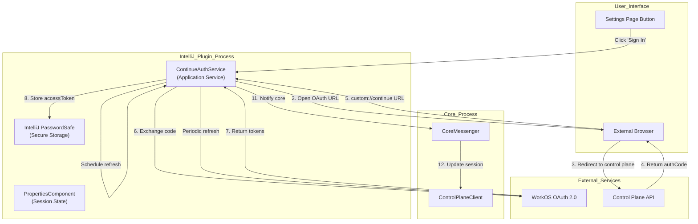
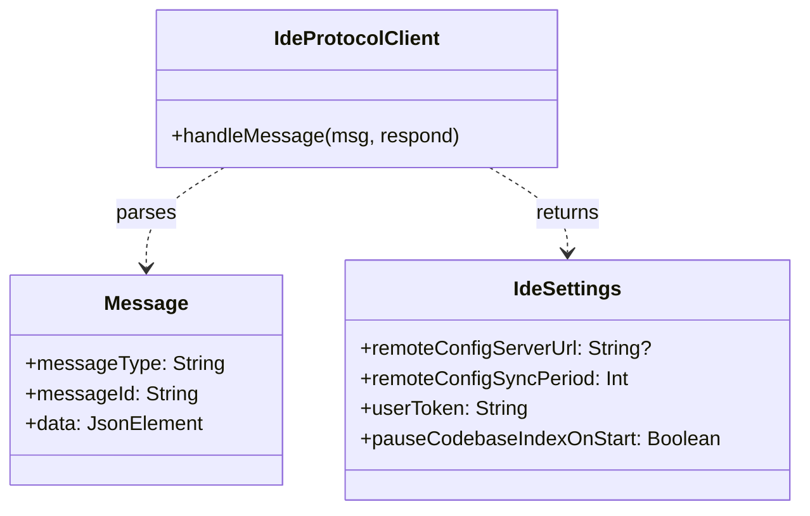
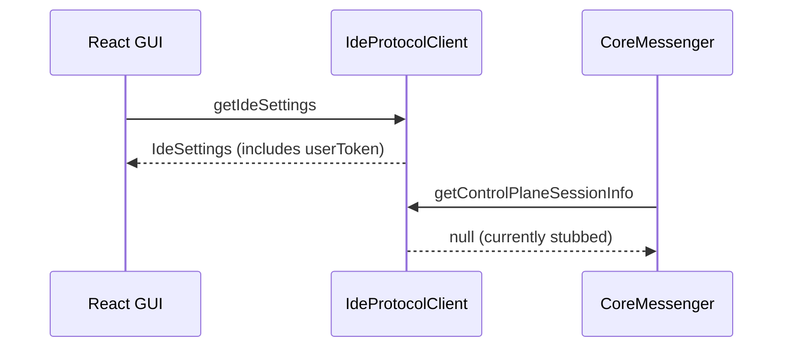

# Authentication Integration

<details>
<summary>Relevant source files</summary>

The following files were used as context for generating this wiki page:

- [extensions/intellij/build.gradle.kts](extensions/intellij/build.gradle.kts)
- [extensions/intellij/gradle.properties](extensions/intellij/gradle.properties)
- [extensions/intellij/src/main/kotlin/com/github/continuedev/continueintellijextension/actions/ContinuePluginActions.kt](extensions/intellij/src/main/kotlin/com/github/continuedev/continueintellijextension/actions/ContinuePluginActions.kt)
- [extensions/intellij/src/main/kotlin/com/github/continuedev/continueintellijextension/activities/ContinuePluginStartupActivity.kt](extensions/intellij/src/main/kotlin/com/github/continuedev/continueintellijextension/activities/ContinuePluginStartupActivity.kt)
- [extensions/intellij/src/main/kotlin/com/github/continuedev/continueintellijextension/auth/ContinueAuthDialog.kt](extensions/intellij/src/main/kotlin/com/github/continuedev/continueintellijextension/auth/ContinueAuthDialog.kt)
- [extensions/intellij/src/main/kotlin/com/github/continuedev/continueintellijextension/auth/ContinueAuthService.kt](extensions/intellij/src/main/kotlin/com/github/continuedev/continueintellijextension/auth/ContinueAuthService.kt)
- [extensions/intellij/src/main/kotlin/com/github/continuedev/continueintellijextension/continue/CoreMessenger.kt](extensions/intellij/src/main/kotlin/com/github/continuedev/continueintellijextension/continue/CoreMessenger.kt)
- [extensions/intellij/src/main/kotlin/com/github/continuedev/continueintellijextension/continue/IdeProtocolClient.kt](extensions/intellij/src/main/kotlin/com/github/continuedev/continueintellijextension/continue/IdeProtocolClient.kt)
- [extensions/intellij/src/main/kotlin/com/github/continuedev/continueintellijextension/continue/IntelliJIde.kt](extensions/intellij/src/main/kotlin/com/github/continuedev/continueintellijextension/continue/IntelliJIde.kt)
- [extensions/intellij/src/main/kotlin/com/github/continuedev/continueintellijextension/protocol/ide.kt](extensions/intellij/src/main/kotlin/com/github/continuedev/continueintellijextension/protocol/ide.kt)
- [extensions/intellij/src/main/kotlin/com/github/continuedev/continueintellijextension/services/ContinueExtensionSettingsService.kt](extensions/intellij/src/main/kotlin/com/github/continuedev/continueintellijextension/services/ContinueExtensionSettingsService.kt)
- [extensions/intellij/src/main/kotlin/com/github/continuedev/continueintellijextension/services/ContinuePluginService.kt](extensions/intellij/src/main/kotlin/com/github/continuedev/continueintellijextension/services/ContinuePluginService.kt)
- [extensions/intellij/src/main/kotlin/com/github/continuedev/continueintellijextension/toolWindow/ContinuePluginToolWindowFactory.kt](extensions/intellij/src/main/kotlin/com/github/continuedev/continueintellijextension/toolWindow/ContinuePluginToolWindowFactory.kt)
- [extensions/intellij/src/main/kotlin/com/github/continuedev/continueintellijextension/types.kt](extensions/intellij/src/main/kotlin/com/github/continuedev/continueintellijextension/types.kt)
- [extensions/intellij/src/main/resources/META-INF/plugin.xml](extensions/intellij/src/main/resources/META-INF/plugin.xml)

</details>


This page documents the authentication system in the IntelliJ plugin, which handles user sign-in, session management, and token refresh for Continue Hub access. For general control plane integration concepts including authentication types and organization management, see [Authentication System](#9.1). For the core `ControlPlaneClient` used across all IDEs, see [Control Plane Client](#9.4).

## Overview

The IntelliJ plugin implements WorkOS-based OAuth 2.0 authentication to enable users to access Continue Hub features including team organizations, shared assistants, and enterprise policies. The authentication system runs entirely within the IDE process and uses IntelliJ's secure credential storage (`PasswordSafe`) for session persistence.

**Sources:** [extensions/intellij/src/main/kotlin/com/github/continuedev/continueintellijextension/auth/ContinueAuthService.kt:1-8]()

## Architecture



**Diagram: OAuth 2.0 Authentication Flow in IntelliJ**

**Sources:** [extensions/intellij/src/main/kotlin/com/github/continuedev/continueintellijextension/auth/ContinueAuthService.kt:1-8](), [extensions/intellij/src/main/kotlin/com/github/continuedev/continueintellijextension/activities/ContinuePluginStartupActivity.kt:126-150]()

## Key Components

### ContinueAuthService

The `ContinueAuthService` is an application-level service defined in the plugin configuration.

| Component | Type | Purpose |
|-----------|------|---------|
| `ContinueAuthService` | Application Service | Main authentication coordinator [extensions/intellij/src/main/resources/META-INF/plugin.xml:52-53]() |
| `ContinueExtensionSettings` | Application Service | Manages user tokens and remote config URLs [extensions/intellij/src/main/kotlin/com/github/continuedev/continueintellijextension/services/ContinueExtensionSettingsService.kt:79-91]() |

**Key Methods (Conceptual):**
- `loadControlPlaneSessionInfo()`: Retrieves stored session from secure storage.
- `refreshAccessToken()`: Performs token refresh via control plane.
- `signOut()`: Clears all stored credentials.

**Sources:** [extensions/intellij/src/main/kotlin/com/github/continuedev/continueintellijextension/auth/ContinueAuthService.kt:1-8](), [extensions/intellij/src/main/kotlin/com/github/continuedev/continueintellijextension/services/ContinueExtensionSettingsService.kt:79-91]()

### Session Data Structures



**Diagram: Authentication and Settings Data Model**

**Sources:** [extensions/intellij/src/main/kotlin/com/github/continuedev/continueintellijextension/types.kt:136-142](), [extensions/intellij/src/main/kotlin/com/github/continuedev/continueintellijextension/continue/IdeProtocolClient.kt:52-54]()

## Authentication Flow

### Initial Sign-In and Token Storage

The authentication process integrates with the IDE's protocol handler to receive tokens and store them securely:

1. **User Initiates Flow**: User clicks "Sign In" in the GUI.
2. **IDE Protocol Client**: The `IdeProtocolClient` handles authentication messages such as `getControlPlaneSessionInfo` and `logoutOfControlPlane` [extensions/intellij/src/main/kotlin/com/github/continuedev/continueintellijextension/continue/IdeProtocolClient.kt:101-107]().
3. **Token Management**: User tokens are managed via `ContinueExtensionSettings` [extensions/intellij/src/main/kotlin/com/github/continuedev/continueintellijextension/services/ContinueExtensionSettingsService.kt:86]().
4. **Core Notification**: When settings are updated, the plugin notifies the Core process via `config/ideSettingsUpdate` [extensions/intellij/src/main/kotlin/com/github/continuedev/continueintellijextension/activities/ContinuePluginStartupActivity.kt:155-160]().

**Sources:** [extensions/intellij/src/main/kotlin/com/github/continuedev/continueintellijextension/continue/IdeProtocolClient.kt:101-107](), [extensions/intellij/src/main/kotlin/com/github/continuedev/continueintellijextension/activities/ContinuePluginStartupActivity.kt:152-160]()

### Silent Session Loading

On plugin startup, the `ContinuePluginStartupActivity` initializes the environment and ensures settings are synced:

```kotlin
// From ContinuePluginStartupActivity.kt
val settings = service<ContinueExtensionSettings>()
// ...
settings.addRemoteSyncJob()
```

This triggers the background synchronization of remote configurations if a `userToken` and `remoteConfigServerUrl` are present.

**Sources:** [extensions/intellij/src/main/kotlin/com/github/continuedev/continueintellijextension/activities/ContinuePluginStartupActivity.kt:131-138]()

## Token Management

### Automatic Remote Config Sync

The plugin maintains synchronization with the remote control plane through `ContinueExtensionSettings`:

| Configuration | Value | Purpose |
|--------------|-------|---------|
| Sync Period | `remoteConfigSyncPeriod` | Interval in minutes [extensions/intellij/src/main/kotlin/com/github/continuedev/continueintellijextension/services/ContinueExtensionSettingsService.kt:85]() |
| Executor | `AppExecutorUtil.getAppScheduledExecutorService()` | IntelliJ platform scheduler [extensions/intellij/src/main/kotlin/com/github/continuedev/continueintellijextension/services/ContinueExtensionSettingsService.kt:149]() |

**Sync Process:**
1. `syncRemoteConfig()` is called periodically [extensions/intellij/src/main/kotlin/com/github/continuedev/continueintellijextension/services/ContinueExtensionSettingsService.kt:112]().
2. It uses the `userToken` as a Bearer token in the `Authorization` header [extensions/intellij/src/main/kotlin/com/github/continuedev/continueintellijextension/services/ContinueExtensionSettingsService.kt:125]().
3. Fetches `config.json` and `config.js` from the `/sync` endpoint [extensions/intellij/src/main/kotlin/com/github/continuedev/continueintellijextension/services/ContinueExtensionSettingsService.kt:119-127]().
4. Writes the received configuration to the local `.continue` directory [extensions/intellij/src/main/kotlin/com/github/continuedev/continueintellijextension/services/ContinueExtensionSettingsService.kt:130-136]().

**Sources:** [extensions/intellij/src/main/kotlin/com/github/continuedev/continueintellijextension/services/ContinueExtensionSettingsService.kt:112-156]()

## IDE Protocol Integration

### Message Handling

The `IdeProtocolClient` acts as the bridge for authentication state between the GUI/Core and the IntelliJ platform:



**Protocol Messages:**

| Message Type | Direction | Purpose |
|-------------|-----------|---------|
| `getIdeSettings` | GUI → IDE | Retrieves current user token and sync settings [extensions/intellij/src/main/kotlin/com/github/continuedev/continueintellijextension/continue/IdeProtocolClient.kt:96-99]() |
| `getControlPlaneSessionInfo` | Core → IDE | Request current session (Stubbed in current version) [extensions/intellij/src/main/kotlin/com/github/continuedev/continueintellijextension/continue/IdeProtocolClient.kt:101-103]() |
| `logoutOfControlPlane` | GUI → IDE | Request logout (Stubbed in current version) [extensions/intellij/src/main/kotlin/com/github/continuedev/continueintellijextension/continue/IdeProtocolClient.kt:105-107]() |

**Sources:** [extensions/intellij/src/main/kotlin/com/github/continuedev/continueintellijextension/continue/IdeProtocolClient.kt:96-107]()

## Secure Storage

### IntelliJ PasswordSafe

While tokens are persisted in `ContinueExtensionSettings` (which uses `PersistentStateComponent`), sensitive credentials in IntelliJ are typically handled by `PasswordSafe`. 

**Current Implementation Status:**
The `ContinueExtensionSettings` stores the `userToken` in an XML file [extensions/intellij/src/main/kotlin/com/github/continuedev/continueintellijextension/services/ContinueExtensionSettingsService.kt:77-86](). Future iterations of the `ContinueAuthService` are intended to migrate these to `PasswordSafe` for enhanced security.

**Sources:** [extensions/intellij/src/main/kotlin/com/github/continuedev/continueintellijextension/services/ContinueExtensionSettingsService.kt:75-93]()

## Sign-Out Process

The sign-out process is initiated through the protocol client:

1. **Protocol Message**: The GUI sends `logoutOfControlPlane` [extensions/intellij/src/main/kotlin/com/github/continuedev/continueintellijextension/continue/IdeProtocolClient.kt:105]().
2. **Core Update**: The IDE notifies the core process that settings have changed, effectively clearing the remote session in the core orchestrator.

**Sources:** [extensions/intellij/src/main/kotlin/com/github/continuedev/continueintellijextension/continue/IdeProtocolClient.kt:105-107]()