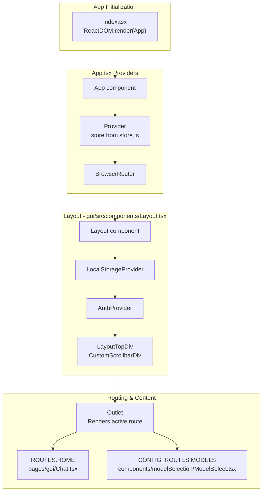
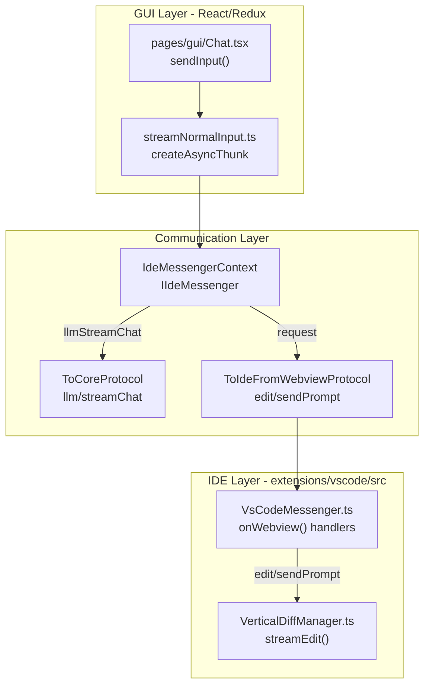
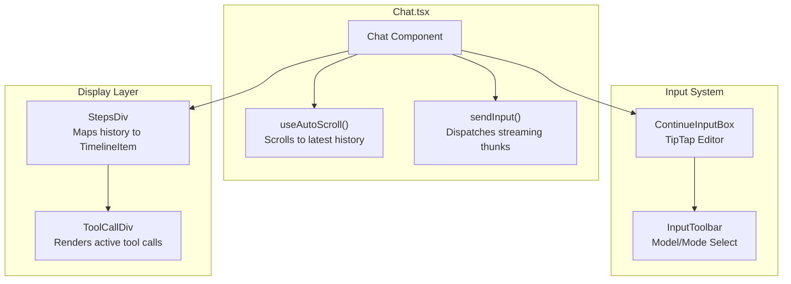

# User Interface

Relevant source files

The following files were used as context for generating this wiki page:

- [core/protocol/ideWebview.ts](core/protocol/ideWebview.ts)
- [core/util/messageContent.ts](core/util/messageContent.ts)
- [extensions/vscode/src/commands.ts](extensions/vscode/src/commands.ts)
- [extensions/vscode/src/extension/VsCodeMessenger.ts](extensions/vscode/src/extension/VsCodeMessenger.ts)
- [gui/src/components/Layout.tsx](gui/src/components/Layout.tsx)
- [gui/src/components/mainInput/ContinueInputBox.tsx](gui/src/components/mainInput/ContinueInputBox.tsx)
- [gui/src/components/mainInput/InputToolbar.tsx](gui/src/components/mainInput/InputToolbar.tsx)
- [gui/src/components/modelSelection/ModelSelect.tsx](gui/src/components/modelSelection/ModelSelect.tsx)
- [gui/src/pages/gui/Chat.tsx](gui/src/pages/gui/Chat.tsx)
- [gui/src/redux/slices/sessionSlice.ts](gui/src/redux/slices/sessionSlice.ts)
- [gui/src/redux/store.ts](gui/src/redux/store.ts)
- [gui/src/redux/thunks/streamNormalInput.ts](gui/src/redux/thunks/streamNormalInput.ts)
- [gui/src/redux/thunks/streamResponse.ts](gui/src/redux/thunks/streamResponse.ts)
- [gui/src/redux/thunks/streamResponseAfterToolCall.ts](gui/src/redux/thunks/streamResponseAfterToolCall.ts)
- [gui/src/redux/util/constructMessages.test.ts](gui/src/redux/util/constructMessages.test.ts)
- [gui/src/redux/util/constructMessages.ts](gui/src/redux/util/constructMessages.ts)

The User Interface system encompasses the React-based GUI that powers the webview in both VS Code and IntelliJ extensions. This GUI provides the primary interface for users to interact with Continue's AI features, including chat, autocomplete suggestions, configuration management, and history viewing.

For information about the VS Code extension integration, see [VS Code Extension](#6). For IntelliJ plugin integration, see [IntelliJ Plugin](#7). For the message routing between IDE, core, and GUI, see [Communication Protocols](#2.3).

## Architecture Overview

The GUI is a React application built with TypeScript, Redux Toolkit, TipTap editor, and styled-components. It runs in a webview within VS Code or IntelliJ and communicates with the core backend and IDE through the `IdeMessengerContext` interface.

### Application Bootstrap

The `Layout` component serves as the structural wrapper for the application, handling routing, global event listeners, and providing context for authentication and local storage. It listens for IDE-driven events such as `focusEdit`, `newSession`, and `setCodeToEdit`.

**Application Entry Point and Provider Hierarchy**

**Sources:** `[gui/src/components/Layout.tsx:40-234]()`, `[gui/src/redux/store.ts:106-132]()`, `[gui/src/components/Layout.tsx:198-231]()`

### Message Communication Architecture

The GUI interacts with the Core and IDE via a standardized protocol managed by the `IdeMessenger`. The `VsCodeMessenger` in the extension layer acts as the bridge, routing messages like `applyToFile`, `showFile`, and `edit/sendPrompt` between the webview and the IDE services.

**IdeMessenger Protocol Communication**

**Sources:** `[gui/src/context/IdeMessenger.tsx]()`, `[gui/src/redux/thunks/streamNormalInput.ts:199-207]()`, `[extensions/vscode/src/extension/VsCodeMessenger.ts:39-215]()`, `[core/protocol/ideWebview.ts:16-53]()`

## State Management

The GUI uses Redux with Redux Toolkit for centralized state management. State is persisted to local storage with selective serialization via `redux-persist` transforms.

### Redux Store Structure

| Slice | File | Purpose |
|-------|------|---------|
| `session` | `gui/src/redux/slices/sessionSlice.ts` | Chat history, streaming state, tool calls, and reasoning status. |
| `config` | `gui/src/redux/slices/configSlice.ts` | Configuration, models, context providers, and experimental flags. |
| `ui` | `gui/src/redux/slices/uiSlice.ts` | UI state, dialogs, tool settings, and rule settings. |
| `editModeState` | `gui/src/redux/slices/editState.ts` | Manages state for the Edit mode, including `codeToEdit`. |

**Sources:** `[gui/src/redux/store.ts:26-34]()`, `[gui/src/redux/store.ts:36-64]()`, `[gui/src/redux/slices/sessionSlice.ts:1-40]()`

## Chat Interface

The `Chat.tsx` component is the primary interface for user interaction. It manages the message history (`history`), handles input via `ContinueInputBox`, and orchestrates streaming responses through thunks like `streamResponseThunk` and `streamNormalInput`.

### Chat Component Structure

**Chat.tsx Rendering Logic**

**Sources:** `[gui/src/pages/gui/Chat.tsx:106-166]()`, `[gui/src/pages/gui/Chat.tsx:160-289]()`, `[gui/src/components/mainInput/ContinueInputBox.tsx:55-151]()`

### Tool Call State Management

Tool calls are managed through `ToolCallState` objects in the `sessionSlice`. The GUI handles streaming updates via `handleStreamingToolCallUpdates`, which applies deltas to existing tool call states.

**Sources:** `[gui/src/redux/slices/sessionSlice.ts:166-190]()`, `[gui/src/redux/thunks/streamResponseAfterToolCall.ts:37-89]()`

## Configuration UI

### Model Selection

The `ModelSelect` component allows users to switch between configured LLMs. It dynamically updates based on the current mode (Chat or Edit) and displays configuration status, such as missing API keys.

**Sources:** `[gui/src/components/modelSelection/ModelSelect.tsx:120-145]()`, `[gui/src/components/modelSelection/ModelSelect.tsx:236-255]()`

## Child Pages

- [GUI Architecture](#8.1) — Explain the React application structure, routing (Layout component), and Vite build configuration.
- [Chat Interface](#8.2) — Document the Chat component, message rendering, tool call display, and streaming updates.
- [State Management](#8.3) — Detail the Redux store architecture, including sessionSlice, stateSlice, and thunk-based async operations.
- [Input System](#8.4) — Explain the ContinueInputBox (TipTap editor), InputToolbar, context item management, and slash command integration.
- [Model Selection](#8.5) — Document the ModelSelect component, role-based model selection, and configuration status display.
- [Edit Mode](#8.6) — Explain edit mode functionality, including state transitions, input filtering, and apply state tracking.
- [History and Session Persistence](#8.7) — Document the HistoryManager, session file format, MiniSearch indexing, and session loading/saving.