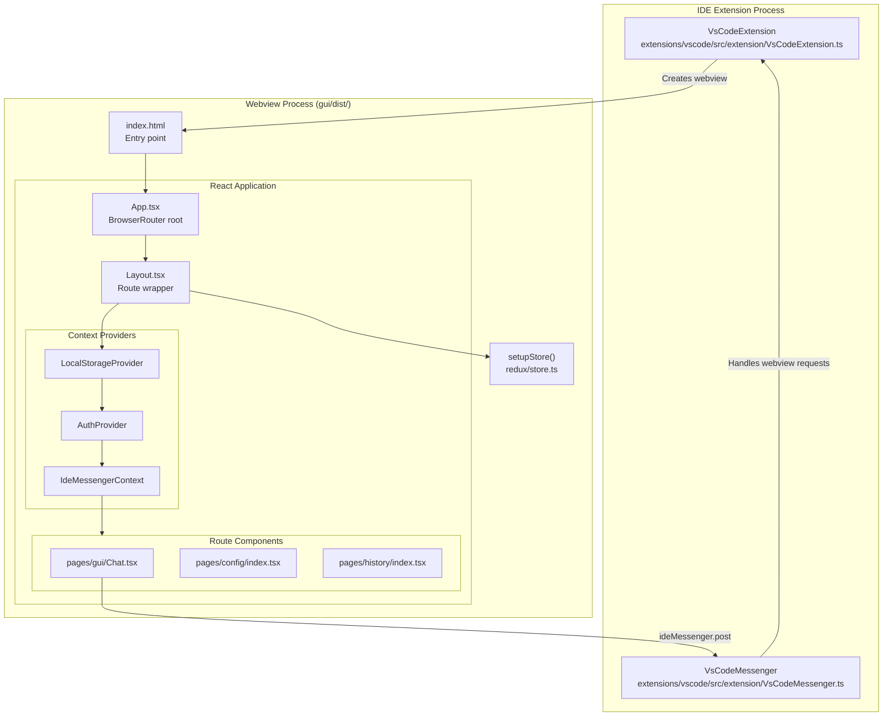

# GUI Architecture

Relevant source files

The following files were used as context for generating this wiki page:

- [core/protocol/ideWebview.ts](core/protocol/ideWebview.ts)
- [extensions/intellij/src/main/kotlin/com/github/continuedev/continueintellijextension/continue/GetTheme.kt](extensions/intellij/src/main/kotlin/com/github/continuedev/continueintellijextension/continue/GetTheme.kt)
- [extensions/vscode/src/commands.ts](extensions/vscode/src/commands.ts)
- [extensions/vscode/src/extension/VsCodeMessenger.ts](extensions/vscode/src/extension/VsCodeMessenger.ts)
- [gui/src/components/Layout.tsx](gui/src/components/Layout.tsx)
- [gui/src/components/TabBar/TabBar.tsx](gui/src/components/TabBar/TabBar.tsx)
- [gui/src/components/find/FindWidget.tsx](gui/src/components/find/FindWidget.tsx)
- [gui/src/components/index.ts](gui/src/components/index.ts)
- [gui/src/components/mainInput/ContinueInputBox.tsx](gui/src/components/mainInput/ContinueInputBox.tsx)
- [gui/src/components/mainInput/InputToolbar.tsx](gui/src/components/mainInput/InputToolbar.tsx)
- [gui/src/components/modelSelection/ModelSelect.tsx](gui/src/components/modelSelection/ModelSelect.tsx)
- [gui/src/index.css](gui/src/index.css)
- [gui/src/pages/gui/Chat.tsx](gui/src/pages/gui/Chat.tsx)
- [gui/src/pages/gui/index.tsx](gui/src/pages/gui/index.tsx)
- [gui/src/redux/slices/tabsSlice.ts](gui/src/redux/slices/tabsSlice.ts)
- [gui/src/styles/ThemePage.tsx](gui/src/styles/ThemePage.tsx)
- [gui/src/styles/theme.test.ts](gui/src/styles/theme.test.ts)
- [gui/src/styles/theme.ts](gui/src/styles/theme.ts)
- [gui/tailwind.config.cjs](gui/tailwind.config.cjs)

## Purpose and Scope

This page documents the architecture of the React-based graphical user interface (GUI) that powers Continue's webview in both VS Code and JetBrains IDEs. It covers the application structure, component organization, routing, and integration with the IDE extensions via message passing.

## Overall Architecture

The Continue GUI is a React single-page application built with Vite. It is hosted within an IDE webview and shares a unified codebase across platforms. Platform-specific differences are handled through an abstraction layer called the `IdeMessenger`.

### High-Level Application Structure

Diagram: React Application Component Hierarchy

The `IdeMessenger` interface abstracts the underlying `postMessage` (VS Code) or JCEF (JetBrains) communication. Bidirectional communication allows the GUI to request IDE actions (e.g., `showFile`) and the IDE to trigger GUI updates (e.g., `newSession`).

**Sources:** [gui/src/components/Layout.tsx:198-232](), [extensions/vscode/src/extension/VsCodeMessenger.ts:39-84](), [core/protocol/ideWebview.ts:1-82]()

## Application Entry Point and Structure

The GUI is bundled as a static asset by Vite into `gui/dist/`. The main entry point for the React application is `gui/src/main.tsx` (linked from `index.html`).

### Directory Structure

| Directory | Purpose | Key Files |
|-----------|---------|-----------|
| `gui/src/` | Source root | `App.tsx` |
| `gui/src/pages/` | Top-level page components | `gui/Chat.tsx` |
| `gui/src/components/` | Reusable UI components | `Layout.tsx`, `ContinueInputBox.tsx` |
| `gui/src/redux/` | State management | `store.ts`, `slices/sessionSlice.ts` |
| `gui/src/context/` | React contexts | `IdeMessenger.tsx`, `Auth.tsx` |

### Redux Store Structure

The Redux store manages the state of the chat, configuration, and UI.

| Slice | Purpose | Key State Entities |
|-------|---------|-------------------|
| `session` | Chat history and streaming state | `history`, `isStreaming`, `isInEdit` [gui/src/pages/gui/Chat.tsx:114-124]() |
| `ui` | Dialogs and global UI flags | `showDialog`, `dialogMessage` [gui/src/components/Layout.tsx:48-50]() |
| `config` | Extension configuration | `config`, `loading` [gui/src/components/modelSelection/ModelSelect.tsx:125-126]() |
| `editModeState` | State for inline edit mode | `codeToEdit`, `applyState` [gui/src/components/mainInput/ContinueInputBox.tsx:64-65]() |

**Sources:** [gui/src/pages/gui/Chat.tsx:107-124](), [gui/src/components/Layout.tsx:40-51]()

## Layout and Routing

The `Layout` component serves as the persistent wrapper for all routes. It initializes global contexts and listens for messages from the IDE.

### Webview Listeners
The `Layout` component uses the `useWebviewListener` hook to respond to IDE-initiated events:
- `newSession`: Resets the chat interface and exits edit mode [gui/src/components/Layout.tsx:57-72]().
- `navigateTo`: Programmatically changes the GUI route [gui/src/components/Layout.tsx:114-124]().
- `focusEdit`: Triggers the transition into "Edit Mode" [gui/src/components/Layout.tsx:143-150]().
- `setupApiKey` / `setupLocalConfig`: Opens the onboarding card for model configuration [gui/src/components/Layout.tsx:126-141]().

### Routing Architecture
Routing is managed via `react-router-dom`. The `Outlet` component in `Layout` renders the active route, such as the `Chat` page or `Models` configuration [gui/src/components/Layout.tsx:222]().

**Sources:** [gui/src/components/Layout.tsx:40-171](), [gui/src/components/Layout.tsx:222]()

## Core GUI Components

### Chat Interface (`Chat.tsx`)
The primary interface for AI interaction. It renders a timeline of `ChatHistoryItem` objects and the `ContinueInputBox`.
- **Streaming**: Uses `streamResponseThunk` to handle real-time LLM updates [gui/src/pages/gui/Chat.tsx:42]().
- **Auto-scroll**: The `useAutoScroll` hook ensures the view follows the latest message during streaming [gui/src/pages/gui/Chat.tsx:134]().
- **Tool Calls**: Renders pending and completed tool calls via `ToolCallDiv` [gui/src/pages/gui/Chat.tsx:44]().

### Input System (`ContinueInputBox.tsx`)
A complex input component based on the TipTap editor.
- **Context Integration**: Supports `@`-mentions for context providers. In `edit` mode, certain providers like `codebase` are disallowed [gui/src/components/mainInput/ContinueInputBox.tsx:34-44]().
- **Slash Commands**: Dynamically filters available slash commands based on the current mode (Chat vs. Edit) [gui/src/components/mainInput/ContinueInputBox.tsx:66-75]().
- **Toolbar**: The `InputToolbar` provides model selection and attachment options [gui/src/components/mainInput/InputToolbar.tsx:49-169]().

### Model Selection (`ModelSelect.tsx`)
Allows users to switch between configured LLMs.
- **Role-based Selection**: Displays models appropriate for the current role (`chat` or `edit`) [gui/src/components/modelSelection/ModelSelect.tsx:135-144]().
- **Sync**: Dispatches `updateSelectedModelByRole` to persist changes back to the IDE configuration [gui/src/components/modelSelection/ModelSelect.tsx:190-197]().

**Sources:** [gui/src/pages/gui/Chat.tsx:106-158](), [gui/src/components/mainInput/ContinueInputBox.tsx:55-151](), [gui/src/components/modelSelection/ModelSelect.tsx:120-234]()

## Styling and Build Configuration

### Theme Integration
Continue uses a combination of Tailwind CSS and CSS variables to match the host IDE's theme.
- **Tailwind Config**: Maps standard Tailwind classes to IDE theme variables (e.g., `bg-vsc-background` maps to `var(--vscode-background)`) [gui/tailwind.config.cjs:105-110]().
- **Styled Components**: Reusable UI elements like `Button` and `Input` are defined using `styled-components` to ensure consistent padding and border-radius [gui/src/components/index.ts:32-138]().

### Build Pipeline
The GUI is built using Vite. The configuration ensures that:
- Assets are bundled for production with appropriate base paths for webview loading.
- Tailwind "preflight" is disabled to prevent overriding IDE-provided base styles [gui/tailwind.config.cjs:114-116]().

### Find Widget
The GUI implements a custom `FindWidget` for searching text within the webview, as standard browser/IDE search often fails to penetrate webview boundaries effectively [gui/src/components/find/FindWidget.tsx:58-62]().

**Sources:** [gui/tailwind.config.cjs:38-110](), [gui/src/components/index.ts:1-138](), [gui/src/components/find/FindWidget.tsx:216-230]()