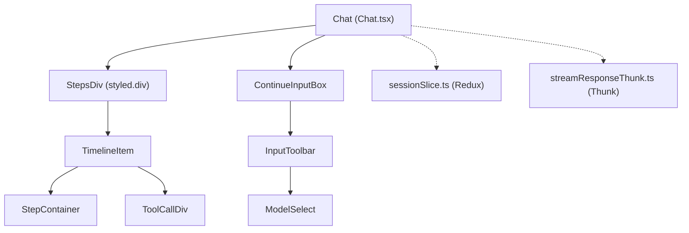
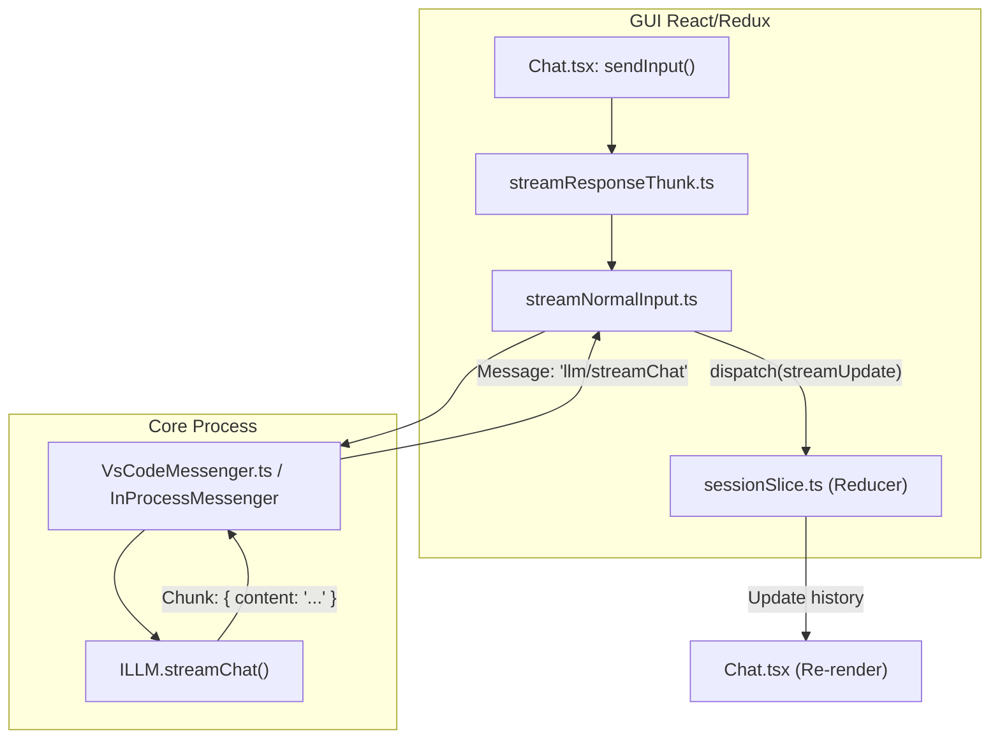

# Chat Interface

Relevant source files

The following files were used as context for generating this wiki page:

- [.idea/jsLinters/eslint.xml](.idea/jsLinters/eslint.xml)
- [.idea/prettier.xml](.idea/prettier.xml)
- [core/edit/recursiveStream.ts](core/edit/recursiveStream.ts)
- [core/protocol/ideWebview.ts](core/protocol/ideWebview.ts)
- [extensions/vscode/src/commands.ts](extensions/vscode/src/commands.ts)
- [extensions/vscode/src/extension/VsCodeMessenger.ts](extensions/vscode/src/extension/VsCodeMessenger.ts)
- [gui/src/components/AcceptRejectDiffButtons.tsx](gui/src/components/AcceptRejectDiffButtons.tsx)
- [gui/src/components/Layout.tsx](gui/src/components/Layout.tsx)
- [gui/src/components/StepContainer/ResponseActions.tsx](gui/src/components/StepContainer/ResponseActions.tsx)
- [gui/src/components/StepContainer/StepContainer.tsx](gui/src/components/StepContainer/StepContainer.tsx)
- [gui/src/components/StyledMarkdownPreview/StepContainerPreToolbar/CollapsibleContainer.tsx](gui/src/components/StyledMarkdownPreview/StepContainerPreToolbar/CollapsibleContainer.tsx)
- [gui/src/components/StyledMarkdownPreview/StepContainerPreToolbar/ToolbarButtonWithTooltip.tsx](gui/src/components/StyledMarkdownPreview/StepContainerPreToolbar/ToolbarButtonWithTooltip.tsx)
- [gui/src/components/StyledMarkdownPreview/StepContainerPreToolbar/index.tsx](gui/src/components/StyledMarkdownPreview/StepContainerPreToolbar/index.tsx)
- [gui/src/components/StyledMarkdownPreview/index.tsx](gui/src/components/StyledMarkdownPreview/index.tsx)
- [gui/src/components/StyledMarkdownPreview/rehypeHighlightPlugin.ts](gui/src/components/StyledMarkdownPreview/rehypeHighlightPlugin.ts)
- [gui/src/components/gui/Select.tsx](gui/src/components/gui/Select.tsx)
- [gui/src/components/gui/Switch.tsx](gui/src/components/gui/Switch.tsx)
- [gui/src/components/mainInput/ContinueInputBox.tsx](gui/src/components/mainInput/ContinueInputBox.tsx)
- [gui/src/components/mainInput/InputToolbar.tsx](gui/src/components/mainInput/InputToolbar.tsx)
- [gui/src/components/mainInput/Lump/LumpToolbar/EditOutcomeToolbar.tsx](gui/src/components/mainInput/Lump/LumpToolbar/EditOutcomeToolbar.tsx)
- [gui/src/components/mainInput/Lump/LumpToolbar/EditToolbar.tsx](gui/src/components/mainInput/Lump/LumpToolbar/EditToolbar.tsx)
- [gui/src/components/mainInput/Lump/LumpToolbar/GeneratingIndicator.tsx](gui/src/components/mainInput/Lump/LumpToolbar/GeneratingIndicator.tsx)
- [gui/src/components/mainInput/Lump/LumpToolbar/IsApplyingToolbar.tsx](gui/src/components/mainInput/Lump/LumpToolbar/IsApplyingToolbar.tsx)
- [gui/src/components/mainInput/Lump/LumpToolbar/LumpToolbar.tsx](gui/src/components/mainInput/Lump/LumpToolbar/LumpToolbar.tsx)
- [gui/src/components/mainInput/Lump/LumpToolbar/PendingApplyStatesToolbar.tsx](gui/src/components/mainInput/Lump/LumpToolbar/PendingApplyStatesToolbar.tsx)
- [gui/src/components/mainInput/Lump/LumpToolbar/PendingToolCallToolbar.tsx](gui/src/components/mainInput/Lump/LumpToolbar/PendingToolCallToolbar.tsx)
- [gui/src/components/mainInput/Lump/LumpToolbar/StreamingToolbar.tsx](gui/src/components/mainInput/Lump/LumpToolbar/StreamingToolbar.tsx)
- [gui/src/components/mainInput/icons.ts](gui/src/components/mainInput/icons.ts)
- [gui/src/components/modelSelection/ModelSelect.tsx](gui/src/components/modelSelection/ModelSelect.tsx)
- [gui/src/context/LocalStorage.tsx](gui/src/context/LocalStorage.tsx)
- [gui/src/pages/config/components/UserSetting.tsx](gui/src/pages/config/components/UserSetting.tsx)
- [gui/src/pages/gui/Chat.tsx](gui/src/pages/gui/Chat.tsx)
- [gui/src/pages/gui/ToolCallDiv/EditFile.tsx](gui/src/pages/gui/ToolCallDiv/EditFile.tsx)
- [gui/src/pages/gui/ToolCallDiv/FunctionSpecificToolCallDiv.tsx](gui/src/pages/gui/ToolCallDiv/FunctionSpecificToolCallDiv.tsx)
- [gui/src/pages/gui/ToolCallDiv/SimpleToolCallUI.tsx](gui/src/pages/gui/ToolCallDiv/SimpleToolCallUI.tsx)
- [gui/src/pages/gui/ToolCallDiv/ToolCallArgs.tsx](gui/src/pages/gui/ToolCallDiv/ToolCallArgs.tsx)
- [gui/src/pages/gui/ToolCallDiv/ToolCallDisplay.tsx](gui/src/pages/gui/ToolCallDiv/ToolCallDisplay.tsx)
- [gui/src/pages/gui/ToolCallDiv/ToolCallStatusMessage.tsx](gui/src/pages/gui/ToolCallDiv/ToolCallStatusMessage.tsx)
- [gui/src/pages/gui/ToolCallDiv/ToolTruncateHistoryIcon.tsx](gui/src/pages/gui/ToolCallDiv/ToolTruncateHistoryIcon.tsx)
- [gui/src/pages/gui/ToolCallDiv/index.tsx](gui/src/pages/gui/ToolCallDiv/index.tsx)
- [gui/src/redux/selectors/selectToolCalls.ts](gui/src/redux/selectors/selectToolCalls.ts)
- [gui/src/redux/thunks/edit.ts](gui/src/redux/thunks/edit.ts)
- [gui/src/redux/thunks/handleApplyStateUpdate.test.ts](gui/src/redux/thunks/handleApplyStateUpdate.test.ts)
- [gui/src/redux/thunks/handleApplyStateUpdate.ts](gui/src/redux/thunks/handleApplyStateUpdate.ts)
- [gui/src/util/clientTools/callClientTool.ts](gui/src/util/clientTools/callClientTool.ts)
- [gui/src/util/clientTools/editImpl.ts](gui/src/util/clientTools/editImpl.ts)

## Purpose and Scope

This document describes the Chat Interface, centered around the `Chat.tsx` component, which serves as the primary interactive hub in Continue's React-based GUI. It manages the rendering of message history, user input via the TipTap editor, streaming LLM responses, and the visualization of tool calls and reasoning blocks.

The interface is designed to be cross-platform, running within webviews in VS Code and JCEF browsers in IntelliJ [extensions/vscode/src/extension/VsCodeMessenger.ts:39-70]().

---

## Component Architecture

The `Chat` component [gui/src/pages/gui/Chat.tsx:106]() is the top-level container for the chat view. It orchestrates the display of the conversation thread and the main input box.

Title: Chat Interface Component Hierarchy

**Sources:** [gui/src/pages/gui/Chat.tsx:71-106](), [gui/src/components/mainInput/ContinueInputBox.tsx:55](), [gui/src/redux/thunks/streamResponse.ts:42]()

### Key Responsibilities
- **Session Orchestration**: Monitors `state.session.history` to render messages [gui/src/pages/gui/Chat.tsx:119]().
- **Streaming Lifecycle**: Manages the `isStreaming` state and provides a mechanism to cancel streams via `cancelStream` [gui/src/pages/gui/Chat.tsx:136-152]().
- **Auto-Scrolling**: Uses the `useAutoScroll` hook to maintain viewport position during token streaming [gui/src/pages/gui/Chat.tsx:134]().
- **Input Dispatch**: The `sendInput` callback resolves editor content and dispatches `streamResponseThunk` or `streamEditThunk` [gui/src/pages/gui/Chat.tsx:160-250]().

---

## Message Rendering and History

Messages are stored in the Redux `session` slice as `ChatHistoryItem` objects [gui/src/redux/slices/sessionSlice.ts:22]().

### Rendering Logic
The `Chat` component maps history items to UI components within the `StepsDiv` [gui/src/pages/gui/Chat.tsx:71-82]():
- **User Messages**: Rendered as read-only `ContinueInputBox` components [gui/src/pages/gui/Chat.tsx:340-354]().
- **Assistant Messages**: Rendered using `StepContainer` for Markdown and `ToolCallDiv` for any associated tool executions [gui/src/pages/gui/Chat.tsx:360-394]().
- **Reasoning Blocks**: Models that support reasoning (e.g., Claude 3.7, DeepSeek R1) have their thought process displayed in `ThinkingBlockPeek` [gui/src/components/StepContainer/StepContainer.tsx:88-95]().

### Conversation Compaction
The interface supports "Compacted" history. If a `conversationSummary` exists in a history item, all preceding messages are dimmed (reduced opacity) [gui/src/components/StepContainer/StepContainer.tsx:80](). The `findLatestSummaryIndex` helper identifies the cutoff point for this visual state [gui/src/pages/gui/Chat.tsx:62-69]().

**Sources:** [gui/src/pages/gui/Chat.tsx:324-432](), [gui/src/components/StepContainer/StepContainer.tsx:21-40](), [gui/src/components/StepContainer/StepContainer.tsx:123-133]()

---

## Tool Call Display

Tool calls are managed through `toolCallStates` attached to assistant messages in the history [gui/src/redux/slices/sessionSlice.ts:26]().

### Visualization
The `ToolCallDiv` [gui/src/pages/gui/ToolCallDiv/index.tsx:19]() handles the display of tool calls, supporting both single and grouped views. It uses `FunctionSpecificToolCallDiv` [gui/src/pages/gui/ToolCallDiv/index.tsx:85]() for specialized UI for built-in tools:

| Tool Name | Purpose |
| :--- | :--- |
| `SingleFindAndReplace` | Displays search and replace changes [gui/src/pages/gui/ToolCallDiv/index.tsx:79]() |
| `MultiEdit` | Shows proposed edits across multiple files [gui/src/pages/gui/ToolCallDiv/index.tsx:80]() |
| `RunTerminalCommand` | Displays the command and its execution status [gui/src/pages/gui/ToolCallDiv/index.tsx:81]() |

For MCP tools, it utilizes `McpAppRenderer` [gui/src/pages/gui/ToolCallDiv/index.tsx:58]().

### Status and Actions
Code blocks within chat can be applied to the editor. The `StepContainerPreToolbar` [gui/src/components/StyledMarkdownPreview/StepContainerPreToolbar/index.tsx:43]() provides buttons for:
- **Apply**: Dispatches `applyToFile` to the IDE [gui/src/components/StyledMarkdownPreview/StepContainerPreToolbar/index.tsx:191]().
- **Insert at Cursor**: Dispatches `insertAtCursor` [gui/src/components/StyledMarkdownPreview/StepContainerPreToolbar/index.tsx:202]().
- **Accept/Reject Diff**: Handles the post-apply state transitions [gui/src/components/StyledMarkdownPreview/StepContainerPreToolbar/index.tsx:205-218]().

**Sources:** [gui/src/pages/gui/ToolCallDiv/index.tsx:40-106](), [gui/src/components/StyledMarkdownPreview/StepContainerPreToolbar/index.tsx:180-218]()

---

## Input System and Toolbar

The `ContinueInputBox` [gui/src/components/mainInput/ContinueInputBox.tsx:55]() wraps the `TipTapEditor` and provides the `InputToolbar`.

### InputToolbar Features
The toolbar [gui/src/components/mainInput/InputToolbar.tsx:49]() provides contextual controls:
- **Model Selection**: Uses `ModelSelect` to switch between configured LLMs [gui/src/components/mainInput/InputToolbar.tsx:96]().
- **Reasoning Toggle**: If the selected model supports it (`modelSupportsReasoning`), a lightbulb icon allows users to toggle the `hasReasoningEnabled` state [gui/src/components/mainInput/InputToolbar.tsx:138-167]().
- **Context Status**: Displays the `ContextStatus` component showing indexing progress or selected items [gui/src/components/mainInput/InputToolbar.tsx:177]().

### Edit Mode Constraints
When `isInEdit` is active, the input box behavior changes:
- Certain context providers (e.g., `codebase`, `folder`, `web`) are disallowed [gui/src/components/mainInput/ContinueInputBox.tsx:34-44]().
- Only specific slash command sources (e.g., `mcp-prompt`, `prompt-file-v2`) are permitted [gui/src/components/mainInput/ContinueInputBox.tsx:46-53]().

**Sources:** [gui/src/components/mainInput/InputToolbar.tsx:49-180](), [gui/src/components/mainInput/ContinueInputBox.tsx:34-106]()

---

## Data Flow: Streaming Responses

The process of generating a chat response involves coordination between the GUI Redux thunks and the Core process.

Title: Chat Response Data Flow

### Stream Orchestration
1. **streamResponseThunk**: Resolves editor content into a clean prompt and context items [gui/src/redux/thunks/streamResponse.ts:48-61]().
2. **streamNormalInput**: 
   - Builds completion options, including `reasoningBudgetTokens` if enabled [gui/src/redux/thunks/streamNormalInput.ts:48-70]().
   - Requests message compilation from Core to handle context pruning [gui/src/redux/thunks/streamNormalInput.ts:175-191]().
   - Iterates over the generator returned by `ideMessenger.llmStreamChat` [gui/src/redux/thunks/streamNormalInput.ts:199]().
3. **IDE Communication**: The `VsCodeMessenger` handles the JSON-RPC-like communication between the webview and the extension host [extensions/vscode/src/extension/VsCodeMessenger.ts:39-70]().

**Sources:** [gui/src/redux/thunks/streamResponse.ts:28-117](), [gui/src/redux/thunks/streamNormalInput.ts:81-207](), [extensions/vscode/src/extension/VsCodeMessenger.ts:39-70]()