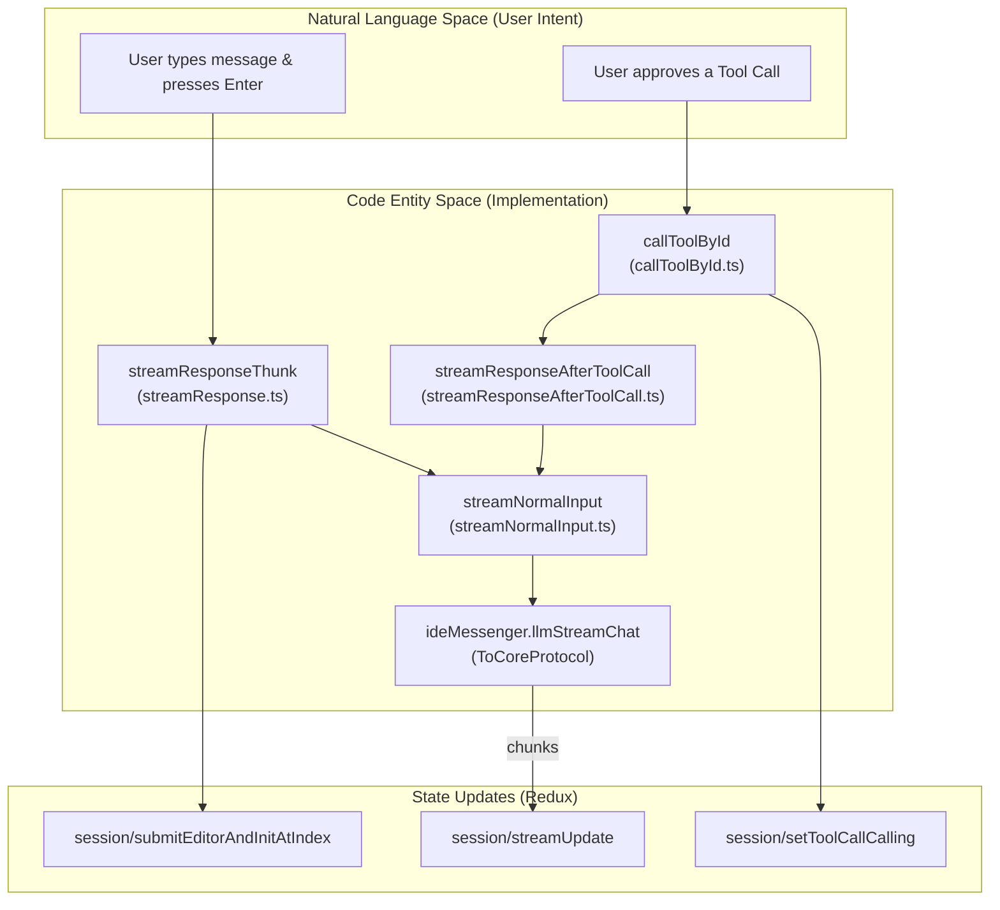
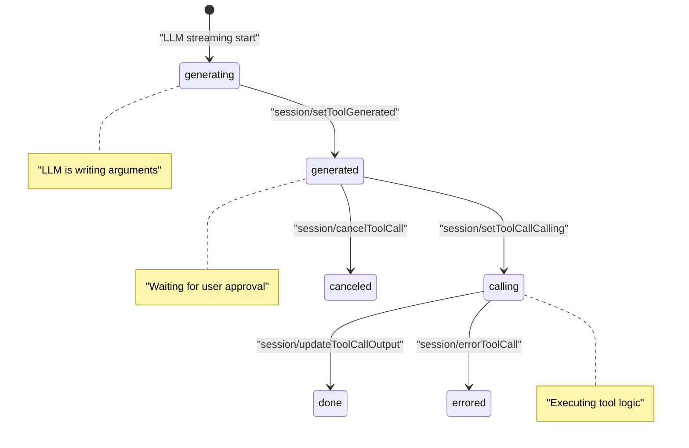

# State Management

<details>
<summary>Relevant source files</summary>

The following files were used as context for generating this wiki page:

- [core/util/messageContent.ts](core/util/messageContent.ts)
- [gui/src/redux/slices/sessionSlice.ts](gui/src/redux/slices/sessionSlice.ts)
- [gui/src/redux/store.ts](gui/src/redux/store.ts)
- [gui/src/redux/thunks/callToolById.ts](gui/src/redux/thunks/callToolById.ts)
- [gui/src/redux/thunks/cancelToolCall.ts](gui/src/redux/thunks/cancelToolCall.ts)
- [gui/src/redux/thunks/streamNormalInput.ts](gui/src/redux/thunks/streamNormalInput.ts)
- [gui/src/redux/thunks/streamResponse.test.ts](gui/src/redux/thunks/streamResponse.test.ts)
- [gui/src/redux/thunks/streamResponse.ts](gui/src/redux/thunks/streamResponse.ts)
- [gui/src/redux/thunks/streamResponseAfterToolCall.ts](gui/src/redux/thunks/streamResponseAfterToolCall.ts)
- [gui/src/redux/thunks/streamResponse_errorHandling.test.ts](gui/src/redux/thunks/streamResponse_errorHandling.test.ts)
- [gui/src/redux/thunks/streamResponse_toolCalls.test.ts](gui/src/redux/thunks/streamResponse_toolCalls.test.ts)
- [gui/src/redux/util/constructMessages.test.ts](gui/src/redux/util/constructMessages.test.ts)
- [gui/src/redux/util/constructMessages.ts](gui/src/redux/util/constructMessages.ts)
- [gui/src/util/test/mockStore.ts](gui/src/util/test/mockStore.ts)

</details>


## Purpose and Scope

This document describes the state management architecture in Continue's GUI layer. Continue uses Redux for managing UI and session state in the React-based webview that runs in both VS Code and IntelliJ extensions. The state management system handles chat history, tool call execution, streaming responses, session persistence, and apply state tracking.

For information about the broader GUI architecture and React component structure, see [8.1 GUI Architecture](). For details on how the GUI communicates with Core and IDE layers, see [2.3 Communication Protocols]().

---

## Redux Store Architecture

The Redux store is the central state container for the GUI application. It is composed of multiple slices that manage different aspects of application state. The store is configured using `@reduxjs/toolkit` and includes middleware for persistence and async operations.

### Store Configuration and Slices

The root reducer combines several specialized slices to manage the application's global state:

| Slice | Reducer | Purpose |
|-------|---------|---------|
| `session` | `sessionReducer` | Chat history, streaming status, tool call states, and session metadata. |
| `ui` | `uiReducer` | UI settings like tool permissions, reasoning settings, and rule configurations. |
| `editModeState`| `editModeStateReducer`| State specific to the inline "Edit" mode. |
| `config` | `configReducer` | Loaded Continue configuration, including models and slash commands. |
| `indexing` | `indexingReducer` | Status of codebase indexing and embedding progress. |
| `tabs` | `tabsReducer` | Management of multiple chat tabs within the GUI. |
| `profiles` | `profilesReducer` | Management of user profiles and organization-level settings. |

**Sources:** [gui/src/redux/store.ts:26-34](), [gui/src/redux/store.ts:121-137]()

### Persistence and Migration

Continue uses `redux-persist` to maintain state across webview reloads. To prevent bloating the persistent storage, `saveSubsetFilters` (using `redux-persist-transform-filter`) are applied to only save essential fields like `sessionId`, `mode`, and `ruleSettings`. The store includes a migration manifest to handle schema updates between versions.

**Sources:** [gui/src/redux/store.ts:36-69](), [gui/src/redux/store.ts:97-104]()

---

## Session State Structure

The `SessionState` type, defined in `sessionSlice.ts`, is the most critical part of the GUI state. It tracks the lifecycle of the current interaction with the LLM.

### SessionState Key Fields

| Field | Type | Description |
|-------|------|-------------|
| `history` | `ChatHistoryItemWithMessageId[]` | The array of messages and context in the current session. |
| `isStreaming` | `boolean` | Global flag indicating if an LLM response is currently being received. |
| `id` | `string` | UUID of the current active session. |
| `streamAborter` | `AbortController` | Used to cancel active LLM streams. |
| `mode` | `MessageModes` | Current interaction mode (e.g., `chat`, `edit`, or `background`). |
| `hasReasoningEnabled`| `boolean` | Whether the model should output reasoning/thought process. |
| `codeBlockApplyStates`| `ApplyState[]` | Tracks progress of "Apply" operations for code blocks. |

**Sources:** [gui/src/redux/slices/sessionSlice.ts:204-227](), [gui/src/redux/slices/sessionSlice.ts:251-255]()

### Chat History Item

Each entry in the `history` array is a `ChatHistoryItemWithMessageId`. This extends the core `ChatHistoryItem` by adding a unique `id` to the `message` object to ensure stable React rendering during history manipulations.

```typescript
// From gui/src/redux/slices/sessionSlice.ts
export type ChatHistoryItemWithMessageId = ChatHistoryItem & {
  message: ChatMessage & { id: string };
};
```

**Sources:** [gui/src/redux/slices/sessionSlice.ts:198-202]()

---

## Streaming and Async Operations

State updates during LLM streaming are orchestrated by Redux Thunks. These thunks bridge the "Natural Language Space" (user intent) to the "Code Entity Space" (API calls and state updates).

### The Streaming Thunk Pipeline

The following diagram maps high-level user actions to specific code entities and their side effects on the Redux store.



**Sources:** [gui/src/redux/thunks/streamResponse.ts:27-40](), [gui/src/redux/thunks/streamNormalInput.ts:199-207](), [gui/src/redux/thunks/callToolById.ts:19-23]()

### Key Async Thunks

1.  **`streamResponseThunk`**: The entry point for standard chat inputs. It resolves context items via `resolveEditorContent`, triggers symbol updates via `updateFileSymbolsFromFiles`, and initializes history before handing off to `streamNormalInput`.
    *   **Sources:** [gui/src/redux/thunks/streamResponse.ts:27-117](), [gui/src/redux/thunks/streamResponse.ts:70-70]()
2.  **`streamNormalInput`**: Handles LLM communication. It requests `llm/compileChat` from the Core to handle token pruning and then calls `extra.ideMessenger.llmStreamChat`. It also configures `reasoningBudgetTokens` for supported providers.
    *   **Sources:** [gui/src/redux/thunks/streamNormalInput.ts:175-207](), [gui/src/redux/thunks/streamNormalInput.ts:48-70]()
3.  **`callToolById`**: Manages the execution of tools. It updates tool state to `calling`, executes the tool via either `callClientTool` (for GUI-side tools) or `ideMessenger.request("tools/call")` (for Core-side tools), and then dispatches `streamResponseAfterToolCall`.
    *   **Sources:** [gui/src/redux/thunks/callToolById.ts:53-105](), [gui/src/redux/thunks/callToolById.ts:69-81]()
4.  **`streamResponseAfterToolCall`**: Appends the tool result to the history as a `role: "tool"` message and triggers the next LLM turn via `streamNormalInput` if all parallel tools are finished.
    *   **Sources:** [gui/src/redux/thunks/streamResponseAfterToolCall.ts:43-84]()

---

## Tool Call State Management

Tool calls follow a state machine to ensure UI consistency. The system supports OpenAI-style streaming where tool IDs and arguments may arrive in separate fragments.

### Tool Call Lifecycle

This diagram associates tool statuses with the Redux actions defined in `sessionSlice`.



**Sources:** [gui/src/redux/slices/sessionSlice.ts:835-962](), [gui/src/redux/slices/sessionSlice.ts:39-40]()

### Incremental Updates

The `handleStreamingToolCallUpdates` function processes partial tool call deltas. It uses `applyToolCallDelta` to merge fragments into the `toolCallStates` array. It specifically filters duplicate edit tool calls using `filterMultipleEditToolCalls` to prevent parallel file modifications.

**Sources:** [gui/src/redux/slices/sessionSlice.ts:117-156](), [gui/src/redux/slices/sessionSlice.ts:52-67]()

---

## Message Construction Logic

Before sending history to the LLM, `constructMessages` (in `constructMessages.ts`) transforms the Redux `history` into a flat list of `ChatMessage` objects.

| Step | Logic |
|------|-------|
| **Summarization** | Discards messages prior to the latest `conversationSummary`. [gui/src/redux/util/constructMessages.ts:48-60]() |
| **Context Flattening** | Resolves `ContextItem` objects into text blocks prepended to the user message. [gui/src/redux/util/constructMessages.ts:81-99]() |
| **System Tools** | If using `SystemMessageToolsFramework`, converts tool calls into text blocks within assistant/user messages. [gui/src/redux/util/constructMessages.ts:107-124]() |
| **Tool Integration** | Converts `toolCallStates` into `role: "assistant"` (with tool calls) and `role: "tool"` messages. [gui/src/redux/util/constructMessages.ts:131-160]() |
| **Rule Application** | Injects active rules into the system prompt via `getSystemMessageWithRules`. [gui/src/redux/util/constructMessages.ts:198-204]() |

**Sources:** [gui/src/redux/util/constructMessages.ts:37-230]()

---

## UI and Reasoning State

The `uiSlice` manages settings that persist across sessions but are not part of the chat history itself.

*   **Reasoning Settings**: Tracks whether reasoning is enabled per-model title. [gui/src/redux/slices/uiSlice.ts:145-151]()
*   **Tool Policies**: Manages per-tool permissions (`allowedWithPermission`, `allowedWithoutPermission`, `disabled`). [gui/src/redux/slices/uiSlice.ts:84-113]()
*   **Rule Settings**: Tracks which system rules are toggled on/off. [gui/src/redux/slices/uiSlice.ts:124-141]()

**Sources:** [gui/src/redux/slices/uiSlice.ts:20-32](), [gui/src/redux/slices/uiSlice.ts:46-52]()