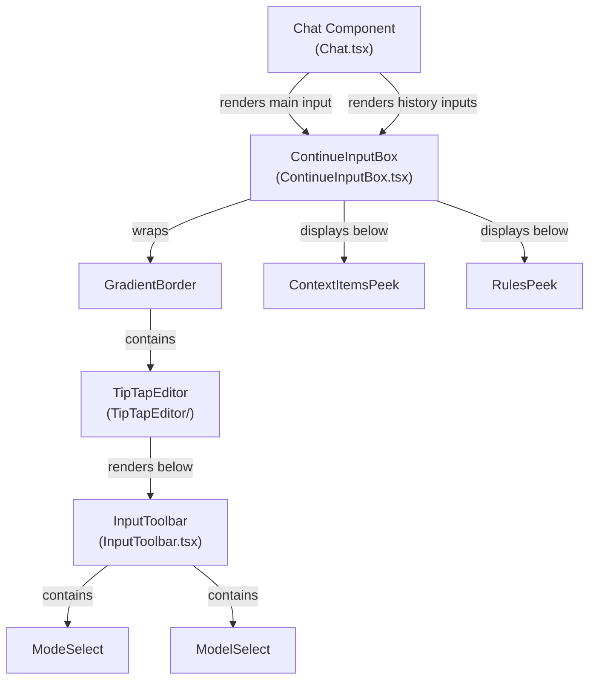
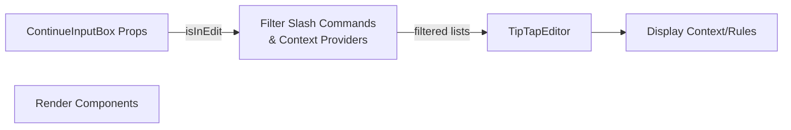
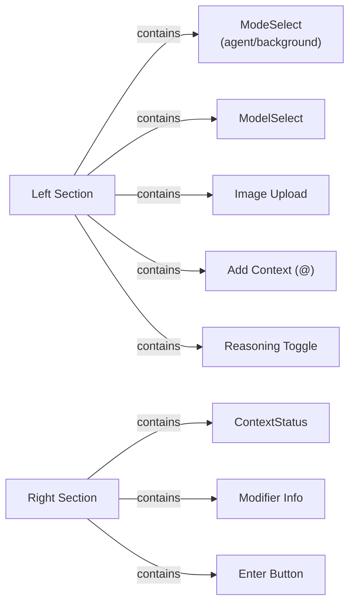
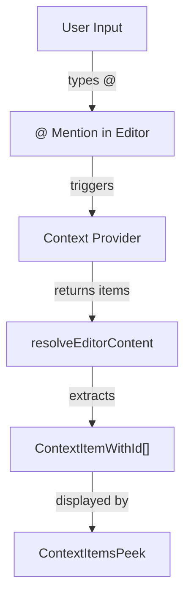
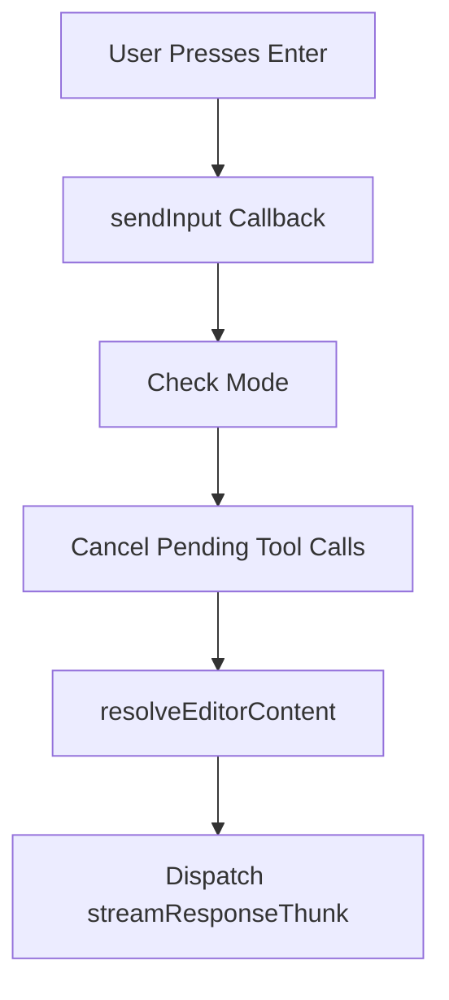
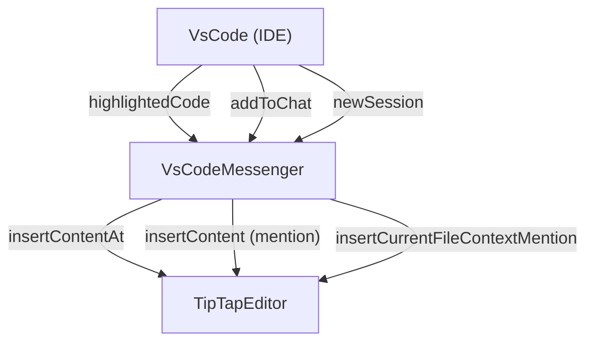
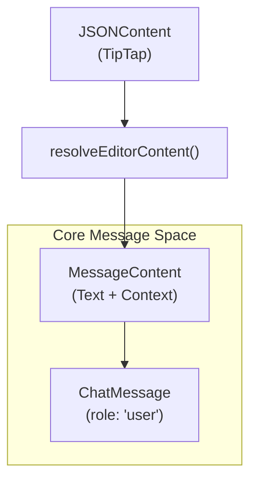

# Input System

<details>
<summary>Relevant source files</summary>

The following files were used as context for generating this wiki page:

- [.continue/rules/css-units.md](.continue/rules/css-units.md)
- [core/protocol/ideWebview.ts](core/protocol/ideWebview.ts)
- [extensions/vscode/src/commands.ts](extensions/vscode/src/commands.ts)
- [extensions/vscode/src/extension/VsCodeMessenger.ts](extensions/vscode/src/extension/VsCodeMessenger.ts)
- [gui/src/components/ConversationStarters/ConversationStarterCard.tsx](gui/src/components/ConversationStarters/ConversationStarterCard.tsx)
- [gui/src/components/ConversationStarters/ConversationStarterCards.tsx](gui/src/components/ConversationStarters/ConversationStarterCards.tsx)
- [gui/src/components/ConversationStarters/__tests__/utils.test.ts](gui/src/components/ConversationStarters/__tests__/utils.test.ts)
- [gui/src/components/ConversationStarters/utils.ts](gui/src/components/ConversationStarters/utils.ts)
- [gui/src/components/Layout.tsx](gui/src/components/Layout.tsx)
- [gui/src/components/mainInput/ContinueInputBox.tsx](gui/src/components/mainInput/ContinueInputBox.tsx)
- [gui/src/components/mainInput/InputToolbar.tsx](gui/src/components/mainInput/InputToolbar.tsx)
- [gui/src/components/mainInput/TipTapEditor/TipTapEditor.tsx](gui/src/components/mainInput/TipTapEditor/TipTapEditor.tsx)
- [gui/src/components/mainInput/TipTapEditor/components/DragOverlay.tsx](gui/src/components/mainInput/TipTapEditor/components/DragOverlay.tsx)
- [gui/src/components/mainInput/TipTapEditor/components/ExpandableToolbarPreview.tsx](gui/src/components/mainInput/TipTapEditor/components/ExpandableToolbarPreview.tsx)
- [gui/src/components/mainInput/TipTapEditor/components/NodeViewWrapper.tsx](gui/src/components/mainInput/TipTapEditor/components/NodeViewWrapper.tsx)
- [gui/src/components/mainInput/TipTapEditor/components/StyledComponents.ts](gui/src/components/mainInput/TipTapEditor/components/StyledComponents.ts)
- [gui/src/components/mainInput/TipTapEditor/extensions/CodeBlock/CodeBlock.tsx](gui/src/components/mainInput/TipTapEditor/extensions/CodeBlock/CodeBlock.tsx)
- [gui/src/components/mainInput/TipTapEditor/extensions/CodeBlock/CodeBlockPreview.test.tsx](gui/src/components/mainInput/TipTapEditor/extensions/CodeBlock/CodeBlockPreview.test.tsx)
- [gui/src/components/mainInput/TipTapEditor/extensions/CodeBlock/CodeBlockPreview.tsx](gui/src/components/mainInput/TipTapEditor/extensions/CodeBlock/CodeBlockPreview.tsx)
- [gui/src/components/mainInput/TipTapEditor/extensions/Prompt/PromptBlock.ts](gui/src/components/mainInput/TipTapEditor/extensions/Prompt/PromptBlock.ts)
- [gui/src/components/mainInput/TipTapEditor/extensions/Prompt/PromptBlockPreview.tsx](gui/src/components/mainInput/TipTapEditor/extensions/Prompt/PromptBlockPreview.tsx)
- [gui/src/components/mainInput/TipTapEditor/extensions/SlashCommand.ts](gui/src/components/mainInput/TipTapEditor/extensions/SlashCommand.ts)
- [gui/src/components/mainInput/TipTapEditor/useMainEditorWebviewListeners.ts](gui/src/components/mainInput/TipTapEditor/useMainEditorWebviewListeners.ts)
- [gui/src/components/mainInput/TipTapEditor/utils/editorConfig.ts](gui/src/components/mainInput/TipTapEditor/utils/editorConfig.ts)
- [gui/src/components/mainInput/TipTapEditor/utils/getSuggestion.ts](gui/src/components/mainInput/TipTapEditor/utils/getSuggestion.ts)
- [gui/src/components/mainInput/TipTapEditor/utils/imageUtils.ts](gui/src/components/mainInput/TipTapEditor/utils/imageUtils.ts)
- [gui/src/components/modelSelection/ModelSelect.tsx](gui/src/components/modelSelection/ModelSelect.tsx)
- [gui/src/components/ui/index.ts](gui/src/components/ui/index.ts)
- [gui/src/pages/config/sections/HelpSection.tsx](gui/src/pages/config/sections/HelpSection.tsx)
- [gui/src/pages/gui/Chat.tsx](gui/src/pages/gui/Chat.tsx)

</details>


## Purpose and Scope

The Input System manages all user input interactions in the Continue GUI, including text editing, context item attachment, slash command execution, and submission with modifiers. This system encompasses the TipTap-based editor, toolbar controls for model selection and context management, and the flow of converting user input into structured messages for LLM processing.

For information about how submitted input is processed into LLM requests, see [State Management](#8.3). For model selection specifically, see [Model Selection](#8.5). For edit mode functionality, see [Edit Mode](#8.6).

---

## System Architecture

### Component Hierarchy



**Sources:** [gui/src/pages/gui/Chat.tsx:23-26](), [gui/src/components/mainInput/ContinueInputBox.tsx:110-151]()

---

## ContinueInputBox Component

The `ContinueInputBox` is the primary wrapper component that coordinates the editor, toolbar, and associated display components.

### Component Structure



### Key Props and Behavior

| Prop | Type | Purpose |
|------|------|---------|
| `isMainInput` | `boolean` | Identifies the main chat input vs historical inputs [gui/src/components/mainInput/ContinueInputBox.tsx:21]() |
| `onEnter` | `function` | Callback when user submits input [gui/src/components/mainInput/ContinueInputBox.tsx:22]() |
| `editorState` | `JSONContent` | Initial TipTap editor state [gui/src/components/mainInput/ContinueInputBox.tsx:27]() |
| `contextItems` | `ContextItemWithId[]` | Context items attached to this input [gui/src/components/mainInput/ContinueInputBox.tsx:28]() |
| `appliedRules` | `RuleMetadata[]` | Rules that were applied [gui/src/components/mainInput/ContinueInputBox.tsx:29]() |
| `inputId` | `string` | Unique identifier for Redux state tracking [gui/src/components/mainInput/ContinueInputBox.tsx:31]() |

**Sources:** [gui/src/components/mainInput/ContinueInputBox.tsx:19-32]()

### Edit Mode Filtering

In edit mode, the input system restricts available features to maintain focus on code editing. Certain providers like `codebase` or `tree` are disabled as they are typically used for broad chat context rather than targeted inline edits.

```typescript
// Disallowed context providers in edit mode
const EDIT_DISALLOWED_CONTEXT_PROVIDERS = [
  "codebase", "tree", "open", "web", "diff", 
  "folder", "search", "debugger", "repo-map"
]

// Allowed slash command sources in edit mode
const EDIT_ALLOWED_SLASH_COMMAND_SOURCES: SlashCommandSource[] = [
  "yaml-prompt-block", "mcp-prompt", "prompt-file-v1", 
  "prompt-file-v2", "invokable-rule", "json-custom-command"
]
```

**Sources:** [gui/src/components/mainInput/ContinueInputBox.tsx:34-53](), [gui/src/components/mainInput/ContinueInputBox.tsx:66-88]()

---

## InputToolbar Component

The `InputToolbar` provides controls for configuring input behavior and model selection.

### Toolbar Layout



**Sources:** [gui/src/components/mainInput/InputToolbar.tsx:78-248]()

### Toolbar Controls

#### Model and Mode Selection
- **ModeSelect**: Switches between chat modes (not shown in edit mode) [gui/src/components/mainInput/InputToolbar.tsx:87-93]().
- **ModelSelect**: Displays and allows changing the selected chat/edit model [gui/src/components/mainInput/InputToolbar.tsx:94-98]().
- **Keyboard shortcut**: `Cmd/Ctrl + '` cycles through available models [gui/src/components/modelSelection/ModelSelect.tsx:172-204]().

**Sources:** [gui/src/components/mainInput/InputToolbar.tsx:86-98](), [gui/src/components/modelSelection/ModelSelect.tsx:172-204]()

#### Context and Reasoning Controls
- **Image Upload**: Enabled when the selected model supports images via `modelSupportsImages` [gui/src/components/mainInput/InputToolbar.tsx:63-70]().
- **Add Context (@)**: Triggers the context provider selection dropdown [gui/src/components/mainInput/InputToolbar.tsx:131-137]().
- **Reasoning Toggle**: Shows for models with reasoning capabilities (e.g., O1 models) via `modelSupportsReasoning` [gui/src/components/mainInput/InputToolbar.tsx:138-167]().

**Sources:** [gui/src/components/mainInput/InputToolbar.tsx:63-72](), [gui/src/components/mainInput/InputToolbar.tsx:100-167]()

#### Submit Button and Modifiers

The Enter button accepts input modifiers based on key combinations, such as including the codebase or ignoring context.

| Modifier | Key Combination | Effect |
|----------|----------------|--------|
| Default | `Enter` | Submit with active file (if `useActiveFile` is true) [gui/src/components/mainInput/InputToolbar.tsx:189-193]() |
| Meta/Ctrl | `Meta/Ctrl + Enter` | Toggle codebase inclusion [gui/src/components/mainInput/InputToolbar.tsx:182-187]() |

**Sources:** [gui/src/components/mainInput/InputToolbar.tsx:178-246]()

---

## Context Item Management

Context items are files, code snippets, and other data attached to user messages. The system manages their display and resolution.

### Context Item Flow



### Context Item Display

The `ContextItemsPeek` component displays attached context items below the input. Each context item shows an icon based on its type and a remove button [gui/src/components/mainInput/ContinueInputBox.tsx:143-147]().

**Sources:** [gui/src/components/mainInput/ContinueInputBox.tsx:140-149]()

---

## Slash Command Integration

Slash commands provide quick access to prompts, tools, and custom commands.

### Slash Command Filtering

Commands are filtered based on the current mode (Chat vs Edit). In Edit mode, only a subset of sources like `yaml-prompt-block` and `mcp-prompt` are allowed [gui/src/components/mainInput/ContinueInputBox.tsx:46-53]().

```typescript
const filteredSlashCommands = useMemo(() => {
  if (isInEdit) {
    return availableSlashCommands.filter((cmd) =>
      cmd.slashCommandSource
        ? EDIT_ALLOWED_SLASH_COMMAND_SOURCES.includes(cmd.slashCommandSource)
        : false,
    );
  }
  return availableSlashCommands;
}, [isInEdit, availableSlashCommands]);
```

**Sources:** [gui/src/components/mainInput/ContinueInputBox.tsx:66-75]()

---

## Input Submission Flow

### Submission Logic

The `sendInput` callback in `Chat.tsx` coordinates the transition from user input to LLM request.



1. **Mode Check**: Determines if the user is in standard `chat` or `edit` mode [gui/src/pages/gui/Chat.tsx:191]().
2. **Cancellation**: Cancels any existing streaming or tool calls [gui/src/pages/gui/Chat.tsx:176-184]().
3. **Resolution**: Resolves the TipTap editor state into structured content using `resolveEditorContent` [gui/src/pages/gui/Chat.tsx:254]().
4. **Dispatch**: Dispatches `streamResponseThunk` (Chat) or `streamEditThunk` (Edit) [gui/src/pages/gui/Chat.tsx:261-273]().

**Sources:** [gui/src/pages/gui/Chat.tsx:160-280]()

---

## Edit Mode vs Chat Mode

The input system adapts its UI and constraints when the user enters Edit mode.

### Feature Comparison

| Feature | Chat Mode | Edit Mode |
|---------|-----------|-----------|
| Context Providers | All | Filtered (no codebase/search) [gui/src/components/mainInput/ContinueInputBox.tsx:77-88]() |
| Mode Selection | Visible | Hidden [gui/src/components/mainInput/InputToolbar.tsx:87-93]() |
| Use Codebase | Visible | Hidden [gui/src/components/mainInput/InputToolbar.tsx:178]() |
| Enter Text | "Enter" | "Edit" or "Retry" [gui/src/components/mainInput/ContinueInputBox.tsx:101]() |

**Sources:** [gui/src/components/mainInput/ContinueInputBox.tsx:34-106](), [gui/src/components/mainInput/InputToolbar.tsx:55-106]()

---

## TipTap Editor Configuration

The `TipTapEditor` uses a custom configuration to handle mentions, slash commands, and special code blocks.

### Editor Setup and Extensions

The editor is initialized with a set of custom extensions to support Continue's unique input requirements:
- **`Mention`**: Handles `@` context provider triggers [gui/src/components/mainInput/TipTapEditor/utils/editorConfig.ts:24]().
- **`SlashCommand`**: Handles `/` command triggers [gui/src/components/mainInput/TipTapEditor/utils/editorConfig.ts:24]().
- **`CodeBlock` / `PromptBlock`**: Specialized nodes for rendering attached code and prompts [gui/src/components/mainInput/TipTapEditor/utils/editorConfig.ts:24]().

### Image Support
The editor supports image pasting by checking model capabilities via `modelSupportsImages` and handling the file through `handleImageFile` [gui/src/components/mainInput/TipTapEditor/utils/editorConfig.ts:162-187]().

**Sources:** [gui/src/components/mainInput/TipTapEditor/utils/editorConfig.ts:151-193]()

---

## Webview Protocol Integration

The input box communicates with the IDE extension via several webview listeners defined in `useMainEditorWebviewListeners.ts`.

### Interaction Mapping



- **`highlightedCode`**: Triggered when a user selects code in the IDE. It creates a `CodeBlock` node at the top of the editor [gui/src/components/mainInput/TipTapEditor/useMainEditorWebviewListeners.ts:112-165]().
- **`newSession`**: Automatically inserts the current file as context if `useCurrentFileAsContext` is enabled [gui/src/components/mainInput/TipTapEditor/useMainEditorWebviewListeners.ts:193-200]().
- **`addToChat`**: Iterates through data and inserts `mention` nodes into the editor [gui/src/components/mainInput/TipTapEditor/useMainEditorWebviewListeners.ts:203-225]().

**Sources:** [gui/src/components/mainInput/TipTapEditor/useMainEditorWebviewListeners.ts:40-226](), [extensions/vscode/src/extension/VsCodeMessenger.ts:194-202]()

---

## Message Construction

When input is submitted, the `resolveEditorContent` utility converts the TipTap JSON content into structured parts (text, images, and context items) for message construction.

### Data Flow to Code Entities



- **Node Resolution**: The system iterates through TipTap nodes, identifying `mention` types as `ContextItem` and `text` types as standard content [gui/src/components/mainInput/TipTapEditor/utils/resolveEditorContent.ts]().
- **Prompt Blocks**: Slash commands are resolved into `PromptBlock` nodes which can contain predefined templates [gui/src/components/ConversationStarters/ConversationStarterCards.tsx:27-32]().

**Sources:** [gui/src/pages/gui/Chat.tsx:254](), [gui/src/components/mainInput/TipTapEditor/utils/resolveEditorContent.ts](), [gui/src/components/ConversationStarters/ConversationStarterCards.tsx:27-32]()