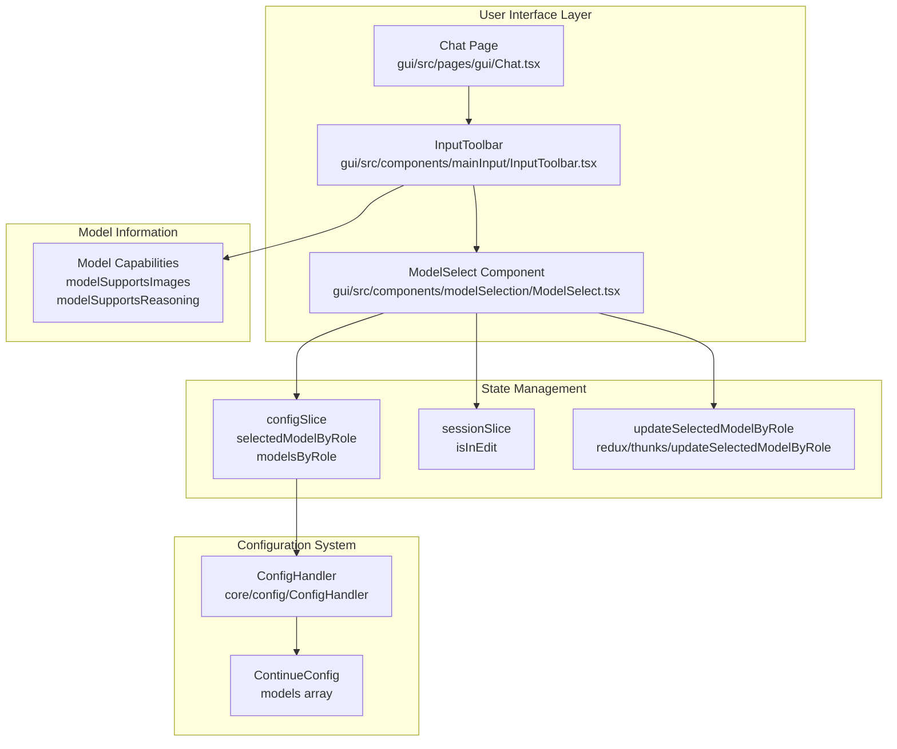
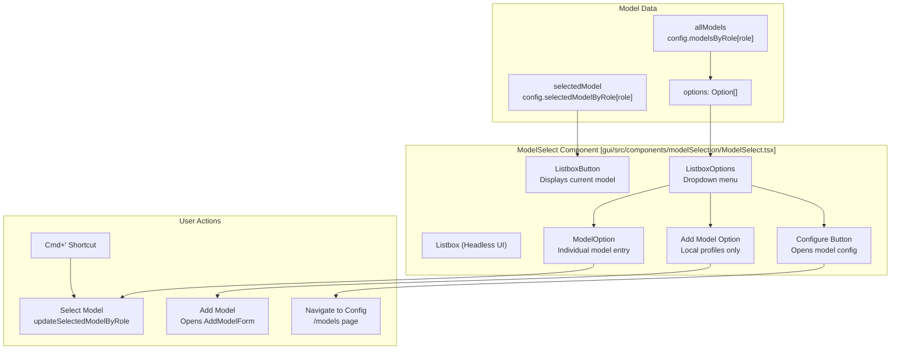

# Model Selection

Relevant source files

The following files were used as context for generating this wiki page:

- [core/config/yaml/default.ts](core/config/yaml/default.ts)
- [core/llm/utils/calculateRequestCost.ts](core/llm/utils/calculateRequestCost.ts)
- [core/protocol/ideWebview.ts](core/protocol/ideWebview.ts)
- [extensions/cli/src/e2e/basic-commands.test.ts](extensions/cli/src/e2e/basic-commands.test.ts)
- [extensions/cli/src/e2e/headless-anthropic-api-key.test.ts](extensions/cli/src/e2e/headless-anthropic-api-key.test.ts)
- [extensions/cli/src/e2e/headless-org-flag.test.ts](extensions/cli/src/e2e/headless-org-flag.test.ts)
- [extensions/cli/src/util/yamlConfigUpdater.test.ts](extensions/cli/src/util/yamlConfigUpdater.test.ts)
- [extensions/cli/src/util/yamlConfigUpdater.ts](extensions/cli/src/util/yamlConfigUpdater.ts)
- [extensions/vscode/src/commands.ts](extensions/vscode/src/commands.ts)
- [extensions/vscode/src/extension/VsCodeMessenger.ts](extensions/vscode/src/extension/VsCodeMessenger.ts)
- [gui/src/components/Layout.tsx](gui/src/components/Layout.tsx)
- [gui/src/components/ModeSelect/ModeIcon.tsx](gui/src/components/ModeSelect/ModeIcon.tsx)
- [gui/src/components/ModeSelect/ModeSelect.tsx](gui/src/components/ModeSelect/ModeSelect.tsx)
- [gui/src/components/mainInput/ContinueInputBox.tsx](gui/src/components/mainInput/ContinueInputBox.tsx)
- [gui/src/components/mainInput/InputToolbar.tsx](gui/src/components/mainInput/InputToolbar.tsx)
- [gui/src/components/modelSelection/ModelSelect.tsx](gui/src/components/modelSelection/ModelSelect.tsx)
- [gui/src/components/modelSelection/ModelSelectionListbox.tsx](gui/src/components/modelSelection/ModelSelectionListbox.tsx)
- [gui/src/components/ui/Listbox.tsx](gui/src/components/ui/Listbox.tsx)
- [gui/src/forms/AddModelForm.tsx](gui/src/forms/AddModelForm.tsx)
- [gui/src/pages/gui/Chat.tsx](gui/src/pages/gui/Chat.tsx)

This page documents the model selection system in the Continue GUI, which allows users to choose and configure Large Language Models (LLMs) for different interaction roles (chat, edit, autocomplete). The system provides a dropdown interface for selecting models, manages role-based model assignments, validates API keys, and detects model capabilities.

For information about LLM provider implementations and abstraction, see **4.1 LLM Abstraction Layer**. For configuration loading and management, see **5. Configuration System**.

## Purpose and Scope

The Model Selection system provides:
- A dropdown UI component (`ModelSelect`) for choosing models.
- Role-based model selection (chat, edit, autocomplete).
- Model configuration management and validation.
- Keyboard shortcuts for quick model switching.
- API key validation and missing key warnings.
- Detection of model capabilities (image support, reasoning).
- Integration with the configuration system and profile management.

## Architecture Overview

The model selection system is implemented primarily in the GUI layer and integrates with the Redux state management system and configuration infrastructure.

**Model Selection Data Flow**

Sources: [gui/src/components/modelSelection/ModelSelect.tsx:120-131](), [gui/src/components/mainInput/InputToolbar.tsx:49-72](), [gui/src/pages/gui/Chat.tsx:106-124]()

## ModelSelect Component

The `ModelSelect` component is a dropdown UI element that displays the currently selected model and allows users to choose from available models. It is implemented using Headless UI's `Listbox` component [gui/src/components/modelSelection/ModelSelect.tsx:236-338]().

### Component Structure

Sources: [gui/src/components/modelSelection/ModelSelect.tsx:120-231]()

### Model Option Data Structure

Each model option is mapped to an `Option` interface before rendering [gui/src/components/modelSelection/ModelSelect.tsx:34-40]():

| Field | Type | Description |
|-------|------|-------------|
| `value` | `string` | Model title used as identifier |
| `title` | `string` | Display name for the model |
| `apiKey` | `string` | API key for the provider (empty if missing) |
| `sourceFile` | `string` | Configuration file source |
| `isAutoDetected` | `boolean` | Whether model was auto-detected |

### Model Title Generation

The `modelSelectTitle` function generates display titles for models based on available metadata [gui/src/components/modelSelection/ModelSelect.tsx:42-51]():

1. `model.title` (if provided) [gui/src/components/modelSelection/ModelSelect.tsx:43-43]()
2. `model.class_name` + " - " + `model.model` (if model name exists) [gui/src/components/modelSelection/ModelSelect.tsx:45-47]()
3. `model.model` only [gui/src/components/modelSelection/ModelSelect.tsx:48-48]()
4. `model.class_name` only [gui/src/components/modelSelection/ModelSelect.tsx:50-50]()

## Role-Based Model Selection

Models are assigned to specific roles such as `chat` and `edit`. The system selects the appropriate model list and selected model based on whether the user is in "Edit Mode" [gui/src/components/modelSelection/ModelSelect.tsx:124-144]().

- **Edit mode**: Attempts to use `config.selectedModelByRole.edit`. If not found, it falls back to the chat model [gui/src/components/modelSelection/ModelSelect.tsx:135-141]().
- **Chat mode**: Uses `config.selectedModelByRole.chat` [gui/src/components/modelSelection/ModelSelect.tsx:140-141]().

When input is sent, the system retrieves the selected model for the active role. For example, in VS Code commands, the `streamInlineEdit` function selects the `edit` model role, falling back to `chat` [extensions/vscode/src/commands.ts:153-154]().

## Model Configuration Management

### Adding and Configuring Models

- **Adding Models**: For local profiles, users can add new models through the "Add Chat model" option, which dispatches `setShowDialog(true)` and renders `AddModelForm` [gui/src/components/modelSelection/ModelSelect.tsx:212-221](). The `AddModelForm` handles provider-specific inputs like API keys and base URLs [gui/src/forms/AddModelForm.tsx:149-161]().
- **Configuring Models**: Users can navigate to the models configuration page (`/models`) by clicking the gear icon on individual model options or the main configuration button [gui/src/components/modelSelection/ModelSelect.tsx:77-80](), [gui/src/components/modelSelection/ModelSelect.tsx:224-231]().

### API Key Validation

Models without API keys are visually distinguished with a "(Missing API key)" message and are disabled in the selection list [gui/src/components/modelSelection/ModelSelect.tsx:85-104](). The options are sorted so that those with an API key appear first [gui/src/components/modelSelection/ModelSelect.tsx:147-155]().

## User Interactions

### Keyboard Shortcuts

The GUI listens for a specific keyboard shortcut to cycle through available models [gui/src/components/modelSelection/ModelSelect.tsx:172-198]():

| Shortcut | Action |
|----------|--------|
| `Cmd + '` (or Meta equivalent) | Cycle to the next available model |
| `Cmd + Shift + '` | Cycle to the previous available model |

### Integration with Input System

The `ModelSelect` component is embedded in the `InputToolbar` [gui/src/components/mainInput/InputToolbar.tsx:96-98](). The toolbar also handles capability detection for the selected model:

- **Image Support**: Uses `modelSupportsImages` to determine if the photo upload icon should be shown [gui/src/components/mainInput/InputToolbar.tsx:63-70]().
- **Reasoning Support**: Uses `modelSupportsReasoning` to determine if the model supports a reasoning mode, represented by a lightbulb icon [gui/src/components/mainInput/InputToolbar.tsx:72](). Users can toggle this mode, which updates the `hasReasoningEnabled` state in the session slice [gui/src/components/mainInput/InputToolbar.tsx:138-167]().

Sources: [gui/src/components/modelSelection/ModelSelect.tsx:1-338](), [gui/src/components/mainInput/InputToolbar.tsx:1-169](), [gui/src/forms/AddModelForm.tsx:149-179](), [extensions/vscode/src/commands.ts:153-154]()