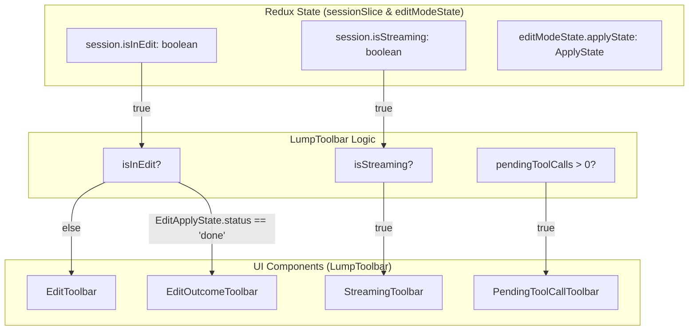
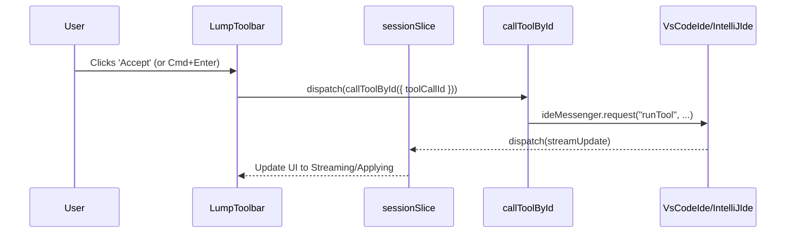

# Edit Mode

Relevant source files

The following files were used as context for generating this wiki page:

- [core/edit/recursiveStream.ts](core/edit/recursiveStream.ts)
- [core/util/messageContent.ts](core/util/messageContent.ts)
- [gui/src/components/AcceptRejectDiffButtons.tsx](gui/src/components/AcceptRejectDiffButtons.tsx)
- [gui/src/components/StepContainer/ResponseActions.tsx](gui/src/components/StepContainer/ResponseActions.tsx)
- [gui/src/components/StepContainer/StepContainer.tsx](gui/src/components/StepContainer/StepContainer.tsx)
- [gui/src/components/mainInput/Lump/LumpToolbar/EditOutcomeToolbar.tsx](gui/src/components/mainInput/Lump/LumpToolbar/EditOutcomeToolbar.tsx)
- [gui/src/components/mainInput/Lump/LumpToolbar/EditToolbar.tsx](gui/src/components/mainInput/Lump/LumpToolbar/EditToolbar.tsx)
- [gui/src/components/mainInput/Lump/LumpToolbar/GeneratingIndicator.tsx](gui/src/components/mainInput/Lump/LumpToolbar/GeneratingIndicator.tsx)
- [gui/src/components/mainInput/Lump/LumpToolbar/IsApplyingToolbar.tsx](gui/src/components/mainInput/Lump/LumpToolbar/IsApplyingToolbar.tsx)
- [gui/src/components/mainInput/Lump/LumpToolbar/LumpToolbar.tsx](gui/src/components/mainInput/Lump/LumpToolbar/LumpToolbar.tsx)
- [gui/src/components/mainInput/Lump/LumpToolbar/PendingApplyStatesToolbar.tsx](gui/src/components/mainInput/Lump/LumpToolbar/PendingApplyStatesToolbar.tsx)
- [gui/src/components/mainInput/Lump/LumpToolbar/PendingToolCallToolbar.tsx](gui/src/components/mainInput/Lump/LumpToolbar/PendingToolCallToolbar.tsx)
- [gui/src/components/mainInput/Lump/LumpToolbar/StreamingToolbar.tsx](gui/src/components/mainInput/Lump/LumpToolbar/StreamingToolbar.tsx)
- [gui/src/redux/selectors/selectToolCalls.ts](gui/src/redux/selectors/selectToolCalls.ts)
- [gui/src/redux/slices/sessionSlice.ts](gui/src/redux/slices/sessionSlice.ts)
- [gui/src/redux/store.ts](gui/src/redux/store.ts)
- [gui/src/redux/thunks/edit.ts](gui/src/redux/thunks/edit.ts)
- [gui/src/redux/thunks/streamNormalInput.ts](gui/src/redux/thunks/streamNormalInput.ts)
- [gui/src/redux/thunks/streamResponse.ts](gui/src/redux/thunks/streamResponse.ts)
- [gui/src/redux/thunks/streamResponseAfterToolCall.ts](gui/src/redux/thunks/streamResponseAfterToolCall.ts)
- [gui/src/redux/util/constructMessages.test.ts](gui/src/redux/util/constructMessages.test.ts)
- [gui/src/redux/util/constructMessages.ts](gui/src/redux/util/constructMessages.ts)

Edit Mode is a specialized interaction mode in Continue where users can select code in their editor and send prompts to modify that specific code selection. Unlike the standard chat mode which focuses on conversation and code generation, Edit Mode provides a focused interface for iterative code refinement with inline diff visualization and surgical file modifications.

## Purpose and Scope

Edit Mode enables:
- **Selection-based editing**: Users select code in their IDE, which becomes the primary context for the AI.
- **Focused prompts**: The input interface is tailored for edit-specific instructions, often triggered by shortcuts like `Cmd+I`.
- **Inline diffs**: Edits are displayed as visual diffs directly in the editor using the `VerticalDiffManager` [gui/src/redux/store.ts:29]().
- **Iterative refinement**: Users can retry or refine edits without losing the selection context.
- **Tool-based editing**: Integration with built-in tools like `edit_existing_file` for structured modifications.

## Edit Mode State Architecture

The system maintains Edit Mode state across Redux slices and the IDE extension. A key component is the `LumpToolbar`, which dynamically switches its UI based on whether the session is in Edit Mode, streaming, or has pending tool calls [gui/src/components/mainInput/Lump/LumpToolbar/LumpToolbar.tsx:171-212]().

| State Slice | Field | Type | Purpose |
|-------------|-------|------|---------|
| `sessionSlice` | `isInEdit` | `boolean` | Controls whether Edit Mode UI is active [gui/src/redux/slices/sessionSlice.ts:311]() |
| `editModeState` | `applyState` | `ApplyState` | Tracks the status of the current edit application [gui/src/redux/store.ts:29]() |
| `sessionSlice` | `codeBlockApplyStates` | `ApplyState[]` | Tracks the status of individual code block applications [gui/src/components/mainInput/Lump/LumpToolbar/LumpToolbar.tsx:61-63]() |

### State and UI Transition Diagram

Sources: [gui/src/components/mainInput/Lump/LumpToolbar/LumpToolbar.tsx:171-204](), [gui/src/redux/slices/sessionSlice.ts:24](), [gui/src/redux/store.ts:29]()

## Entry and Exit Flow

### Entering Edit Mode
1. User invokes the edit command (e.g., `Cmd+I` in VS Code), which triggers `enterEdit` [gui/src/redux/thunks/edit.ts:118-124]().
2. The system checks if a file is open [gui/src/redux/thunks/edit.ts:132-138]().
3. `enterEdit` saves the current session and sets `isInEdit` to `true` [gui/src/redux/thunks/edit.ts:146-154]().
4. The `LumpToolbar` switches to display the `EditToolbar` [gui/src/components/mainInput/Lump/LumpToolbar/LumpToolbar.tsx:180]().

### Exiting Edit Mode
1. User finishes the edit or cancels via `exitEdit` [gui/src/redux/thunks/edit.ts:76-80]().
2. If there are pending diffs, the system sends a `rejectDiff` request to the IDE [gui/src/redux/thunks/edit.ts:91-95]().
3. The `isInEdit` state is set to `false` and previous editor content is restored [gui/src/redux/thunks/edit.ts:101-107]().
4. The system loads the last session or starts a new one [gui/src/redux/thunks/edit.ts:109-113]().

## Tool-Based Editing and Input Filtering

Edit Mode relies on tool calls to apply changes. To prevent conflicts, the system filters duplicate edit tool calls during streaming.

### Edit Tool Filtering
The `filterMultipleEditToolCalls` function ensures that only the first occurrence of an edit tool (like `edit_existing_file`) is processed, as parallel apply calls are not supported [gui/src/redux/slices/sessionSlice.ts:51-66]().

### Message Construction
When streaming in Edit Mode, `constructMessages` handles the conversion of tool call states into the appropriate message format for the LLM [gui/src/redux/util/constructMessages.ts:37-47](). It gathers context items and normalizes message parts to ensure the LLM has the necessary code context [gui/src/redux/util/constructMessages.ts:81-99]().

## User Interface Components

### Response Actions
The `ResponseActions` component provides controls for the output of an edit or chat, including the ability to delete messages or continue generation if the response was truncated [gui/src/components/StepContainer/ResponseActions.tsx:23-30](). It also includes a "Compact conversation" button to summarize history and reduce context length [gui/src/components/StepContainer/ResponseActions.tsx:48-70]().

### Pending Tool Call Toolbar
When a tool requires user permission, the `PendingToolCallToolbar` provides "Accept" and "Reject" buttons with keyboard shortcuts (`Cmd+Enter` to accept, `Cmd+Backspace` to reject) [gui/src/components/mainInput/Lump/LumpToolbar/PendingToolCallToolbar.tsx:16-89]().

### Data Flow for Tool Execution

Sources: [gui/src/components/mainInput/Lump/LumpToolbar/LumpToolbar.tsx:129-136](), [gui/src/redux/thunks/callToolById.ts](), [gui/src/components/mainInput/Lump/LumpToolbar/PendingToolCallToolbar.tsx:26-36](), [gui/src/redux/slices/sessionSlice.ts:166-193]()

## Apply State Tracking

The system tracks the progress of applying code blocks via `ApplyState`. This is critical for Edit Mode to provide feedback to the user while the IDE is performing file modifications.

| Status | Meaning |
|--------|---------|
| `streaming` | The code block is currently being written to the file [gui/src/components/mainInput/Lump/LumpToolbar/LumpToolbar.tsx:67]() |
| `done` | The modification is complete and awaiting user review [gui/src/components/mainInput/Lump/LumpToolbar/LumpToolbar.tsx:64-66]() |

Sources: [gui/src/redux/slices/sessionSlice.ts:10-27](), [gui/src/components/mainInput/Lump/LumpToolbar/LumpToolbar.tsx:58-68]()