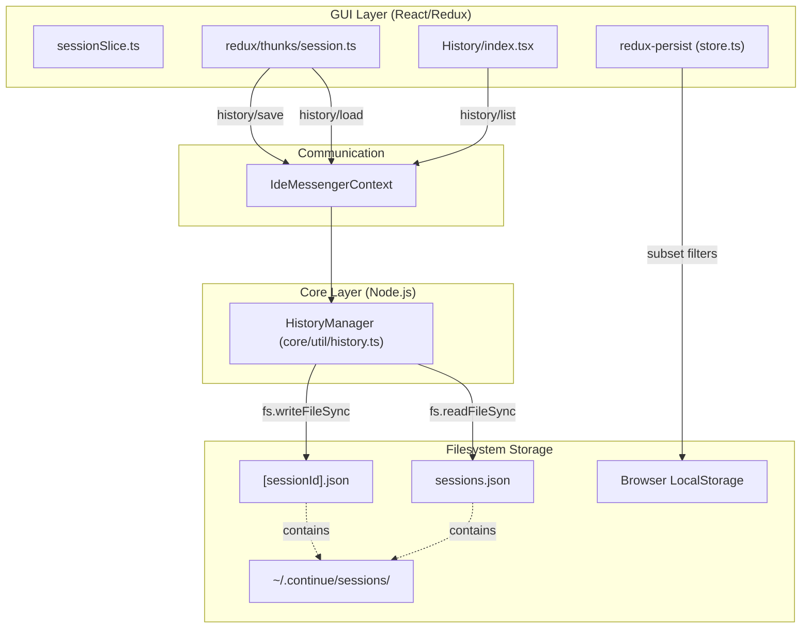
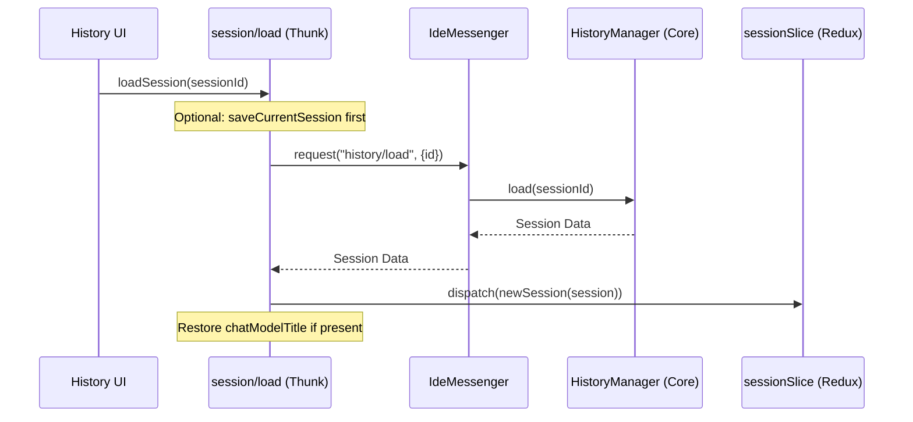

# History and Session Persistence

<details>
<summary>Relevant source files</summary>

The following files were used as context for generating this wiki page:

- [BUILD_DEPENDENCIES.md](BUILD_DEPENDENCIES.md)
- [core/autocomplete/templating/filtering.ts](core/autocomplete/templating/filtering.ts)
- [core/autocomplete/templating/formatOpenedFilesContext.ts](core/autocomplete/templating/formatOpenedFilesContext.ts)
- [core/autocomplete/templating/formatting.ts](core/autocomplete/templating/formatting.ts)
- [core/autocomplete/templating/validation.ts](core/autocomplete/templating/validation.ts)
- [core/autocomplete/util/AutocompleteLoggingService.ts](core/autocomplete/util/AutocompleteLoggingService.ts)
- [core/util/IdeInfoService.ts](core/util/IdeInfoService.ts)
- [core/util/history.test.ts](core/util/history.test.ts)
- [core/util/history.ts](core/util/history.ts)
- [core/util/messageContent.ts](core/util/messageContent.ts)
- [extensions/vscode/src/autocomplete/RecentlyVisitedRangesService.ts](extensions/vscode/src/autocomplete/RecentlyVisitedRangesService.ts)
- [extensions/vscode/src/autocomplete/recentlyEdited.ts](extensions/vscode/src/autocomplete/recentlyEdited.ts)
- [gui/src/components/History/HistoryTableRow.tsx](gui/src/components/History/HistoryTableRow.tsx)
- [gui/src/components/History/index.tsx](gui/src/components/History/index.tsx)
- [gui/src/components/History/util.ts](gui/src/components/History/util.ts)
- [gui/src/redux/slices/sessionSlice.test.ts](gui/src/redux/slices/sessionSlice.test.ts)
- [gui/src/redux/slices/sessionSlice.ts](gui/src/redux/slices/sessionSlice.ts)
- [gui/src/redux/store.ts](gui/src/redux/store.ts)
- [gui/src/redux/thunks/session.ts](gui/src/redux/thunks/session.ts)
- [gui/src/redux/thunks/streamNormalInput.ts](gui/src/redux/thunks/streamNormalInput.ts)
- [gui/src/redux/thunks/streamResponse.ts](gui/src/redux/thunks/streamResponse.ts)
- [gui/src/redux/thunks/streamResponseAfterToolCall.ts](gui/src/redux/thunks/streamResponseAfterToolCall.ts)
- [gui/src/redux/util/constructMessages.test.ts](gui/src/redux/util/constructMessages.test.ts)
- [gui/src/redux/util/constructMessages.ts](gui/src/redux/util/constructMessages.ts)
- [gui/src/util/test/setupTests.ts](gui/src/util/test/setupTests.ts)
- [gui/tsconfig.json](gui/tsconfig.json)
- [gui/vite.config.ts](gui/vite.config.ts)

</details>


## Purpose and Scope

This document covers the session persistence system that manages chat history storage, retrieval, and indexing in Continue. It describes how chat sessions are stored on the filesystem, how they are loaded into Redux state, and how they are made searchable through MiniSearch indexing. For information about the Redux state management of active sessions, see [State Management](8.3). This page focuses on the `HistoryManager` implementation, data flow between the GUI and Core, and the session file format.

## Session State Structure

A session in Continue represents a complete chat conversation, including all messages, context items, tool calls, and metadata. The in-memory representation is managed by Redux, while the filesystem representation is managed by `HistoryManager`.

### Core Session Type

The `Session` type defines the persisted structure:

| Field | Type | Description |
|-------|------|-------------|
| `sessionId` | `string` | Unique identifier (UUID) |
| `title` | `string` | Human-readable title |
| `workspaceDirectory` | `string` | Associated workspace path |
| `history` | `ChatHistoryItem[]` | Array of chat exchanges |
| `mode` | `MessageModes?` | Chat mode (chat/edit/etc) |
| `chatModelTitle` | `string?` | Selected model title for this session |
| `usage` | `LLMUsage?` | Token usage statistics |

Sources: [core/util/history.ts:115-130](), [gui/src/redux/thunks/session.ts:2-5](), [gui/src/redux/slices/sessionSlice.ts:22-27]()

### Session Metadata Type

Session metadata provides a lightweight summary for listing sessions without loading full history:

| Field | Type | Description |
|-------|------|-------------|
| `sessionId` | `string` | Session identifier |
| `title` | `string` | Display title |
| `dateCreated` | `string` | Creation timestamp |
| `workspaceDirectory` | `string` | Workspace path |
| `messageCount` | `number` | Number of assistant messages |

Sources: [core/util/history.ts:168-175](), [gui/src/components/History/HistoryTableRow.tsx:26-32]()

## Persistence Architecture

Sessions are persisted to the filesystem in a structured directory under `~/.continue/sessions/`. The architecture separates session data (individual files) from session metadata (index file).



**Diagram: Session Persistence Architecture**

Sources: [gui/src/redux/thunks/session.ts:23-82](), [core/util/history.ts:24-183](), [gui/src/components/History/index.tsx:30-43](), [gui/src/redux/store.ts:36-64]()

### Directory Structure

The filesystem layout follows this pattern:

```
~/.continue/
└── sessions/
    ├── sessions.json                    # Metadata index for fast listing
    ├── <uuid-1>.json                    # Full history for session 1
    ├── <uuid-2>.json                    # Full history for session 2
    └── ...
```

Sources: [core/util/history.ts:8-11]()

## HistoryManager Class

The `HistoryManager` class in `core/util/history.ts` provides the core persistence operations. It is instantiated as a singleton and handles all filesystem I/O for sessions.

### Key Methods

| Method | Role | File Reference |
|--------|------|----------------|
| `list(options)` | Reads `sessions.json` and returns paginated metadata. | [core/util/history.ts:25-58]() |
| `load(sessionId)` | Reads `[sessionId].json` and returns a full `Session`. | [core/util/history.ts:91-109]() |
| `save(session)` | Writes the session JSON and updates the metadata index. | [core/util/history.ts:111-192]() |
| `delete(sessionId)` | Removes the session file and metadata entry. | [core/util/history.ts:60-85]() |
| `clearAll()` | Deletes the entire sessions folder. | [core/util/history.ts:87-89]() |

#### save(session: Session) Implementation

When saving, `HistoryManager` explicitly orders keys to ensure the resulting JSON is human-readable (e.g., `sessionId` at the top). It also calculates the `messageCount` by filtering the history for assistant roles.

Sources: [core/util/history.ts:115-134](), [core/util/history.ts:154-166]()

## GUI Integration and Thunks

The GUI interacts with persistence via Redux Thunks, which wrap `IdeMessenger` requests to the Core.

### Loading and Saving Workflows



**Diagram: Load Session Sequence**

Sources: [gui/src/redux/thunks/session.ts:87-114](), [gui/src/redux/thunks/session.ts:23-32]()

### Save Current Session

The `saveCurrentSession` thunk is responsible for persisting the active state. If the session title is still the default "New Session", it attempts to generate a descriptive title using the `chatDescriber/describe` request before saving.

Sources: [gui/src/redux/thunks/session.ts:186-230](), [gui/src/redux/thunks/session.ts:218-225]()

## MiniSearch Indexing

The History UI uses `MiniSearch` to provide fast, fuzzy client-side search over session titles.

### Indexing Logic
In `gui/src/components/History/index.tsx`, a `useEffect` hook monitors changes to `allSessionMetadata`. When metadata is updated (e.g., after a refresh), the index is cleared and rebuilt.

```typescript
useEffect(() => {
  try {
    minisearch.removeAll();
    minisearch.addAll(
      allSessionMetadata.map((session) => ({
        title: session.title,
        sessionId: session.sessionId,
        id: session.sessionId,
      })),
    );
  } catch (e) {
    console.log("error adding sessions to minisearch", e);
  }
}, [allSessionMetadata]);
```

Sources: [gui/src/components/History/index.tsx:52-65]()

### Search Strategy
The search implementation combines three tiers of matching:
1. **Exact phrase matching** (`fuzzy: false`)
2. **Fuzzy matching** with high tolerance (`fuzzy: 0.3`)
3. **Prefix matching** for partial words (`prefix: true`)

Results are deduplicated based on `sessionId`, with exact matches receiving higher priority (`priority: 3`) in the final sorted list.

Sources: [gui/src/components/History/index.tsx:69-116]()

## Local Persistence (Redux Persist)

While `HistoryManager` handles long-term chat storage, `redux-persist` is used to maintain immediate UI state across reloads (e.g., if the IDE window is closed mid-session).

### Persisted Subsets
Only specific fields are synchronized to browser storage to minimize performance overhead:
- **Session Slice**: `id`, `lastSessionId`, `title`, and `mode`.
- **Edit Mode**: `returnToMode`, `codeToEdit`.
- **UI Settings**: `toolSettings`, `ruleSettings`, `reasoningSettings`.

Sources: [gui/src/redux/store.ts:36-64](), [gui/src/redux/store.ts:92-99]()

## Initial Load and Sync

When the GUI initializes, it performs an initial sync to load the last used session and refresh history metadata.

1. **Session Restore**: If a `lastSessionId` exists in state, `loadLastSession` is dispatched.
2. **Retry Logic**: `loadLastSession` includes a 1-second retry mechanism if the initial session load fails.
3. **Metadata Refresh**: `refreshSessionMetadata` is called to populate the history sidebar/page by requesting `history/list` from the core.

Sources: [gui/src/redux/thunks/session.ts:140-170](), [gui/src/redux/thunks/session.ts:34-52]()