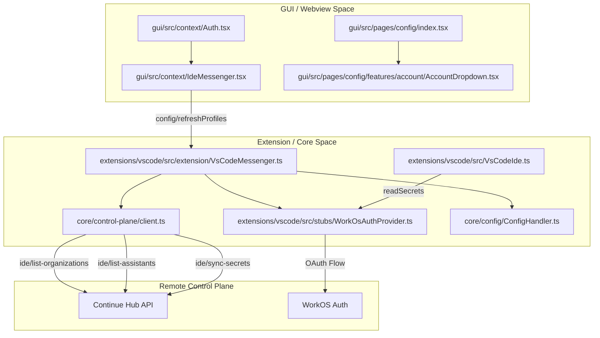
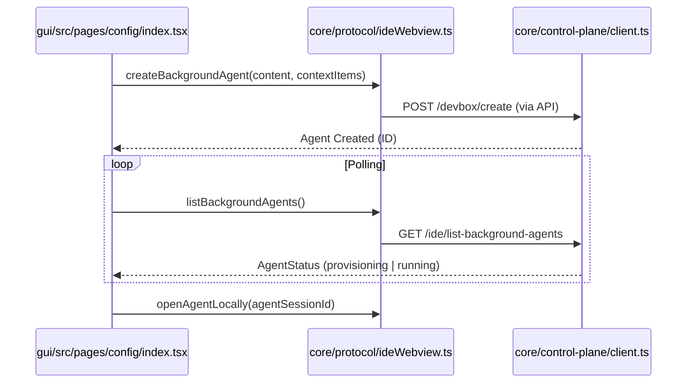

# Control Plane Integration

Relevant source files

The following files were used as context for generating this wiki page:

- [gui/src/components/PageHeader.tsx](gui/src/components/PageHeader.tsx)
- [gui/src/context/Auth.tsx](gui/src/context/Auth.tsx)
- [gui/src/pages/config/configTabs.tsx](gui/src/pages/config/configTabs.tsx)
- [gui/src/pages/config/index.tsx](gui/src/pages/config/index.tsx)
- [gui/src/pages/history/index.tsx](gui/src/pages/history/index.tsx)

The Continue Control Plane is a cloud service that provides enterprise features including authentication, remote configuration management, organization/team coordination, secret resolution, and background agent provisioning. This page documents how the IDE extensions and core backend integrate with the Control Plane to enable these capabilities.

For details on the authentication mechanisms (WorkOS), see [Authentication System](#9.1). For background agents, see [Background Agents](#9.2). For remote configuration synchronization, see [Remote Configuration](#9.3). For the client API used to communicate with the Control Plane, see [Control Plane Client](#9.4).

## Overview

The Control Plane integration enables:
- **Authentication**: WorkOS-based single sign-on with automatic token refresh managed by `WorkOsAuthProvider` [extensions/vscode/src/stubs/WorkOsAuthProvider.ts:72-116]().
- **Remote Configurations**: Centrally-hosted assistant definitions and profiles shared across teams, managed via the `AuthProvider` [gui/src/context/Auth.tsx:19-58]() and `refreshProfiles` [gui/src/context/Auth.tsx:29-45]().
- **Organization Management**: Multi-tenant support with per-organization profiles and policies [core/control-plane/client.ts:204-208]().
- **Background Agents**: Cloud-hosted development environments that run Continue agents autonomously, integrated via the IDE protocol [core/protocol/ideWebview.ts:55-64]().
- **Secret Resolution**: Hierarchical secret management via Fully Qualified Secret Names (FQSN) [core/control-plane/client.ts:96-99]().

Sources: [core/control-plane/client.ts:90-116](), [core/protocol/ideWebview.ts:55-87](), [gui/src/context/Auth.tsx:19-58](), [extensions/vscode/src/extension/VsCodeMessenger.ts:29-32]()

## System Architecture

The following diagram illustrates how the Control Plane components bridge the gap between the IDE user interface and the remote services.

### Control Plane Component Map

**Key Components**

| Component | Code Entity | Purpose |
|-----------|----------|---------|
| **Auth Provider** | `AuthProvider` | React context providing `selectedProfile` and `refreshProfiles` to the GUI [gui/src/context/Auth.tsx:19](). |
| **Account Dropdown** | `AccountDropdown` | UI component in the `ConfigPage` sidebar for managing user sessions [gui/src/pages/config/index.tsx:61](). |
| **Control Plane Client** | `ControlPlaneClient` | Primary API client for Hub communication (secrets, assistants, orgs) [core/control-plane/client.ts:90](). |
| **Messenger** | `VsCodeMessenger` | Routes Control Plane requests from the Webview to the Core/Extension [extensions/vscode/src/extension/VsCodeMessenger.ts:49](). |
| **IDE Implementation** | `VsCodeIde` | Implements secret storage and IDE info retrieval for the core [extensions/vscode/src/VsCodeIde.ts:38](). |

Sources: [core/control-plane/client.ts:90-95](), [gui/src/context/Auth.tsx:11-58](), [gui/src/pages/config/index.tsx:28-63](), [extensions/vscode/src/extension/VsCodeMessenger.ts:49-95]()

## Authentication Flow

The authentication system utilizes WorkOS to provide a secure OAuth flow. The `WorkOsAuthProvider` handles the lifecycle of these sessions within the VS Code environment, while the GUI consumes this state via `AuthContext`.

- **Profile Management**: The GUI uses `useAuth` to access available `profiles` and the currently `selectedProfile` [gui/src/context/Auth.tsx:60-66]().
- **Token Management**: Access tokens are retrieved via `getAccessToken()` and used in the `Authorization` header for all Control Plane requests [core/control-plane/client.ts:123-155]().
- **Refreshing State**: The `refreshProfiles` function triggers a `config/refreshProfiles` request through the `ideMessenger`, updating the global configuration state [gui/src/context/Auth.tsx:29-45]().
- **Token Refresh**: The provider sets up a `REFRESH_INTERVAL_MS` (10 minutes) to proactively refresh tokens before expiration [extensions/vscode/src/stubs/WorkOsAuthProvider.ts:84-116]().

For details, see [Authentication System](#9.1).

Sources: [core/control-plane/client.ts:123-155](), [extensions/vscode/src/stubs/WorkOsAuthProvider.ts:72-116](), [gui/src/context/Auth.tsx:29-45]()

## Background Agents

Continue supports "Background Agents"—autonomous agents that run in remote containers. This allows long-running tasks to proceed without blocking the local IDE.

### Background Agent Lifecycle

- **Creation**: Triggered via the protocol method `createBackgroundAgent` which accepts content, context items, and optional organization scoping [core/protocol/ideWebview.ts:55-64]().
- **Monitoring**: The `listBackgroundAgents` protocol method returns status, repository URLs, and metadata for active agents [core/protocol/ideWebview.ts:65-80]().
- **Takeover**: Users can transition from remote to local execution via `openAgentLocally` [core/protocol/ideWebview.ts:81-86]().

For details, see [Background Agents](#9.2).

Sources: [core/protocol/ideWebview.ts:55-87](), [core/control-plane/client.ts:69-88]()

## Remote Configuration

The Control Plane acts as a central repository for team configurations and assistants.

- **Assistant Listing**: `ControlPlaneClient.listAssistants()` fetches unrolled assistant definitions for a specific organization [core/control-plane/client.ts:172-180]().
- **Organization Sync**: The client can list all organizations the user belongs to via `listOrganizations()`, facilitating team-based configuration loading [core/control-plane/client.ts:204-208]().
- **Secret Resolution**: Configuration files can reference secrets (e.g., API keys) that are resolved server-side via `resolveFQSNs()` to keep sensitive data out of local config files [core/control-plane/client.ts:96-116]().
- **GUI Integration**: The `ConfigsSection` in the configuration page allows users to view and select these remote profiles [gui/src/pages/config/configTabs.tsx:90-99]().

For details, see [Remote Configuration](#9.3).

Sources: [core/control-plane/client.ts:96-116](), [core/control-plane/client.ts:172-251](), [gui/src/pages/config/configTabs.tsx:86-100]()

## Control Plane Client API

The `ControlPlaneClient` is the core class responsible for all network communication with the Continue Hub.

- **Request Handling**: Implements `request` which automatically injects the `Authorization` bearer token and extension version headers [core/control-plane/client.ts:128-155]().
- **Endpoints**:
    - `ide/sync-secrets`: Resolves Fully Qualified Secret Names [core/control-plane/client.ts:111-114]().
    - `ide/list-assistants`: Retrieves available assistants/agents [core/control-plane/client.ts:186-193]().
    - `ide/list-organizations`: Fetches the user's organization list with built-in retry logic for account creation propagation [core/control-plane/client.ts:213-251]().

For details, see [Control Plane Client](#9.4).

Sources: [core/control-plane/client.ts:90-170](), [core/control-plane/client.ts:172-251]()